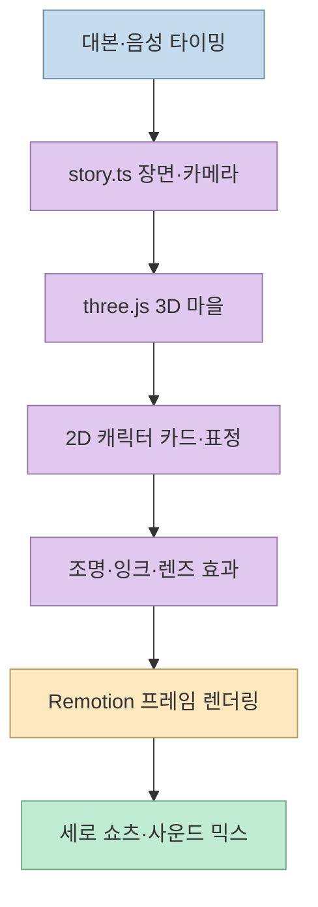
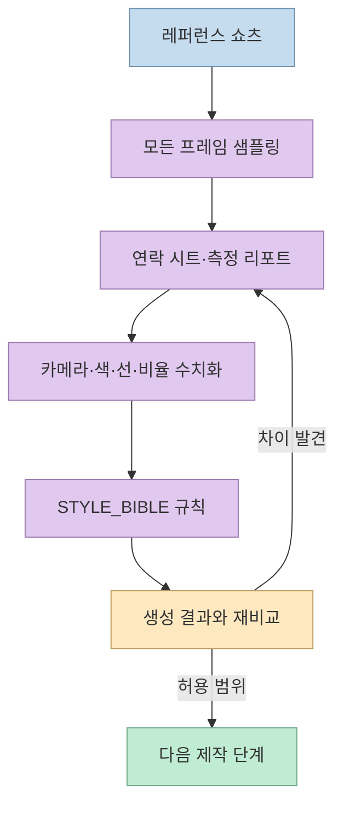
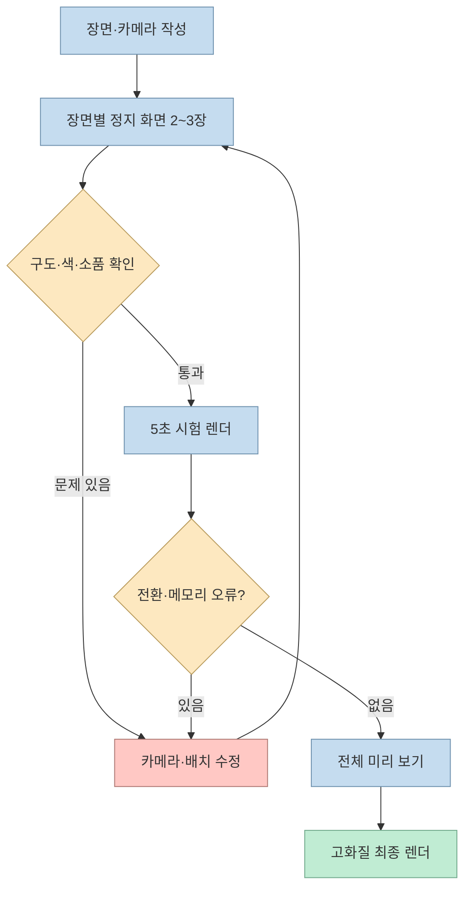
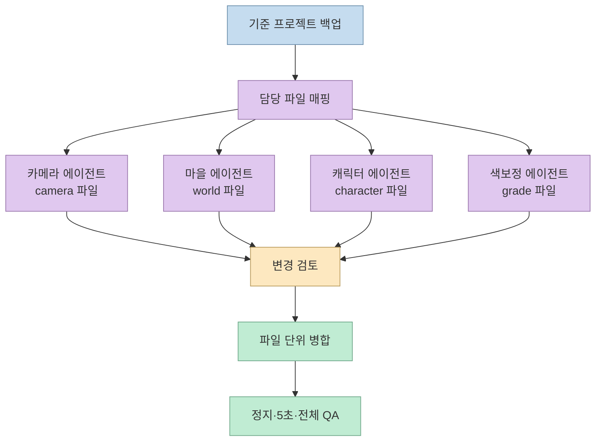

영상 생성 AI 없이도 2D 캐릭터가 3D 마을을 걷는 세로 쇼츠를 만들 수 있다. [이번 영상](https://www.youtube.com/watch?v=JvCHc2EtSyk)은 Claude가 three.js로 3D 공간을 만들고, 캐릭터를 카메라를 향하는 평면 카드로 배치한 다음 Remotion으로 프레임을 렌더링하는 과정을 소개한다([01:50](https://youtu.be/JvCHc2EtSyk?t=110)). 이 글은 영상의 재현 가능한 원칙과 [공개 Claude 스킬](https://github.com/mromidev/claude-animated-shorts)의 실제 구조를 연결해 설명한다.

<!--more-->

## Sources

- [입력 YouTube 영상](https://www.youtube.com/watch?v=JvCHc2EtSyk)
- [Claude Animated Shorts GitHub 저장소](https://github.com/mromidev/claude-animated-shorts)
- [저장소 README](https://github.com/mromidev/claude-animated-shorts#readme)

## 이 스타일의 기술적 구성

저장소는 55~70초 세로 애니메이션 쇼츠를 목표로 한다. 2D 캐릭터는 컬러 3D 세계 안에 놓이고, 잉크 외곽선·페인팅된 마을·렌즈 블러·미끄러지듯 움직이는 카메라·행진 음악과 효과음을 조합한다([README](https://github.com/mromidev/claude-animated-shorts#readme)). 영상에서는 3D 마을을 three.js로 만들고 캐릭터를 평면 카드로 세워 카메라를 향하게 하며, Remotion이 장면을 한 장씩 촬영해 영상 파일로 묶는다고 설명한다([01:50](https://youtu.be/JvCHc2EtSyk?t=110)).

저장소의 `templates/bridge/`에는 월드·캐릭터·잉크·렌즈 블러·색보정·스토리/카메라가 있고, `templates/audio/`에는 효과음·행진 음악·덕킹·loudness 믹스가 있다. `templates/scripts/`는 정지 화면, 비교 시트, 샷 병합, 프레임 단위 QA 도구를 제공한다([저장소 구조](https://github.com/mromidev/claude-animated-shorts#whats-inside)). 따라서 단순히 영상을 생성하는 프롬프트가 아니라, 측정 자료와 렌더링 도구가 함께 들어 있는 작업 템플릿이다.

## 원칙 1: 감상 대신 측정 가능한 규칙을 만든다

영상은 초당 약 30장의 사진인 프레임으로 구성된다. 튜토리얼은 레퍼런스 쇼츠 20편, 약 18분 분량을 모두 프레임 단위로 분석하기 위해 2초마다 60장을 모은 연락 시트 549장을 만들고, 카메라 이동·밝기·대비·채도를 수치화했다고 설명한다([02:51](https://youtu.be/JvCHc2EtSyk?t=171)). “따뜻한 색감”이나 “카메라가 자연스럽다” 같은 형용사를 그대로 복제하는 대신, 컷의 개수, 초당 단어 수, 색상 코드, 선 굵기처럼 다시 측정할 수 있는 규칙으로 바꾸는 방식이다([03:40](https://youtu.be/JvCHc2EtSyk?t=220)).

측정은 한 번으로 끝나지 않는다. 처음에는 카메라가 80%의 프레임에서 멈춘 것처럼 보였지만, 더 민감하게 재측정하자 65%의 프레임에서 매우 느린 전진이 발견되었고, 캐릭터 머리 비율도 실제 샘플 측정으로 수정되었다([04:17](https://youtu.be/JvCHc2EtSyk?t=257)). 스킬 저장소는 이 분석 결과를 `STYLE_BIBLE.md`, 일곱 개의 측정 리포트, 38개의 비교용 원본 프레임, 20개의 연락 시트로 보관한다([README](https://github.com/mromidev/claude-animated-shorts#readme)).

이 원칙은 특정 쇼츠 스타일에만 한정되지 않는다. 다른 영상을 따라 만들 때도 “전부 분석해 줘”라고 요청하기보다 프레임 샘플, 색상·속도·간격의 측정값, 허용 오차를 먼저 정의해야 결과를 검증할 수 있다. 단, 레퍼런스의 이야기·캐릭터·장면을 복사하는 것이 아니라 시각적 규칙만 학습해야 한다([11:52](https://youtu.be/JvCHc2EtSyk?t=712)).

## 원칙 2: 고화질 렌더링 전에 정지 화면을 검사한다

고화질 렌더링은 비싸다. 영상 사례에서는 67초 쇼츠를 초당 약 4장씩 그려 약 10분이 걸렸고, 제작자가 실제 한국어 쇼츠를 만들 때는 전체 고화질 렌더링만 약 50분이 걸렸다([05:03](https://youtu.be/JvCHc2EtSyk?t=303), [19:43](https://youtu.be/JvCHc2EtSyk?t=1183)). 반면 정지 화면은 몇 초 안에 확인할 수 있으므로, 장면마다 시작 1초 뒤와 끝 직전의 두 장 이상을 먼저 뽑아야 한다([06:17](https://youtu.be/JvCHc2EtSyk?t=377)).

정지 검수에서 카메라가 벽을 향하거나, 원본 모델 색이 그대로 남거나, 소품이 얼굴을 가리거나, 장면의 핵심 물체가 프레임 밖으로 잘린 문제를 빠르게 찾을 수 있다([05:26](https://youtu.be/JvCHc2EtSyk?t=326), [18:40](https://youtu.be/JvCHc2EtSyk?t=1120)). 이후 5초 시험 영상과 전체 미리 보기를 거친 뒤에만 긴 렌더링을 시작하면, 장면 전환 순간에만 발생하는 오류와 그래픽 메모리 부족을 조기에 발견할 수 있다([06:55](https://youtu.be/JvCHc2EtSyk?t=415), [18:44](https://youtu.be/JvCHc2EtSyk?t=1124)).

## 원칙 3: 에이전트가 많을수록 일을 파일로 분할한다

스타일 차이가 색·테두리·빛과 그림자·질감·캐릭터 비율·깊이·카메라처럼 여러 요소에 걸쳐 있으면, 담당 에이전트를 나누는 것이 유용하다. 영상 사례에서는 측정 담당 일곱, 소리 담당 하나, 실제 수정 담당 넷으로 총 열두 개의 에이전트가 구성되었다([07:48](https://youtu.be/JvCHc2EtSyk?t=468)).

하지만 같은 프로젝트 파일을 동시에 수정하면 마지막 저장이 앞선 변경을 덮어쓴다. 해결책은 각 에이전트에 프로젝트 복사본과 담당 파일을 지정하는 것이다. 카메라 담당은 카메라 파일만, 캐릭터 담당은 캐릭터 파일만 편집하고, 공용 빛 설정처럼 공유되는 값은 관련 담당에게 알린다. 모든 작업이 끝나면 원본을 백업한 뒤 파일 단위로 병합한다([08:16](https://youtu.be/JvCHc2EtSyk?t=496)).

이 방식으로 재측정하면 “싸 보이는” 이유도 수치로 드러난다. 영상 사례에서는 외곽선이 거의 없던 이유가 배경 블러 단계에서 선이 지워졌기 때문이었고, 카메라 이동이 3프레임으로 너무 급했으며, 캐릭터 비율과 팔다리 두께도 원본과 달랐다([08:55](https://youtu.be/JvCHc2EtSyk?t=535)). 에이전트 분할의 목적은 호출 수를 늘리는 것이 아니라 원인과 수정 파일의 경계를 명확히 하는 데 있다.

## 대본은 사실 검증과 반복 가능한 긴장 구조로 만든다

스킬의 `STYLE_BIBLE.md`는 20개 레퍼런스 쇼츠의 대본을 비교해 공통 뼈대를 기록한다. 첫 문장에 이상하거나 믿기 힘든 사실을 던지고, 시간·장소를 짧게 제시한 뒤, 긴장을 몇 차례 키우고, 전환 문장으로 진짜 이유를 설명하며, 일상적인 비유와 마지막 반전으로 끝낸다([09:49](https://youtu.be/JvCHc2EtSyk?t=589)). 영상에서는 20편 중 14편이 `You see`라는 전환 표현을 썼다고 설명하지만, 한국어 콘텐츠에서는 같은 기능을 하는 자연스러운 연결어로 바꾸어야 한다([09:54](https://youtu.be/JvCHc2EtSyk?t=594)).

웃음이나 반전은 지어낸 사실보다 검증된 사실에서 찾는다. 1831년 브로턴 다리 붕괴 사례를 다룰 때 병사 수, 날짜, 강물 깊이, 부상자 수를 확인한 뒤 “강물이 60cm밖에 안 됐다”는 사실을 농담의 핵심으로 사용했다([11:22](https://youtu.be/JvCHc2EtSyk?t=682)). 주제를 고를 때도 원본 채널이 이미 다룬 이야기를 피하고, 시각 스타일만 참고해 이야기와 캐릭터는 새로 만들어야 한다([11:52](https://youtu.be/JvCHc2EtSyk?t=712)).

## 설치·실행과 운영상 주의사항

저장소 README는 `~/.claude/skills/cartoon-3d-short/`에 스킬을 복사한 뒤 Remotion과 `@remotion/three`, Node.js, Python 3, ffmpeg를 준비하고 Claude Code에서 “Use the cartoon short skill and make a short about …”라고 요청하라고 안내한다([README 설치](https://github.com/mromidev/claude-animated-shorts#install)). 영상은 작업 폴더를 넉넉한 드라이브에 두고, 미리 보기 때 `public/` 약 1.3GB가 임시 폴더로 복사되므로 `REMOTION_TMP`를 큰 디스크로 지정하라고 설명한다([12:40](https://youtu.be/JvCHc2EtSyk?t=760), [README](https://github.com/mromidev/claude-animated-shorts#readme)).

Kenney의 Nature Kit와 Fantasy Town Kit 같은 3D 모델은 별도로 내려받아야 하며, 영상 사례에서는 두 묶음 합계가 약 15MB였다([14:52](https://youtu.be/JvCHc2EtSyk?t=892), [15:15](https://youtu.be/JvCHc2EtSyk?t=915)). Remotion·three.js 버전을 스킬 문서와 맞추지 않으면 이펙트가 렌더링되지 않고 빈 하늘색 화면만 나올 수 있으므로, 설치 직후 다리 템플릿의 정지 화면을 먼저 확인해야 한다([16:34](https://youtu.be/JvCHc2EtSyk?t=994), [19:44](https://youtu.be/JvCHc2EtSyk?t=1184)).

스킬 코드는 MIT 라이선스지만, 저장소의 참조 프레임은 스타일 학습용으로만 포함되어 있다. 따라서 코드·문서의 라이선스와 레퍼런스 이미지·이야기·캐릭터의 권리를 분리해 확인해야 한다([README 라이선스](https://github.com/mromidev/claude-animated-shorts#license)). 또한 영상 사례처럼 전체 제작에 약 5시간, 최종 렌더링에 약 50분, 임시 파일 약 4GB가 들 수 있고, 여러 에이전트를 사용하면 Claude 사용량도 커진다([19:43](https://youtu.be/JvCHc2EtSyk?t=1183)).

## 핵심 요약

- three.js가 3D 마을을 만들고, 평면 2D 캐릭터 카드와 Remotion이 세로 프레임을 구성한다.
- 레퍼런스는 감상문이 아니라 프레임·색·선·속도·비율을 측정한 `STYLE_BIBLE`과 리포트로 바꿔야 한다([02:51](https://youtu.be/JvCHc2EtSyk?t=171)).
- 긴 렌더링 전에 장면별 정지 화면, 5초 시험 영상, 전체 미리 보기 순서로 QA한다([06:42](https://youtu.be/JvCHc2EtSyk?t=402)).
- 멀티 에이전트는 작업이 아니라 파일을 분할하고, 백업 후 파일 단위로 병합한다([08:16](https://youtu.be/JvCHc2EtSyk?t=496)).
- 대본은 사실을 검증해 반전과 유머를 만들고, 레퍼런스의 스타일만 가져오며 이야기와 캐릭터는 새로 만든다([11:22](https://youtu.be/JvCHc2EtSyk?t=682)).
- MIT 코드 라이선스와 참조 프레임의 스타일 학습 전용 조건을 구분하고, 디스크·버전·렌더링 비용을 사전에 계획해야 한다([README](https://github.com/mromidev/claude-animated-shorts#readme)).

## 결론

Claude Animated Shorts의 핵심은 영상 생성 모델을 호출하는 것이 아니라, 레퍼런스를 측정 가능한 규칙으로 바꾸고 코드 기반 렌더링 루프를 짧게 검증하는 데 있다. 정지 화면으로 구도를 먼저 고치고, 에이전트마다 파일 소유권을 부여하면 긴 렌더링과 병렬 수정의 실패 비용을 줄일 수 있다. 이 세 원칙은 애니메이션 쇼츠뿐 아니라 AI로 기존 결과물을 재현하거나 개선하는 모든 작업에 적용할 수 있다.
