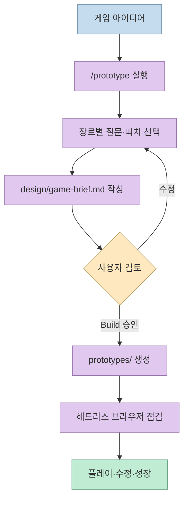
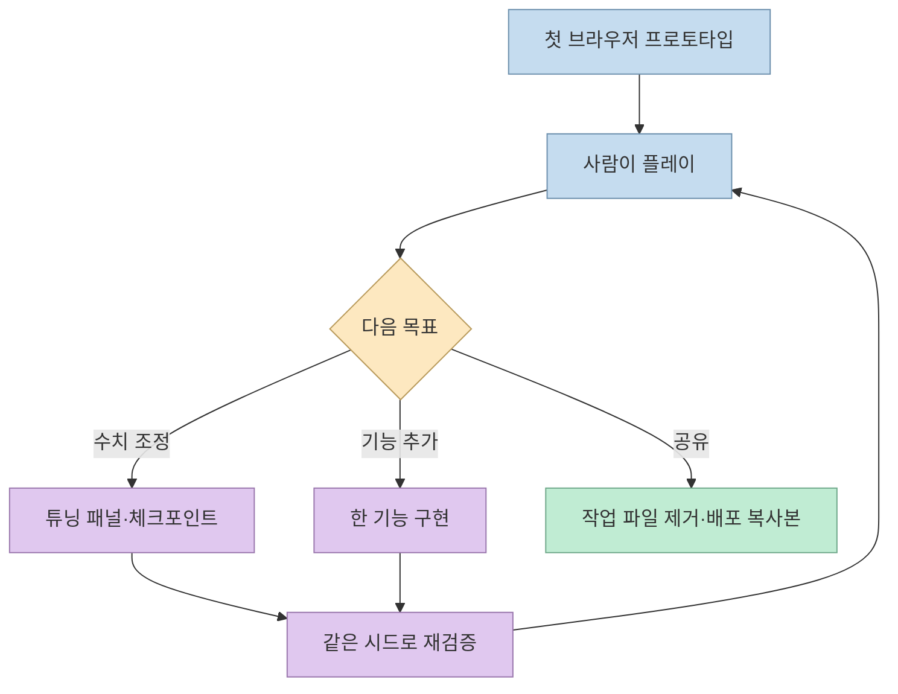
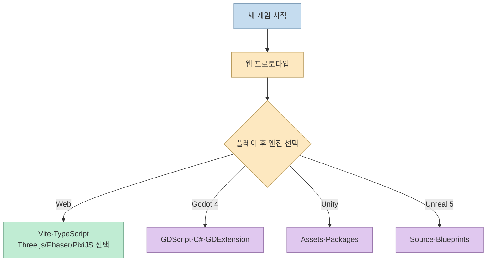
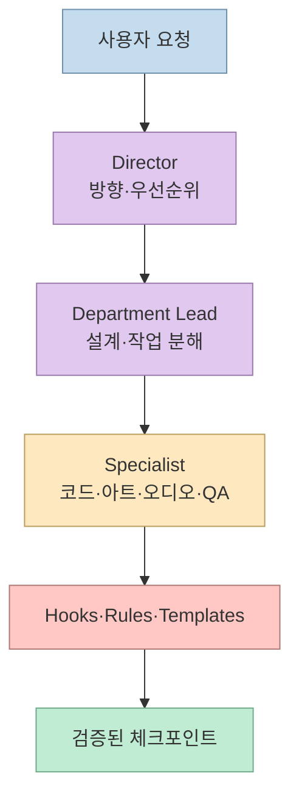

게임을 만들고 싶지만 기획·아트·코드·QA를 한 사람이 모두 맡기 어렵다면, Claude Code를 작은 게임 스튜디오처럼 구성할 수 있다. [Threads 게시물](https://www.threads.com/share/BBvExhiSa-)이 소개한 `Claude-Code-Game-Studios`는 아이디어를 질문과 한 페이지 브리프로 구체화한 뒤, 플레이 가능한 브라우저 프로토타입을 만들고 자동 점검하는 템플릿이다. 이 글은 저장소가 실제로 제공하는 흐름과 아직 검증되지 않은 범위를 구분해 설명한다.

<!--more-->

## Sources

- [입력 Threads 게시물](https://www.threads.com/share/BBvExhiSa-)
- [Claude-Code-Game-Studios GitHub 저장소](https://github.com/Donchitos/Claude-Code-Game-Studios)
- [저장소 README — 시작하기·엔진·구조·Studio Mode](https://github.com/Donchitos/Claude-Code-Game-Studios#readme)

## `/prototype`가 아이디어를 플레이 가능한 첫 빌드로 바꾸는 과정

저장소 README의 기본 진입점은 Claude Code에서 실행하는 `/prototype`이다. 예를 들어 `/prototype a fishing game where the rare fish only bite at dusk`처럼 게임 아이디어를 입력하면, 먼저 장르에 맞는 질문을 한 차례 묻는다. 장르·감각·시각 스타일·난이도·목표처럼 결과를 크게 바꾸는 선택을 좁히고, 아이디어가 모호하면 한 줄짜리 피치 몇 개를 먼저 제시한다.

그 다음 `design/game-brief.md`에 한 페이지 브리프를 만든다. 사용자가 입력한 표현, 게임의 분위기, 첫 1분, 도전 요소, 기능 목록, 나중으로 미룰 일을 남기므로 “바로 코드를 생성하는 프롬프트”보다 검토 가능한 계약에 가깝다. 사용자가 Build를 승인하면 `prototypes/<name>/`에 브라우저 게임을 만들고, 각 그림을 직접 그리며 이모지나 다른 게임의 복제를 피하도록 설계되어 있다.

첫 빌드 전에 브리프를 사람이 확인하게 만드는 이유는 생성 속도보다 방향의 정확성이 중요하기 때문이다. README는 생성된 게임이 열리고 입력에 반응하는지, 글자가 너무 작거나 겹치지 않는지, 화면이 멈추지 않는지를 스크립트 키 입력과 스크린샷으로 확인한다고 설명한다. 다만 이 자동 점검은 사람이 실제로 재미를 느끼는지 대신할 수 없다. 결과 카드에도 무엇이 통과·실패·추정되었는지와 함께 “아직 사람이 플레이하지 않음”이라는 상태가 남는다.

## 게임을 만든 뒤의 성장 루프

첫 프로토타입은 완성품이 아니라 다음 변경을 위한 기준점이다. 사용자는 기능을 추가하거나 튜닝을 요청할 수 있고, 각 변경은 유지·금지 조건과 비교된 뒤 체크포인트로 돌아갈 수 있다. 수치 조정이 필요하면 슬라이더가 있는 튜닝 패널을 만들고, 공유할 때는 패널과 작업 파일을 제거한 깨끗한 복사본을 준비한다.

게임이 계속 발전하면 Vite와 TypeScript 기반의 실제 웹 프로젝트로 전환할 수 있다. 이때 값은 데이터 파일로 분리하고 테스트와 빌드를 추가하며, 한 번에 한 기능씩 구현하고 같은 시드(seed)로 다시 플레이해 변경 효과를 비교한다. `/create-stories`, `/dev-story`, `/story-done`은 이 성장 단계에서 사용자가 원할 때만 도입되는 스토리 중심 흐름이다.

이미 브라우저 게임이 있다면 `/prototype --from <path>`로 복사해 같은 방식으로 변경·성장시킬 수 있다. 이 명령은 기존 프로젝트를 무조건 재작성하는 것이 아니라, 템플릿이 기대하는 작업 경계 안으로 가져오는 진입점이다.

## 엔진은 웹게임부터, 전문 엔진은 나중에

새 프로젝트의 기본 경로는 Web이다. 엔진을 지정하지 않으면 `/prototype`이 브라우저 게임을 먼저 만들고, 사용자가 플레이한 뒤 Godot·Unity·Unreal Engine 5 중 하나를 선택하도록 유도한다. 웹 엔진 스타터는 아무 추가 라이브러리 없이 시작하거나 Three.js·Phaser·PixiJS를 선택할 수 있다.

`/setup-engine godot 4.7`처럼 엔진과 버전을 먼저 고정하면 해당 엔진의 참조 문서와 폴더 규칙이 생성된다. Godot은 GDScript·C#·GDExtension, Unity는 `Assets/`와 `Packages/`, Unreal은 `Source/<Module>/`와 C++·Blueprints를 사용한다. 저장소 README는 이 엔진 경로가 구축되어 있고 자체 점검을 통과한다고 말하지만, 엔진별 결과를 웹게임과 같은 수준으로 검증한 것은 아니라고 명시한다.

이 순서는 도구 선택을 늦추자는 뜻이지, 모든 게임이 웹에 적합하다는 뜻은 아니다. 첫 1분의 재미와 핵심 상호작용을 브라우저에서 확인한 뒤 엔진으로 옮기면, 초기 설계가 엔진 설정과 에셋 파이프라인에 묻히는 것을 줄일 수 있다. 반대로 네이티브 성능·복잡한 물리·콘솔 배포가 핵심이라면 초기에 엔진 경로를 선택하고 별도의 빌드·테스트 환경을 준비해야 한다.

## 49개 에이전트와 75개 스킬은 “팀 규모”가 아니라 규칙 집합이다

저장소는 49개 전문 에이전트, 75개 스킬, 15개 훅, 14개 경로별 규칙, 62개 템플릿을 제공한다. 에이전트는 크리에이티브 디렉터·테크니컬 디렉터·프로듀서 같은 1단계, 게임 디자이너·리드 프로그래머·QA 리드 같은 부서 리드, 그리고 게임플레이·네트워크·UI·접근성·보안 등 전문 역할의 3단계로 나뉜다.

이 숫자를 동시에 49개의 모델이 계속 실행된다는 의미로 읽으면 안 된다. README는 역할별 모델 선언을 제공하지만 대부분은 현재 세션 모델을 상속하고, 실제 호출은 요청한 스킬과 프로젝트 단계에 따라 달라진다. 즉 핵심 가치는 병렬 호출 수보다 “누가 무엇을 검토하고 어떤 파일 규칙을 적용할지”를 미리 정의한 데 있다.

훅은 세션 시작, 커밋·푸시, 파일 읽기·쓰기, 에셋·레지스트리 변경을 감시한다. 예를 들어 경로 규칙은 게임플레이 코드에서 데이터 기반 값을 사용하도록 하고, 디자인 문서를 과도하게 한 번에 읽는 것을 막으며, 데이터 JSON의 유효성을 확인한다. 위험한 작업을 전부 차단하는 보안 경계는 아니므로, 실제 프로젝트의 권한과 비밀값 정책은 별도로 점검해야 한다.

## 설치 전제와 검증의 한계

최소 전제는 Git, Claude Code, Python 3, Bash, Chrome·Edge·Chromium이다. Python은 `project.yaml`과 스킬·훅 설정을 읽고, 브라우저는 `/prototype` 결과를 열어 키 입력과 스크린샷 점검을 수행한다. Node.js는 웹 프로젝트로 성장시키거나 Three.js를 사용할 때 권장되며, `jq`도 훅 검증에 유용하다. 선택 도구가 없으면 대부분의 훅이 우아하게 생략되지만, 브라우저가 없으면 화면 검증이 “평가되지 않음”으로 남는다.

README가 제시한 비교 실험은 세 가지 게임 아이디어에서 생성된 브리프와 사람이 쓴 브리프를 비교한 수준이다. 브리프 선택에서는 생성 쪽이 세 번 모두 선택되었지만, 두 방식으로 만든 게임의 계속 개발 의향은 동률이었다. 여섯 게임이라는 작은 사례이며, Godot·Unity·Unreal 엔진 경로와 복잡한 단일 시스템의 깊은 설계는 같은 방식으로 검증되지 않았다고 저장소가 명시한다.

## 핵심 요약

- `Claude-Code-Game-Studios`는 `/prototype`로 질문 → 한 페이지 브리프 → 브라우저 게임 → 자동 점검의 흐름을 제공한다.
- 첫 결과는 `prototypes/<name>/`에 저장되고, 사람의 플레이가 자동 QA 이후에도 최종 검증 단계로 남는다.
- 새 프로젝트는 웹게임으로 시작한 뒤 필요하면 Vite·TypeScript, Godot 4, Unity, Unreal Engine 5로 확장한다.
- 49개 에이전트와 75개 스킬의 핵심은 동시 실행 규모가 아니라 역할·규칙·훅·템플릿을 통한 협업 구조다.
- 브리프 실험은 유망하지만 엔진별 품질과 복잡한 게임 시스템에 대한 일반화 근거는 아직 제한적이다.

## 결론

Claude-Code-Game-Studios는 “게임을 한 번에 완성하는 마법 프롬프트”보다 게임 개발의 의사결정과 검증 순서를 템플릿화한 프로젝트다. 아이디어를 브리프로 고정하고, 작은 브라우저 빌드를 만든 뒤, 자동 점검과 사람의 플레이를 반복하는 구조가 가장 실용적인 부분이다. 웹게임 프로토타입부터 시작하고 필요할 때만 전문 엔진과 Studio Mode로 복잡도를 올린다면, 에이전트 수에 기대지 않고도 재현 가능한 개발 루프를 만들 수 있다.
