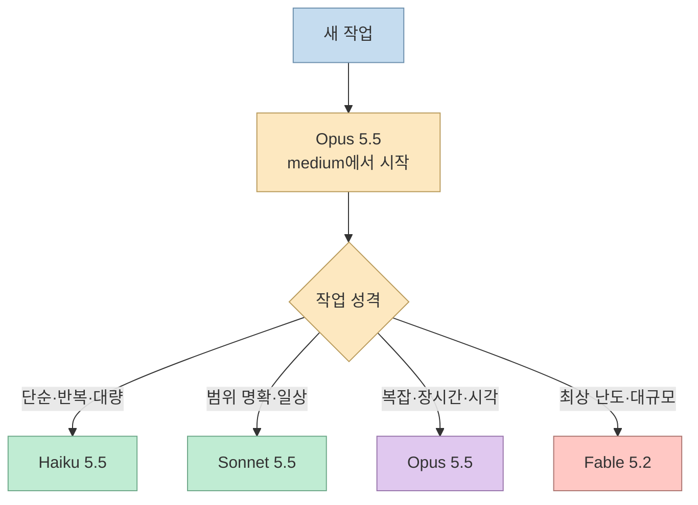
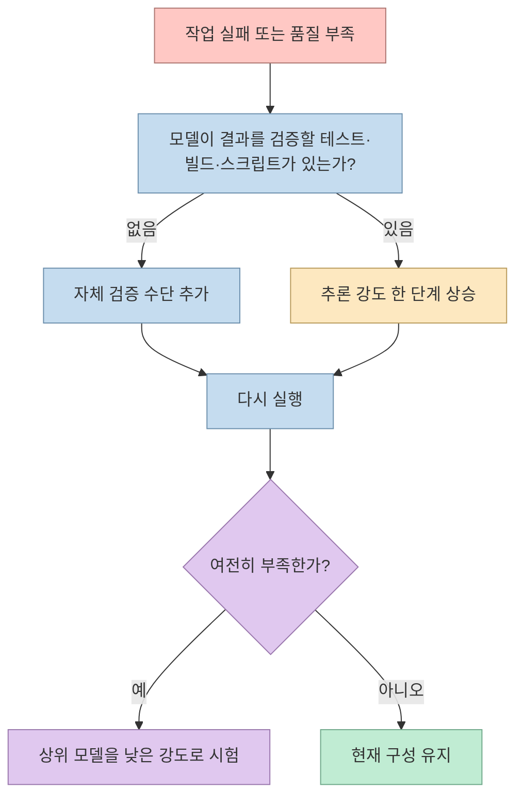
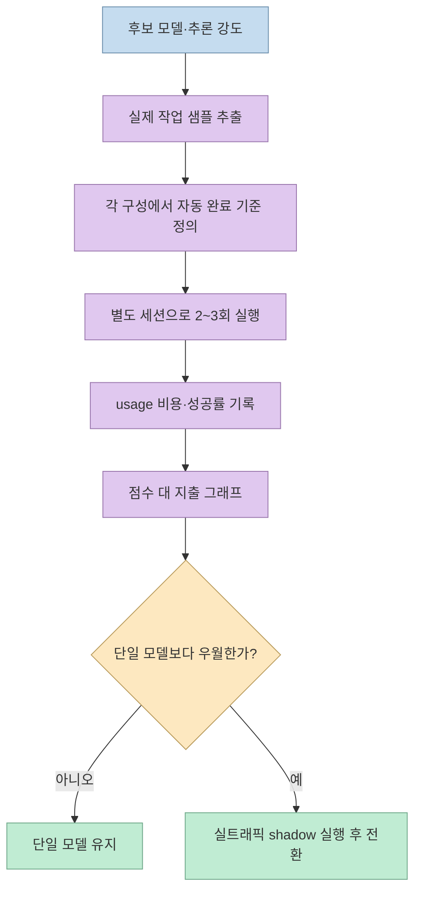
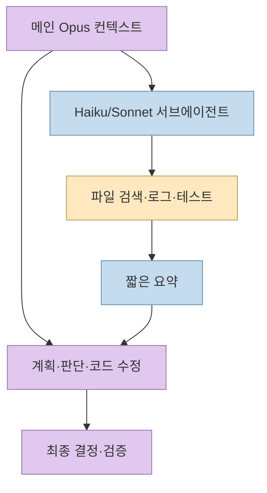
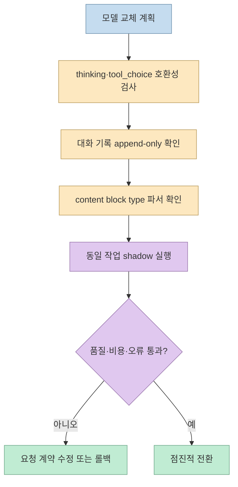

Claude를 쓰다 보면 “어떤 모델이 가장 좋은가?”보다 “이 작업을 어떤 비용과 지연으로 끝내야 하는가?”가 더 중요한 질문이 된다. [Threads 요약](https://www.threads.com/share/_85bZwquE)이 소개한 Anthropic의 [공식 모델 선택 가이드](https://claude.dev/blog/which-claude-model-should-you-build-with/)는 모델 이름, 추론 강도(effort), 컨텍스트 비용, 서브에이전트 구성을 함께 보라고 권한다. 이 글은 그 기준을 Claude Code와 API 작업에 적용할 수 있도록 재구성한다.

<!--more-->

## Sources

- [입력 Threads 게시물](https://www.threads.com/share/_85bZwquE)
- [Anthropic 공식 가이드: Which Claude model should you build with?](https://claude.dev/blog/which-claude-model-should-you-build-with/)

## 기본값은 Opus 5.5 medium, 단순한 일은 아래로 내린다

공식 가이드의 출발점은 대부분의 작업을 **Claude Opus 5.5의 기본 추론 강도 `medium`** 에서 시작하는 것이다. Claude Code의 기본 모델인 동시에 Fable 5.2보다 입력·출력 토큰 단가가 절반이어서, 일상적인 코딩과 지식 작업의 능력·비용 균형이 좋다는 이유다. 단, “기본값”은 모든 작업을 Opus로 고정하라는 뜻이 아니라 실제 결과를 보고 아래·위로 조정할 기준점이다.

- **Sonnet 5.5**: 명세가 분명한 버그 수정, 기능 반복, 문서·슬라이드·스프레드시트, 대화형 세션
- **Haiku 5.5**: 분류·라우팅·태깅·추출 같은 대량 처리와 실수가 쉽게 드러나는 서브에이전트 작업
- **Opus 5.5**: 일상적인 복합 코딩, 여러 PR에 걸친 작업, 컴퓨터 사용·이미지 중심의 긴 에이전트 루프
- **Fable 5.2**: 대규모 리팩터링·마이그레이션·아키텍처 설계, 깊은 리서치와 과학·금융 분석, Opus `high`가 부족한 장시간 작업

명세가 분명하더라도 마이그레이션과 성능 최적화는 영향 범위가 넓어 Opus 이상이 필요할 수 있다. 반대로 결과를 자동으로 확인할 수 있는 단순 작업은 Haiku가 더 적합하다.

## 모델을 바꾸기 전에 추론 강도를 조정한다

모델마다 같은 작업을 더 오래 생각하거나, 도구를 더 많이 호출하거나, 결과를 자체 검증하도록 하는 추론 강도 단계가 있다. 공식 가이드는 모델을 올리기 전에 이 다이얼을 한 단계 조정하라고 한다. 다만 `high`를 넘어서면 추가 강도 비용이 한 단계 큰 모델을 쓰는 비용과 비슷해질 수 있으므로, 그 시점에는 상위 모델을 더 낮은 강도로 시험해야 한다.

추론 강도를 올려도 모델이 원래 갖지 않은 지식이나 기술이 생기지는 않는다. 모델이 문제를 이해하지만 검증이 부족한 경우에는 강도를 올리는 것이 유효하고, 도메인 지식이나 구현 능력 자체가 부족하면 상위 모델로 이동해야 한다. 강도는 지연 시간도 늘리므로 사람이 기다리는 대화형 작업에서는 Sonnet `low` 또는 `medium`이 합리적인 출발점이다.

공식 가이드가 제시한 SWE-bench Pro 예시는 이 순서를 뒷받침한다. Opus 5.5 `medium`은 `high`보다 점수가 약 2.5점 낮은 대신 비용이 약 70% 수준이고, `low`는 비용이 약 3분의 1이다. 자동 채점이 가능한 작업이라면 전부 `low`로 실행한 뒤 실패만 `high`로 재시도하는 방식이 전부 `high`로 돌리는 것보다 비용·성공률 균형이 나을 수 있다. 이 수치는 특정 벤치마크 결과이므로 자신의 작업에 그대로 대입하지 말고 기준점으로만 사용해야 한다.

## 토큰 단가보다 완료 과제 비용을 계산한다

공식 가이드가 제시한 API 목록 단가는 다음과 같다. Haiku 5.5는 10만 토큰 이하 입력에서 입력/출력 100만 토큰당 `$0.10 / $0.50`, Sonnet 5.5는 `$2 / $10`, Opus 5.5는 `$4 / $20`, Fable 5.2는 `$8 / $40`이다. 네 모델 모두 컨텍스트 윈도는 100만 토큰, 최대 출력은 12만 8천 토큰이다. 캐시 읽기는 Haiku가 짧은 프롬프트에서 가장 싸고, Opus와 Fable은 100만 토큰당 `$0.20`으로 같다.

하지만 높은 토큰 단가가 곧 높은 **과제당 비용**을 뜻하지는 않는다. 더 강한 모델이 한 번에 끝내거나 값싼 모델의 재시도가 줄면 전체 비용이 역전될 수 있다. 반대로 가장 어려운 소수의 작업이 전체 지출을 크게 차지하므로 평균 작업만 보고 모델을 고르면 안 된다. Haiku 5.5는 입력 프롬프트가 10만 토큰을 넘으면 단가가 다섯 배가 되므로, 긴 컨텍스트에서는 Sonnet과 완료 과제 비용을 비교해야 한다.

## 긴 컨텍스트는 비싼 모델의 판단에 남긴다

대화가 이어질 때마다 이전 컨텍스트가 다시 전송되고, 긴 실행에서는 대부분이 캐시 읽기로 청구된다. 공식 예시는 Opus 5.5에서 15만 토큰 컨텍스트 한 턴의 캐시 읽기가 약 `$0.03`, 2만 토큰은 약 `$0.004`라고 설명한다. 수백 턴을 수행하면 이 차이가 누적되므로, 메인 모델의 컨텍스트를 결정에 필요한 정보로 가볍게 유지해야 한다.

서브에이전트는 별도 컨텍스트에서 파일 검색·로그 읽기·테스트 실행을 하고 요약만 메인 모델에 돌려준다. Claude Code에서는 에이전트 정의에 `model: haiku` 또는 `model: sonnet`을 지정할 수 있고, `CLAUDE_CODE_SUBAGENT_MODEL`로 기본값을 설정할 수 있다. 작은 모델에는 실수가 빨리 드러나는 작업만 맡기고, 코드 수정과 판단은 메인 모델에 남겨야 한다. 현재 Explore 서브에이전트가 세션 모델을 사용할 수 있으므로, 탐색 비용을 줄이려면 `model: haiku`인 자체 Explore를 정의하는 방법도 있다.

모델을 중간에 바꿀 때는 자연스러운 경계에서 `/compact`를 실행하거나 짧은 계획으로 새 세션을 열어야 한다. 프롬프트 캐시는 캐시를 만든 모델에 귀속되므로, 새 모델의 첫 턴은 전체 대화를 다시 캐시 쓰기할 수 있다. 또한 모델을 아래로 내리면 앞 모델의 추론 블록을 읽지 못해 기존 reasoning이 사라질 수 있다. 따라서 모델 전환은 “이름만 변경”이 아니라 컨텍스트·추론 기록·캐시를 함께 바꾸는 작업이다.

## 모델 교체 전에 API 호환성을 검사한다

여러 모델을 같은 시스템에 연결한다면 가장 까다로운 모델을 기준으로 요청을 설계해야 한다.

- Opus 5.5와 Fable 5.2는 항상 thinking을 사용하므로 thinking을 끄면 오류가 난다.
- Sonnet·Opus·Fable에서 `tool_choice: any` 또는 `tool`은 400 오류가 될 수 있다. `auto`와 `strict: true`를 사용하고 프롬프트에 도구 사용 조건을 적는다.
- Haiku 4.5에서 5.5로 옮길 때는 `budget_tokens`를 effort로 바꾸고, 비기본 `temperature`, `top_p`, `top_k`를 제거해야 한다.
- Fable 5.2는 thinking 블록 앞의 기록을 수정하면 요청을 거부할 수 있으므로 대화 기록을 append-only로 유지해야 한다.
- 응답은 항상 텍스트라고 가정하지 말고 `thinking` 등 content block의 `type`을 검사해야 한다.

## 핵심 요약

- 기본 시작점은 Opus 5.5 `medium`이며, 명확한 일상 작업은 Sonnet, 대량·단순 작업은 Haiku, 최상 난도는 Fable로 내리거나 올린다.
- 모델을 바꾸기 전에 자체 검증 수단을 만들고 추론 강도를 한 단계 조절한다.
- 토큰 단가가 아니라 성공률·재시도·컨텍스트 캐시를 포함한 완료 과제 비용을 측정해야 한다.
- 긴 파일 읽기·로그·탐색은 저렴한 서브에이전트에 맡기고, 메인 모델의 컨텍스트는 판단에 사용한다.
- 모델 교체는 thinking, tool choice, content block, 보존된 추론 기록의 호환성까지 검사해야 한다.
- 최종 구성은 벤치마크 순위가 아니라 실제 작업 샘플과 shadow 실행으로 선택한다.

## 결론

Claude 모델 선택의 핵심은 “가장 큰 모델 하나”가 아니라 작업별 품질·지연·비용 곡선을 측정하는 것이다. Opus 5.5 `medium`을 기준점으로 삼고, 자동 검증 가능한 실패만 상위 강도로 재시도하며, 긴 읽기 작업은 저렴한 서브에이전트로 분리하면 비용을 통제할 수 있다. 다만 모델 버전과 가격은 바뀌므로 공식 문서의 최신 호환성·단가를 확인하고, 실제 코드베이스에서 `/model`과 `/usage`로 비교한 뒤 전환해야 한다.
