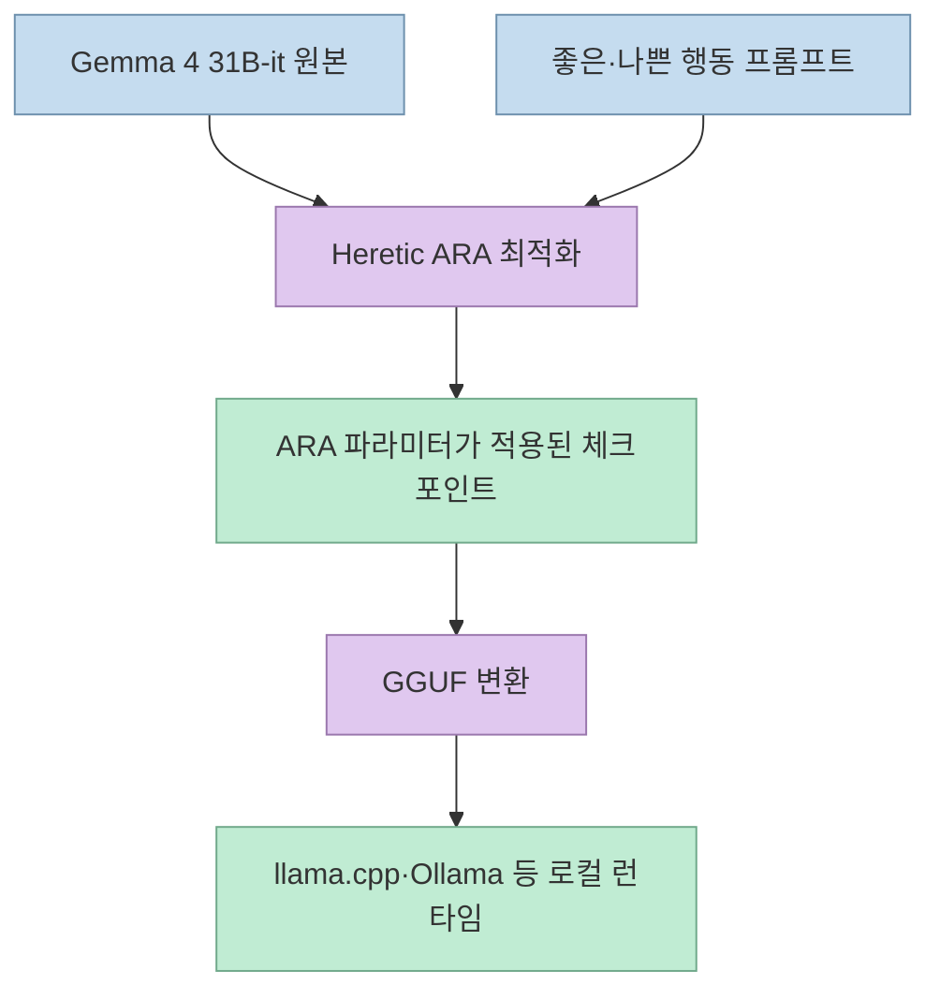
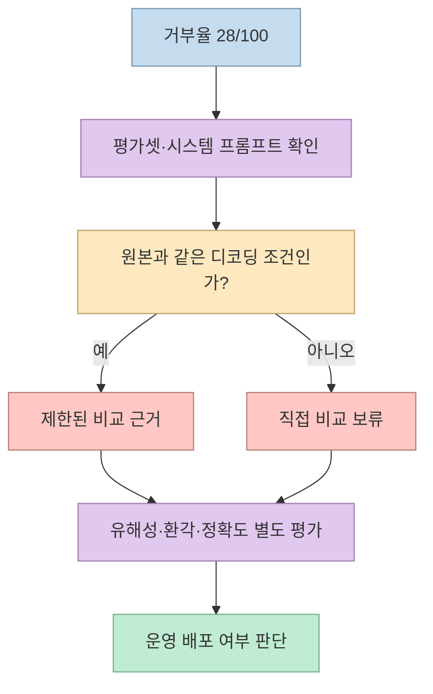
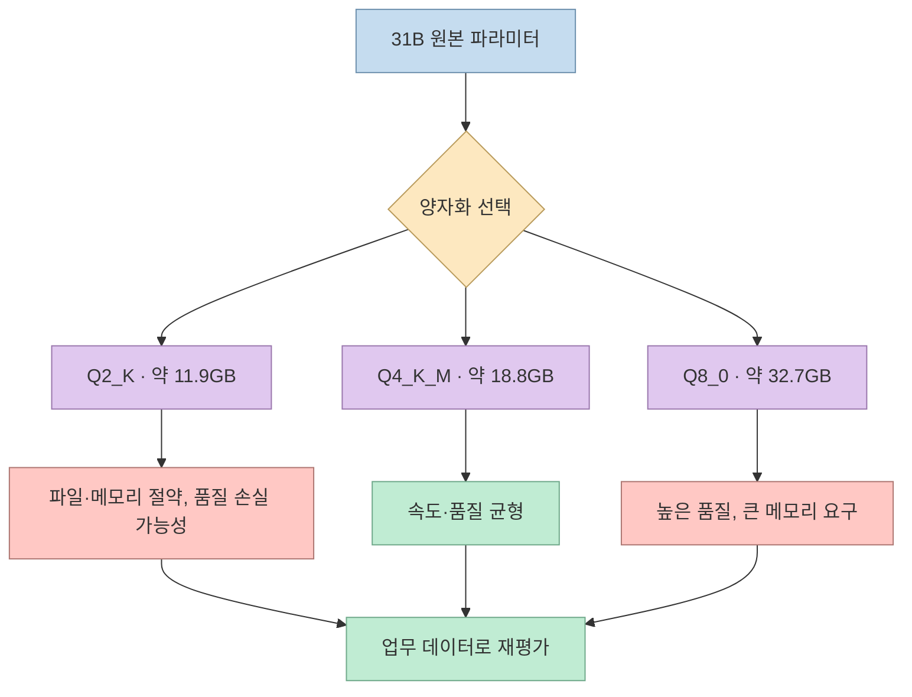
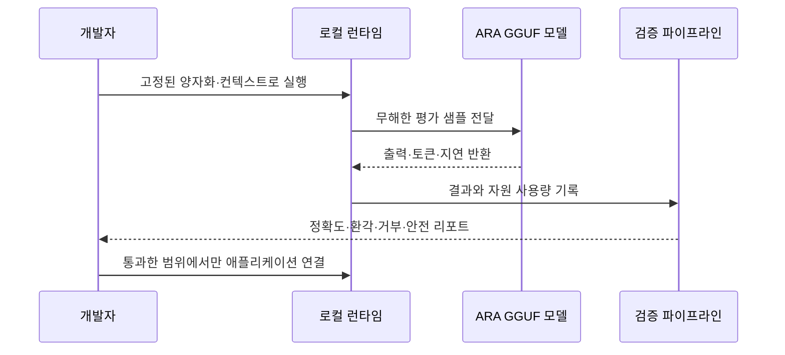

X 게시물은 Google Gemma 4 31B에 Heretic의 ARA(Arbitrary-Rank Ablation)를 적용한 GGUF 모델을 “거부율을 낮춘 31B 로컬 모델”로 소개한다. 모델 카드의 비교표에는 ARA 모델이 100개 중 28개를 거부하고 원본 Gemma 4 31B-it가 99개를 거부했다는 결과가 실제로 기록되어 있다. 다만 게시물이 말하는 11.9GB는 Q4 파일이 아니라 **Q2_K 양자화 파일**의 크기다. 또 GGUF 저장소의 메타데이터에 Apache-2.0이 표시되더라도, 원본 ARA 모델 카드에는 OpenRAIL++의 사용 제한이 함께 적혀 있다. [원문 X 게시물](https://x.com/HeLi8866/status/2119769095793238183?a=kFyW3lZd4Xss565PmGc&s=35), [GGUF 모델 카드](https://huggingface.co/mradermacher/gemma-4-31B-it-ARA-heretic-GGUF), [원본 ARA 모델 카드](https://huggingface.co/richardyoung/gemma-4-31B-it-ARA-heretic)

<!--more-->

## Sources

- [원문 X 게시물](https://x.com/HeLi8866/status/2119769095793238183?a=kFyW3lZd4Xss565PmGc&s=35) — `scrapling-get`으로 공개 본문과 Hugging Face 링크를 추출했다.
- [mradermacher GGUF 모델 카드](https://huggingface.co/mradermacher/gemma-4-31B-it-ARA-heretic-GGUF) — GGUF 변환, 양자화별 파일 크기, llama.cpp 실행 예제를 확인했다.
- [richardyoung 원본 ARA 모델 카드](https://huggingface.co/richardyoung/gemma-4-31B-it-ARA-heretic) — ARA 파라미터, 거부율 비교, 능력 변화와 OpenRAIL++ 제한을 확인했다.
- [Heretic GitHub](https://github.com/p-e-w/heretic) — ARA가 모델 행동 방향을 수정하는 Heretic의 기본 기법임을 교차 확인했다.
- [Heretic ARA 문서](https://heretic-project.org/configuration) — ARA의 행렬 최적화와 능력 보존 목표를 확인했다.

## 무엇이 바뀐 모델인가

원본 모델 카드는 이 체크포인트를 `google/gemma-4-31B-it`의 디센서링 버전으로 설명한다. Heretic v2.0.0을 사용해 ARA 파라미터를 최적화했고, 수정된 모델과 원본 모델의 거부 응답 수를 같은 100개 평가 항목에서 비교했다. ARA는 프롬프트를 가로채는 외부 필터가 아니라, 모델 내부 행렬에 변환을 적용해 특정 행동 방향을 약화하는 방식이다. 따라서 결과 모델은 “원본에 안전 필터를 하나 붙인 모델”이 아니라, 가중치가 달라진 별도 체크포인트로 봐야 한다. [원본 카드의 ARA 설명](https://huggingface.co/richardyoung/gemma-4-31B-it-ARA-heretic#arbitrary-rank-ablation-ara-parameters)



ARA 파라미터 표에는 적용 레이어 범위, 좋은 행동 보존 가중치, 나쁜 행동 방향 조정 가중치, 이웃 수가 공개되어 있다. 공개 파라미터는 재현성에는 도움이 되지만, 그것만으로 안전성이나 성능 보존을 보장하지 않는다. 원본 카드의 별도 평가에서는 능력 점수 변화와 거부율을 따로 측정하며, 거부 감소가 곧 지능 향상이라는 뜻은 아니라고 해석해야 한다.

## 28/100 거부율은 무엇을 말하고 무엇을 말하지 않는가

원본 ARA 모델 카드의 Performance 표는 ARA 모델의 거부가 28/100, 원본 모델이 99/100이라고 기록한다. 이는 X 게시물의 핵심 숫자와 일치한다. 그러나 “100개 테스트에서 28개 거부”는 평가셋·프롬프트·디코딩 설정에 종속된 측정값이다. 카드에 함께 소개된 후속 연구 표는 WildGuard 972개 유해 프롬프트에서 거부율, KL divergence, 능력 변화가 서로 다른 방식으로 계산된다는 점도 보여 준다. 거부율만 낮추면 답변의 유해성이나 사실성이 좋아진다는 결론은 낼 수 없다. [Performance 표](https://huggingface.co/richardyoung/gemma-4-31B-it-ARA-heretic#performance), [평가·제한 사항](https://huggingface.co/richardyoung/gemma-4-31B-it-ARA-heretic#evaluation-in-the-paper-is-abliteration-getting-harder-evidence-from-five-open-weight-release-pairs)



실무에서는 거부율을 단일 목표로 삼지 않는 것이 좋다. 정상적인 보안 연구·코드 감사 요청을 과도하게 차단하는지와, 반대로 위험한 요청에 구체적인 실행 절차를 내놓는지를 분리해 측정해야 한다. 또한 테스트 결과는 자동 판정만으로 확정하지 말고, 표본을 사람 검토로 확인해야 한다. 모델 카드도 거부 측정이 자동 판정에 의존하고, 낮은 거부가 답변의 유해성 부재를 의미하지 않는다고 명시한다.

## 11.9GB는 Q2_K, Q4_K_M은 18.8GB다

GGUF 카드의 양자화 표를 보면 Q2_K 파일은 11.9GB, Q3_K_S는 13.9GB, Q4_K_S는 17.9GB, Q4_K_M은 18.8GB, Q8_0은 32.7GB다. 따라서 X 게시물의 “31B 모델이 11.9GB”라는 설명은 파일 크기만 놓고 보면 맞지만, “Q4 양자화 11.9GB”라는 식으로 이해하면 틀린다. 11.9GB는 가장 공격적으로 압축된 2비트 계열이며, 카드도 Q4_K_M을 빠르고 권장되는 선택으로 별도 표시한다. [GGUF 양자화 표](https://huggingface.co/mradermacher/gemma-4-31B-it-ARA-heretic-GGUF#provided-quants)



다운로드 파일 크기는 실행에 필요한 전체 메모리와 다르다. 런타임은 가중치 외에 KV 캐시, 컨텍스트 버퍼, 멀티모달 보조 프로젝터(해당 파일을 사용할 경우), 운영체제 메모리를 추가로 사용한다. 12~16GB VRAM 시스템에서 Q2 파일을 “실행할 수 있다”는 말도 컨텍스트 길이와 CPU 오프로딩 여부에 따라 속도가 크게 달라질 수 있다. 설치 전에는 목표 컨텍스트, 토큰 생성 속도, 동시 요청 수를 정하고 작은 샘플로 측정해야 한다.

## 로컬 실행 예제와 검증 순서

GGUF 모델 카드는 `llama.cpp`와 Ollama 실행 예제를 제공한다. 예를 들어 llama.cpp의 Hugging Face 모델 참조는 다음처럼 사용할 수 있다.

```bash
llama serve -hf mradermacher/gemma-4-31B-it-ARA-heretic-GGUF:Q4_K_M
llama cli -hf mradermacher/gemma-4-31B-it-ARA-heretic-GGUF:Q4_K_M
```

이 명령은 모델 카드에 적힌 실행 경로를 보여 주는 예시일 뿐, 모든 하드웨어에서 즉시 적정 속도가 나온다는 보장은 아니다. 운영 전에 모델 파일의 해시와 카드의 버전을 기록하고, 네트워크가 차단된 샌드박스에서 무해한 테스트 세트를 실행한다. 이후 출력 필터, 요청 권한, 감사 로그를 애플리케이션 계층에 추가한다. “무검열” 모델을 사용하는 경우에도 안전 정책을 모델에만 맡기지 않는 것이 핵심이다. [llama.cpp 사용 예제](https://huggingface.co/mradermacher/gemma-4-31B-it-ARA-heretic-GGUF#usage)



## Apache-2.0 표기만 보고 배포하면 안 된다

GGUF 저장소 상단에는 Apache-2.0이 표시되지만, 기반 ARA 모델 카드의 Licence 절에는 Apache-2.0 기반 모델에 OpenRAIL++ 사용 제한이 추가되어 있다고 적혀 있다. 카드에는 금지된 사용 목적을 위해 배포하거나 콘텐츠를 생성해서는 안 된다고 명시되어 있다. 이는 “무료 다운로드 가능”과 “어떤 서비스에도 무제한 사용 가능”이 같은 뜻이 아니라는 사례다. 모델을 제품에 넣기 전에는 GGUF 변환 저장소, 원본 ARA 모델, Gemma 기반 모델의 라이선스와 사용 제한을 함께 확인해야 한다. [원본 라이선스](https://huggingface.co/richardyoung/gemma-4-31B-it-ARA-heretic#licence), [GGUF 카드](https://huggingface.co/mradermacher/gemma-4-31B-it-ARA-heretic-GGUF)

라이선스 검토는 기술 검증과 분리하지 않는 편이 좋다. 어떤 양자화 파일을 배포할지, 모델 파일을 고객에게 내려받게 할지, 서버에서만 추론할지에 따라 의무와 위험이 달라진다. 특히 보안 연구나 침투 테스트처럼 이중 용도인 작업은 사전 승인된 환경과 범위에서만 수행하고, 모델의 제한을 제거한 사실을 보안 통제의 대체물로 사용하지 않아야 한다.

## 핵심 요약

- X 게시물의 28/100 대 99/100 거부율 비교는 원본 ARA 모델 카드에도 기록되어 있다.
- ARA는 프롬프트 필터가 아니라 모델 가중치에 적용되는 행렬 변환이다.
- 11.9GB는 Q2_K 파일이며, Q4_K_M은 약 18.8GB, Q8_0은 약 32.7GB다.
- 파일 크기만으로 VRAM 요구량과 실제 속도를 판단할 수 없다. KV 캐시·컨텍스트·런타임 메모리를 포함해 측정해야 한다.
- 거부율 감소는 능력 향상이나 안전성 확보를 의미하지 않는다. 정확도·환각·유해성·형식 준수를 별도 평가해야 한다.
- Apache-2.0 표기와 별개로 원본 ARA 카드에는 OpenRAIL++ 사용 제한이 있으므로 배포 전 라이선스를 교차 검토해야 한다.

## 결론

Gemma 4 31B ARA Heretic은 큰 모델을 로컬에서 돌릴 수 있게 만든 GGUF 배포판이면서, ARA로 거부 행동을 줄인 실험적 체크포인트다. 흥미로운 숫자는 분명하지만, “11.9GB의 Q4 모델”, “거부 감소 = 지능 보존”, “Apache-2.0 = 무제한 사용”이라는 세 가지 해석은 모두 교정이 필요하다. 모델 카드의 평가 조건과 양자화 표, 라이선스를 함께 읽고, 승인된 데이터셋과 샌드박스에서 직접 재평가할 때 이 모델의 실제 가치를 판단할 수 있다.
