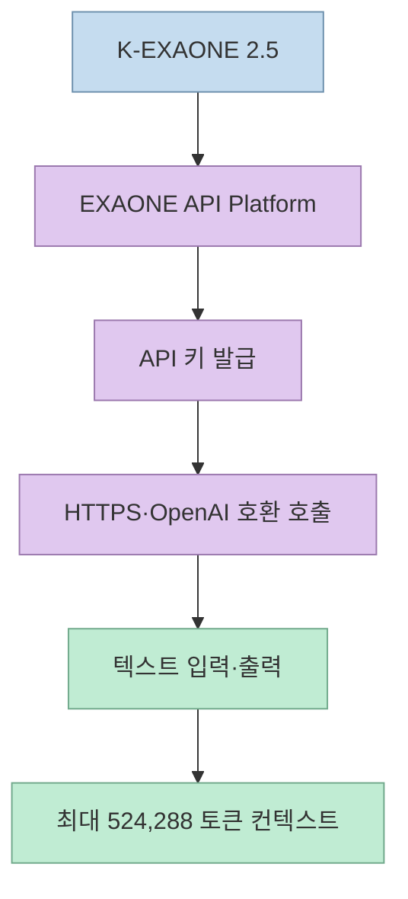
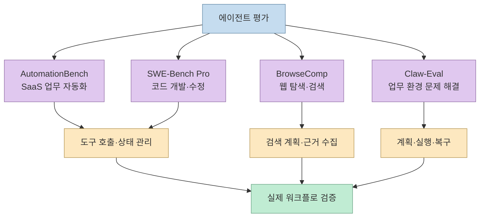
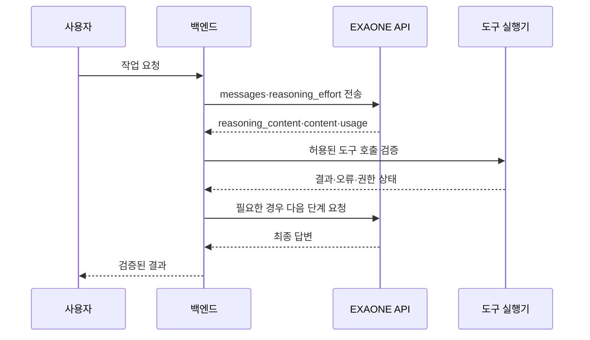
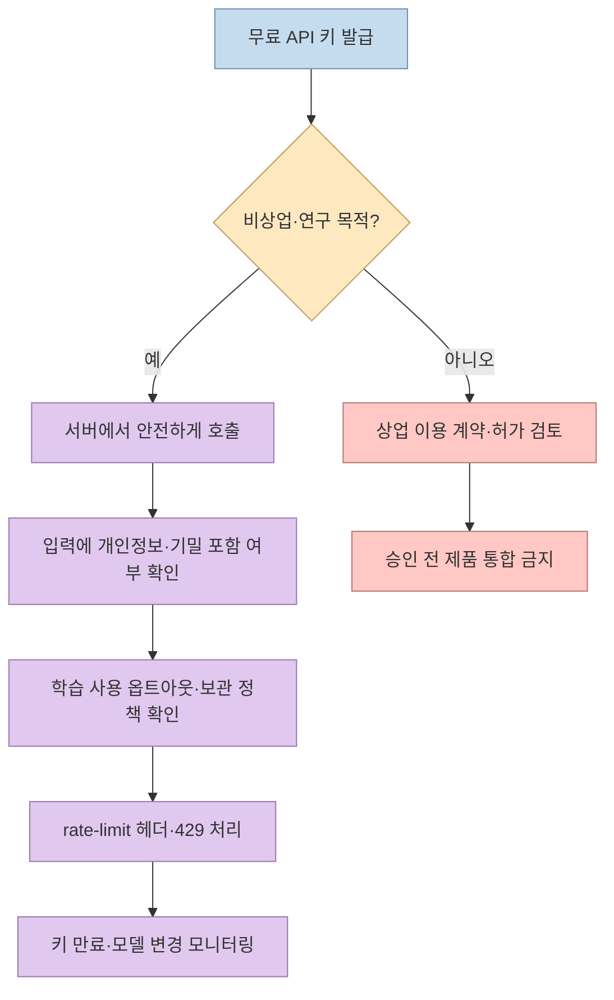

X 게시물은 LG AI연구원의 **K-EXAONE 2.5 API 무료 개방**을 소개하며 에이전트 벤치마크 네 가지를 강조한다. LG 공식 발표에 따르면 개발자·스타트업·기업·연구기관은 API 키를 발급받아 비용 없이 서비스 개발과 연구에 사용할 수 있다. 다만 EXAONE API 약관은 현재 플랫폼 사용을 비상업적 목적으로 제한하고, 입력·출력을 모델 학습에 사용할 수 있는 권리와 API 키 만료·사용량 제한을 규정한다. 따라서 “무료”는 “상업 서비스에 무제한으로 사용 가능”이나 “가중치를 내려받을 수 있음”과 같은 뜻이 아니다. [원문 X 게시물](https://x.com/goan999999/status/2119639411558392059?a=8q4c7Af4Pqc-6ff2lws&s=35), [LG AI연구원 공식 발표](https://www.lgresearch.ai/news/view?seq=755), [EXAONE API 약관](https://docs.exaone.ai/en/terms/terms-of-service)

<!--more-->

## Sources

- [원문 X 게시물](https://x.com/goan999999/status/2119639411558392059?a=8q4c7Af4Pqc-6ff2lws&s=35) — `scrapling-get`으로 공개 본문과 공식 API 링크를 추출했다.
- [LG AI Research: K-EXAONE 2.5 API Available for Free](https://www.lgresearch.ai/news/view?seq=755) — 무료 개방 대상과 네 가지 에이전트 평가 수치를 확인했다.
- [LG 공식 보도자료](https://www.lg.co.kr/media/release/30760) — 비교 모델 점수, 기술 검증 모델의 성격, 8주 개선 주장과 API 공개 범위를 확인했다.
- [K-EXAONE 2.5 API 문서](https://docs.exaone.ai/en/docs/k-exaone-2.5) — OpenAI 호환 엔드포인트, 모델명, 텍스트 전용, 컨텍스트 길이, 추론 파라미터를 확인했다.
- [인증·API 키 문서](https://docs.exaone.ai/en/docs/authentication) — Bearer 인증과 서버 측 키 보관 원칙을 확인했다.
- [사용량 제한 문서](https://docs.exaone.ai/en/docs/rate-limits) — 429 응답과 rate-limit 헤더를 확인했다.
- [EXAONE API 서비스 약관](https://docs.exaone.ai/en/terms/terms-of-service) — 비상업 이용, 입력·출력 처리, 금지 행위, 키 만료와 사용량 제한을 확인했다.

## K-EXAONE 2.5는 어떤 공개인가

LG AI연구원은 K-EXAONE 2.5를 지난해 8월 공개한 모델에 추가 학습을 적용한 **기술 검증 모델**이라고 설명한다. 이번 공개는 모델 가중치를 배포하는 오픈 웨이트 릴리스가 아니라, EXAONE API Platform에서 키를 발급받아 HTTPS API로 호출하는 방식이다. 공식 API 문서는 OpenAI 호환 `POST /v1/chat/completions` 엔드포인트와 모델명 `k-exaone_v2.5`를 제공한다. 모델은 현재 텍스트 전용이며, 입력 토큰과 `max_tokens`를 합쳐 최대 524,288토큰까지 받을 수 있다. [LG 보도자료](https://www.lg.co.kr/media/release/30760), [API 문서](https://docs.exaone.ai/en/docs/k-exaone-2.5)



이 구조는 “무료 모델을 내 서버에 설치한다”와 다르다. 요청은 LG의 API 인프라로 전송되고, 약관·사용량 정책·모델 버전 변경의 영향을 받는다. 반대로 API 방식은 로컬 GPU를 준비하지 않고도 에이전트 프로토타입을 빠르게 시험할 수 있다는 장점이 있다. 서비스의 핵심 데이터가 외부 API로 나가도 되는지, 모델 버전이 바뀌어도 결과를 허용할 수 있는지를 먼저 확인해야 한다.

## 네 가지 에이전트 점수는 무엇을 측정했나

LG가 공개한 내부 평가에서 K-EXAONE 2.5는 AutomationBench-Openset 74.6, SWE-Bench Pro 59.2, BrowseComp 78.0, Claw-Eval 77.3을 기록했다. LG의 정의에 따르면 AutomationBench는 SaaS 도구를 이용한 업무 자동화, SWE-Bench Pro는 실제 소프트웨어 개발·수정, BrowseComp는 웹 탐색과 정보 검색, Claw-Eval은 업무 환경에서의 에이전트 문제 해결 능력을 측정한다. [LG AI Research 발표](https://www.lgresearch.ai/news/view?seq=755)



LG 보도자료의 비교값을 보면 K-EXAONE 2.5는 AutomationBench에서 DeepSeek V4.1 Flash 74.9에 0.3점 뒤지고, GLM 5.3(max) 71.6보다 높다. Claw-Eval은 77.3으로 DeepSeek 75.8보다 높지만 GLM 77.6보다 낮다. BrowseComp는 78.0으로 DeepSeek 75.8보다 높고 GLM 79.0보다 낮으며, SWE-Bench Pro는 59.2로 DeepSeek 58.4보다 높지만 GLM 64.0보다는 낮다. 따라서 공식 표현인 “경쟁 가능한 성능”은 타당하지만, 네 항목 모두에서 최고라는 뜻은 아니다. [LG 공식 비교 수치](https://www.lg.co.kr/media/release/30760)

또한 이 결과는 오픈 데이터셋을 사용한 LG의 내부 평가다. 벤치마크 이름과 점수만으로 내 도메인의 에이전트 성공률을 예측할 수 없고, 도구 스키마, 브라우저 환경, 평가 프롬프트, 실패 복구 정책에 따라 결과가 달라진다. 실제 도입 전에는 같은 도구 목록과 제한된 샘플로 후보 모델을 재평가해야 한다.

## API 호출은 OpenAI 호환이지만 에이전트는 별도 설계다

공식 문서의 최소 호출은 다음과 같다. API 키는 브라우저나 모바일 코드에 넣지 않고 서버 환경 변수나 키 관리 시스템에서 읽어야 한다. [인증 문서](https://docs.exaone.ai/en/docs/authentication)

```bash
curl 'https://api.exaone.ai/v1/chat/completions' \
  -H "Authorization: Bearer $EXAONE_API_KEY" \
  -H 'Content-Type: application/json' \
  -d '{
    "model": "k-exaone_v2.5",
    "max_tokens": 512,
    "messages": [{"role": "user", "content": "작업 계획을 단계별로 정리해 주세요."}],
    "stream": false,
    "reasoning_effort": "high"
  }'
```

K-EXAONE 2.5는 항상 추론한 뒤 답변하며, `reasoning_effort`를 `low`, `high`, `max`로 조절한다. 추론 내용은 `reasoning_content`로, 최종 답변은 `content`로 분리되어 반환되고 사용량에는 `reasoning_tokens`가 포함된다. 이는 에이전트 비용·지연을 측정할 때 출력 토큰만 세면 안 된다는 뜻이다. [K-EXAONE 2.5 파라미터](https://docs.exaone.ai/en/docs/k-exaone-2.5)



모델이 OpenAI 호환 형식을 지원한다고 해서 자동으로 에이전트가 되는 것은 아니다. 도구 목록과 인자 스키마, 실행 권한, 타임아웃, 재시도, 중복 실행 방지, 사람 승인 단계를 애플리케이션이 구현해야 한다. 모델의 `content`를 곧바로 셸 명령이나 결제 API에 연결하지 말고, 구조화된 출력 검증과 허용 목록을 거쳐야 한다.

## 무료 사용의 실제 조건

LG 발표는 API 키를 발급받은 개발자·스타트업·기업·연구기관이 비용 없이 사용할 수 있다고 말한다. 하지만 약관은 플랫폼 사용 권리를 **비상업적 목적**으로 제한하고, API나 모델을 제품·서비스에 통합해 제3자가 직접 사용하게 하는 것을 금지한다. 따라서 개인 학습, 연구, 프로토타입에는 적합할 수 있지만, 유료 SaaS나 고객용 기능에 바로 연결하기 전에 별도 계약과 허가가 필요하다. [LG 발표](https://www.lg.co.kr/media/release/30760), [약관 2.1](https://docs.exaone.ai/en/terms/terms-of-service)

약관상 입력과 출력은 LG가 처리·분석·모델 학습 등에 사용할 수 있으며, 플랫폼에서 옵트아웃한 이후의 데이터만 학습에 사용하지 않는다고 적혀 있다. API 키는 발급 후 30일 동안 유효하고, 90일 동안 로그인하지 않으면 계정이 휴면 처리될 수 있다. 또한 API는 초·분·일 단위 사용량 제한을 둘 수 있고, 초과 시 429가 반환된다. [약관 2·3·6·10절](https://docs.exaone.ai/en/terms/terms-of-service), [Rate Limits](https://docs.exaone.ai/en/docs/rate-limits)



데이터를 외부 API로 보내기 어려운 조직이라면 무료라는 장점보다 약관과 데이터 흐름이 더 중요하다. 민감한 원문을 보내지 않고 비식별화한 샘플만 사용하거나, 아예 로컬·사설 배포 가능한 다른 모델을 선택해야 한다. API 제공이 계속 유지된다는 보장도 약관상 없으므로, 프로토타입 단계부터 모델 교체 인터페이스와 예산·성능 기준을 분리해 두는 것이 좋다.

## 핵심 요약

- K-EXAONE 2.5는 LG의 기술 검증 모델이며, 현재는 가중치가 아닌 API 형태로 제공된다.
- 공식 점수는 AutomationBench 74.6, SWE-Bench Pro 59.2, BrowseComp 78.0, Claw-Eval 77.3이다.
- 비교 모델보다 모든 항목에서 앞선 것은 아니며, 수치는 LG의 오픈 데이터셋 기반 내부 평가다.
- API는 OpenAI 호환 `POST /v1/chat/completions`, 모델명 `k-exaone_v2.5`, 텍스트 전용, 최대 524,288토큰 컨텍스트를 제공한다.
- 항상 추론한 뒤 답변하며 `reasoning_effort`와 `reasoning_tokens`로 비용·지연을 관리할 수 있다.
- 무료 사용은 현재 약관상 비상업 목적에 한정되고, 입력·출력 학습 활용 가능성, API 키 만료, rate limit을 확인해야 한다.

## 결론

K-EXAONE 2.5 API는 한국어 에이전트와 자동화 워크플로를 실험하려는 개발자에게 진입 비용이 낮은 선택지다. 특히 OpenAI 호환 인터페이스와 긴 컨텍스트, 도구 사용에 초점을 둔 평가 수치는 실제 프로토타입을 만들어 볼 이유가 된다. 그러나 벤치마크 점수는 내부 평가의 출발점일 뿐이고, 무료 API는 상업 이용·데이터 처리·사용량 정책을 동반한다. 먼저 비민감한 테스트 데이터로 호출·도구 검증·429 복구를 설계한 뒤, 약관에 맞는 범위에서만 실제 서비스로 확장해야 한다.
