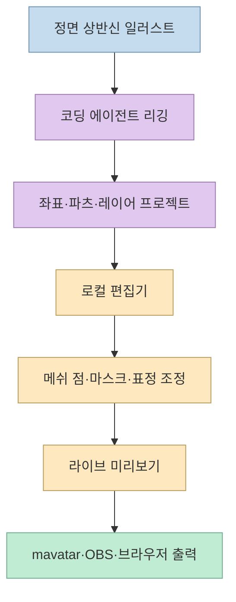
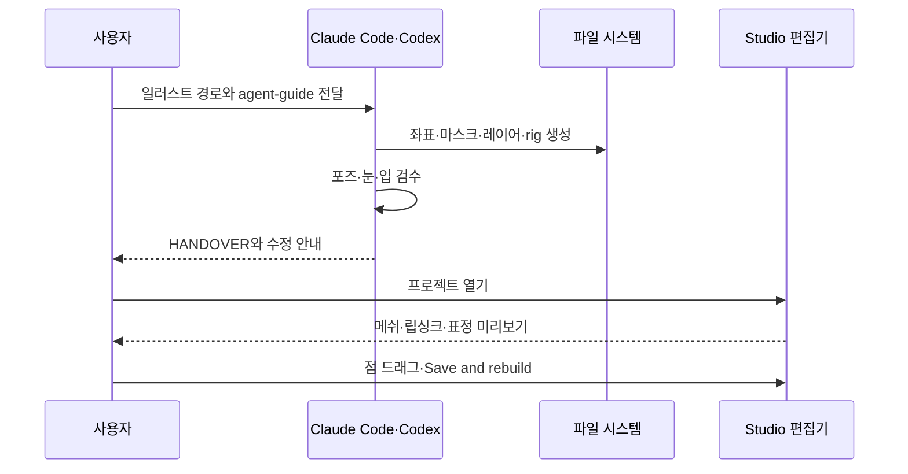
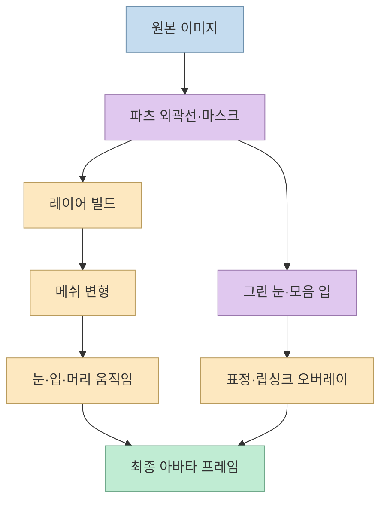
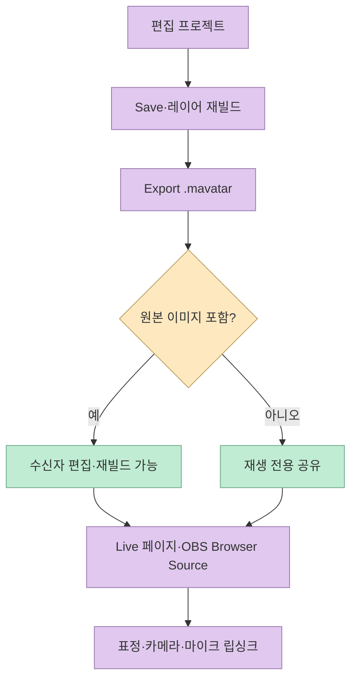

`shinshin86/mesh-avatar-studio`는 한 장의 일러스트를 눈 깜빡임, 말하기, 고개 돌리기, 호흡, 머리카락 흔들림이 가능한 2D 메쉬 아바타로 바꾸는 오픈소스 프로젝트다. 핵심은 생성형 비디오를 호출하는 것이 아니라, **코딩 에이전트가 이미지에서 리깅 정보를 준비하고 로컬 편집기가 메쉬 변형을 실시간으로 미리 보여 주는 것**이다. 저장소는 Claude Code와 Codex를 에이전트로 지원하고, 결과물을 `.mavatar` 파일이나 OBS 브라우저 소스로 내보낸다. [Mesh Avatar Studio 저장소](https://github.com/shinshin86/mesh-avatar-studio)

<!--more-->

## Sources

- [Mesh Avatar Studio GitHub 저장소](https://github.com/shinshin86/mesh-avatar-studio) — README의 설치, 에이전트 작업, 편집기, 라이브 스트리밍, 내보내기, 라이선스를 확인했다.
- [Agent guide](https://github.com/shinshin86/mesh-avatar-studio/blob/main/docs/agent-guide.md) — 이미지 좌표 측정, 레이어 분리, 포즈 검수 절차를 확인했다.
- [Avatar format](https://github.com/shinshin86/mesh-avatar-studio/blob/main/docs/avatar-format.md) — 프로젝트 폴더와 `.mavatar` 구성의 역할을 확인했다.
- [Full-body tracking](https://github.com/shinshin86/mesh-avatar-studio/blob/main/docs/full-body-tracking.md) — MediaPipe 기반 신체 추적의 실험적 성격을 확인했다.
- [MIT License 및 샘플 자산 조건](https://github.com/shinshin86/mesh-avatar-studio#license) — 코드와 Miko 샘플 캐릭터의 권리 범위를 확인했다.

## 이 프로젝트가 해결하는 문제

일러스트 한 장을 그대로 화면에 띄우면 표정·립싱크·고개 회전이 어렵다. 반대로 Live2D나 3D 리깅 도구는 아트 자산과 수동 설정이 필요하다. Mesh Avatar Studio는 이 사이를 겨냥한다. 사용자는 정면 상반신 PNG를 준비하고, 에이전트가 이미지 좌표와 파츠 경계를 읽어 리그를 생성한다. 이후 편집기에서 점을 드래그해 눈·입·머리카락·손의 위치를 고치고, 메쉬 변형을 실시간 미리 본다. [README: How it works](https://github.com/shinshin86/mesh-avatar-studio#how-it-works)



이 방식의 장점은 에이전트가 모든 결과를 고정된 영상으로 굽지 않는다는 점이다. 프로젝트에는 좌표와 파츠 구조가 남으므로 사용자가 직접 수정하고 다시 레이어를 빌드할 수 있다. 반대로 원본 일러스트의 투명 배경, 얼굴 방향, 파츠 경계가 부정확하면 자동 리깅의 품질도 떨어진다. README는 정면을 향한 상반신 투명 PNG가 가장 좋은 출발점이라고 권장한다.

## 설치와 에이전트 생성 흐름

샘플 실행에는 Node.js 22.17 이상과 Git이 필요하다.

```bash
npx create-mesh-avatar-studio
cd mesh-avatar-studio
npm run dev
```

직접 clone한 경우에는 `npm install` 후 `npm run doctor`를 실행한다. 편집기와 Live 페이지에는 Node.js만 필요하지만, 에이전트가 아바타를 만들 때는 Python 재빌드 계층과 Playwright Chromium이 추가로 사용될 수 있다. `doctor`는 빠진 도구를 경고하므로 환경을 먼저 확인할 수 있다. [README: Try the sample](https://github.com/shinshin86/mesh-avatar-studio#try-the-sample)



Codex는 `npm run create -- /path/to/your-image.png` 한 명령으로 프로젝트 생성과 편집기 실행을 연결할 수 있다. 이미지 변형을 위해 OpenAI 이미지 생성을 사용할 수 있으며, 이 경우 이미지와 마스크가 외부 서비스로 전송될 수 있으므로 명시적 동의가 필요하다. `--no-variants` 옵션은 변형 생성을 끄고 파일을 로컬에 유지하는 선택지다. Claude Code는 이미지를 직접 생성하지 않고, 필요한 마스크와 프롬프트를 준비하는 역할을 한다. [README: One command with Codex](https://github.com/shinshin86/mesh-avatar-studio#one-command-with-codex)

## 메쉬·레이어·표정은 서로 다른 계층이다

편집기에서 점을 드래그하는 것은 단순히 이미지를 움직이는 일이 아니다. 일부 좌표는 눈과 손의 외곽선, 머리·머리카락·번 영역을 결정하고, 이 값이 이미지가 파츠별로 잘리는 레이어 빌드에 사용된다. 값을 바꾸면 저장 후 레이어를 다시 빌드해야 한다. 메쉬 변형만으로 눈과 입을 움직일 수도 있지만, 닫힌 눈과 모음별 입 모양을 그린 변형을 추가하면 깜빡임과 말하기가 더 자연스러워진다. [README: Fix what looks wrong](https://github.com/shinshin86/mesh-avatar-studio#fix-what-looks-wrong), [README: Get drawn eyes and mouths](https://github.com/shinshin86/mesh-avatar-studio#get-drawn-eyes-and-mouths)



이 계층을 분리하면 “눈이 이상하게 깜빡인다”와 “얼굴 이미지가 잘못 잘렸다”를 다른 문제로 진단할 수 있다. 먼저 마스크와 레이어 경계를 고치고, 그 다음 메쉬 점을 조정하며, 마지막으로 그린 표정 변형을 추가하는 순서가 효율적이다. 프로젝트가 변경 사항을 즉시 반영하더라도, 변경된 외곽선은 반드시 저장하고 레이어를 다시 빌드해야 한다.

## `.mavatar`와 OBS로 공유하기

편집기의 Export `.mavatar`는 저장된 리그, 빌드된 레이어, 그린 표정, 메타데이터를 하나의 파일에 담는다. 원본 이미지 포함 옵션이 켜져 있으면 받는 사람이 Studio에서 다시 편집할 수 있다. 반대로 원본을 제외하면 재생은 가능하지만 편집·재빌드는 할 수 없다. 가져오기는 `npm run dev`가 실행 중인 Studio에서 `.mavatar`를 열거나 드래그하는 방식이며, 아카이브 크기는 128MiB까지다. [README: Share your avatar](https://github.com/shinshin86/mesh-avatar-studio#share-your-avatar)



Live 페이지는 카메라와 마이크를 사용해 얼굴·입 움직임을 추적한다. README는 카메라 영상과 마이크 오디오는 로컬에 머물고, 스트림 뷰로 전달되는 것은 수치화된 아바타 움직임 값이라고 설명한다. OBS에서는 Live 페이지가 제공하는 URL을 Browser Source로 추가하고, 1080×1080 같은 캔버스에서 투명 배경을 사용할 수 있다. 카메라 없이 마이크만 켜서 음성 립싱크와 idle motion만 사용하는 것도 가능하다. [README: Live and streaming](https://github.com/shinshin86/mesh-avatar-studio#live-and-streaming)

브라우저만 사용하는 Player도 제공되며, `.mavatar`를 열어 얼굴 추적·마이크 립싱크·표정·조명을 실행한다. 이 방식은 업로드 없이 Chrome 또는 Edge에서 동작하지만, OBS Browser Source와 외부 앱에서 표정을 전환하는 기능은 Studio의 Live 페이지가 필요하다. [README: Without installing anything](https://github.com/shinshin86/mesh-avatar-studio#without-installing-anything)

## MediaPipe 신체 추적은 실험 기능

기본 Live는 얼굴 추적을 사용하고, 전신 추적은 기본값이 꺼진 실험 기능이다. 켜면 어깨·엉덩이·팔꿈치·손목이 추가로 사용되지만, README는 웹캠 신체 포인트가 얼굴보다 불안정해 특히 치마나 천에서 흔들림이 커질 수 있다고 경고한다. 따라서 방송용 기본값은 얼굴 추적만 유지하고, 전신 추적은 조명·카메라 각도·의상별로 별도 검증하는 편이 좋다. [Full-body tracking](https://github.com/shinshin86/mesh-avatar-studio/blob/main/docs/full-body-tracking.md)

## 라이선스와 샘플 캐릭터의 분리

프로젝트 코드는 MIT 라이선스다. 그러나 `samples/miko-qipao/`의 Miko 캐릭터는 MIT 적용 대상이 아니며, AITuber OnAir와 Yuki Shindo의 자산 사용 지침을 따른다. 샘플 이미지를 프로젝트 코드와 함께 재배포하거나 에셋 컬렉션으로 판매할 수 없고, 이 프로젝트가 공식 AITuber OnAir 제품이라는 의미도 아니다. MediaPipe 구성 요소는 Apache-2.0을 따른다. 자신의 일러스트를 사용할 때도 원본 이미지·음성·모델·표정 변형의 권리를 각각 확인해야 한다. [README: License](https://github.com/shinshin86/mesh-avatar-studio#license)

## 핵심 요약

- Mesh Avatar Studio는 한 장의 일러스트에서 에이전트가 좌표·레이어·리그를 만들고, 로컬 편집기에서 메쉬를 조정하는 도구다.
- Node.js 22.17 이상으로 샘플을 실행할 수 있으며, 에이전트 생성에는 Python·Playwright가 추가로 필요할 수 있다.
- 눈·입·머리카락의 메쉬 변형과 그린 표정·모음 입을 별도 계층으로 다뤄 품질을 개선한다.
- `.mavatar`는 리그·레이어·표정·메타데이터를 묶어 공유하며, 원본 포함 여부에 따라 편집 가능성이 달라진다.
- MediaPipe 얼굴 추적과 마이크 립싱크는 로컬에서 처리되고, OBS에는 수치화된 움직임을 전달하는 구조다.
- 코드는 MIT지만 Miko 샘플 캐릭터와 MediaPipe는 별도 조건이므로 자산 라이선스를 분리해 확인해야 한다.

## 결론

Mesh Avatar Studio의 핵심은 “AI가 애니메이션 영상을 대신 만들어 준다”가 아니다. 에이전트가 반복적인 리깅·마스크·포즈 검수를 수행하고, 사용자는 로컬 편집기에서 메쉬와 표정을 직접 조정하며, 결과를 `.mavatar`와 OBS 스트림으로 재사용한다. 이 분업은 한 장의 일러스트를 방송 가능한 아바타로 바꾸는 과정을 코드·데이터·검수 단계로 나눈다. 자신의 이미지와 권리를 확보한 뒤, 얼굴 추적만으로 작은 프로젝트를 시작하고 전신 추적·표정 생성·OBS 연동을 단계적으로 추가하는 것이 가장 안정적인 도입 순서다.
