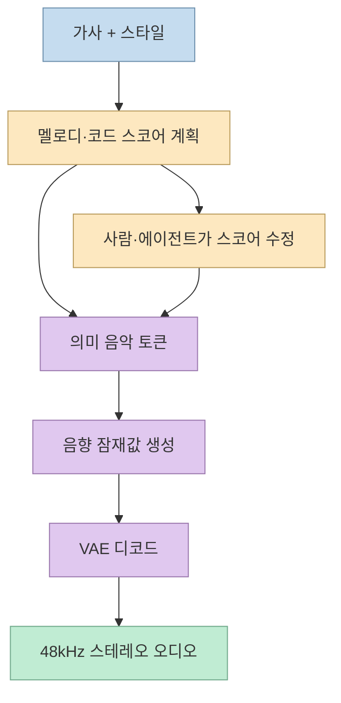
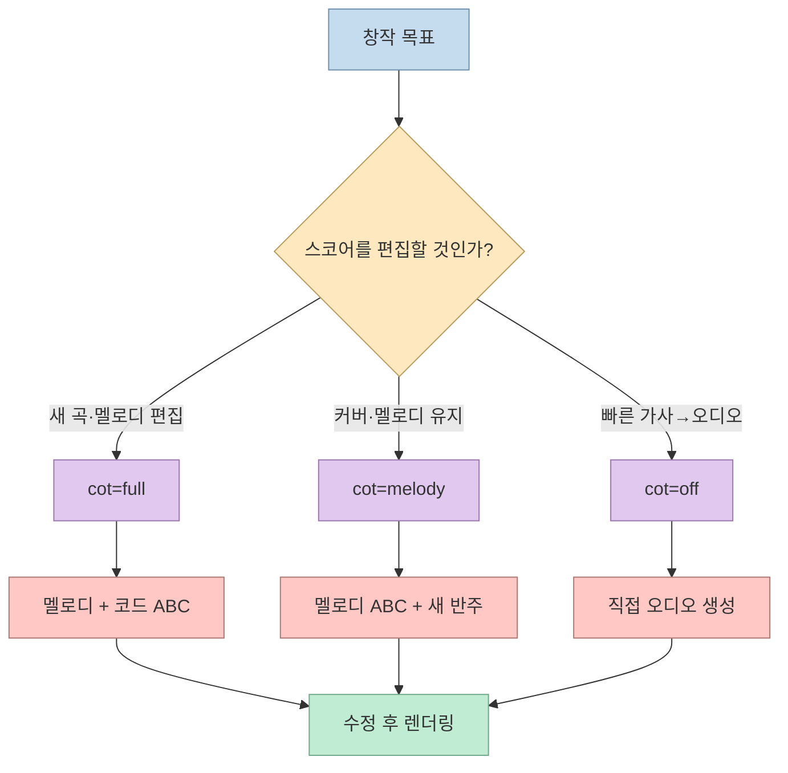
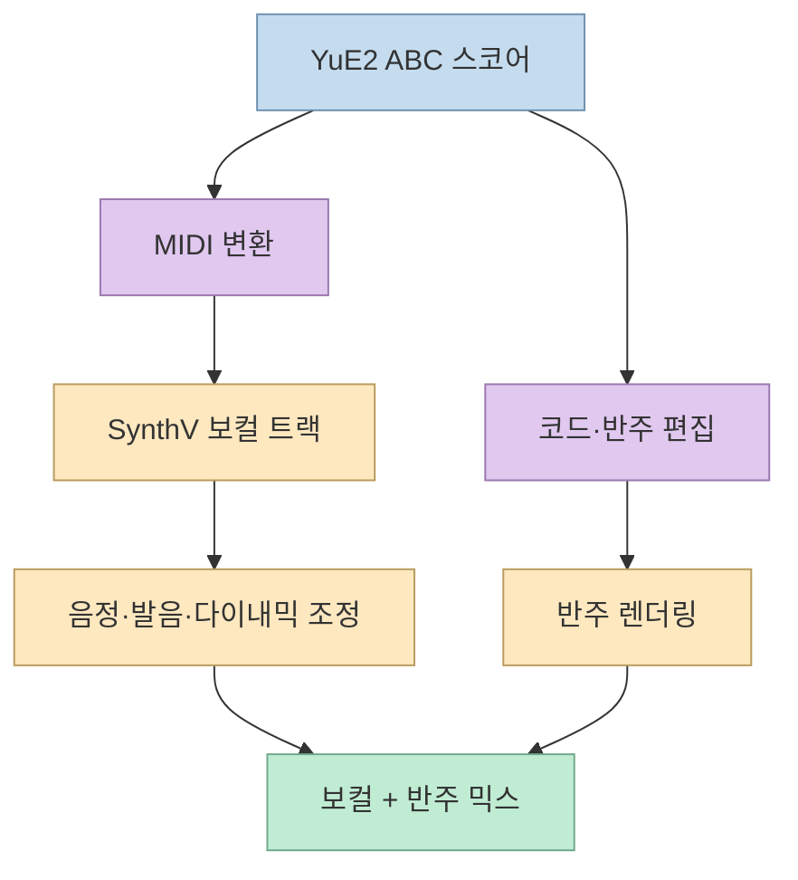
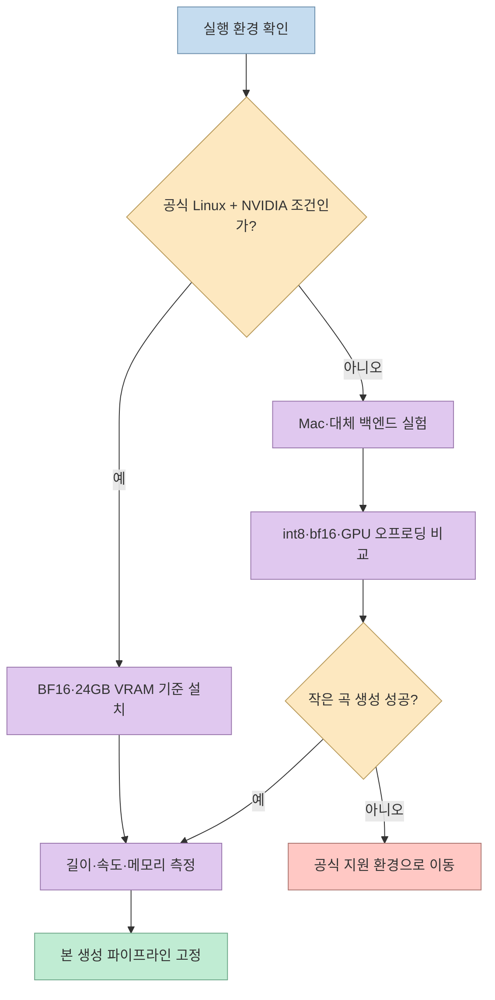

X 게시물은 오픈소스 작곡 AI **YuE2**를 Apple Silicon Mac에서 실행해 가사만으로 57초짜리 노래를 약 5분 만에 만들고, 멜로디 스코어를 MIDI로 꺼내 SynthV에 넘길 수 있었다고 소개한다. 이 경험은 흥미롭지만, 공식 저장소가 검증한 기본 환경은 Linux·Python 3.12·BF16을 지원하는 NVIDIA GPU와 24GB VRAM이다. 따라서 Mac M1 Max 실행은 공식 지원 보장이 아니라 커뮤니티의 실험 결과로 구분해야 한다. YuE2의 핵심은 완성 오디오를 한 번에 뽑는 것이 아니라, 먼저 읽고 수정할 수 있는 멜로디·코드 스코어를 만든 뒤 소리로 렌더링하는 데 있다. [원문 X 게시물](https://x.com/ShinobuFujimoto/status/2119297842452038107?a=siZt7ki7vbjVPZB5Vrc&s=35), [YuE2 공식 저장소](https://github.com/multimodal-art-projection/YuE)

<!--more-->

## Sources

- [원문 X 게시물](https://x.com/ShinobuFujimoto/status/2119297842452038107?a=siZt7ki7vbjVPZB5Vrc&s=35) — `scrapling-get`으로 본문·Mac 실행 경험·MIDI·SynthV·라이선스 관련 주장을 추출했다.
- [YuE2 공식 GitHub 저장소](https://github.com/multimodal-art-projection/YuE) — 생성 구조, Quick Start 환경, 스코어·오디오 산출물, 에이전트 편집, 라이선스를 확인했다.
- [YuE2 모델 가중치 라이선스](https://github.com/tidesea/yue/blob/main/MODEL_LICENSE) — YuE2 체크포인트가 CC BY-NC 4.0임을 확인했다.
- [YuE2 기술 보고서](https://arxiv.org/abs/2609.33757) — 심벌릭 계획과 오디오 생성의 결합 구조를 교차 확인했다.
- [ComfyUI-YuE2 공식·호환 노드 안내](https://github.com/ScryptHunter/ComfyUI-YuE2) — ComfyUI에서 ABC·MIDI·멜로디 편집을 연결하는 방식을 확인했다.

## 가사에서 오디오까지: 스코어가 중간 표현이다

YuE2 공식 README는 가사와 스타일 프롬프트를 입력하면 **멜로디·코드 계획(score)** 을 작성하고, 그 계획을 바탕으로 보컬과 반주가 있는 완성곡을 만든다고 설명한다. 내부 구조는 AR–NAR Mixture-of-Transformers가 스코어와 의미 토큰을 예측하고, flow matching으로 음향 잠재값을 만든 뒤 VAE가 스테레오 오디오로 디코드하는 단계로 나뉜다. Python API도 `plan()` → `generate_semantic()` → `synthesize()` → `decode()`라는 구간을 노출한다. [공식 README](https://github.com/multimodal-art-projection/YuE#how-it-works), [YuE2 기술 보고서](https://arxiv.org/abs/2609.33757)

이 중간 스코어는 단순한 내부 로그가 아니다. 공식 저장소는 출력 폴더에 스코어, 의미 토큰, 음향 잠재값, 생성 설정, 모델 식별자를 함께 보존한다고 설명한다. 따라서 같은 스코어를 다시 렌더링하거나, 반주만 바꾸거나, 가사를 수정한 버전을 비교할 수 있다. X 작성자가 “멜로디만 먼저 만들고 Teto에 맞춘다”고 본 이유도 이 중간 표현을 직접 편집할 수 있기 때문이다.

## `cot` 모드가 만드는 창작 워크플로

YuE2는 생성 모드를 세 가지로 나눈다. `cot="full"`은 멜로디와 코드가 있는 편집 가능한 계획을 만들고, `cot="melody"`는 멜로디 중심으로 자유로운 반주를 붙이는 커버 작업에 권장된다. `cot="off"`는 스코어 계획 없이 가사·스타일에서 바로 생성한다. ABC 스코어를 직접 전달하면 사람이 만든 멜로디를 고정한 채 오디오를 만들 수도 있다. [생성 가이드](https://github.com/multimodal-art-projection/YuE#quick-start)

`cot="full"`에서 만들어진 ABC는 사람이 읽을 수 있는 텍스트 악보에 가깝다. ComfyUI 통합 노드나 별도 변환기를 사용하면 이를 MIDI나 피아노 롤로 옮길 수 있고, 이후 SynthV 같은 보컬 합성 도구에서 음정과 발음을 조정할 수 있다. 다만 YuE2의 스코어가 곧바로 완벽한 보컬 트랙을 보장하는 것은 아니다. X 글도 “악보에는 가사가 붙지 않는다”, “특정 구간만 요청해도 전주부터 시작한다”는 사용상 한계를 기록한다. 이 제약은 스코어·가사·구간 편집을 별도 단계로 두어야 한다는 뜻이다.

## MIDI와 SynthV 연결이 중요한 이유

Suno처럼 완성 음원을 먼저 만드는 시스템에서는 음원을 다시 분석해 멜로디를 추출해야 한다. 이 과정에서 원래 가수의 미세한 음정 흔들림이나 발성 습관까지 따라올 수 있다. YuE2는 멜로디를 먼저 노출하므로, 작곡자는 그 음표를 원하는 보컬 합성기에 넘기고 음색·발음·다이내믹을 별도로 제어할 수 있다. 이는 “생성 AI가 부른 결과를 그대로 사용”하는 흐름에서 “작곡과 보컬 연출을 분리”하는 흐름으로 바뀌는 것이다.

이 구조의 장점은 반복 가능한 편곡이다. 같은 멜로디를 Teto, 다른 가상 보컬, 실제 보컬 가이드에 각각 적용할 수 있고, 보컬을 바꾸어도 곡의 핵심 음정 구조는 유지된다. 반대로 MIDI가 자동으로 좋은 작곡을 의미하는 것은 아니다. 프레이징, 음역, 가사 강세, 숨 위치는 사람이 듣고 다시 손봐야 한다. YuE2는 멜로디를 “명시적으로 편집할 수 있게 만든다”는 점에서 창작 도구이지, 음악적 결정을 모두 대신하는 자동 작곡가가 아니다.

## Mac 실행 사례와 공식 하드웨어 조건을 분리하기

X 작성자는 M1 Max Mac에서 가벼운 int8 버전은 GPU로 실행되지 않았지만, 7.8GB 정도의 bf16 버전은 끝까지 실행됐다고 기록한다. 또한 ComfyUI를 CPU와 GPU 혼합으로 실행하면 약 20배 느려졌다고 보고한다. 이는 실제 사용자에게 유용한 경험담이지만, 공식 Quick Start가 보장하는 환경은 Linux·Python 3.12·BF16 지원 NVIDIA GPU·24GB VRAM이다. Apple Silicon 실행은 버전·백엔드·메모리 배치에 따라 달라질 수 있으므로, 설치 전에 자신의 환경에서 작은 테스트를 먼저 돌려야 한다. [공식 Quick Start](https://github.com/multimodal-art-projection/YuE#quick-start), [X의 Mac 경험](https://x.com/ShinobuFujimoto/status/2119297842452038107?a=siZt7ki7vbjVPZB5Vrc&s=35)

공식 출력은 48kHz 스테레오이며, 모델 파일은 첫 실행 때 Hugging Face에서 내려받는다. 따라서 GPU 메모리만이 아니라 저장 공간, 다운로드 시간, VAE 디코드 메모리, 생성 길이에 따른 처리 시간을 함께 기록해야 한다. ComfyUI를 사용할 때도 “GPU로 실행한다”는 말이 모델·VAE·노드 전체가 GPU에 올라간다는 뜻인지 확인해야 한다. 일부 단계가 CPU로 이동하면 결과는 나오더라도 체감 속도가 크게 떨어질 수 있다.

## 라이선스: 코드 Apache-2.0과 가중치 CC BY-NC 4.0

공식 저장소는 현재 코드·에이전트 스킬·문서를 Apache-2.0으로 공개하지만, YuE2-3B와 VAE 체크포인트 가중치는 별도로 CC BY-NC 4.0이라고 명시한다. 즉 GitHub 코드가 오픈소스라는 사실만으로 모델 가중치와 생성물의 상업적 사용 조건이 자동으로 같아지지 않는다. X 글의 “개인 크리에이터는 곡으로 수익화 가능, 회사는 별도 계약”이라는 설명은 작성자의 해석·확인 내용이므로, 실제 프로젝트에서는 현재 `MODEL_LICENSE`와 저작권·샘플·가사 권리를 함께 검토해야 한다. [코드·가중치 라이선스](https://github.com/tidesea/yue#license), [MODEL_LICENSE 원문](https://github.com/tidesea/yue/blob/main/MODEL_LICENSE)

특히 커버 기능은 원본 녹음의 권리, 가사 저작권, 가수 음색의 퍼블리시티권이 추가로 얽힌다. YuE2가 기술적으로 MIDI와 새 오디오를 생성할 수 있어도, 입력으로 사용한 곡을 상업적으로 변환·배포할 권리가 생기는 것은 아니다. 테스트는 직접 만든 가사와 권리 문제가 없는 자료로 시작하고, 상업 공개 전에는 모델·데이터·보컬·샘플의 권리 범위를 별도로 기록하는 것이 안전하다.

## 핵심 요약

- YuE2는 가사·스타일에서 멜로디·코드 스코어를 먼저 만든 뒤 의미 토큰과 오디오를 생성한다.
- `cot=full`, `cot=melody`, `cot=off`로 스코어 편집과 빠른 생성 사이의 흐름을 선택할 수 있다.
- 스코어를 ABC·MIDI로 넘기면 SynthV에서 음색·발음·음정을 별도로 조정할 수 있다.
- Mac M1 Max 실행은 유용한 커뮤니티 사례지만 공식 지원 조건은 Linux·NVIDIA·BF16·24GB VRAM이다.
- 코드와 문서는 Apache-2.0이지만 모델 가중치는 CC BY-NC 4.0이므로 상업 이용을 자동으로 허용하지 않는다.
- 커버·가사·음색을 사용한 결과물은 별도의 저작권·초상/퍼블리시티권 검토가 필요하다.

## 결론

YuE2의 차별점은 더 그럴듯한 음원을 한 번에 만드는 데 있지 않다. **작곡의 중간 결과인 멜로디와 코드를 파일로 드러내고, 사람이 수정한 뒤 다시 노래로 렌더링할 수 있게 한 것**이 핵심이다. 이 덕분에 AI가 만든 멜로디를 SynthV 보컬이나 다른 편곡기에 연결하는 작업이 가능해진다. 다만 Mac 실행은 실험 영역이고, 코드 라이선스와 가중치 라이선스도 다르다. 자신의 GPU 환경과 권리 범위를 먼저 확인한 뒤, 짧은 테스트 곡·스코어·MIDI를 단계적으로 검증하는 것이 YuE2를 안전하게 활용하는 가장 현실적인 방법이다.
