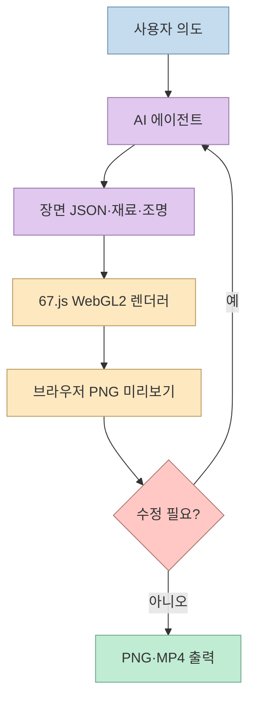
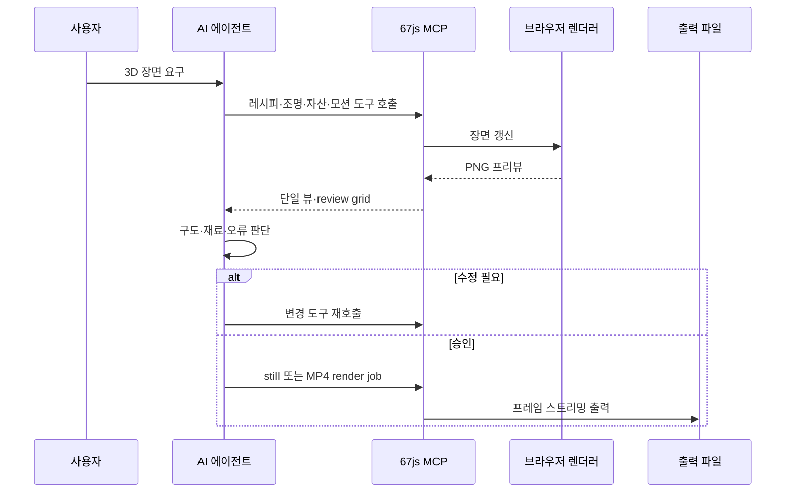
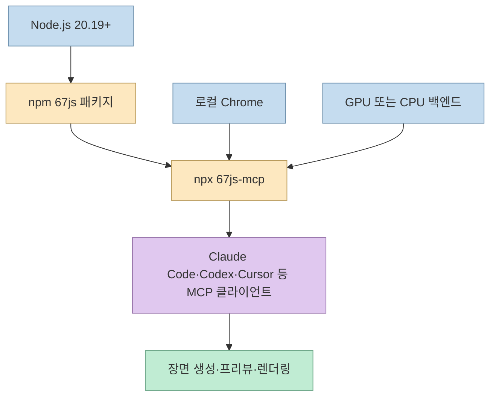
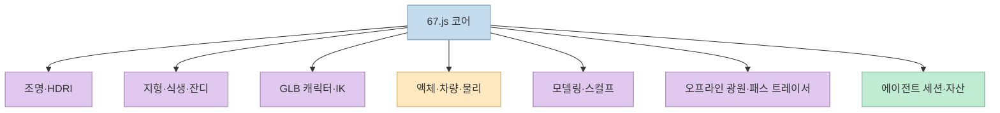

AI가 3D 코드를 매번 새로 작성하는 대신, 실행 중인 3D 장면을 직접 조작하고 결과를 눈으로 확인한다면 제작 루프가 달라진다. [Threads 게시물](https://www.threads.com/share/BAYzjxDoIe)이 소개한 `67.js`는 AI 에이전트가 MCP 도구로 장면 데이터를 편집하고 PNG 미리보기와 MP4 렌더링 결과를 받아 반복하는 WebGL2 엔진이다. 이 글은 [공식 저장소](https://github.com/codepawl/67.js)의 README를 기준으로 실제 구성과 한계를 정리한다.

<!--more-->

## Sources

- [입력 Threads 게시물](https://www.threads.com/share/BAYzjxDoIe)
- [67.js GitHub 저장소](https://github.com/codepawl/67.js)
- [67.js 공식 문서·에이전트 가이드](https://67js.codepawl.com/)

## 67.js의 핵심 모델: 장면은 코드가 아니라 데이터다

67.js는 WebGL2 렌더러와 terrain·vegetation·characters·liquid·vehicles·media export 애드온을 제공한다. 공식 README는 장면을 각 파트의 `geometry`, `matrix`, `material`로 표현되는 평범한 데이터로 설명한다. 에이전트는 이 데이터를 MCP 서버를 통해 만들고 변경하며, 렌더러가 그 결과를 브라우저에서 보여준다.



이 구조의 차이는 에이전트가 “새 코드를 생성해 빌드하고 결과를 추측”하는 데 머물지 않는다는 점이다. MCP 서버는 지속적인 브라우저 렌더러에 연결되고, 에이전트는 PNG 미리보기를 받아 여러 시점과 각도를 비교한다. 다만 저장소가 목표로 삼는 것은 Blender 수준의 기능성과 three.js 수준의 가벼움이며, 일반적인 속도 우위나 Blender와의 시각적 동등성을 입증한 것은 아니다([성능 한계](https://github.com/codepawl/67.js#performance-claims)).

## MCP 에이전트 루프와 23개 도구의 역할

Threads 게시물은 23개의 MCP 도구를 강조하지만, 저장소 README는 도구를 개별 숫자보다 기능 흐름으로 설명한다. 에이전트는 JSON 장면 레시피를 작성하고, 조명·안개를 설정하며, GLB 자산과 모션을 추가한다. 이후 최대 네 개의 뷰를 review grid로 받아 비교하고, still 또는 MP4 render job을 실행한다.



서버는 임의 코드를 실행하지 않고 원격 자산 URL도 받지 않는다. 대신 로컬 Chrome이 필요하고, GPU가 없으면 `--backend cpu`로 전환한다. 이 제한은 보안과 재현성 측면에서는 유리하지만, 에이전트가 웹에서 임의의 모델을 내려받아 실행하는 범용 자동화는 아니다([For agents](https://github.com/codepawl/67.js#for-agents)).

## 설치 경로: 에이전트에게 맡기거나 npm으로 직접 연결하기

공식 설치 프롬프트는 다음과 같다.

```text
Install 67js from npm as `67js@npm:@codepawlhq/67js` and connect its MCP server with `npx 67js-mcp`. Read https://67js.codepawl.com/llms.txt first and follow it.
```

Claude Code에서는 플러그인 마켓플레이스를 추가하고 `67js` 플러그인을 설치할 수도 있다.

```text
/plugin marketplace add codepawl/67.js
/plugin install 67js@67js
```

직접 설치할 때는 `npm install 67js@npm:@codepawlhq/67js`를 실행한다. 패키지는 ESM이며 도구는 Node.js 20.19 이상, 렌더링은 WebGL2 브라우저가 필요하다. MCP 서버는 `npx 67js-mcp --backend gpu --memory 192`로 시작하고 GPU가 없는 환경에서는 `--backend cpu`를 사용한다.



브라우저 사이트를 직접 개발하려면 저장소를 clone한 뒤 Node.js 22.12 이상에서 `npm ci`와 `npm run dev`를 실행한다. npm 패키지의 최소 Node 버전과 저장소 사이트의 개발 버전이 다르므로, 라이브러리 사용과 저장소 기여 환경을 구분해 준비해야 한다([Install](https://github.com/codepawl/67.js#install), [Run the site locally](https://github.com/codepawl/67.js#run-the-site-locally)).

## 애드온으로 확장하는 장면 데이터

핵심 엔진은 필요한 기능만 별도 import하도록 애드온을 분리한다. HDRI 조명, 청크 기반 지형, 바람과 LOD가 있는 식생, glTF 캐릭터·리타게팅·IK 포즈, 액체, 차량, Rapier 물리, 입력, 메쉬 편집·스컬프, path tracer와 light bake까지 선택적으로 추가할 수 있다. 에이전트 전용으로는 장면 세션과 체크포인트를 제공하는 `agent-scene`, 자산을 다루는 `agent-asset`이 있다.



각 애드온은 사용한 페이지만 로드하므로 작은 장면에서는 불필요한 기능을 피할 수 있다. 반면 애드온마다 가이드와 자산 포맷·성능 특성이 다르므로, 에이전트에게 “3D를 만들어 달라”고만 말하기보다 장면 목적, 예산, 필요한 애드온과 출력 형식을 명시해야 한다.

## PNG와 MP4 출력, 그리고 메모리 경계

이미지 렌더는 `npm run render -- --kind image --scene nature --backend gpu --preset high --output artifacts/nature.png`처럼 실행한다. 영상은 한 프레임씩 스트리밍하므로 전체 영상을 메모리에 올리지 않고 MP4를 만들 수 있다. 렌더 명령의 preset과 flag는 전용 render skill이 관리한다([Render images and video](https://github.com/codepawl/67.js#render-images-and-video)).

이 방식은 에이전트가 프리뷰와 최종 출력 사이를 분리하게 만든다. 먼저 낮은 비용의 PNG로 카메라·재료·조명을 검토한 뒤, 승인된 장면만 고화질 still이나 MP4로 렌더링하면 실패한 영상 전체를 반복 생성하는 비용을 줄일 수 있다. 다만 GPU/CPU 백엔드에 따라 결과와 속도가 달라질 수 있으므로 같은 하드웨어에서 성능을 비교해야 한다.

## 라이선스와 성능 주의사항

67.js 코드는 MIT 라이선스다. 그러나 쇼케이스 자산은 각 `scene.json`에 출처가 기록되고, Amazon Lumberyard Bistro는 CC BY 4.0, 일부 텍스처와 HDRI는 CC0 등 별도 조건을 가진다. 따라서 엔진 라이선스와 장면에 포함한 GLB·텍스처·HDRI의 라이선스를 분리해 관리해야 한다([Credits](https://github.com/codepawl/67.js#credits), [License](https://github.com/codepawl/67.js#license)).

README의 성능 검증은 동일 하드웨어에서 동일 장면을 비교한 결과이며, three.js보다 일반적으로 빠르다는 주장이나 Blender와 시각적으로 동등하다는 증거가 아니라고 명시한다. 따라서 제품에 도입할 때는 목표 장면을 정하고, GPU·CPU·메모리 예산·렌더 시간·이미지 품질을 자신의 벤치마크로 측정해야 한다.

## 핵심 요약

- 67.js는 AI 에이전트가 MCP로 장면 데이터를 조작하는 WebGL2 3D 엔진이다.
- 에이전트는 JSON 레시피·조명·GLB·모션을 적용하고 PNG 프리뷰와 review grid로 결과를 확인한다.
- `npx 67js-mcp`와 로컬 Chrome이 필요하며, GPU가 없으면 CPU 백엔드를 사용할 수 있다.
- terrain, vegetation, glTF, physics, modeling, path-tracer 등 애드온을 필요한 만큼 선택한다.
- still·MP4 렌더는 프레임 스트리밍으로 처리되지만, 성능 우위는 자신의 하드웨어와 장면에서 검증해야 한다.
- MIT 코드와 쇼케이스 자산의 개별 라이선스를 구분하고, 원격 URL·임의 코드 실행 제한을 이해해야 한다.

## 결론

67.js의 핵심 변화는 AI를 3D 코드 생성기로만 쓰지 않고, 실행 중인 장면을 관찰하고 수정하는 조작자로 연결한 데 있다. MCP와 PNG 프리뷰가 결합되면 에이전트는 장면을 만들고, 결과를 보고, 데이터 일부를 다시 고치는 폐쇄 루프를 갖는다. 다만 이 도구가 Blender를 대체한다는 결론보다, 반복 가능한 장면 데이터·검수·렌더링 파이프라인을 AI 친화적으로 만든 새로운 계층으로 이해하는 편이 정확하다.
