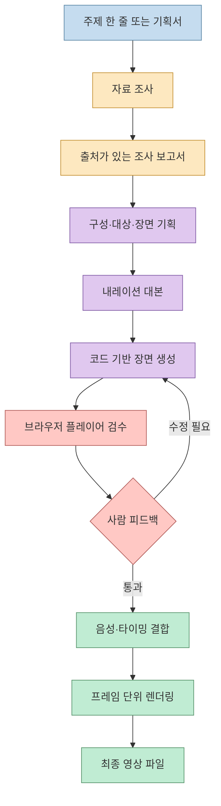
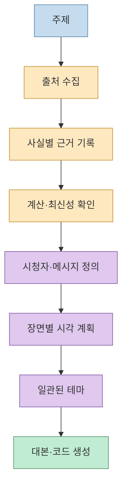
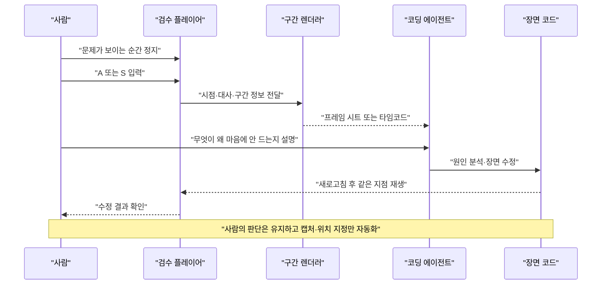
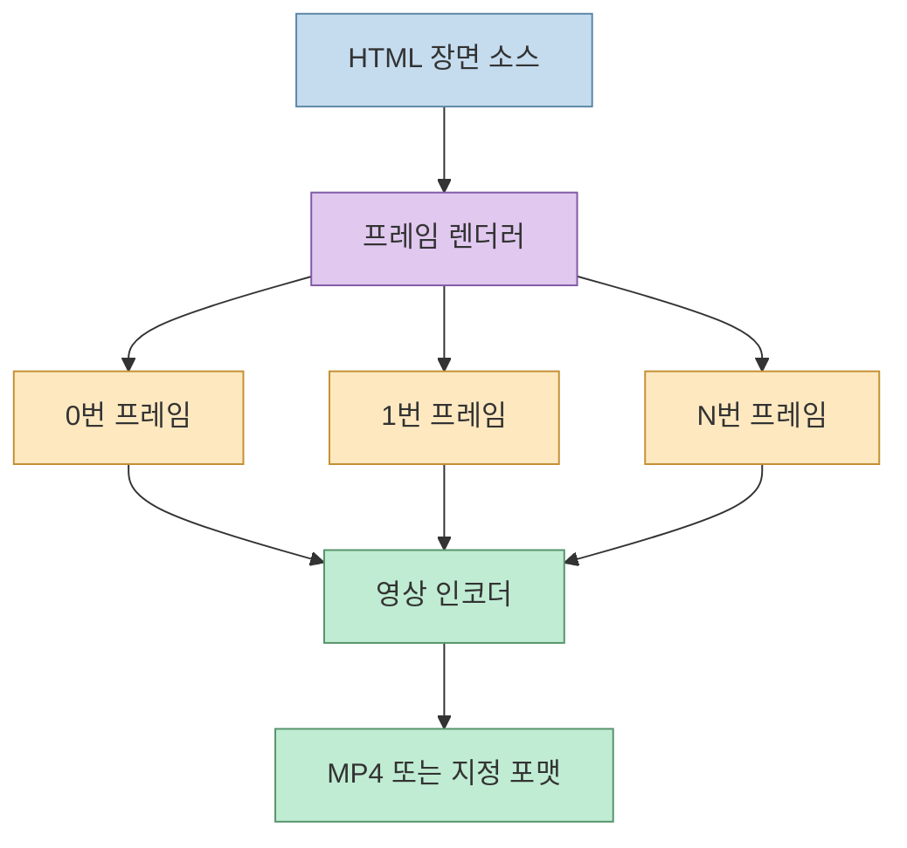
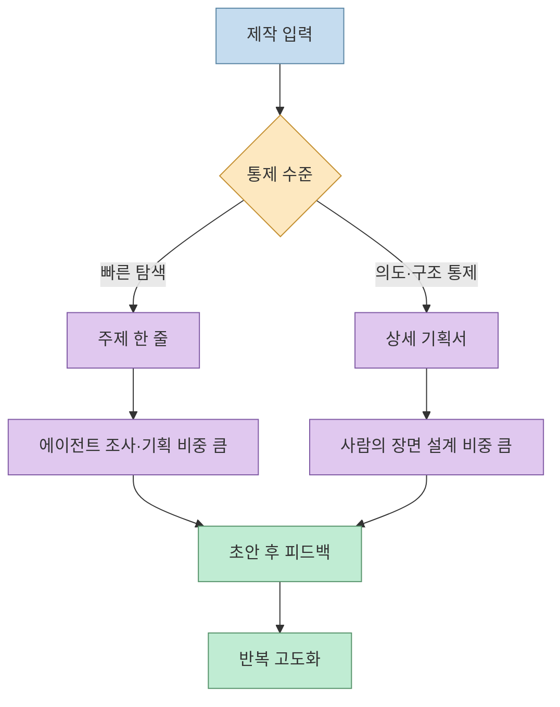

영상 한 편을 만들려면 주제 선정, 자료 조사, 대본 작성, 장면 설계, 애니메이션, 내레이션, 렌더링, 검수가 모두 필요합니다. 소개 영상은 이 과정을 Claude Code와 `script-to-motion` 스킬로 연결해 **주제 한 줄에서 시작해 브라우저에서 재생되는 코드 기반 영상을 만들고, 사람이 피드백한 뒤 최종 파일로 렌더링하는 루프**를 보여줍니다.

<!--more-->

핵심은 “한 번의 프롬프트로 완성품을 만든다”가 아닙니다. 영상은 한 줄 입력으로도 초안이 나오지만, 장면을 직접 보고 수정 지시를 반복할수록 결과가 좋아진다고 설명합니다([00:00:26](https://youtu.be/zprZqlNpE9M?t=26), [00:11:40](https://youtu.be/zprZqlNpE9M?t=700)). 이 글은 그 과정을 재현 가능한 제작 파이프라인으로 분해합니다.

## Sources

- 원문 YouTube: [클로드 오퍼스 5.5, 페이블 5.2로 모션 그래픽 영상 기가막히게 만드는 무료 스킬 공개](https://youtu.be/zprZqlNpE9M?si=Kc1WwXDHHINarFRu)

## 전체 파이프라인: 주제에서 렌더링까지

영상에서 설명하는 준비물은 코딩 에이전트와 `script-to-motion` 스킬입니다. 이 스킬은 스크립트를 받아 영상으로 만드는 것을 목표로 하며, 주제만 주고 조사·기획·대본까지 맡기는 방식도 가능하다고 설명됩니다([01:25](https://youtu.be/zprZqlNpE9M?t=85), [01:40](https://youtu.be/zprZqlNpE9M?t=100)).

## 1. 설치: 에이전트가 스킬과 실행 환경을 점검한다

영상의 시연은 빈 폴더에서 Claude Code를 열고 스킬 저장소 주소를 주어 설치하는 방식입니다. 에이전트는 저장소와 필요한 패키지를 받고, 영상을 표시할 브라우저 환경까지 점검한 뒤 설치 완료를 보고합니다([02:00](https://youtu.be/zprZqlNpE9M?t=120), [02:10](https://youtu.be/zprZqlNpE9M?t=130)). 설치 직후 현재 화면에 스킬이 보이지 않으면 Claude Code를 재시작해야 목록에 나타난다는 점도 함께 설명합니다([02:20](https://youtu.be/zprZqlNpE9M?t=140)).

이 단계에서 중요한 것은 “스킬 파일을 복사했다”와 “실행에 필요한 브라우저·패키지까지 준비됐다”를 구분하는 것입니다. 영상의 방식처럼 설치 에이전트에게 환경 점검을 맡기더라도, 실제 프로젝트에서는 다음을 기록해 두는 편이 좋습니다.

- 스킬 버전 또는 커밋
- Node·Python·브라우저 버전
- 렌더링에 필요한 패키지와 실행 명령
- 음성 서비스의 API 키를 저장할 위치

## 2. 주제 한 줄로 만드는 초안

시연에서는 “1초는 누가 어떻게 정했을까”라는 문장만 전달하고 길이와 분위기는 지정하지 않습니다. 에이전트는 주제를 조사하고, 자료를 바탕으로 기획과 대본을 만든 뒤 영상 폴더를 생성합니다([02:38](https://youtu.be/zprZqlNpE9M?t=158), [02:48](https://youtu.be/zprZqlNpE9M?t=168)). 출력은 처음부터 MP4가 아니라 `index.html`을 중심으로 한 웹 페이지 묶음입니다. 브라우저에서 로딩이 끝나면 바로 재생되며, 영상의 장면과 타이밍이 코드로 표현됩니다([02:53](https://youtu.be/zprZqlNpE9M?t=173), [03:10](https://youtu.be/zprZqlNpE9M?t=190)).

영상은 이 초안이 “그럭저럭 볼 만한” 수준에서 출발한다고 표현합니다. 따라서 한 줄 프롬프트는 최종 연출 지시서라기보다 **조사·구성·장면 생성을 시작하는 트리거**로 이해해야 합니다.

## 3. 조사와 기획을 코드 생성 앞에 둔다

영상에서 설명하는 내부 흐름은 다음과 같습니다.

1. 주제와 관련된 자료를 조사합니다.
2. 영상에 들어갈 사실마다 출처를 확인하고 Markdown 보고서로 정리합니다.
3. 필요하면 조사된 데이터로 계산합니다.
4. 최신 정보가 기존 내용을 바꾸는지 확인하고 낡은 정보를 교체합니다.
5. 누가 보고 무엇을 얻어 갈지, 장면마다 무엇을 보여줄지 기획합니다.
6. 시각 테마를 정해 영상 전체에 일관되게 적용합니다.

이 설명은 [03:24~04:01](https://youtu.be/zprZqlNpE9M?t=204) 구간에 나옵니다. 즉, 모션 그래픽 스킬은 단순히 “문장을 장면으로 바꾸는 템플릿”이 아니라 **근거 수집 → 서사 설계 → 장면 구현**을 하나의 에이전트 작업으로 묶는 방식입니다.

## 4. 대본과 코드 장면을 함께 설계한다

대본은 듣기에 자연스럽게 쓰고, 숫자는 의미를 풀어 설명하며, 처음 나오는 용어는 쉬운 말로 바꿉니다([04:03](https://youtu.be/zprZqlNpE9M?t=243)). 장면을 만들 때는 기존 영상 효과 스킬의 원리를 재사용하되, 주제에 맞게 새 장면으로 구성한다고 설명합니다([04:12](https://youtu.be/zprZqlNpE9M?t=252)).

결과물은 동영상 파일이 아니라 HTML 기반 장면 묶음입니다. 영상은 이 방식의 장점으로 4K에서도 글자가 또렷하고, 대본을 고치면 장면 타이밍도 다시 계산된다는 점을 소개합니다([04:23](https://youtu.be/zprZqlNpE9M?t=263)). 이는 프레임을 편집 프로그램에서 직접 옮기는 대신, **대본·타임라인·렌더링 코드를 하나의 소스 오브 트루스로 두는 접근**입니다.

## 5. 브라우저 플레이어를 검수 도구로 사용한다

스킬이 제공하는 플레이어는 버튼보다 키보드 중심입니다. 영상에서 설명한 조작은 다음과 같습니다([05:20~06:29](https://youtu.be/zprZqlNpE9M?t=320)).

- `Space`: 일시 정지·재생
- `←` / `→`: 0.5초 이동
- `Shift` + 화살표: 5초 이동
- `0`: 처음으로 이동
- `,` / `.`: 정지 상태에서 한 프레임씩 이동
- `Shift` + 꺾쇠: 재생 속도 조정
- `C`: 자막 켜기·끄기
- `F`: 전체 화면
- `R`: 1배속으로 처음부터 재생

여기서 재생 속도 조정은 영상 파일 자체를 바꾸는 것이 아니라 빠르게 훑어보기 위한 기능입니다. 이 구분이 있어야 검수용 플레이어의 속도와 최종 영상의 시간축을 혼동하지 않습니다.

## 6. A/S 단축키로 장면 피드백을 구조화한다

영상의 가장 실용적인 부분은 문제 장면을 에이전트에게 전달하는 방식입니다. 재생 중 문제가 보이면 `A`를 눌러 현재 시점 앞뒤 1초를 이미지로 캡처하라는 명령을 복사합니다. 내부적으로는 `render.py`가 2초 구간을 10프레임 간격으로 렌더링해 한 장의 시트로 묶고, 에이전트는 각 칸의 프레임 번호·시각·대사 번호를 함께 봅니다([07:10~07:57](https://youtu.be/zprZqlNpE9M?t=430)).

시연에서는 장면 시작 전에 금빛 조각을 숨기지 않아 세 개가 일찍 나타난 문제를 시트에서 찾아 수정합니다([08:07~08:22](https://youtu.be/zprZqlNpE9M?t=487)). `S`는 화면보다 대사나 타이밍을 고칠 때 사용하며, 영상의 시점과 해당 대사가 한 줄로 복사됩니다([08:35](https://youtu.be/zprZqlNpE9M?t=515)).

이 방식의 핵심은 “영상 전체를 다시 설명하는 것”이 아니라 **문제 시점과 시각 증거를 함께 전달하는 것**입니다. 에이전트가 장면을 직접 볼 수 있게 만들면 “여기 이상해”라는 모호한 지시가 구체적인 프레임 분석으로 바뀝니다.

## 7. 화면 녹화 대신 프레임 단위로 최종 렌더링한다

영상은 브라우저를 녹화할 때 계산량이 많은 장면에서 프레임이 빠질 수 있다고 설명합니다([08:50](https://youtu.be/zprZqlNpE9M?t=530)). 그래서 최종 파일이 필요하면 검수 시트에 사용한 렌더러를 영상 폴더에서 실행해 한 프레임씩 그립니다. 화면 캡처가 아니라 프레임을 순서대로 생성하므로 녹화 중 프레임 드롭을 피할 수 있고, 480p부터 4K까지 해상도를 고를 수 있다고 안내합니다([09:00~09:13](https://youtu.be/zprZqlNpE9M?t=540)).

## 8. TTS는 대본 승인 뒤에 연결한다

영상의 초기 결과는 자막만 있고 목소리는 없는 상태입니다. 이후 음성 합성 서비스의 보이스 ID와 API 키를 전달하면 에이전트가 내레이션 오디오를 만들고, 녹음된 단어가 실제로 시작하는 시점을 측정해 화면의 숫자와 강조 효과를 맞춥니다([09:24~10:35](https://youtu.be/zprZqlNpE9M?t=564)). 다른 TTS를 쓰고 싶다면 해당 서비스 문서를 에이전트에게 제공해 교체할 수 있다고 설명합니다.

이 흐름에서 “대본을 먼저 확인하고 녹음하라”고 승인하는 단계가 중요합니다. 영상은 대본이 완성되기 전에 음성을 반복 생성하면 음성 서비스 크레딧을 낭비한다고 지적합니다([10:03](https://youtu.be/zprZqlNpE9M?t=603)). 또 에이전트는 음성을 직접 듣지 못하므로, 발음·호흡·강조가 어색한 부분은 사람이 듣고 다시 알려줘야 합니다([10:35](https://youtu.be/zprZqlNpE9M?t=635)).

## 9. 디자인 검수 에이전트와 사람의 검수

영상은 사람이 장면을 직접 보고 고치는 수동 루프와, 별도의 디자인 검수 에이전트가 화면을 평가하는 자동 루프를 함께 보여줍니다. 검수 에이전트는 연출·그래픽 디자인·모션을 5점 만점으로 평가하고 점수가 낮은 장면은 다시 설계하며, 모든 부분이 4점을 넘거나 정해진 반복 횟수에 도달할 때까지 반복한다고 설명합니다([11:45~12:06](https://youtu.be/zprZqlNpE9M?t=705)).

하지만 영상은 자동 점수만으로 충분하지 않다고 분명히 말합니다. 가치 있는 콘텐츠에는 제작자의 의도가 담겨야 하므로 사람이 직접 보고 의견을 공유해야 합니다([04:54~05:09](https://youtu.be/zprZqlNpE9M?t=294)). 자동 검수는 누락된 시각 문제를 찾는 보조 장치이고, 사실의 중요도·톤·전달력은 사람이 결정하는 구조가 안전합니다.

## 10. 결과물의 수준을 높이는 두 가지 입력 방식

영상 후반에는 같은 스킬을 두 가지 방식으로 사용하는 예시가 나옵니다.

### 주제 한 줄

“1초는 누가 어떻게 정했을까”처럼 주제만 주면 에이전트가 조사부터 기획까지 맡습니다. 빠르게 초안을 얻는 데 유리하지만, 시청자·길이·분위기·마지막 메시지를 세밀하게 통제하기는 어렵습니다([02:38](https://youtu.be/zprZqlNpE9M?t=158)).

### 구조화된 기획서

공룡 멸종 영상에서는 대상 시청자, 길이와 분위기, 장면 흐름, 마지막 문장까지 적은 기획서를 먼저 전달하고 여러 차례 수정합니다([15:47~16:04](https://youtu.be/zprZqlNpE9M?t=947)). 이 방식은 첫 결과부터 방향을 좁히고, 사람의 의도를 장면 설계에 더 많이 반영하는 데 유리합니다.

## 실무 적용 체크리스트

영상의 시연을 실제 프로젝트에 적용할 때는 다음 순서를 권장합니다.

1. 먼저 주제와 시청자를 한 문단으로 고정합니다.
2. 에이전트가 만든 조사 보고서에서 사실별 출처를 확인합니다.
3. 대본과 장면 계획을 승인한 뒤 모션 코드를 생성합니다.
4. 브라우저 플레이어에서 문제 시점마다 `A` 또는 `S`로 피드백합니다.
5. 대본이 안정된 뒤에만 TTS를 실행합니다.
6. 브라우저 녹화는 미리보기로만 사용하고, 최종본은 프레임 렌더러로 만듭니다.
7. 자동 디자인 점수와 사람의 편집 판단을 함께 기록합니다.
8. 최종 MP4와 함께 조사 보고서·대본·장면 코드·음성 라이선스를 보관합니다.

## 핵심 요약

- `script-to-motion`은 주제나 스크립트를 HTML 기반 모션 그래픽으로 확장하는 에이전트 스킬입니다.
- 조사 보고서와 기획을 먼저 만들고, 대본과 장면 코드를 연결해 결과물을 생성합니다.
- 초안은 브라우저 플레이어에서 확인하며, `A`는 시각 구간 캡처, `S`는 대사·타이밍 피드백을 위한 단축키입니다.
- 최종 렌더링은 화면 녹화보다 프레임 단위 렌더러가 안정적입니다.
- TTS는 대본 승인 뒤 실행하고, 음성 타이밍은 자동 정렬 후 사람이 직접 청취해야 합니다.
- 자동 디자인 검수는 반복 작업을 줄이지만, 콘텐츠의 의도와 최종 품질 판단을 대체하지 않습니다.

## 결론

이 영상이 보여주는 변화는 “AI가 영상을 한 번에 만든다”가 아니라 **영상 제작의 중간 산출물을 에이전트가 다루기 쉬운 코드와 증거로 바꾼다**는 점입니다. HTML 장면, 프레임 시트, 타임코드, 조사 보고서가 모두 남기 때문에 사람은 모호한 재작업 대신 정확한 지점에 의견을 줄 수 있습니다.

가장 현실적인 시작점은 주제 한 줄로 짧은 초안을 만든 뒤, 플레이어에서 문제를 발견할 때마다 구간 캡처와 한 문장 피드백을 남기는 것입니다. 대본·장면·음성을 분리해 승인하고, 마지막에 프레임 렌더링을 수행하면 자동화의 속도와 사람의 편집 감각을 함께 유지할 수 있습니다.
