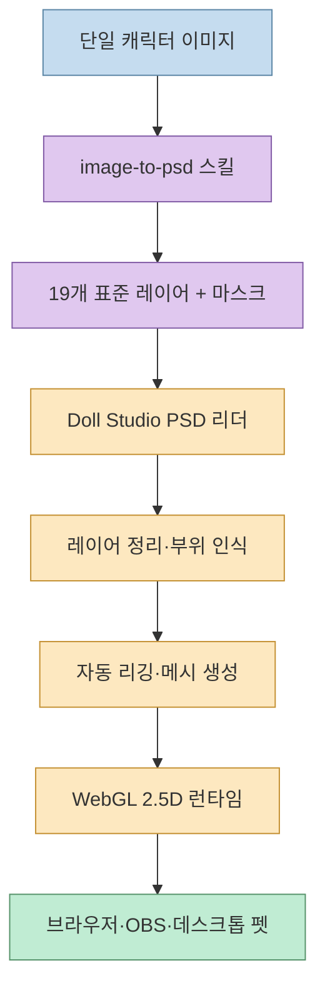
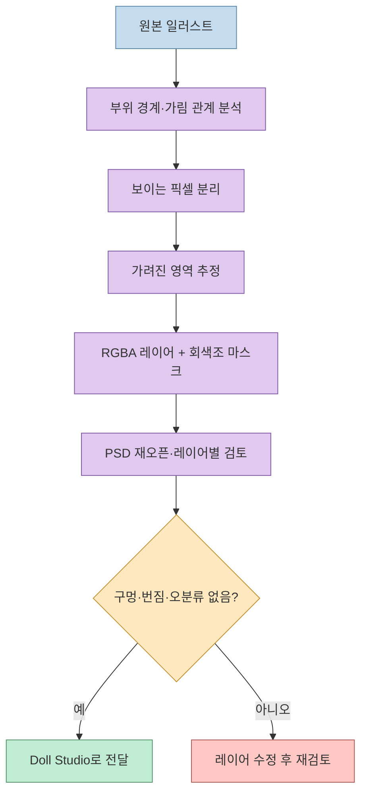
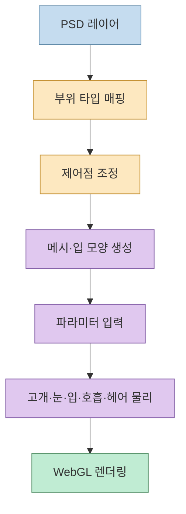
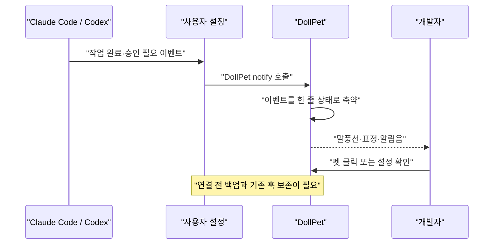

Live2D처럼 별도 편집기를 먼저 배우지 않고도, 한 장의 캐릭터 이미지를 움직이는 2D 캐릭터로 만들 수 있을까요? Threads에서 소개된 **Doll Studio**는 레이어드 PSD를 입력으로 받아 브라우저에서 리깅하고, 립싱크·얼굴 추적·데스크톱 펫까지 연결하는 오픈소스 프로젝트입니다.

<!--more-->

중요한 점은 Doll Studio가 마법처럼 평면 이미지를 완성된 리그로 바꾸는 단일 모델이 아니라는 것입니다. `image-to-psd`가 먼저 이미지를 부위별 레이어와 마스크로 분리하고, Doll Studio가 그 레이어 이름을 해석해 메시와 런타임 파라미터를 구성합니다. 이 두 단계를 나누어 보면 자동화가 편리한 이유와 사람이 검수해야 하는 지점이 동시에 보입니다.

## Sources

- 원문 Threads: [Introducing Doll Studio](https://www.threads.com/share/_zYrhrnXl)
- Doll Studio 저장소: [link-ding/doll-studio](https://github.com/link-ding/doll-studio)
- image-to-psd 저장소: [link-ding/image-to-psd](https://github.com/link-ding/image-to-psd)

## Doll Studio의 전체 구조



Doll Studio README에 따르면 프로젝트는 PSD/PSB 리더, 레이어 정리, 자동 리깅, WebGL 렌더러, 립싱크, 얼굴 추적, `.doll` 모델 포맷을 각각 모듈로 나눕니다. 즉, “PSD를 읽는다”와 “캐릭터를 움직인다” 사이에 여러 검증 가능한 단계가 있습니다.

## 입력은 PSD이고, 핵심은 레이어 이름이다

자동 리깅은 그림의 의미를 무한히 이해하는 것이 아니라, 정해진 부위와 레이어 규칙을 해석하는 방식입니다. `front hair`, `eyewhite`, `irides` 같은 이름은 Doll Studio가 인식하는 역할과 연결됩니다. 레이어가 잘못 분류되면 편집기에서 부위 타입을 다시 지정하고 리그를 재생성할 수 있습니다.

`image-to-psd`는 PNG·JPG·SVG 한 장에서 다음과 같은 19개 표준 부위를 만듭니다.

- 머리카락: `back hair`, `front hair`
- 얼굴과 눈: `face`, `eyewhite`, `irides`, `eyelash`, `eyebrow`, `nose`, `mouth`
- 신체와 의상: `ears`, `neck`, `topwear`, `bottomwear`, `legwear`, `footwear`
- 장식과 소품: `earwear`, `headwear`, `handwear`, `objects`

그림에서 보이지 않는 부분도 추정해 채웁니다. 예를 들어 앞머리 아래의 얼굴, 머리 뒤쪽의 헤어, 홍채 아래의 흰자처럼 고개를 돌릴 때 드러나는 영역이 대상입니다. 이 부분은 원본에 존재하는 픽셀이 아니라 추론된 결과이므로, 최종 캐릭터의 품질을 결정하는 검수 지점이 됩니다.



## Doll Studio가 PSD를 캐릭터로 바꾸는 과정

편집기를 열면 먼저 PSD를 읽고, 레이어 이름에 따라 부위를 분류합니다. 그 다음 머리 중심, 머리 반지름, 목 피벗, 양쪽 눈꺼풀 선과 같은 제어점을 조정합니다. 사용자는 잘못 추정된 부위의 타입을 바꾸거나, Touch up 도구로 지우기·덮기·다른 레이어로 이동·복원을 수행할 수 있습니다.

런타임은 레이어를 단순히 평면 이동시키는 대신 메시 변형 파라미터로 처리합니다. README가 설명하는 동작에는 2.5D 고개 회전, 깜빡임, 안구 움직임, 입 모양, 호흡, 머리카락 물리가 포함됩니다. 따라서 결과는 완전한 3D 모델이 아니라 **레이어 이미지와 메시 변형을 조합한 2.5D 캐릭터**로 이해하는 편이 정확합니다.



## 브라우저에서 실행하고 OBS에 연결하기

저장소는 브라우저 ES 모듈을 로컬 서버에서 실행하는 방법을 제공합니다.

```bash
cd doll-studio
python3 -m http.server 8765
```

그 다음 `http://localhost:8765`를 열고 PSD를 드롭하면 됩니다. 얼굴 추적을 사용하려면 저장소의 MediaPipe 파일이 필요하며, 처음 추적을 켤 때 WebAssembly 초기화가 발생합니다. 이 프로젝트는 외부 서버로 이미지를 업로드하는 SaaS가 아니라, README가 설명하듯 브라우저와 데스크톱에서 로컬 실행을 지향합니다.

Player는 `.doll` 파일을 읽고, OBS에서는 투명 배경 Browser Source로 연결할 수 있습니다. 립싱크를 켜면 마이크 입력의 주파수 특성을 바탕으로 입 모양을 바꿉니다. 이 방식은 방송용 아바타에 유용하지만, 마이크 권한·오디오 장치·브라우저 캡처 설정은 사용 환경에서 별도로 확인해야 합니다.

## 데스크톱 펫과 개발 에이전트 알림

Electron 기반 DollPet은 Windows와 macOS용 데스크톱 앱으로 제공됩니다. 투명하고 항상 위에 있는 창, 커서 시선 추적, 립싱크, 얼굴 추적, 배경화면 모드 등을 제공합니다. 원문이 강조한 “Claude Code나 Codex 작업이 끝나면 알려주는 펫”은 프로젝트의 작업 알림 기능입니다.

연결할 때는 기존 설정 파일을 무작정 덮어쓰는 것이 중요하지 않습니다. README에 따르면 Claude Code에는 `Stop`·`Notification` 훅을, Codex에는 `notify` 설정을 추가하고, 변경 전 백업을 만들며 기존 알림 프로그램도 함께 실행하도록 처리합니다. 그래도 개인 설정 파일을 수정하는 기능인 만큼, 연결 전에 설정을 커밋하거나 별도 백업하는 것이 안전합니다.



## 설치와 실행을 분리해서 시작하기

가장 작은 검증은 완성된 데스크톱 앱보다 웹 편집기부터 실행하는 것입니다.

1. `doll-studio`와 `image-to-psd` 저장소의 README와 라이선스를 확인합니다.
2. 테스트용으로 권리를 가진 캐릭터 이미지를 준비합니다.
3. `image-to-psd` 스킬을 설치하고 19개 레이어 PSD를 생성합니다.
4. PSD를 다시 열어 머리카락 아래 얼굴과 눈 주변의 빈틈을 확인합니다.
5. 로컬 서버에서 Doll Studio 편집기로 PSD를 열고 부위 타입과 제어점을 수정합니다.
6. `.doll`과 단일 HTML을 내보낸 뒤 Player와 OBS에서 재생합니다.
7. 마지막에만 Electron 앱과 Claude Code·Codex 알림 연결을 켭니다.

`image-to-psd` 저장소는 스킬 설치 명령과 함께 Pillow, NumPy, `psd-tools` 같은 Python 패키지가 export 스크립트에 필요하다고 안내합니다. SVG 입력을 사용할 때는 `cairosvg`도 추가됩니다. 환경을 가볍게 유지하려면 처음부터 전역 설치하기보다 테스트 프로젝트에서 동작을 확인한 뒤 팀 표준으로 고정하는 편이 좋습니다.

## 자동화의 한계와 품질 체크

`image-to-psd` README는 이 스킬이 레이어 분할과 PSD export를 제공하지만, 어떤 그림에서도 원클릭으로 프로덕션급 리깅 품질을 보장하지 않는다고 명시합니다. 따라서 다음 항목은 사람이 확인해야 합니다.

- 앞머리·눈·입의 레이어 경계가 자연스러운가
- 고개를 돌릴 때 추정된 가림 영역에 구멍이 생기지 않는가
- 손에 든 물체가 신체 앞뒤 레이어로 올바르게 분리되었는가
- 표정 변화에서 눈꺼풀과 입 마스크가 번지지 않는가
- 얼굴 추적을 끄거나 카메라 권한이 없을 때도 기본 애니메이션이 동작하는가
- 방송 화면에서 해상도와 투명 배경이 안정적인가

이 프로젝트는 아직 손으로 메시를 편집하는 기능, 표현식 프리셋, 모션 녹화, 분리된 팔·몸통용 본을 “완료되지 않은 항목”으로 남겨 두고 있습니다. 그래서 전신 애니메이션이나 복잡한 키프레임 연출이 목표라면 Doll Studio의 현재 범위를 먼저 확인해야 합니다.

## 핵심 요약

- Doll Studio는 레이어드 PSD를 읽어 2.5D 캐릭터로 재생하는 로컬 웹·데스크톱 도구입니다.
- `image-to-psd`는 단일 PNG·JPG·SVG를 19개 표준 부위의 PSD로 분리하고, 가려진 영역을 추정해 마스크를 만듭니다.
- 자동 리깅의 품질은 레이어 이름, 가림 영역, 제어점 검수에 크게 좌우됩니다.
- 결과물은 `.doll`, 단일 HTML, OBS Browser Source, Windows/macOS 데스크톱 펫으로 이어집니다.
- Claude Code와 Codex 알림 연동은 편리하지만 사용자 설정 파일을 수정하므로 백업 후 연결해야 합니다.
- 원클릭 프로덕션 품질을 보장하는 도구가 아니므로 얼굴·헤어·소품 레이어를 직접 확인해야 합니다.

## 결론

Doll Studio의 핵심 아이디어는 “그림을 바로 애니메이션화”하는 데 있지 않습니다. **이미지를 의미 있는 레이어 계약으로 바꾸고, 그 계약을 런타임이 해석하게 만드는 것**에 있습니다. 이 구조 덕분에 브라우저 편집기, OBS 아바타, 데스크톱 펫, 개발 작업 알림을 하나의 `.doll` 포맷으로 연결할 수 있습니다.

단일 일러스트를 가볍게 움직여 보고 싶다면 `image-to-psd` → PSD 검수 → Doll Studio 웹 편집기 순서로 시작하는 것이 가장 안전합니다. 결과가 마음에 든 뒤에만 얼굴 추적, OBS, Electron 알림을 추가하면 디버깅 범위를 단계적으로 통제할 수 있습니다.
