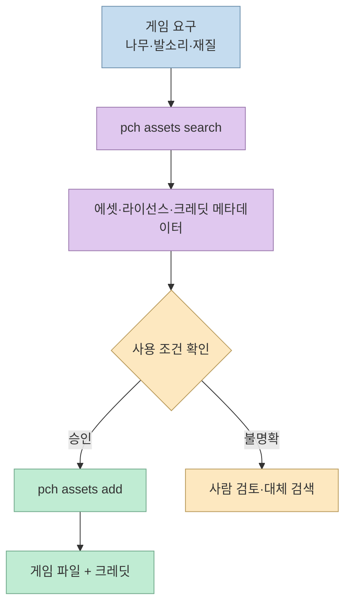
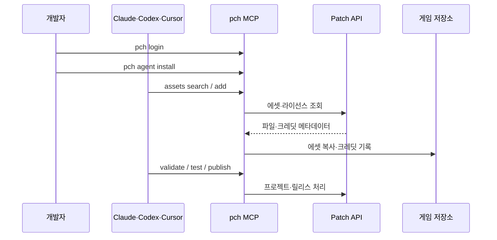
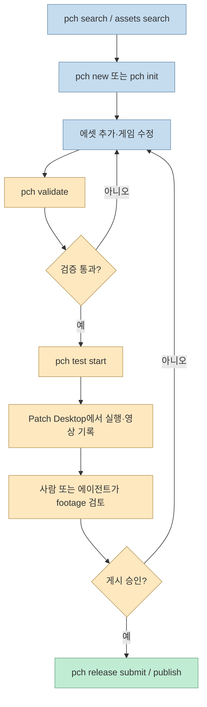

게임을 만들 때 나무 모델, 발소리, 재질, 효과음을 찾고 라이선스와 크레딧을 기록하는 일은 코드 작성만큼 오래 걸린다. [Threads 게시물](https://www.threads.com/share/BAnGW_aMgn)이 소개한 **Patch**는 이 과정을 `pch` CLI와 MCP로 코딩 에이전트에게 연결한다. 공식 사이트와 문서를 기준으로 보면 Patch는 단순한 에셋 검색기가 아니라, 에셋·게임·모드·배포를 하나의 프로젝트 흐름으로 묶는 플랫폼이다.

<!--more-->

## Sources

- [입력 Threads 게시물](https://www.threads.com/share/BAnGW_aMgn)
- [Patch 공식 사이트](https://patch.gg/)
- [Patch `pch` CLI 문서](https://docs.patch.gg/cli)
- [Patch 시작하기 문서](https://docs.patch.gg/get-started)

## Patch가 해결하려는 문제: 검색보다 사용 가능한 출처 관리

Patch 사이트는 3D 모델·캐릭터·텍스처·재질·사운드 효과 등 5만 개 이상의 게임용 오픈소스 에셋을 제공한다고 설명한다. 각 항목에는 라이선스와 크레딧 문구가 붙어 있고, 사용자는 직접 검색하거나 에이전트가 게임에 필요한 것을 가져오게 할 수 있다. Threads의 “나무와 발소리를 찾아 넣어 달라”는 요청은 이 카탈로그를 자연어 작업으로 바꾸는 예다.

중요한 점은 “무료”와 “아무 조건 없음”을 구분하는 것이다. `pch assets search`는 에셋을 찾고, `pch assets add`는 파일을 게임에 복사하면서 각 파일의 라이선스와 크레딧을 추가한다. 그래도 최종 배포자는 에셋별 조건, 상업적 사용 범위, 저작자 표기 위치를 확인해야 한다. 자동 크레딧은 누락을 줄이는 장치이지 법적 검토를 대신하지 않는다.



## `pch` CLI와 MCP가 에이전트에 붙는 방식

`pch`는 Patch 프로젝트를 찾고, 만들고, 검증하고, 게시하고, 로컬에서 테스트하는 명령줄 도구다. `pch agent install`은 현재 컴퓨터에서 찾은 코딩 에이전트의 MCP 설정에 Patch 서버를 추가하고, Patch의 역할을 설명하는 스킬도 설치한다. MCP 서버는 `pch mcp`로 실행되며, 에이전트 설정에는 키 자체가 아니라 명령만 남기고 인증은 `pch`가 관리한다.



공식 문서는 macOS·Linux·WSL에서 `curl -fsSL https://patch.gg/install.sh | sh`, Windows PowerShell에서 `irm https://patch.gg/install.ps1 | iex`로 설치할 수 있다고 안내한다. 설치 프로그램은 SHA-256을 확인하고 `~/.pch/bin`을 PATH에 추가한 뒤 에이전트 설치를 실행한다. Node 20 이상이면 `npm install -g @patchgg/cli` 방식도 사용할 수 있다. 설치 후에는 새 터미널에서 `pch login`을 실행해야 한다.

```bash
# macOS, Linux, WSL
curl -fsSL https://patch.gg/install.sh | sh
pch login
pch agent install

# Windows PowerShell
irm https://patch.gg/install.ps1 | iex
pch login
pch agent install
```

셸에서 원격 설치 스크립트를 실행하는 방식은 편리하지만, 실제 운영 환경에서는 스크립트 내용을 검토하거나 npm 설치를 선택하고, 설치 후 `pch --help`와 버전을 확인하는 편이 안전하다. `pch`는 API 키를 명령 인자나 git remote URL에 넣지 않고 별도 설정과 credential helper로 관리한다.

## 에셋 추가부터 게임 게시까지의 전체 루프

Patch의 CLI 문서는 다음과 같은 흐름을 제공한다. 로그인 없이도 `pch search`와 `pch assets search`로 시작할 수 있고, 새 프로젝트는 `pch new owner/slug` 또는 기존 폴더에서 `pch init`으로 초기화한다. `pch validate`는 `patch.json`과 릴리스 파일·레시피를 검사하고, `pch check`는 브라우저 게임을 실행해 관찰 결과를 제공한다.



`pch publish`는 업로드만 하지 않는다. Patch Desktop에서 로컬 테스트를 수행하고, 실행 영상을 저장해 검토하게 한 뒤 릴리스 리뷰로 넘긴다. 브라우저 게임이나 Patch가 설치하는 모드는 PC에서 실행·기록되며, 사용자가 footage를 확인한 뒤 `--review pass`로 계속 진행한다. 이 구조는 에이전트가 코드를 만들었다고 곧바로 공개하지 않고, 실행 결과를 확인하는 배포 게이트를 둔다는 점에서 중요하다.

## `patch.json`과 모드의 파일 매핑

Patch 프로젝트의 `patch.json`은 프로젝트 이름·버전·채널·릴리스 파일 폴더·레시피를 정의한다. 브라우저 게임은 `index.html`이 있으면 별도 레시피가 필요 없지만, PC 게임 모드는 어떤 게임과 스토어를 대상으로 어떤 파일을 어디에 복사할지 매핑해야 한다. 이 파일은 에이전트가 “게임을 수정한다”는 작업을 구체적인 파일 배치 규칙으로 바꾸는 계약이다.

```json
{
  "project": "you/demo-mod",
  "version": "0.1.0",
  "channel": "public",
  "files": "files",
  "recipe": {
    "games": [{"game": "hollow-knight", "stores": ["steam"]}],
    "mappings": [
      {"component": "main", "from": "DemoMod/", "to": "{game}/hollow_knight_Data/Managed/Mods/DemoMod"}
    ]
  }
}
```

버전은 SemVer이고, 같은 버전은 한 번만 게시된다. 채널은 private·unlisted·public 중 하나이며, `--channel`로 덮어쓸 수 있다. 따라서 초기에는 private로 만들고 `pch guide`와 `pch validate`를 확인한 뒤 공개하는 것이 안전하다. Patch 저장소가 공개되면 되돌릴 수 없다는 문서 경고도 있으므로, 실험 프로젝트와 배포 프로젝트를 분리하는 편이 좋다.

## 플랫폼 차이와 보안 경계

Patch Desktop은 현재 Windows 앱이고, 브라우저 게임은 웹에서 실행된다. macOS 사용자는 데스크톱 앱 대기 목록에 등록해야 하지만, `pch` CLI 자체는 Windows·macOS·Linux에서 동일하게 동작한다. Threads가 언급한 Windows SmartScreen과 Smart App Control 경고도 공식 문서에 설명되어 있다. SmartScreen은 새 게시자에 대한 경고이며, Smart App Control이 설치를 막으면 Windows Security에서 기능을 꺼야 한다. 단, Smart App Control은 Windows를 다시 설치하기 전까지 자동으로 켜지지 않는다고 문서가 명시하므로, 회사 PC 정책에서는 임의로 끄지 말고 관리자와 검토해야 한다.

MCP 서버와 CLI는 Patch API만 통신하고, `pch` 인증 키를 에이전트 설정에 직접 저장하지 않는다. CI에서는 `PCH_TOKEN` 환경 변수로 토큰을 주입할 수 있으며, 토큰은 시크릿으로 보관해야 한다. `pch` 종료 코드도 성공·일반 오류·검증 차단·인증 부족·충돌·사람의 결정 필요를 구분하므로, 자동화 파이프라인에서는 0만 확인하지 말고 `--json` 결과의 `next`와 오류 코드를 처리해야 한다.

## 핵심 요약

- Patch는 5만 개 이상의 게임용 에셋을 라이선스·크레딧 메타데이터와 함께 제공하고, 에이전트 검색을 지원한다.
- `pch agent install`이 코딩 에이전트에 Patch MCP와 스킬을 연결하며, `pch assets add`가 파일과 크레딧을 프로젝트에 넣는다.
- CLI는 Windows·macOS·Linux에서 동작하지만 Patch Desktop은 현재 Windows 중심이고 macOS 앱은 대기 목록이다.
- `pch validate` → 로컬 테스트·footage 검토 → 릴리스 리뷰의 게이트를 거쳐 게시한다.
- 무료·오픈소스라는 표현만 믿지 말고 에셋별 라이선스, 크레딧, 상업적 사용 조건을 확인해야 한다.
- 원격 설치 스크립트, Smart App Control, API 토큰과 공개 저장소의 비가역성을 운영 보안 관점에서 검토해야 한다.

## 결론

Patch의 핵심은 에셋 사이트를 하나 더 추가한 것이 아니라, “필요한 파일을 찾고 라이선스를 기록해 게임에 넣고 검증 후 게시하는” 과정을 MCP가 읽을 수 있는 도구 체계로 만든 데 있다. 에이전트에게 자연어로 요청할 수 있어도 최종 책임은 개발자에게 남는다. 특히 라이선스 확인과 Windows 설치 정책, 실제 플레이 footage 검토를 건너뛰지 않는다면 Patch는 게임 프로토타이핑과 모드 제작의 반복 작업을 크게 줄일 수 있다.
