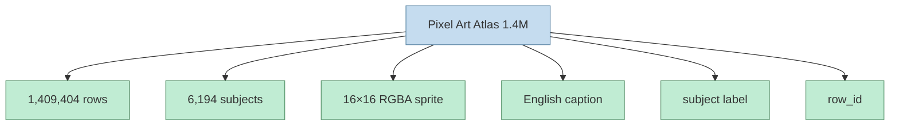
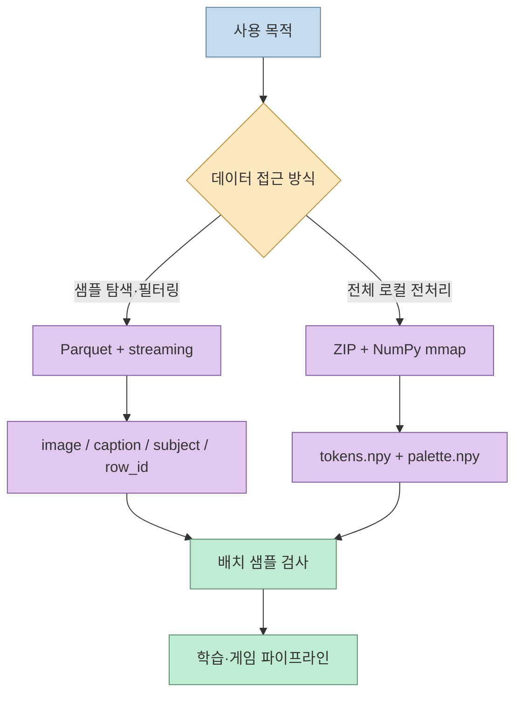
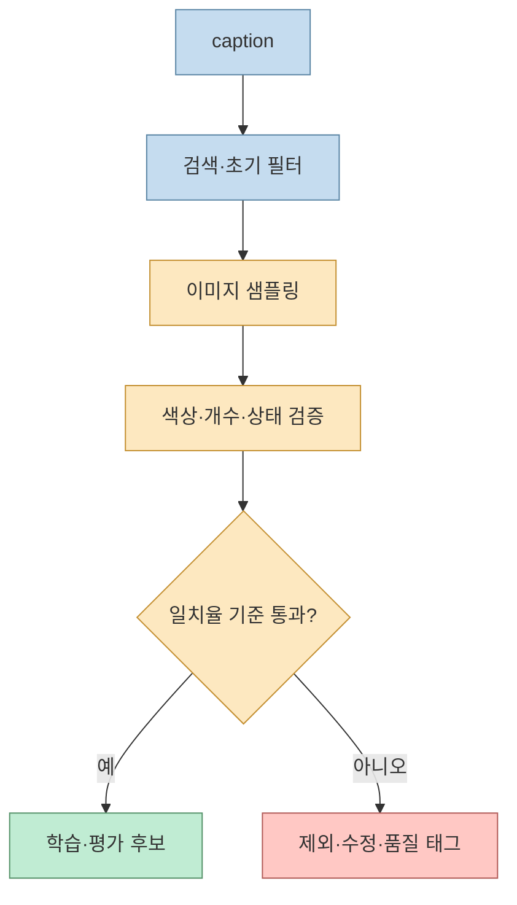
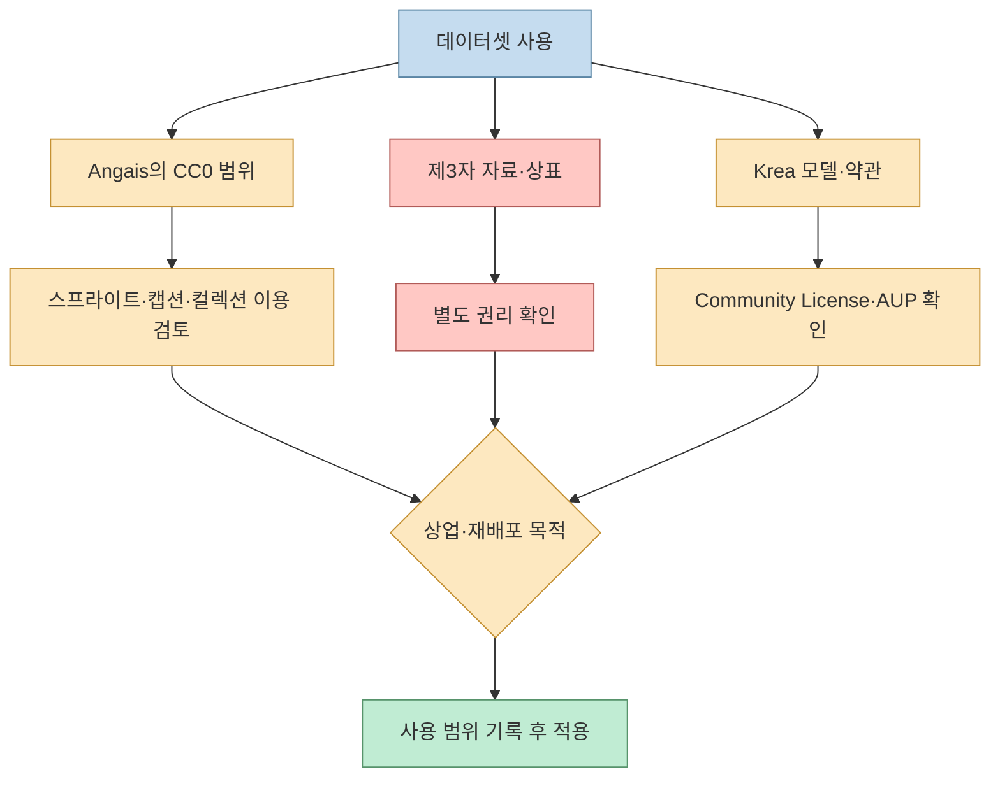
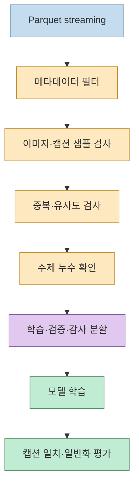

게임 개발에 바로 쓸 수 있는 픽셀 스프라이트와 텍스트-이미지 학습 데이터를 한 번에 찾기는 어렵습니다. Threads에서 소개된 **Angais의 Pixel Art Atlas 1.4M**은 영어 캡션이 붙은 합성 픽셀 스프라이트 1,409,404개를 Hugging Face에 공개한 데이터셋입니다.

<!--more-->

하지만 “CC0 데이터셋”이라는 한 줄만 보고 상업 프로젝트나 모델 학습에 바로 넣으면 안 됩니다. 데이터셋이 제공하는 권리, 생성에 사용된 Krea 모델의 약관, 이미지 안에 우연히 들어간 상표나 제3자 권리는 서로 다른 층위이기 때문입니다. 이 글은 데이터셋 카드의 구조·품질·권리 고지를 기준으로 실제 사용 전 확인할 지점을 정리합니다.

## Sources

- 원문 Threads: [Pixel Art Atlas 소개](https://www.threads.com/share/BAbgCB1D0F)
- 공식 데이터셋 카드: [Angais/pixel-art-atlas-1.4m](https://huggingface.co/datasets/Angais/pixel-art-atlas-1.4m)
- 라이선스 원문: [CC0 1.0](https://creativecommons.org/publicdomain/zero/1.0/)
- 생성 모델 약관: [Krea 2 Community License](https://www.krea.ai/legal/krea-2-community-license)
- 사용 정책: [Krea Acceptable Use Policy](https://www.krea.ai/legal/acceptable-use-policy)

## 데이터셋의 기본 구성

Hugging Face 데이터셋 카드는 1,409,404개의 합성 게임 스프라이트와 영어 캡션, 6,194개의 학습 주제를 설명합니다. 각 이미지는 투명 배경의 네이티브 16×16 픽셀이고, Krea 2 Turbo와 픽셀 아트 LoRA를 사용해 텍스트 프롬프트로 생성됐습니다([데이터셋 카드](https://huggingface.co/datasets/Angais/pixel-art-atlas-1.4m)).



데이터셋 뷰어의 각 행에는 `image`, `caption`, `subject`, `row_id`가 표시됩니다. `caption`은 긴 설명 문장이고 `subject`는 검색·분류에 쓰기 쉬운 짧은 레이블입니다. 예시에는 `printer`, `ghost cat`, `mimic chest` 같은 게임 오브젝트가 보입니다.

## Parquet와 ZIP은 서로 다른 사용 경로다

공식 카드는 개별 샘플을 읽을 때 Parquet 파일을 사용하라고 안내합니다. Hugging Face `datasets` 라이브러리로 스트리밍하면 전체 파일을 한 번에 메모리에 올리지 않고 `image`, `caption`, `subject`, `row_id` 필드를 순회할 수 있습니다.

```python
from datasets import load_dataset

rows = load_dataset(
    "Angais/pixel-art-atlas-1.4m",
    split="train",
    streaming=True,
)

example = next(iter(rows))
print(example["caption"])
print(example["image"].size)  # (16, 16)
```

반대로 로컬 전처리나 대량 배치가 목적이면 ZIP 구조를 사용할 수 있습니다. 카드에 따르면 ZIP에는 팔레트 인덱스 배열, 팔레트, 캡션 목록, 주제 목록, 분할 정보가 들어 있습니다. `tokens.npy`의 각 행은 16×16 픽셀을 펼친 256개의 팔레트 인덱스이며, 0번 인덱스는 투명 픽셀입니다.



Threads 본문은 259MB ZIP을 언급하지만, Hugging Face 페이지의 현재 총 파일 크기는 694MB로 표시됩니다. 다운로드 포맷·압축본·자동 변환 파일에 따라 용량이 달라질 수 있으므로, 실제 파이프라인에서는 페이지의 파일 목록과 다운로드 시점의 크기를 기준으로 디스크를 계산해야 합니다.

## 캡션은 정답 레이블이 아니다

데이터셋 카드가 가장 강하게 경고하는 부분은 이미지와 캡션의 불일치입니다. 캡션은 생성 모델에게 요청한 내용을 대체로 설명할 뿐, 이미지가 실제로 그 내용을 정확히 포함하는지 체계적으로 검토된 것은 아닙니다. 예를 들어 캡션은 “불이 꺼진 촛불”이어도 이미지에는 불이 켜져 있을 수 있고, 색상·재질·개수 같은 세부도 달라질 수 있습니다.

따라서 이 데이터셋에서 캡션은 **완벽한 정답**이 아니라 약한 텍스트 신호입니다. 캡션으로 모델의 프롬프트 추종 성능을 평가하려면 이미지 샘플을 직접 확인하고, 적어도 색상·개수·상태 같은 핵심 속성의 일치율을 별도로 측정해야 합니다([캡션 품질 고지](https://huggingface.co/datasets/Angais/pixel-art-atlas-1.4m)).



## 학습·검증 분할을 과신하지 않기

카드는 원본 1,412,908개에서 3,504개를 필터링하고, 학습 1,405,308개와 검증 4,096개를 남겼다고 설명합니다. 그러나 이 분할은 학습에 등장하지 않은 주제만 검증에 배치했다는 뜻이 아닙니다. 즉, 검증 세트 점수가 높아도 완전히 새로운 오브젝트나 조합으로 일반화된다고 단정할 수 없습니다.

모델 평가에 쓸 때는 다음을 추가하는 것이 안전합니다.

- `subject`가 학습·검증에 겹치는지 확인
- 캡션이 설명하는 세부 속성을 별도 평가
- 동일하거나 유사한 스프라이트의 중복 여부 점검
- 무작위 샘플뿐 아니라 희귀 주제와 긴 캡션을 따로 평가

데이터셋의 분할을 그대로 쓰는 것과, 평가 목적에 맞는 새로운 분할을 설계하는 것은 다른 작업입니다.

## CC0의 범위와 Krea 약관의 경계

데이터셋 카드는 Angais가 포기할 수 있는 권리 범위에서 스프라이트·캡션·컬렉션을 CC0 1.0으로 공개한다고 설명합니다. 동시에 이 선언은 제3자 자료, 상표, Krea 모델에 대한 권리를 부여하지 않는다고 명시합니다.

또한 모든 스프라이트는 AI 생성 결과이며, 모델 가중치나 LoRA 파라미터는 배포하지 않습니다. 카드에는 Krea 2 Community License의 생성물 관련 조항과 상업적 사용 조항, Acceptable Use Policy가 이번 공개로 무효화되지 않는다고 적혀 있습니다.



실무적으로는 “CC0이므로 모든 위험이 사라진다”가 아니라, **공개자가 양도할 수 있는 권리의 범위가 넓다**고 이해해야 합니다. 게임에 넣을 때 이미지 안에 특정 로고나 식별 가능한 제3자 콘텐츠가 있는지 확인하고, 모델 학습에 사용할 때는 생성 모델 약관과 데이터셋의 provenance를 함께 보관해야 합니다.

## 게임 스프라이트로 사용할 때의 검수 루프

16×16 이미지는 작은 아이콘·아이템·타일·픽업 오브젝트의 프로토타입에 특히 편리합니다. 하지만 실제 게임에 넣기 전에는 캡션만 보고 자동 배치하지 말고 이미지와 알파 채널을 검사해야 합니다.

1. `subject`로 후보를 좁힙니다.
2. `caption`으로 원하는 변형을 검색합니다.
3. 원본 픽셀과 투명 배경을 직접 확인합니다.
4. 색상·방향·상태가 게임 규칙에 맞는지 태깅합니다.
5. 필요한 경우 팔레트와 크기를 프로젝트 스타일에 맞춥니다.
6. 사용한 `row_id`, 다운로드 날짜, 라이선스 링크를 기록합니다.

스프라이트를 확대하면 픽셀 경계가 흐려질 수 있으므로 nearest-neighbor 스케일링을 사용하고, 게임 엔진의 필터링 설정도 함께 고정해야 합니다. 이는 데이터셋의 권리 문제와 별개인 엔진 통합 문제입니다.

## 모델 학습 데이터로 사용할 때의 검수 루프

텍스트-이미지 모델이나 검색 모델을 학습할 때는 140만 행을 그대로 넣는 것보다 품질·중복·분할을 먼저 다루는 편이 낫습니다.



특히 검증 세트의 주제가 학습 세트에 이미 포함될 수 있다는 고지는 중요합니다. 새로운 주제에 대한 성능을 알고 싶다면 데이터셋 카드의 기본 split만으로 결론을 내리지 말고, 주제 단위로 분리한 감사용 세트를 별도로 만들어야 합니다.

## 핵심 요약

- Pixel Art Atlas 1.4M은 1,409,404개의 16×16 투명 배경 합성 스프라이트와 영어 캡션을 제공합니다.
- Parquet는 스트리밍·샘플 탐색에, ZIP은 전체 로컬 전처리에 적합합니다.
- 캡션은 생성 프롬프트를 설명하는 약한 레이블이며 이미지와 세부가 다를 수 있습니다.
- 기본 학습·검증 분할은 검증 주제가 학습에 없다는 보장을 하지 않습니다.
- CC0 고지는 Angais가 양도할 수 있는 권리 범위에 한정되며, 제3자 자료·상표·Krea 모델 권리를 대신 부여하지 않습니다.
- 게임 사용과 모델 학습 모두 이미지 샘플 검수, provenance 기록, 라이선스 확인이 필요합니다.

## 결론

Pixel Art Atlas 1.4M의 가치는 거대한 수량 자체보다 **작은 픽셀 이미지와 텍스트 메타데이터를 같은 행 단위로 다룰 수 있다는 점**에 있습니다. 게임 개발자는 빠른 프로토타입과 검색 가능한 스프라이트 재료로 활용할 수 있고, 연구자는 텍스트-이미지 모델의 초기 학습·검색 실험에 사용할 수 있습니다.

다만 데이터셋 카드가 직접 경고하듯 캡션은 정답이 아니며, CC0은 제3자 권리나 생성 모델 약관을 지워 주지 않습니다. 따라서 `Parquet/ZIP 선택 → 샘플 검수 → 분할 감사 → 권리 기록`을 하나의 파이프라인으로 만들 때 이 데이터셋의 장점을 안전하게 활용할 수 있습니다.
