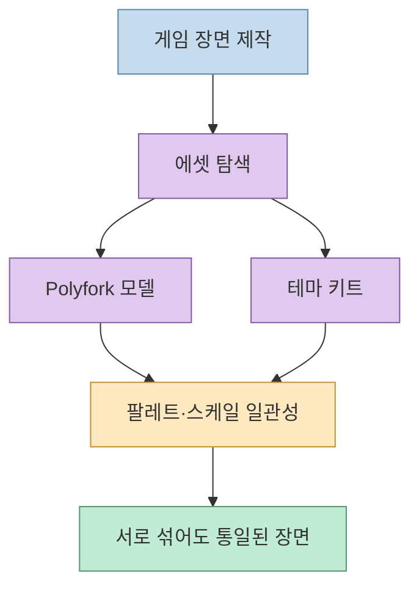
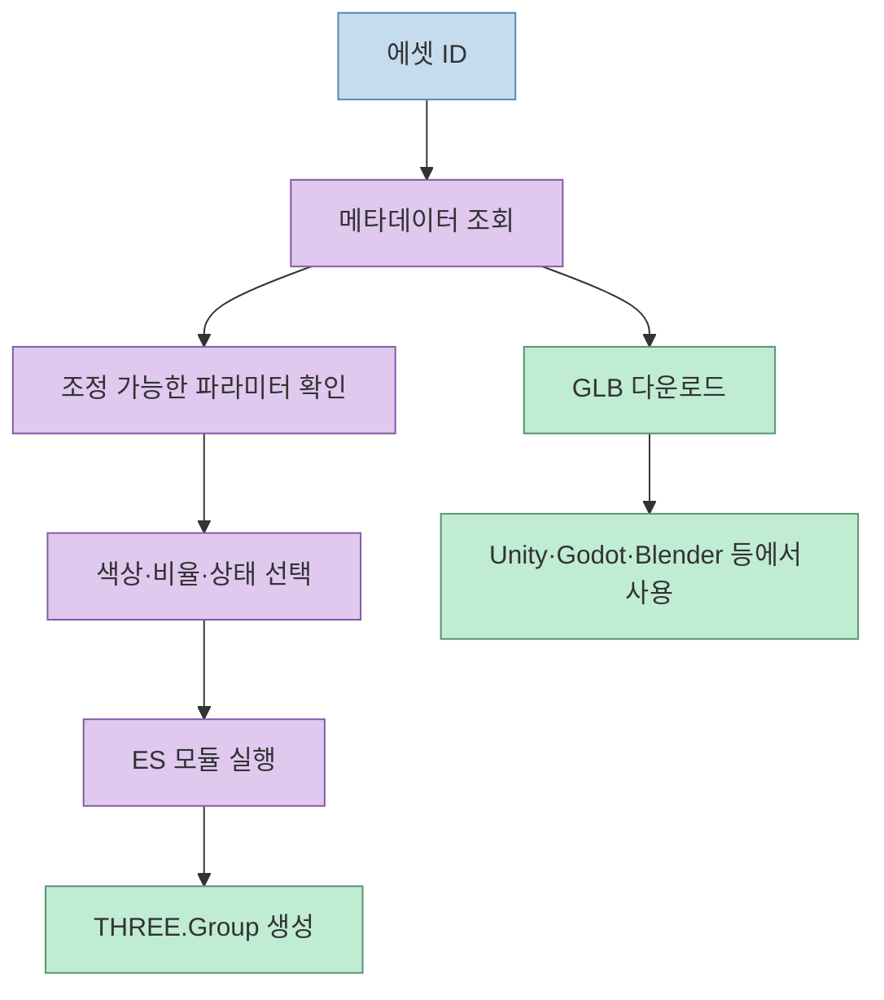
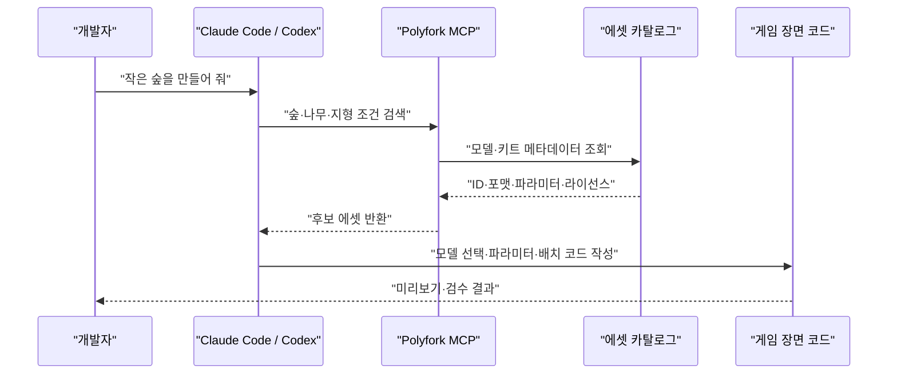
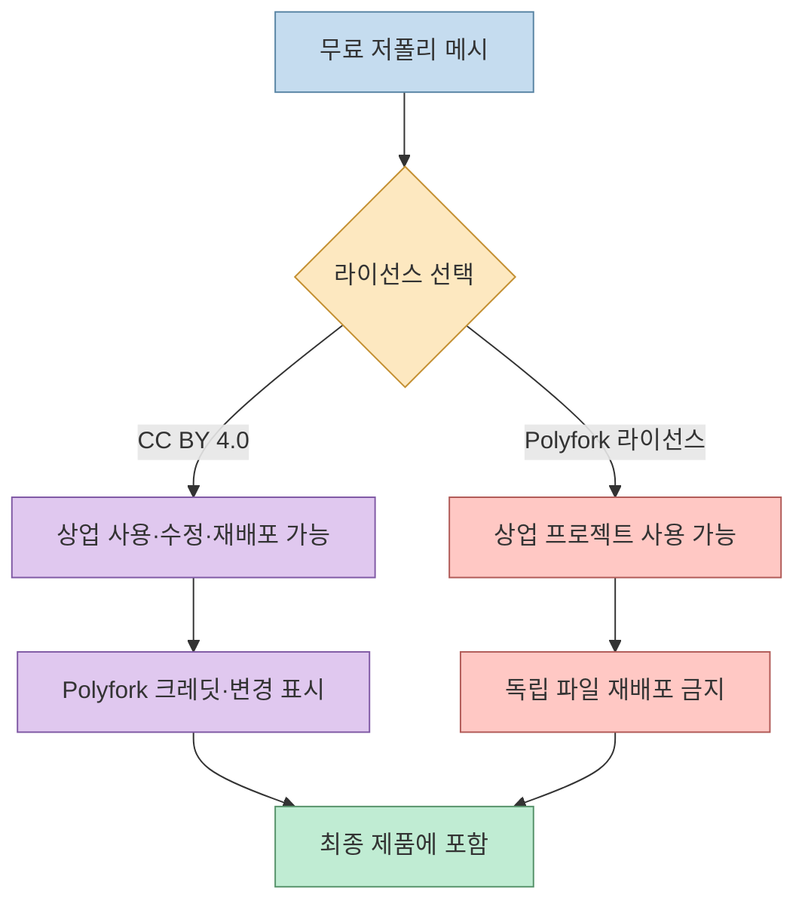

게임 프로토타입을 만들 때 에셋을 하나씩 찾고, 색상·크기·스타일을 맞추는 일은 생각보다 많은 시간을 차지합니다. 영상은 이 문제를 해결하는 **Polyfork**를 소개합니다. 3,000개가 넘는 저폴리 모델과 테마별 키트를 제공하고, 각 모델을 고정된 파일이 아니라 파라미터를 가진 작은 코드 프로그램으로 다루는 서비스입니다.

<!--more-->

다만 “무료 3D 모델”이라는 표현만 보면 안 됩니다. Polyfork의 공식 라이선스는 무료 메시 파일에 대해 CC BY 4.0과 Polyfork 라이선스 중 하나를 선택하게 하며, 출처 없는 대신 원본 파일 재배포를 제한하는 경로도 제공합니다. 따라서 게임에 포함하는 것과 에셋 파일 자체를 다시 배포하는 것은 분리해서 판단해야 합니다.

## Sources

- 원문 YouTube Shorts: [Polyfork 3D 게임 소품 소개](https://youtube.com/shorts/QLcmTs-eDRc?si=mu4s8aVcX-IaprGG)
- Polyfork 공식 사이트: [Polyfork](https://polyfork.dev/)
- Polyfork 공식 라이선스: [Licensing](https://polyfork.dev/licensing)
- Polyfork 공식 MCP 안내: [MCP](https://polyfork.dev/mcp)
- Polyfork 공식 에셋 카탈로그: [Assets](https://polyfork.dev/assets)

## Polyfork가 해결하는 문제

영상은 집·자동차·캐릭터·동물 등 3D 소품 3,000개 이상과 28개 테마 키트를 소개합니다([00:00](https://youtu.be/QLcmTs-eDRc?t=0)). 공식 사이트는 무료 저폴리 모델과 테마별 키트가 하나의 팔레트와 스케일을 공유하도록 구성되어, 서로 섞어도 한 세계처럼 보이게 설계했다고 설명합니다.



기존 무료 모델 사이트에서 여러 제작자의 파일을 섞으면 색상, 크기, 카메라 기준이 제각각인 경우가 많습니다. Polyfork의 키트는 이 문제를 **에셋 선택 단계에서 공유 팔레트와 스케일을 제공하는 방식**으로 줄입니다. 영상이 말한 농장·해적선·우주기지 같은 예시는 장면의 테마를 먼저 고르고 필요한 부품을 함께 가져오는 방식입니다([00:11](https://youtu.be/QLcmTs-eDRc?t=11)).

## 파일이 아니라 조정 가능한 프로그램인 에셋

Polyfork 공식 사이트는 각 에셋을 고정된 메시가 아니라 매개변수를 가진 ES 모듈로 설명합니다. 모델의 색상, 비율, 부품 수, 상태 같은 값을 바꾸면 같은 에셋에서 변형을 만들 수 있고, GLB 파일도 함께 제공합니다.

```js
import {createAsset} from "https://polyfork.dev/cdn/<id>.mjs";

const model = createAsset({
  color: "forest",
  season: "winter",
});
scene.add(model);
```

실제 파라미터 이름과 지원 값은 에셋마다 다르므로 위 코드는 구조를 보여주는 예시입니다. 공식 사이트가 제공하는 API의 에셋 상세 조회와 variant 엔드포인트로 해당 모델의 조정 가능한 값을 먼저 확인해야 합니다.



이 구조의 장점은 같은 모델을 여러 파일로 복제하지 않고도 장면별 변형을 만들 수 있다는 점입니다. 반면 런타임에 모듈을 실행하는 환경이라면 네트워크 접근, CDN 안정성, 로딩 시점, 고정 버전 관리까지 함께 설계해야 합니다. 오프라인 빌드나 장기 보존이 필요하면 GLB·FBX·USD·OBJ를 내려받아 프로젝트에 버전 고정하는 방법을 검토해야 합니다.

## Unity·Godot·Blender와 웹 엔진 연결

영상은 Polyfork 에셋을 Unity, Godot, Blender에서도 사용할 수 있다고 소개합니다([00:40](https://youtu.be/QLcmTs-eDRc?t=40)). 공식 라이선스 문서는 모든 에셋이 GLB로 제공되며 glTF를 읽는 엔진과 Blender에서 사용할 수 있고, 무료 모델은 FBX·USD·OBJ도 제공한다고 설명합니다.

다만 포맷 호환과 프로젝트 완성도는 별개입니다. 엔진에 가져온 뒤에는 좌표계, 단위, 텍스처 필터, 충돌체, 머티리얼, 라이트맵을 대상 엔진의 규칙에 맞춰 점검해야 합니다. 특히 저폴리 모델을 모바일이나 웹에 넣을 때는 삼각형 수와 텍스처 메모리를 실제 목표 기기에서 확인하는 편이 안전합니다.

## MCP로 에이전트에게 장면 구성을 맡기기

영상의 차별점은 Polyfork를 Claude Code나 Codex 같은 코딩 에이전트에 연결하고, “작은 숲을 만들어 줘”처럼 자연어로 요청하는 흐름입니다([00:23](https://youtu.be/QLcmTs-eDRc?t=23)). 에이전트는 카탈로그에서 조건에 맞는 모델을 고르고, 장면 코드에 배치하는 역할을 수행합니다.



이 자동화가 안전하려면 에이전트가 파일만 가져오는 것이 아니라 모델 ID, 출처 URL, 라이선스 선택, 파라미터를 함께 기록해야 합니다. 공식 MCP 문서는 카탈로그 검색과 API 사용을 지원하지만, 최종 장면의 미감·성능·충돌 설정을 대신 검증해 주는 것은 아닙니다.

## Polyfork의 이중 라이선스 이해하기

공식 라이선스 문서는 무료 저폴리 모델의 메시 파일에 대해 두 가지 선택지를 제공합니다.

### CC BY 4.0

상업적 사용, 수정, 재업로드, 판매가 가능하지만 Polyfork 크레딧과 변경 여부를 표시해야 합니다. 모델 페이지에서 복사할 수 있는 한 줄 크레딧을 제공하며, 가능한 경우 해당 모델 페이지 링크를 남기라고 안내합니다.

### Polyfork 라이선스

출처 표시는 필요 없지만, 원본 또는 수정된 에셋 파일 자체를 다른 마켓플레이스·에셋 팩·파일 공유 사이트에 재배포할 수 없습니다. 게임·앱·웹사이트·영상처럼 에셋이 포함된 최종 제품을 배포하는 것은 허용되지만, 파일을 독립적인 상품으로 다시 파는 것은 다른 문제입니다.



출처 없이 사용하고 싶다면 Polyfork 라이선스를 선택할 수 있지만, 이 경우 나중에 에셋 파일을 별도 패키지로 재배포할 계획과 충돌할 수 있습니다. 반대로 CC BY 4.0을 선택하면 크레딧을 제품 문서나 게임 내 크레딧에 포함해야 합니다. 다운로드 당시 어떤 라이선스를 적용했는지 `ASSETS.md`에 기록해 두는 것이 좋습니다.

## HD 에셋과 무료 에셋을 구분하기

Polyfork 공식 사이트는 무료 저폴리 모델과 별도로 HD 에디션을 제공합니다. HD 에디션은 고해상도 메시와 PBR 재질을 포함하며 Pro 또는 Lifetime 요금제와 연결됩니다. 영상이 말한 “고화질 버전은 유료”라는 설명은 이 구분을 가리킵니다([00:36](https://youtu.be/QLcmTs-eDRc?t=36)).

프로토타입에서는 무료 저폴리 에셋으로 게임 루프와 카메라를 검증하고, 출시 품질이 필요한 모델만 HD로 교체하는 단계적 접근이 합리적입니다. 무료 모델과 HD 에디션의 파일·라이선스·CDN 조건을 섞어 기록하지 않도록 프로젝트의 에셋 목록에서 tier를 분리해야 합니다.

## 실무 도입 체크리스트

1. 카탈로그에서 모델 또는 키트를 고릅니다.
2. 대상 엔진이 필요한 포맷(GLB, FBX, USD, OBJ)을 지원하는지 확인합니다.
3. 모델 페이지의 파라미터와 폴리곤 수를 기록합니다.
4. CC BY 4.0과 Polyfork 라이선스 중 하나를 선택합니다.
5. 게임에 포함하는 것과 원본 파일 재배포를 분리해 판단합니다.
6. 에이전트가 생성한 장면에서 출처 URL·모델 ID·라이선스를 함께 저장합니다.
7. 실제 목표 기기에서 렌더링·충돌·메모리를 검수합니다.
8. HD 업그레이드가 필요한 모델만 유료 tier로 교체합니다.

## 핵심 요약

- Polyfork는 3,000개 이상 저폴리 모델과 테마별 키트를 제공하는 3D 에셋 카탈로그입니다.
- 모델은 GLB와 ES 모듈로 제공되며, 파라미터로 색상·비율·상태를 조정할 수 있습니다.
- Unity, Godot, Blender, Unreal, 웹 등 glTF 호환 환경에서 사용할 수 있습니다.
- MCP를 통해 Claude Code·Codex가 자연어 요청을 에셋 검색과 장면 코드로 연결할 수 있습니다.
- 무료 메시 파일은 CC BY 4.0 또는 Polyfork 라이선스 중 하나를 선택합니다.
- CC BY 4.0은 크레딧과 변경 표시가 필요하고, Polyfork 라이선스는 출처 없이 쓸 수 있지만 독립 파일 재배포가 제한됩니다.
- HD 에디션은 무료 저폴리 모델과 별도의 유료 tier입니다.

## 결론

Polyfork의 핵심은 모델 수가 많다는 사실보다 **에셋을 코드와 파라미터로 다루고, 카탈로그·MCP·게임 엔진을 하나의 흐름으로 연결한다는 점**입니다. 에이전트에게 장면 제작을 맡기면 검색과 배치 코드를 빠르게 자동화할 수 있고, 테마 키트는 여러 에셋을 섞을 때 생기는 시각적 불일치를 줄여 줍니다.

다만 무료 에셋을 안전하게 쓰려면 라이선스 선택을 먼저 고정해야 합니다. 게임에 포함해 배포하는 것인지, 에셋 파일 자체를 다시 배포하는 것인지 구분하고, 모델 ID·출처·라이선스·파라미터를 함께 기록하면 Polyfork를 프로토타입부터 상용 게임까지 예측 가능한 방식으로 사용할 수 있습니다.
