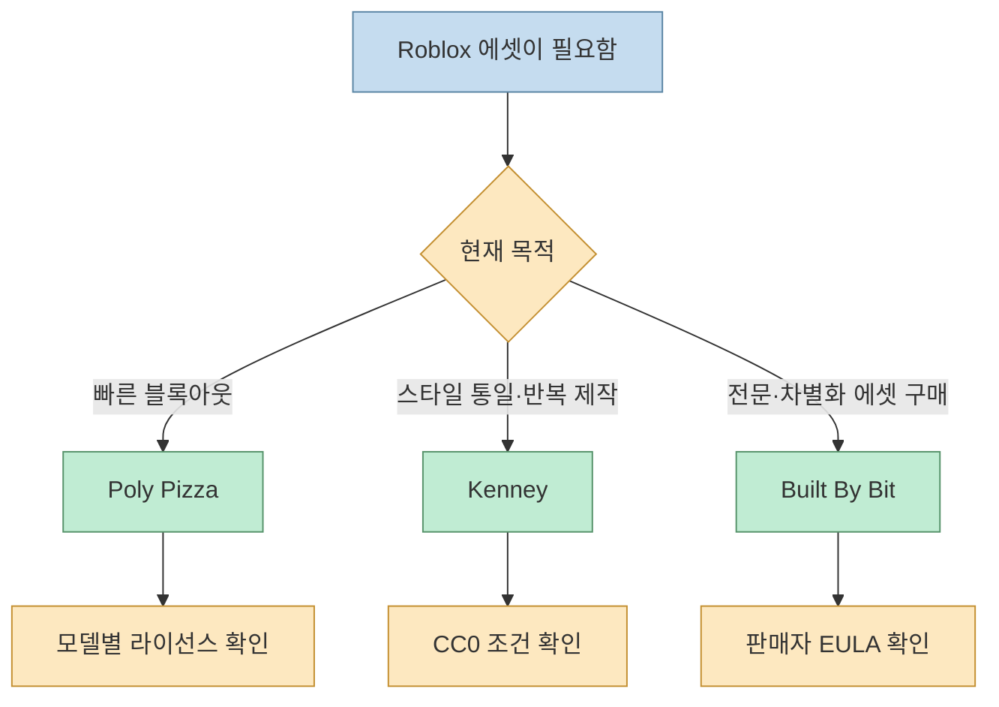
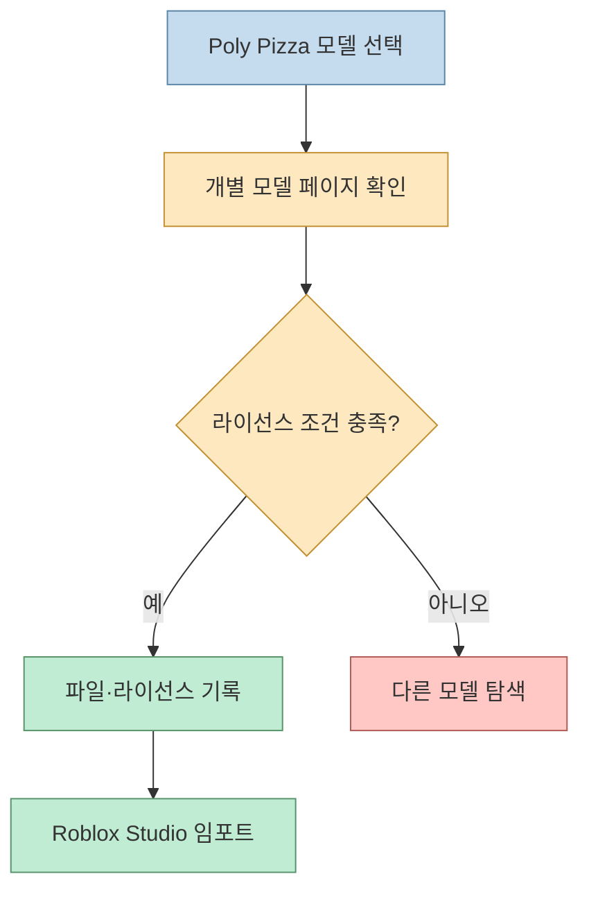
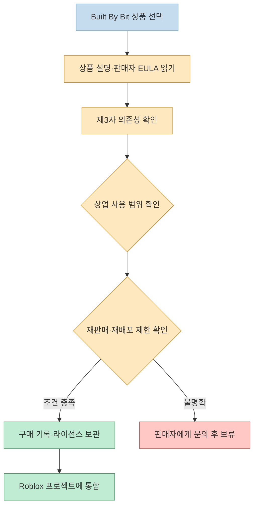
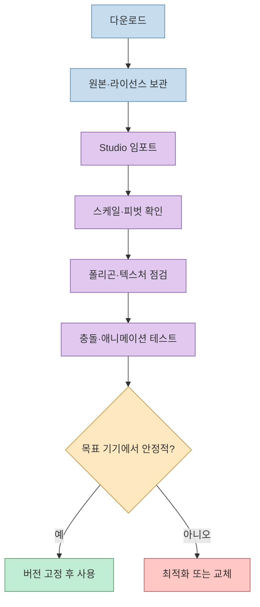

Roblox 게임을 만들 때 가장 오래 걸리는 일은 모델을 직접 만드는 것보다 **쓸 만한 에셋을 찾고, 써도 되는지 확인하고, 게임 안에서 안전하게 검수하는 일**일 때가 많습니다. 원문 스레드는 Roblox 개발 3년 차의 추천으로 Poly Pizza, Kenney, Built By Bit을 소개합니다.

<!--more-->

이 세 곳은 같은 종류의 라이브러리가 아닙니다. Poly Pizza는 로우폴리 탐색에 강하고, Kenney는 재사용하기 쉬운 CC0 팩을 제공하며, Built By Bit은 판매자별 조건이 붙는 마켓플레이스에 가깝습니다. 따라서 “가장 좋은 사이트 하나”를 고르기보다 **프로토타입인지, 일관된 스타일의 제작인지, 전문 에셋 구매인지**를 먼저 결정해야 합니다.

## Sources

- 원문 Threads: [로블록스 개발 3년차가 알려주는 유용한 사이트 TOP 3](https://www.threads.com/share/BA-a9ONtz4)
- Poly Pizza 공식 소개: [Press](https://poly.pizza/docs/press)
- Poly Pizza 공식 약관: [Terms of Service](https://poly.pizza/docs/tos)
- Kenney 공식 지원 문서: [Support](https://kenney.nl/support)
- Kenney 공식 에셋 페이지: [Assets](https://kenney.nl/assets)
- Built By Bit 공식 사이트: [Marketplace](https://builtbybit.com/)
- Built By Bit 공식 약관: [Terms of Service](https://builtbybit.com/wiki/terms)
- Built By Bit 리소스 라이선스: [Resource EULAs](https://builtbybit.com/wiki/resource-eulas/)

## 세 사이트의 역할부터 나누기

핵심은 **사이트 이름이 아니라 라이선스와 제작 단계의 조합**입니다. 무료라는 이유만으로 상용 게임에 바로 넣을 수 있는 것도 아니고, 유료라는 이유만으로 모든 재배포가 허용되는 것도 아닙니다.

## 1. Poly Pizza: 로우폴리 프로토타입을 빠르게 채우기

Poly Pizza의 공식 소개는 게임·AR·VR·웹 프로젝트에서 사용할 수 있는 무료 3D 모델을 모아 둔 플랫폼이라고 설명합니다. 같은 페이지에는 선별된 로우폴리 모델이 7,000개 이상 있다고 안내되어 있어, 직접 모델링하기 전에 장면의 밀도를 빠르게 채우는 용도로 적합합니다.

### 잘 맞는 상황

- 맵 블록아웃 단계에서 건물, 나무, 소품을 빠르게 배치할 때
- 캐주얼·로우폴리 스타일로 시각적 방향을 실험할 때
- 임시 에셋으로 동선과 카메라를 먼저 검증할 때

### 주의할 점

Poly Pizza 약관은 다운로드 시 해당 콘텐츠에 적용되는 Creative Commons 라이선스를 지켜야 한다고 명시합니다. 따라서 “Poly Pizza의 모든 모델은 동일한 조건”이라고 가정하면 안 됩니다. 모델 페이지에서 라이선스, 저작자 표시 필요 여부, 수정·상업적 사용 조건을 **다운로드 시점에 기록**해야 합니다.

## 2. Kenney: CC0 팩으로 일관된 스타일 만들기

Kenney 공식 지원 문서는 에셋 페이지의 게임 에셋이 CC0(public domain)이며, 개인·상업적 사용이 가능하고 출처 표시는 필수가 아니라고 안내합니다. 크레딧을 남기는 것은 선택 사항이지만, Kenney 로고를 사용해서 공식 후원이나 제휴처럼 보이게 해서는 안 됩니다.

Kenney의 강점은 한두 개의 모델보다 **같은 시각 언어를 공유하는 팩**입니다. UI, 2D 스프라이트, 3D 모델, 오디오 등 여러 요소를 함께 조달할 수 있으므로 프로토타입을 넘어 작은 게임의 기본 스타일을 잡기 좋습니다.

다만 에셋 페이지와 번들 판매 페이지를 구분해야 합니다. 예를 들어 공식 “Game Assets All-in-1” 페이지는 유료 번들로 표시됩니다. “Kenney는 무료”라는 표현은 모든 다운로드 경로가 무료라는 뜻이 아니라, 공식 지원 문서가 설명하는 **에셋 페이지의 CC0 조건**을 가리키는 것으로 이해하는 편이 안전합니다.

### Kenney를 고를 때의 체크리스트

1. 필요한 팩의 공식 에셋 페이지인지 확인합니다.
2. 다운로드한 압축 파일과 라이선스 안내를 프로젝트 저장소에 보관합니다.
3. 팩 안의 모델을 Roblox용 크기·재질·충돌 설정에 맞게 조정합니다.
4. 판매 페이지나 번들 페이지라면 가격과 사용 조건을 별도로 확인합니다.

## 3. Built By Bit: 전문 에셋을 구매하는 마켓플레이스

Built By Bit 공식 사이트는 Roblox를 포함한 여러 플랫폼의 상품을 거래하는 마켓플레이스로 소개합니다. 즉, 하나의 제작자가 동일한 라이선스를 적용하는 라이브러리라기보다 **판매자별 상품과 EULA가 공존하는 장터**입니다.

공식 약관은 플랫폼이 사용자 사이의 상품·서비스 거래를 연결하며, 거래 당사자 사이의 계약 자체는 플랫폼이 당사자가 아니라고 설명합니다. Resource EULAs도 상품에 포함된 제3자 자산에는 MIT, GPL, CC 등 별도의 라이선스가 적용될 수 있고, 상업적 사용과 재판매 권한은 서로 다르다고 안내합니다.

따라서 Built By Bit의 상품을 살 때는 다음을 반드시 분리해서 읽어야 합니다.

- 게임에 포함해 수익을 내도 되는가
- 원본 파일이나 수정본을 다시 배포해도 되는가
- 팀원·외주자와 라이선스를 공유할 수 있는가
- 에셋 안에 포함된 제3자 의존성의 조건은 무엇인가
- 구매 기록과 라이선스 키를 나중에 증명할 수 있는가

## Roblox에 넣기 전의 공통 검수 루프

사이트에서 파일을 받았다고 바로 게임에 포함하지 말고, 다음 순서로 작은 검수 루프를 거치는 것이 좋습니다.

여기서 “상용 사용 가능”은 Roblox에서 성능이 좋다는 뜻이 아닙니다. 에셋의 라이선스와 엔진 적용성은 별개의 문제입니다. 특히 모바일을 목표로 한다면 텍스처 크기, 메시 복잡도, 투명 재질, 충돌체 수를 실제 저사양 기기에서 확인해야 합니다.

## 프로젝트 단계별 선택법

### 프로토타입 단계

Poly Pizza에서 장면을 채우고, 라이선스가 맞지 않거나 최종 품질이 부족한 에셋은 임시 표시로 남깁니다. 이 단계의 목표는 “완벽한 모델 확보”가 아니라 맵 구조와 플레이 루프 검증입니다.

### 스타일 고정 단계

Kenney의 한 팩 또는 호환되는 팩을 기준으로 UI·소품·환경의 시각 언어를 통일합니다. 팩을 섞을 때는 색상, 카메라 스케일, 그림자 스타일이 충돌하지 않는지 먼저 작은 테스트 장면에서 확인합니다.

### 출시 품질 단계

Built By Bit에서 차별화된 에셋을 구매할 수 있지만, 구매 전 EULA와 재배포 범위를 문서화해야 합니다. 최종 빌드에 포함되는 파일과 개발 중에만 사용하는 원본 파일을 분리하면 팀원이 실수로 원본을 재배포하는 위험도 줄일 수 있습니다.

## 다운로드 기록을 남기는 최소 포맷

에셋마다 다음 정보를 `ASSETS.md`나 프로젝트 데이터베이스에 남겨 두면 나중에 업데이트와 감사가 쉬워집니다.

- 사이트와 상품 URL
- 다운로드 날짜와 버전
- 파일명·압축 파일 해시
- 라이선스 이름과 원문 링크
- 저작자 표시 문구 필요 여부
- 상업 사용·수정·재배포 가능 여부
- Roblox 프로젝트에서 사용한 위치

## 결론

원문의 세 사이트 추천은 서로 경쟁하는 목록이라기보다 역할 분담에 가깝습니다. **Poly Pizza는 빠른 로우폴리 탐색**, **Kenney는 조건이 명확한 반복 제작**, **Built By Bit은 전문 에셋 구매**에 적합합니다.

가장 안전한 순서는 “목적 선택 → 개별 라이선스 확인 → 다운로드 기록 → Roblox 검수 → 목표 기기 테스트”입니다. 이 루프를 습관화하면 무료 에셋을 잘못 사용하거나, 유료 에셋을 샀는데도 재배포 조건을 놓치는 일을 크게 줄일 수 있습니다.
