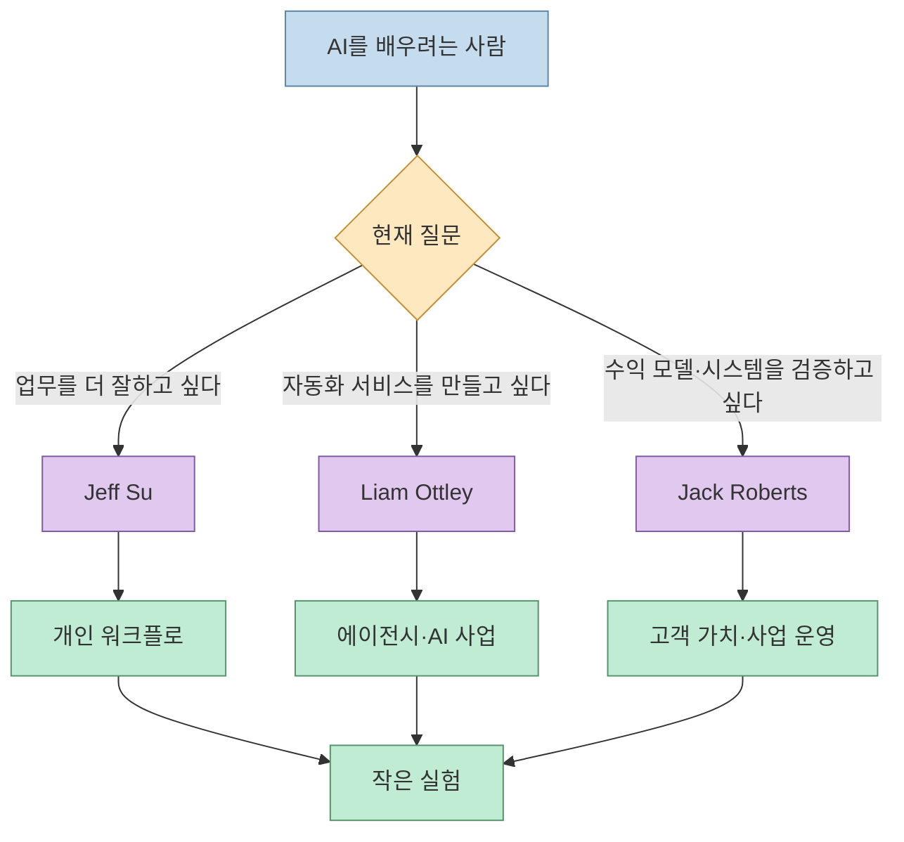
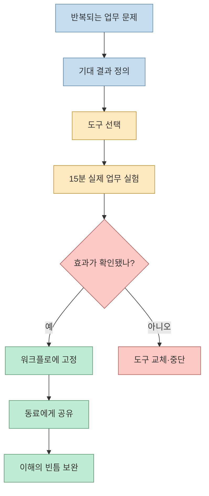
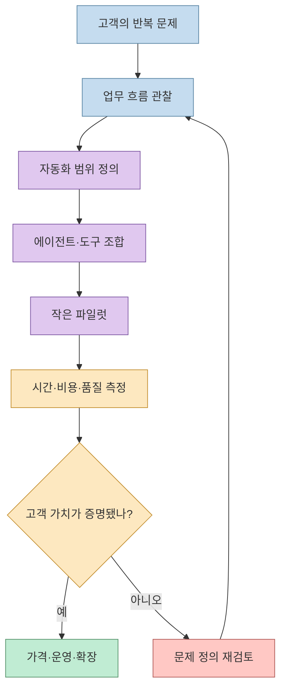
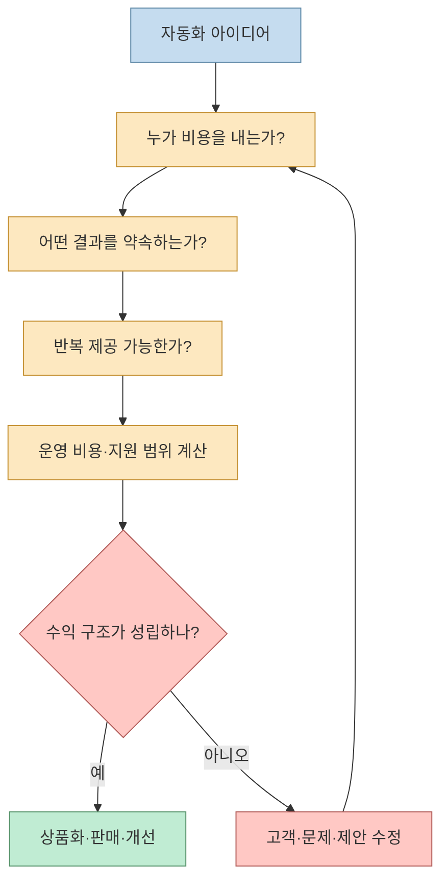
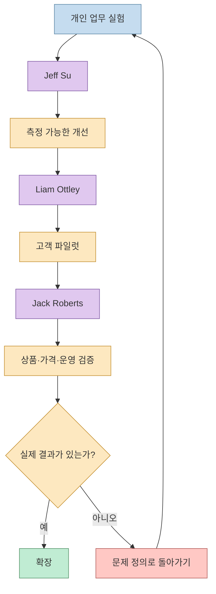

AI를 배우려고 강의와 유튜브를 찾다 보면 정보가 부족해서가 아니라 **무엇을 어떤 순서로 배워야 할지 몰라서** 시간을 잃습니다. Threads 게시물은 고가 강의를 듣기 전에 참고할 AI·자동화 유튜버로 Jeff Su, Liam Ottley, Jack Roberts를 소개합니다.

<!--more-->

세 사람은 같은 내용을 반복하는 채널이 아닙니다. Jeff Su는 업무 생산성과 실용적인 AI 워크플로를, Liam Ottley는 AI 자동화 에이전시와 AI 사업 운영을, Jack Roberts는 자동화를 실제 시스템과 수익 구조로 연결하는 관점을 다룹니다. 따라서 구독자 수보다 **지금 해결하려는 문제에 맞는 채널을 고르는 것**이 중요합니다.

## Sources

- 원문 Threads: [AI 학습을 위한 유튜버 3명 추천](https://www.threads.com/share/F_9IgCfu1)
- Jeff Su 공식 사이트: [Jeff Su](https://www.jeffsu.org/)
- Jeff Su AI 학습 페이지: [AI for Work](https://www.jeffsu.org/ai/)
- Liam Ottley 공식 채널 정보: [Liam Ottley](https://www.youtube.com/@LiamOttley)
- Liam Ottley의 사업 사이트: [Morningside AI](https://morningside.ai/)
- Jack Roberts 공식 사이트: [AI Automations by Jack](https://jackroberts.ai/)

## 세 사람의 학습 영역

이 분류는 Threads의 추천 문구와 각자의 공식 소개를 합친 해석입니다. 콘텐츠 주제는 계속 바뀔 수 있으므로 “이 사람은 오직 한 분야만 다룬다”라고 고정하기보다, 현재 채널이 제공하는 대표 학습 경로로 이해하는 편이 안전합니다.

## 1. Jeff Su: 업무에 바로 적용하는 AI 워크플로

Jeff Su의 공식 사이트는 커리어·생산성·실용적인 팁을 중심으로 소개합니다. AI 페이지에서는 무료 YouTube AI 플레이리스트와 함께, 문제에서 시작하고 도구 유행을 좇지 말라는 학습 원칙을 강조합니다([AI for Work](https://www.jeffsu.org/ai/)).

### 무엇을 배우나

- ChatGPT·Claude·Gemini·Perplexity·NotebookLM을 용도별로 비교하는 법
- 반복 업무를 AI 워크플로로 바꾸는 사고방식
- 프롬프트를 저장하고 실제 업무에 적용하는 방법
- 한 번 본 튜토리얼을 작은 실험으로 검증하는 습관

Jeff Su의 공식 AI 학습 페이지는 “문제부터 시작하고 도구에서 시작하지 말라”는 원칙을 제시합니다. 또한 새 도구를 발견하면 실제 업무에 15분간 적용해 보고, 효과가 없으면 다음 도구로 넘어가라고 권합니다. 이 접근은 AI 초보자가 도구 목록을 모으는 데서 멈추지 않고 작업 결과를 개선하게 만듭니다.

### 누구에게 맞나

AI를 처음 접했거나, 도구를 많이 구독했지만 업무 결과가 달라지지 않은 사람에게 적합합니다. 사업 아이디어보다 먼저 자신의 문서·회의·리서치·정리 업무를 개선하고 싶은 경우 Jeff Su의 콘텐츠를 첫 단계로 두는 것이 좋습니다.

## 2. Liam Ottley: AI 자동화 에이전시와 사업 운영

Threads는 Liam Ottley를 AI 자동화 에이전시 Morningside AI의 창시자이자 기업가·유튜버로 소개합니다. 채널 소개는 자신의 AI 자동화 에이전시와 AI SaaS 운영 경험, 그리고 AI 사업을 시작하고 확장하려는 커뮤니티를 대상으로 한 학습 내용을 공유한다고 설명합니다.

### 무엇을 배우나

- 고객의 반복 문제를 자동화 서비스로 정의하는 법
- 챗봇·에이전트·워크플로 도구를 조합하는 방법
- AI 자동화 에이전시의 판매·가격·운영 관점
- 한 사람이 AI로 서비스를 제공하는 과정

여기서 중요한 것은 도구 사용법만 배우는 것이 아닙니다. 자동화 기술을 고객의 비용 절감, 응답 속도, 영업 처리량처럼 측정 가능한 가치로 번역해야 합니다. “에이전트를 만들 수 있다”와 “고객이 돈을 내는 시스템을 운영한다” 사이에는 요구사항 정의, 보안, 유지보수, 가격 책정이 들어갑니다.

### 누구에게 맞나

AI를 이용해 프리랜서 서비스, 자동화 에이전시, AI SaaS를 만들려는 사람에게 적합합니다. 다만 영상 속 성공 사례를 그대로 복제하기보다, 자신의 고객군에서 반복되고 비용을 측정할 수 있는 문제를 먼저 찾아야 합니다.

## 3. Jack Roberts: 자동화를 수익 시스템으로 연결하기

Jack Roberts의 공식 사이트는 AI Automations by Jack라는 브랜드와 AI 자동화 학습 콘텐츠를 운영합니다. 공개 글은 자동화를 만드는 것과 실제로 수익을 내는 사업을 만드는 것이 다르며, 시작할 때 학습 로드맵과 커뮤니티가 중요하다고 설명합니다.

Threads가 Jack Roberts를 추천한 이유도 여기에 있습니다. 자동화가 작동하는 데서 멈추지 않고, 누가 비용을 지불하는지·어떤 결과를 약속하는지·반복 운영할 수 있는지를 함께 보게 합니다.

### 무엇을 배우나

- 자동화 기능을 고객이 이해하는 결과로 설명하는 법
- 단순한 태스크 자동화와 업무 시스템의 차이
- 서비스·제품·커뮤니티를 조합한 수익 구조
- 학습 내용을 실제 프로젝트로 끝까지 실행하는 습관

### 누구에게 맞나

이미 간단한 자동화를 만들 수 있지만, 이를 서비스나 상품으로 발전시키지 못한 사람에게 적합합니다. 다만 “돈이 되는 자동화”라는 표현은 특정 수익을 보장하는 말이 아니며, 시장·고객·영업·운영 검증이 별도로 필요합니다.

## 세 채널을 보는 추천 순서

세 사람의 콘텐츠를 동시에 소비하면 또 다른 정보 과부하가 생길 수 있습니다. 다음 순서로 한 단계씩 실행하는 편이 낫습니다.

1. **Jeff Su** 콘텐츠에서 자신의 실제 업무 하나를 골라 AI 워크플로로 바꿉니다.
2. 그 워크플로가 해결하는 비용·시간 문제를 측정합니다.
3. **Liam Ottley** 콘텐츠로 고객 문제·에이전트 구성·서비스 운영 관점을 학습합니다.
4. 작은 파일럿을 유료 또는 내부 사용자에게 제공해 피드백을 받습니다.
5. **Jack Roberts** 콘텐츠로 제안·가격·반복 운영·수익 구조를 점검합니다.

## 강의와 유튜브를 비교하는 기준

원문은 강의비를 쓰기 전에 무료 콘텐츠를 보라는 취지입니다. 그렇다고 유튜브 영상만 보면 자동으로 사업이 만들어지는 것은 아닙니다. 유료 강의와 무료 콘텐츠를 비교할 때는 다음을 확인해야 합니다.

- 최신 영상이 현재 도구와 가격을 반영하는가
- 단순 데모인지, 실패·유지보수·보안까지 보여주는가
- 자신의 산업·고객·기술 수준에 맞는가
- 시청 후 실제로 실행할 과제와 검증 지표가 있는가
- 성공 사례와 함께 실패 조건·전제·비용을 공개하는가
- 커뮤니티나 지원이 필요한지, 혼자 검증 가능한지

특히 AI 도구는 빠르게 바뀌므로 영상 게시일과 현재 서비스 문서를 함께 확인해야 합니다. 채널의 권위나 구독자 수보다, 자신의 문제에 적용했을 때 측정 가능한 결과가 나오는지가 더 중요한 기준입니다.

## 정보 소비를 실행으로 바꾸는 주간 루프

Jeff Su의 공식 AI 페이지는 매주 하나의 AI 콘텐츠를 보고 하나의 행동을 해 보라는 식의 실행 원칙을 제시합니다. 이를 세 채널 학습에 적용하면 다음과 같습니다.

1. 월요일: 세 채널 중 하나의 영상만 선택합니다.
2. 화요일: 영상에서 주장한 방법을 실제 업무 데이터로 시험합니다.
3. 수요일: 시간·품질·비용을 기록합니다.
4. 목요일: 실패 원인과 재현 조건을 정리합니다.
5. 금요일: 고객 또는 동료에게 결과를 보여 줍니다.
6. 주말: 다음 주에 유지·폐기·상품화할지 결정합니다.

이 루프가 없으면 채널을 많이 구독해도 기술이 늘지 않고, 단순히 새로운 도구 이름만 기억하게 됩니다.

## 핵심 요약

- Jeff Su는 업무 생산성과 실용적인 AI 워크플로를 배우는 출발점입니다.
- Liam Ottley는 AI 자동화 에이전시·AI SaaS·고객 문제와 운영을 다룹니다.
- Jack Roberts는 자동화를 수익 구조·상품·시스템 관점에서 바라보게 합니다.
- 세 채널을 동시에 소비하기보다 개인 실험 → 고객 파일럿 → 상품·운영 검증 순서로 학습하는 편이 효율적입니다.
- 구독자 수나 성공 사례보다 실제 업무에 적용했을 때의 시간·비용·품질 변화를 측정해야 합니다.
- 유튜브 콘텐츠는 최신성·전제·비용·실패 조건을 공식 문서와 교차 확인해야 합니다.

## 결론

AI를 잘 배우는 가장 빠른 방법은 더 많은 강의를 결제하는 것이 아니라, **한 사람에게서 배운 내용을 실제 문제에 적용하고 결과를 측정하는 것**입니다. Jeff Su로 개인 워크플로를 만들고, Liam Ottley로 고객용 자동화의 구조를 이해한 뒤, Jack Roberts로 수익과 운영의 현실을 점검하면 학습이 소비에서 실행으로 이어집니다.

세 사람의 콘텐츠는 강의를 대체하는 만능 해답이 아니라 서로 다른 관점을 제공하는 무료 학습 재료입니다. 자신의 문제·고객·지표를 중심에 두고 한 주에 하나씩 실험할 때 가장 큰 가치가 생깁니다.
