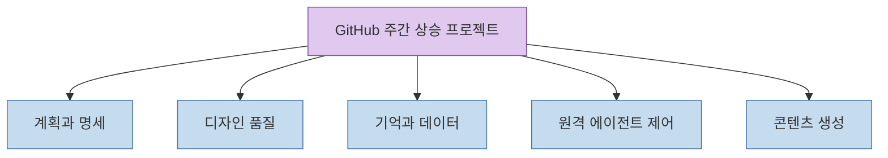
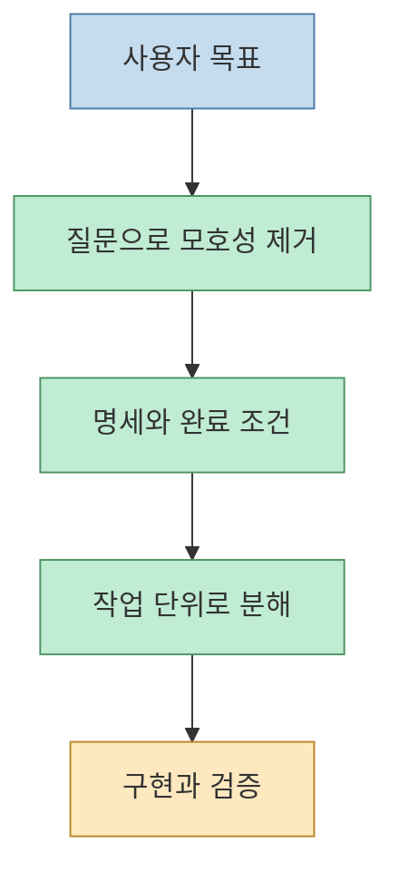
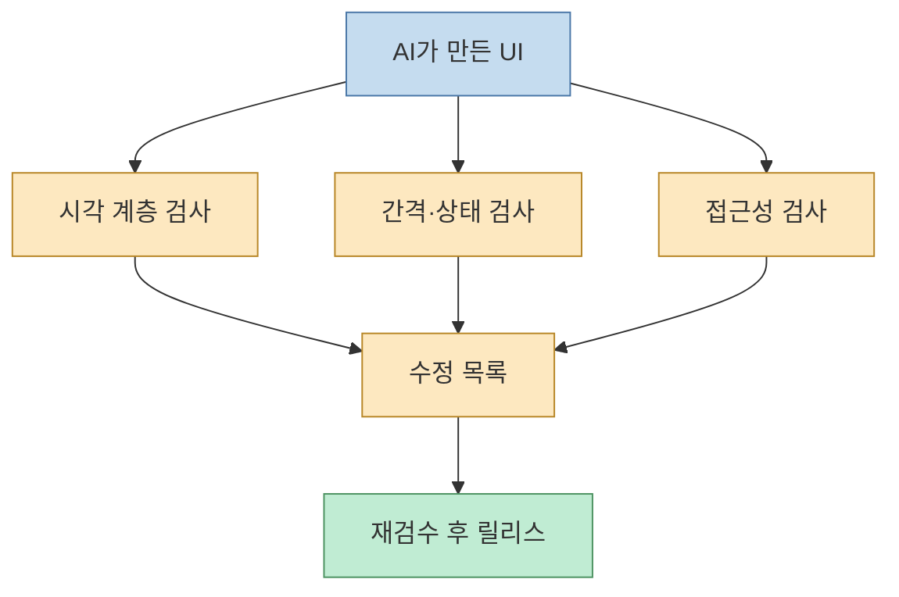
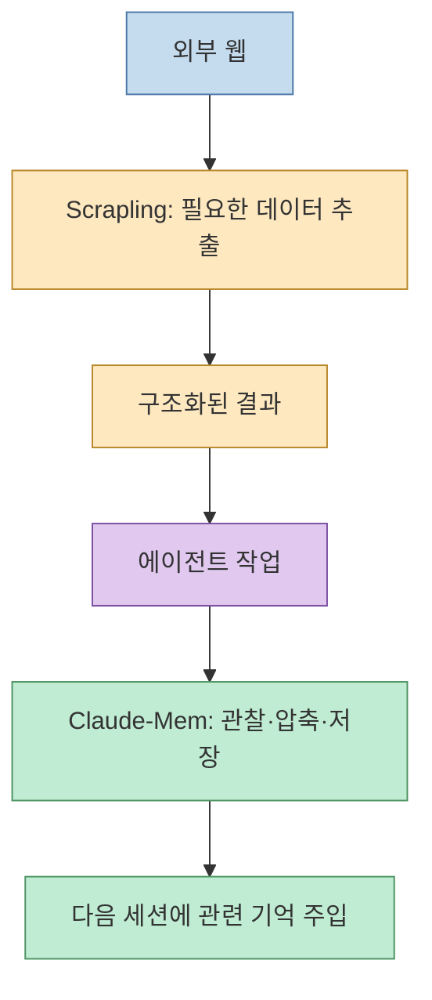
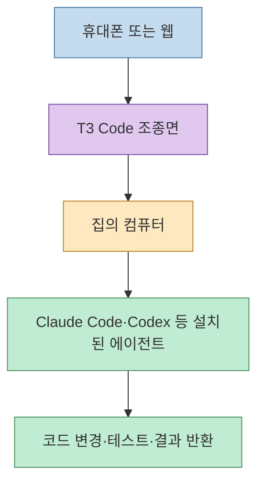
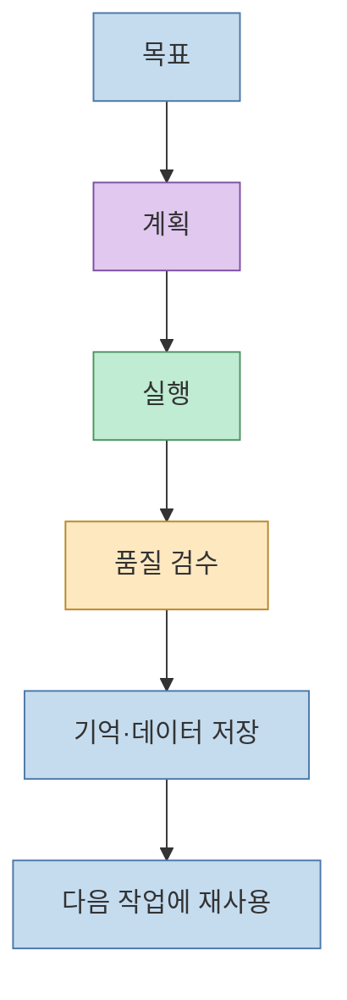

지난주 GitHub에서 별을 많이 얻은 프로젝트를 소개하는 Shorts는 **새로운 모델**보다 **모델을 일하게 만드는 주변 시스템**에 주목한다. 계획을 먼저 쓰고, 디자인을 검수하고, 세션 사이의 기억을 보존하고, 웹 데이터를 구조화하고, 마지막에는 휴대폰으로 에이전트를 조종한다.  

이 글은 영상의 11월 2~8일 주간 스냅샷을 정리한 것이다. 별 수와 순위는 계속 변하므로 현재의 인기 순위로 해석하지 않는다.

<!--more-->

## 먼저 확인할 범위

영상에는 다음 프로젝트들이 소개된다. **Superpower**, 게임 개발을 여러 역할로 나누는 도구, 디자인 품질을 점검하는 **Hallmark**와 **Impeccable**, 메시지형 에이전트 도구, **Claude-Mem**, **Scrapling**, 계획·명세·작업 분해를 돕는 스킬 묶음, 그리고 1위를 차지한 **T3 Code**다. 마지막에는 **Claude Animated Shorts**가 보너스로 등장한다. 각 항목의 고유명사는 Shorts 자동 자막에서 들리는 표기를 옮긴 것이어서, 자막만으로 저장소명을 확정할 수 없는 항목은 기능 중심으로 설명한다.

## 1. 계획을 먼저 쓰는 에이전트

영상의 10위 **Superpower**는 코딩 전에 사용자가 원하는 것을 묻고 계획을 만든다. 2위 항목도 질문→명세→작업 분해→구현이라는 순서를 강조한다. 게임 개발 도구는 감독, 기획, 그래픽 등 역할을 나눈 49개의 AI가 협업하는 방식으로 소개된다. (영상 00:10~01:05, [타임스탬프](https://youtu.be/ZyJKOeXxLVE?t=10))

이 패턴의 핵심은 에이전트에게 곧바로 “만들어”라고 말하지 않는 것이다. 먼저 **완료 조건과 작업 경계**를 문서화하면, 모델이 임의로 범위를 넓히거나 구현부터 시작하는 문제를 줄일 수 있다.

## 2. AI가 만든 화면을 다시 보는 디자인 도구

7위로 소개된 Hallmark와 4위 **Impeccable**은 AI가 만든 화면이 비슷비슷해지는 문제를 겨냥한다. 영상은 Impeccable을 디자인 스킬로 설명하며, 릴리스 전에 화면을 점수화해 “AI가 만든 것처럼 보이는” 결과를 잡는다고 말한다. (영상 00:28~00:53, [타임스탬프](https://youtu.be/ZyJKOeXxLVE?t=28))

Impeccable 저장소는 Claude Code에서 디자인 관련 작업을 수행하는 스킬과 명령 모음을 제공한다. 중요한 점은 모델에게 색상 하나를 추천받는 것이 아니라, **일관성·계층·간격·상태·접근성** 같은 검수 기준을 반복 가능한 체크리스트로 만든다는 것이다. 자세한 구현은 [pbakaus/impeccable](https://github.com/pbakaus/impeccable)에서 확인할 수 있다.

## 3. 기억과 웹 데이터는 별도 계층으로 둔다

5위 **Claude-Mem**은 창을 닫으면 사라지는 대화 맥락을 세션 사이에 남기는 도구로 소개된다. 공식 저장소는 에이전트가 수행한 작업을 관찰·압축하고, 다음 세션에 관련 컨텍스트를 주입하는 플러그인으로 설명한다. (영상 00:41~00:48, [타임스탬프](https://youtu.be/ZyJKOeXxLVE?t=41), [thedotmack/claude-mem](https://github.com/thedotmack/claude-mem))

3위 **Scrapling**은 웹 페이지에서 필요한 정보만 골라 표 형태로 정리하는 스크래핑 도구로 언급된다. 공식 문서에는 일반적인 스크래핑 라이브러리뿐 아니라 에이전트용 스킬도 포함되어 있다. (영상 00:53~00:59, [타임스탬프](https://youtu.be/ZyJKOeXxLVE?t=53), [D4Vinci/Scrapling](https://github.com/D4Vinci/Scrapling))

둘을 함께 보면 에이전트 시스템은 다음처럼 나뉜다.

## 4. 1위 T3 Code: 휴대폰은 조종면이 된다

영상의 1위는 **T3 Code**다. 지난주 10위에서 올라왔고, 영상에서는 휴대폰으로 집의 컴퓨터에서 실행 중인 Claude Code나 Codex에 접속해 “이 버튼을 고쳐 달라”고 말하는 사용 장면을 보여 준다. 별도의 AI 구독이 필요하다는 점도 함께 언급된다. (영상 00:59~01:22, [타임스탬프](https://youtu.be/ZyJKOeXxLVE?t=59))

공식 저장소는 T3 Code를 설치된 코딩 에이전트를 제어하는 **agent harness control surface**로 설명하며, 모바일·웹·Electron 앱을 제공한다. 에이전트 자체를 새로 만드는 제품이라기보다, 이미 인증된 로컬 에이전트에 접근하는 조종면에 가깝다. 자세한 지원 범위와 구조는 [pingdotgg/t3code](https://github.com/pingdotgg/t3code)를 참고한다.

이 구조는 편리하지만 권한 경계가 중요하다. 휴대폰에서 보낸 명령이 로컬 파일과 셸에 닿을 수 있으므로, 작업 디렉터리 제한·승인 모드·비밀정보 분리·실행 로그를 먼저 설계해야 한다. “어디서든 코딩”보다 “어디서든 검토하고 승인”하는 용도로 시작하는 편이 안전하다.

## 5. 보너스: 한 줄 프롬프트에서 애니메이션까지

영상 말미의 보너스는 **Claude Animated Shorts**다. 한 줄 주제를 입력하면 캐릭터가 있는 3D 마을풍 장면의 짧은 애니메이션을 만드는 워크플로로 소개된다. (영상 01:21~01:29, [타임스탬프](https://youtu.be/ZyJKOeXxLVE?t=81))

공식 저장소는 Three.js와 Remotion을 이용한 Claude 스킬과 템플릿을 제공한다. 결과물보다도, 스토리·룩·스토리보드 확인 단계를 에이전트 워크플로에 넣었다는 점이 앞서 소개한 “계획 먼저” 패턴과 닮아 있다. ([mromidev/claude-animated-shorts](https://github.com/mromidev/claude-animated-shorts))

## 이 목록에서 가져갈 설계 원칙

영상의 순위는 바뀌지만 반복되는 구조는 비교적 안정적이다.

1. **계획 계층**: 질문, 명세, 작업 분해를 코드 생성보다 앞에 둔다.
2. **품질 계층**: 디자인과 접근성 검사를 별도 단계로 둔다.
3. **기억 계층**: 세션이 끝나도 재사용할 지식을 저장하되, 모두 저장하지 않고 요약·검색한다.
4. **데이터 계층**: 웹에서 가져온 원문과 에이전트가 사용할 구조화 결과를 분리한다.
5. **제어 계층**: 모바일 원격 제어는 강력한 권한을 부여하므로 승인과 로그를 함께 둔다.

## 마무리

이번 TOP10의 메시지는 “더 큰 모델 하나”가 아니다. **모델이 계획하고, 기억하고, 검수하고, 원격으로 안전하게 실행되도록 주변을 설계하라**는 쪽에 가깝다. 새 도구를 모두 설치하기보다 현재 병목 하나를 고르는 것이 좋다. 계획이 자주 틀리면 명세 도구부터, 맥락을 잃으면 메모리 계층부터, 화면 품질이 낮으면 디자인 검수부터 붙이면 된다.

## Sources

- [YouTube Shorts — 지난주 11위가 1위로 · GitHub 이번 주 TOP10 (11/2–11/8)](https://youtu.be/ZyJKOeXxLVE)
- [T3 Code 공식 저장소](https://github.com/pingdotgg/t3code)
- [Claude-Mem 공식 저장소](https://github.com/thedotmack/claude-mem)
- [Impeccable 공식 저장소](https://github.com/pbakaus/impeccable)
- [Scrapling 공식 저장소](https://github.com/D4Vinci/Scrapling)
- [Claude Animated Shorts 공식 저장소](https://github.com/mromidev/claude-animated-shorts)
