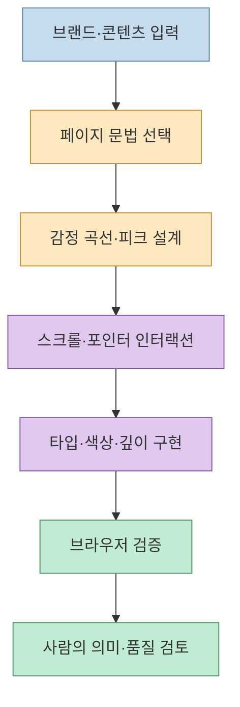
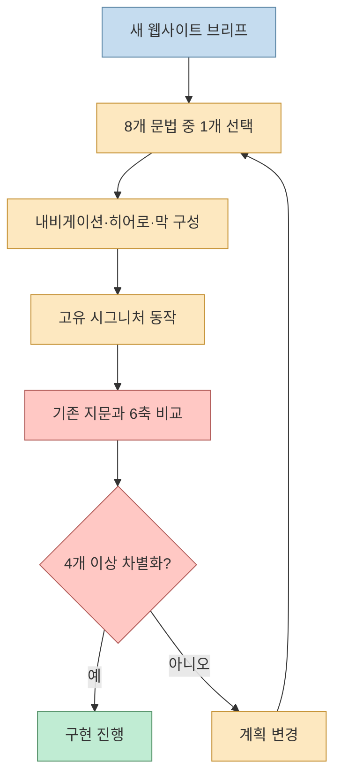
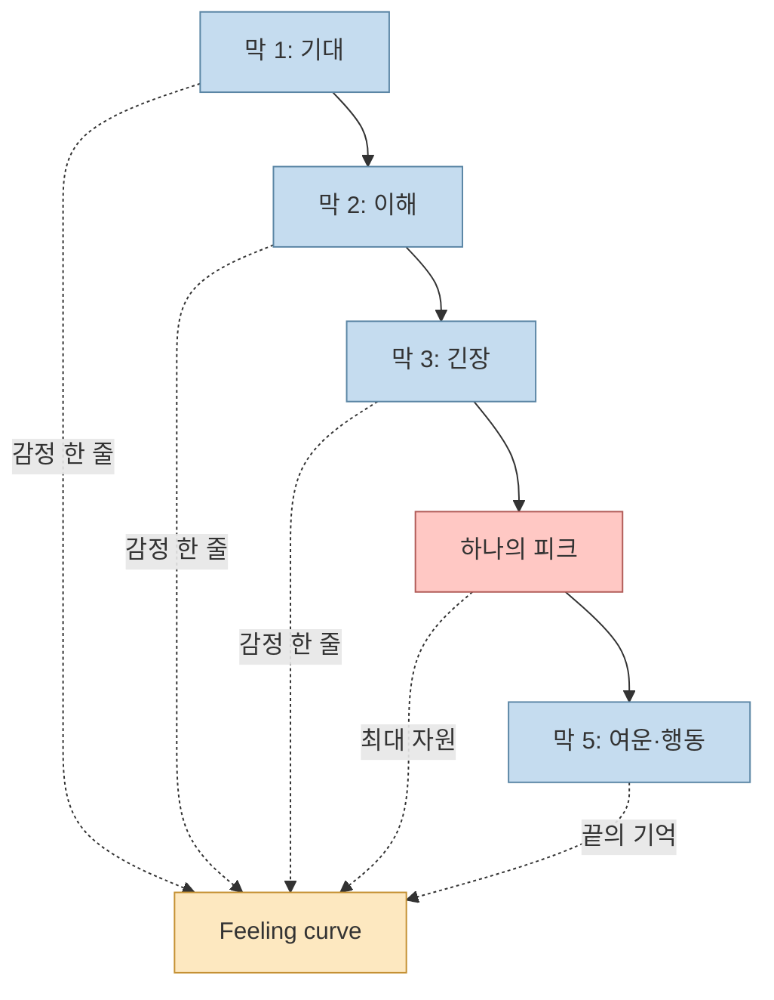
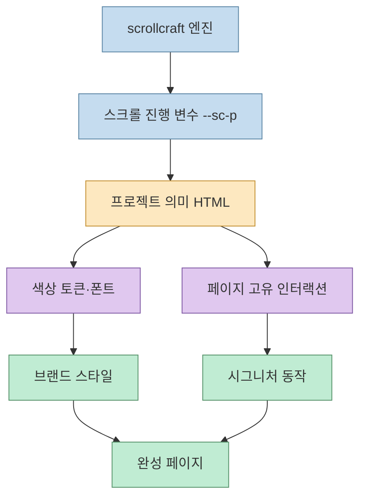
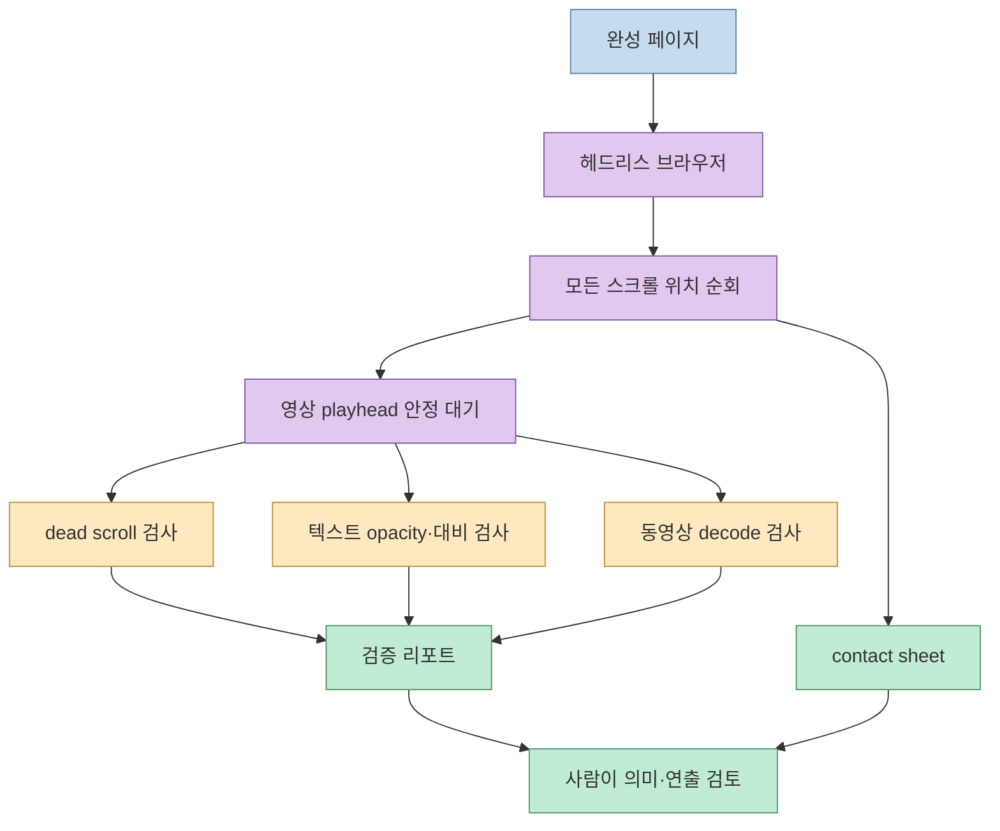

AI에게 웹사이트를 만들어 달라고 하면 두 가지 결과로 흐르기 쉽습니다. 무난하지만 기억에 남지 않는 페이지이거나, 화려한 스크롤 효과만 있고 모바일 가독성과 정보 구조가 무너진 페이지입니다. `nateherkai/scroll-craft`는 이 문제를 **인터랙션과 디자인 완성도를 하나의 제작 규칙으로 묶는 에이전트 스킬**로 다룹니다.

<!--more-->

이 저장소는 스크롤 애니메이션 코드만 제공하지 않습니다. 여덟 가지 페이지 문법 중 하나를 고르고, 다른 페이지와 겹치지 않는 고유한 시그니처 동작을 설계하며, 감정 곡선·타이포그래피·색상·깊이·모바일 구성을 점검합니다. 마지막에는 헤드리스 브라우저가 실제 스크롤 위치를 이동하며 정적 화면과 동영상 재생 상태를 검증합니다.

## Sources

- 공식 저장소: [nateherkai/scroll-craft](https://github.com/nateherkai/scroll-craft)
- 공식 README 원문: [README.md](https://github.com/nateherkai/scroll-craft/blob/main/README.md)
- 라이선스: [MIT LICENSE](https://github.com/nateherkai/scroll-craft/blob/main/LICENSE)

## scroll-craft가 다루는 제작 문제

README는 이 스킬을 Codex, Claude Code 등 파일을 편집하고 명령을 실행하며 브라우저를 검사할 수 있는 코딩 에이전트용 도구로 설명합니다. 핵심은 “스크롤 애니메이션을 넣어라”가 아니라 **페이지의 주장과 사용자의 스크롤을 하나의 연출 타임라인으로 설계하는 것**입니다.



README가 말하는 설계 대상에는 프레임 단위 비디오 스크럽, 고정 섹션, 가로 레일, 한 줄씩 조립되는 헤드라인, 스크롤에 따른 배경색 변화, 포인터 반응이 포함됩니다. 이런 장치들은 장식 목록이 아니라 페이지의 정보 순서를 전달하는 수단으로 취급됩니다.

## 여덟 가지 페이지 문법과 지문 게이트

스킬은 filmic one-shot, chaptered editorial, live surface, continuous world, typographic poster, gallery, split stage, rhythmic cutlist라는 여덟 가지 상호 배타적 페이지 문법을 제시합니다. 한 프로젝트에서 여러 문법을 섞어 평균적인 템플릿으로 수렴하는 대신, 하나의 문법을 고르고 그 문법이 허용하지 않는 패턴을 피하는 방식입니다.

또한 새 페이지는 기존 페이지와 여섯 가지 차원 중 최소 네 가지가 달라야 한다는 fingerprint gate를 둡니다.

- page grammar
- navigation
- hero
- act shape
- close
- signature move



이 규칙은 단순한 스타일 변형과 실제 정보 구조의 차이를 구분합니다. 버튼 색만 바꾼 페이지는 다른 작품으로 인정하지 않고, 탐색 방식·첫 화면의 주장·중간 전개·마지막 행동·대표 인터랙션을 다시 설계하게 만듭니다.

## 감정 곡선과 하나의 engineered peak

각 막(act)이 어떤 감정을 만들어야 하는지, 그리고 그 감정을 화면의 무엇으로 유발할지 먼저 한 줄로 적습니다. 인접한 두 막이 같은 감정이면 한쪽은 채워 넣기일 가능성이 높다고 보고 다시 압축합니다.

그 다음 페이지 전체에 하나의 engineered peak를 둡니다. 가장 강한 장면에 에셋 예산·여백·스크롤 공간을 집중하고, 여러 장면을 동시에 절정으로 만들지 않습니다. 사용자가 페이지를 끝까지 봤을 때 무엇을 기억해야 하는지를 하나의 지점으로 수렴시키는 방식입니다.



## 디자인 바닥선: 타입·간격·색상·깊이

scroll-craft는 에이전트가 매번 취향대로 디자인하지 않도록 최소 기준을 명시합니다.

- 글꼴은 최대 두 계열을 사용합니다.
- 본문 measure는 45~75ch 범위를 목표로 합니다.
- 4px 기반 간격 스케일을 사용하고, 제목 위 여백을 아래보다 크게 둡니다.
- 색상은 여섯 가지 역할과 하나의 액센트로 나눕니다.
- 순수한 검정 대신 배경과 텍스트의 대비를 조정합니다.
- 깊이는 오프셋 그림자, edge light, scale·blur, 겹침, grain의 다섯 도구로 설계합니다.
- 모바일은 데스크톱을 축소한 결과가 아니라 별도로 아트 디렉션합니다.

여기서 중요한 것은 수치를 기계적으로 적용하는 것이 아니라, 페이지의 읽기 리듬과 스크롤 속도에 맞춰 토큰을 조정하는 것입니다. 브랜드 가이드가 있다면 스킬의 기본 취향보다 브랜드의 금지 규칙과 색상 규칙을 우선해야 합니다.

## 엔진과 프로젝트 코드의 경계

저장소는 `plugins/nateherk-design/skills/scroll-craft/` 아래에 스킬 지침, references, engine, templates, scripts를 묶습니다. README의 핵심 규칙은 **엔진을 프로젝트마다 수정하지 않는 것**입니다.

엔진은 메커니즘으로 고정하고, 프로젝트에서는 여섯 개 색상 토큰·두 개 폰트·의미 있는 HTML을 작성하며 `--sc-p` 커스텀 프로퍼티를 통해 고유 동작을 연결합니다. 엔진을 매번 복제해 고치면 모든 페이지가 비슷해지고, 엔진과 콘텐츠의 책임 경계도 무너집니다.



## 브라우저 검증: 작동 여부와 의미를 분리한다

완성 페이지는 헤드리스 브라우저가 모든 스크롤 위치를 이동하며 검사합니다. 동영상 playhead가 안정될 때까지 기다린 뒤 다음 문제를 보고합니다.

- 화면이 아무것도 바꾸지 않는 dead scroll
- 끝까지 불투명해지지 않아 계속 흐릿한 텍스트
- 합성된 실제 화면에서 측정한 줄 단위 대비
- 디코딩되지 않아 정지 화면처럼 보이는 동영상

검증 결과로 contact sheet도 작성합니다. 자동화는 페이지가 작동하는지 증명할 수 있지만, 콘텐츠가 의미 있는지 판단할 수 없기 때문입니다.



## 설치와 첫 실행

Codex나 다른 코딩 에이전트에서는 저장소 전체를 내려받고 `plugins/nateherk-design/skills/scroll-craft/` 폴더를 프로젝트의 `.agents/skills/`에 복사한 뒤 스킬을 읽도록 요청합니다. Claude Code에서는 마켓플레이스 추가와 플러그인 설치 명령을 사용할 수 있습니다.

첫 실행에서는 다음 두 명령을 먼저 수행합니다.

```bash
node plugins/nateherk-design/skills/scroll-craft/scripts/doctor.mjs
node plugins/nateherk-design/skills/scroll-craft/scripts/workspace.mjs --ensure
```

`doctor`는 ffmpeg가 필요한 필터를 지원하는지, WebP muxer가 있는지, `playwright-core`가 올바른 위치에서 해석되는지 점검합니다. README가 안내하는 주요 요구사항은 Node 18 이상, 전체 ffmpeg 빌드, `playwright-core`와 Chrome입니다. 에셋 생성 기능을 사용할 때만 `KIE_AI_API_KEY`가 선택적으로 필요합니다.

## 플랫폼과 비용의 한계

README는 스크립트가 Windows·macOS·Linux의 ffmpeg와 Chrome 위치를 찾지만, 실제 빌드는 Windows에서만 수행됐고 Mac 빌드는 검증하지 않았다고 명시합니다. 따라서 macOS에서 사용할 때는 성공을 전제로 하지 말고 `doctor` 결과와 브라우저 검증을 먼저 확인해야 합니다.

또한 생성 동영상은 무료가 아닐 수 있습니다. 자체 사진과 영상을 사용하는 경로는 비용 없이 가능하지만, 연속적인 월드 비행처럼 생성형 비디오를 쓰는 경우 실제 비용이 발생할 수 있습니다. 이 차이를 에이전트 프롬프트와 예산 계획에 반영해야 합니다.

## 라이선스와 적용 범위

저장소는 MIT License로 공개되어 있어 스킬 코드와 문서를 사용·복사·수정·배포할 수 있습니다. 다만 이 라이선스가 스킬로 생성하는 모든 이미지·영상·클라이언트 자산의 권리까지 자동으로 보장하는 것은 아닙니다. README도 브랜드 자산과 제품 정보를 생성하기 전에 진위와 출처를 확인하라고 요구합니다.

실제 사이트를 만들 때는 다음을 분리해 기록해야 합니다.

- scroll-craft 코드와 스크립트의 MIT 고지
- 사용한 사진·영상·폰트·로고의 원본 라이선스
- 생성형 에셋 API의 약관과 비용
- 브랜드가 제공한 금지·필수 규칙
- 자동 검증 결과와 사람이 승인한 최종 버전

## 핵심 요약

- scroll-craft는 스크롤 기반 프리미엄 웹사이트를 만드는 에이전트 스킬입니다.
- 여덟 가지 페이지 문법과 고유 시그니처 동작으로 반복되는 AI 웹 디자인을 방지합니다.
- 감정 곡선과 하나의 engineered peak를 먼저 정해 페이지의 기억 지점을 만듭니다.
- 엔진은 수정하지 않고 색상 토큰·폰트·의미 HTML·`--sc-p`로 프로젝트를 차별화합니다.
- 헤드리스 브라우저가 dead scroll, 텍스트 대비, opacity, 동영상 디코딩을 검사합니다.
- 자동화는 작동 여부를 검증하지만 콘텐츠가 의미 있는지는 사람이 판단해야 합니다.
- MIT 라이선스이지만 사용 자산·브랜드 정보·생성 API의 권리는 별도로 확인해야 합니다.
- README 기준으로 macOS 빌드는 검증되지 않았으므로 `doctor`와 실제 브라우저 테스트가 필수입니다.

## 결론

scroll-craft의 강점은 화려한 효과 코드가 아니라 **페이지를 반복 생산하는 에이전트의 판단 기준을 문서화했다는 점**입니다. 문법 선택, 고유성 게이트, 감정 곡선, 피크 설계, 디자인 바닥선, 자동 검증을 순서대로 통과하면 “그럴듯한 템플릿”과 “목적을 가진 웹 경험”을 구분할 수 있습니다.

다만 이 도구는 취향이 강하고, 생성형 에셋과 플랫폼 환경에 제약이 있습니다. 먼저 작은 페이지에서 `doctor`와 검증 하니스를 통과시킨 뒤 브랜드 자산과 고유 인터랙션을 얹는 방식으로 도입하면, 에이전트의 속도와 사람의 연출 판단을 함께 유지할 수 있습니다.
