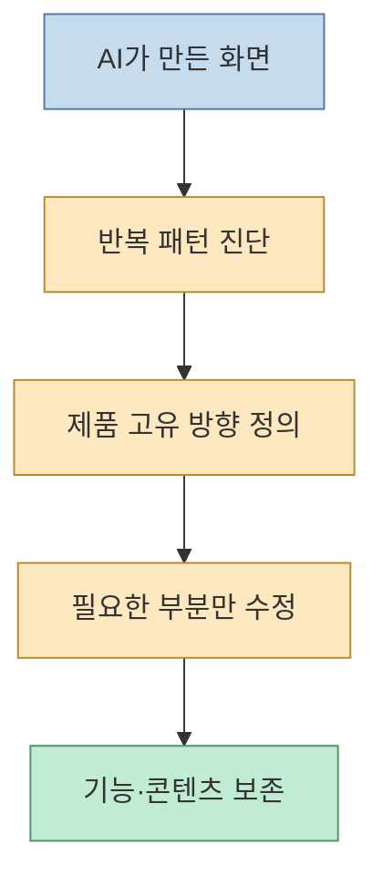
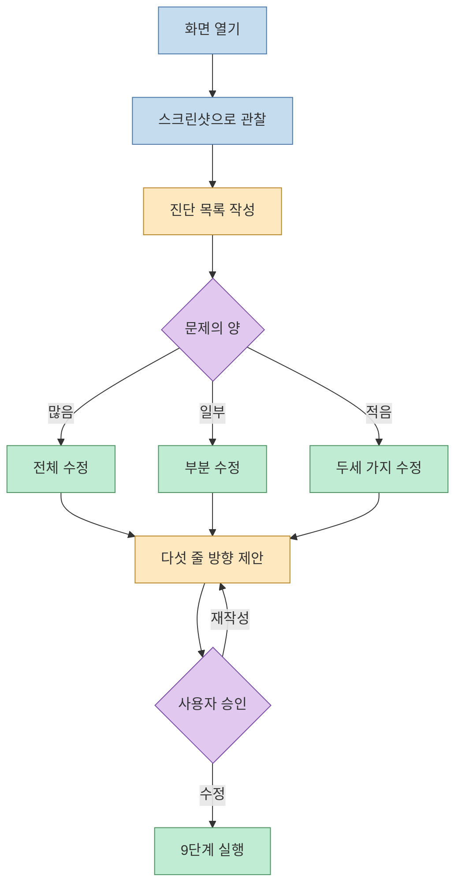
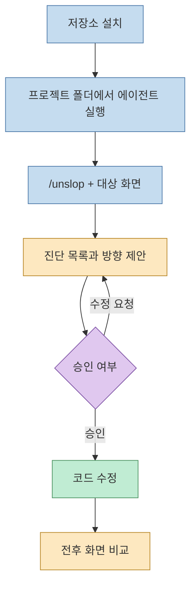
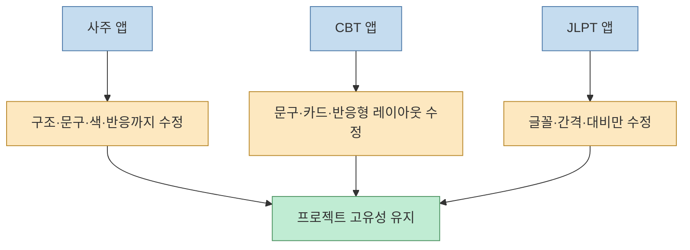
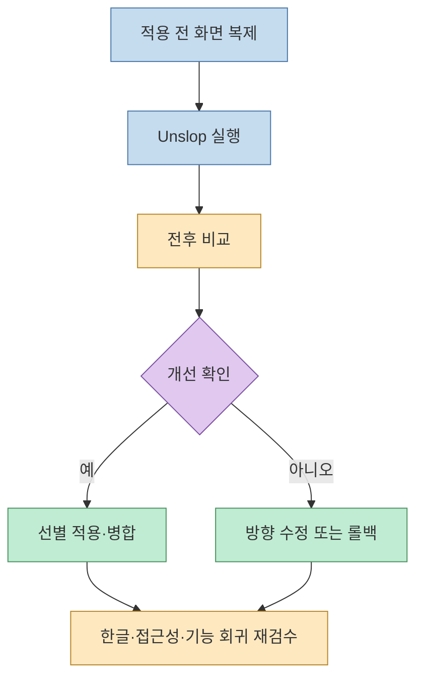

AI 코딩 도구로 만든 화면은 빠르지만, 보라색 그라데이션·이모지 아이콘·반짝이 배지·알약 버튼처럼 비슷한 흔적을 남기기 쉽다. 영상에서 소개한 **Unslop**은 이 흔적을 진단하고 제품의 고유한 방향을 다시 부여하는 디자인 스킬이다. 단순히 “예쁘게 만들어 줘”라고 요청하는 대신, 화면을 보고 문제 목록을 만든 뒤 수정 범위와 방향을 먼저 확인한다.

<!--more-->

## Sources

- [YouTube — 바이브코딩 AI 티 없애는 건당 200만원 기술, 클로드 코드 무료 스킬로 풀려서 제 서비스에 적용했습니다](https://youtu.be/6rgRkP3kqXk?si=MshokN0vX98wt39-)
- [heydamir/unslop 공식 저장소](https://github.com/heydamir/unslop)

## Unslop이 해결하려는 문제

영상은 AI가 만든 UI에서 반복되는 패턴을 “AI 티” 또는 “slop”으로 부른다. 보라색에서 파란색으로 이어지는 그라데이션, 제목의 그라데이션 텍스트, 버튼과 카드의 광택, 메뉴 앞 이모지, 새 기능 옆 반짝이 배지, 문맥 없는 느낌표, 모든 라벨의 영어 대문자, 제각각인 간격이 한 화면에 겹치면 대충 만든 서비스처럼 보인다. 유료 서비스에서는 이런 첫인상이 신뢰와 전환에 직접 영향을 줄 수 있다. (영상 00:13~00:27, [타임스탬프](https://youtu.be/6rgRkP3kqXk?t=13))

Unslop은 새 디자인 시스템을 무조건 덮어쓰는 도구가 아니다. 이미 있는 기능과 콘텐츠를 유지하면서, 장식이 과도하게 분산된 곳을 줄이고 제품을 대표하는 요소에 시각적 강조를 모으는 쪽에 가깝다.

## 유료 디자인 작업을 스킬로 공개하다

Unslop을 만든 디자이너 Damir Sokolovsky는 스타트업의 대시보드·모바일 앱·랜딩 페이지를 디자인부터 코드까지 만드는 일을 해 왔다. 영상에서는 핵심 화면 하나를 3일 안에 고치는 유료 작업이 화면당 1,500달러이며, 기한을 지키지 못하면 환불하는 조건까지 소개한다. 이후 X에 공개한 작업 과정이 반응을 얻었고, 그 순서를 무료 스킬로 공개했다. 이제 같은 방식의 작업을 Claude Code에서 직접 실행할 수 있다는 설명이다. (영상 01:05~02:04, [타임스탬프](https://youtu.be/6rgRkP3kqXk?t=65))

저장소 설명에 따르면 Unslop은 Claude Code, Codex, Google Antigravity에서 사용할 수 있는 스킬이다. 스킬은 모델에 주입하는 단순한 한 문장 프롬프트가 아니라, 반복 가능한 작업 순서와 판단 기준을 담은 폴더다. 랜딩 페이지, 대시보드, 모바일 앱 화면을 대상으로 하며 AI가 만든 화면에서 자주 보이는 문제를 여러 범주로 정리한다. (영상 02:04~02:22, [heydamir/unslop](https://github.com/heydamir/unslop))

## 진단부터 수정까지의 작업 순서

Unslop의 품질은 특정 색상보다 **순서**에 있다. 먼저 화면을 실제로 띄워 스크린샷을 보고, 어디에 어떤 문제가 있는지 진단 목록을 만든다. 문제의 양에 따라 전체 개편, 일부 수정, 또는 작은 수정 두세 개만 선택한다. 이미 괜찮은 화면을 억지로 바꾸지 않는 것이 중요한 안전장치다. (영상 03:21~03:40, [타임스탬프](https://youtu.be/6rgRkP3kqXk?t=201))

그 다음 다섯 줄짜리 디자인 방향을 작성한다. 제품이 무엇인지, 성격은 어떤지, 경쟁 제품과 속한 카테고리는 무엇인지, 색을 집중할 장면은 어디인지, 이 제품만의 작은 표식은 무엇인지 정한다. “깔끔하게”, “모던하게”, “미니멀하게”처럼 어떤 템플릿에도 붙일 수 있는 표현은 사용하지 않는다. 방향을 확인받기 전에는 실제 수정에 들어가지 않는다. 방향이 뒤늦게 바뀌면 전체 작업을 다시 해야 하기 때문이다. (영상 03:41~04:10, [타임스탬프](https://youtu.be/6rgRkP3kqXk?t=221))

### 아홉 단계의 수정 순서

실제 수정은 **간격 → 색 → 아이콘 → 문구 → 글꼴 → 배치 → 세부 요소 → 이미지 → 움직임** 순서다. 간격을 먼저 맞추는 이유는 여백이 정돈되어야 나머지 변경도 다르게 보이기 때문이다. 문구를 글꼴보다 먼저 바꾸는 이유는 제목 길이가 적절한 글자 크기와 줄바꿈을 결정하기 때문이다. 마지막에 움직임을 다루는 것은 장식적 애니메이션보다 정적 구조가 우선이라는 뜻이다. (영상 04:10~04:31, [타임스탬프](https://youtu.be/6rgRkP3kqXk?t=250))

기능의 의미는 바꾸지 않는다. 제품명·기능·섹션 순서를 유지하고, 존재하지 않는 기능이나 수치를 만들어내지 않는다. 예를 들어 “1만 명이 사용 중” 같은 문구의 진위가 확인되지 않으면 먼저 질문하고, 확인할 수 없으면 삭제한다. (영상 04:31~04:39, [타임스탬프](https://youtu.be/6rgRkP3kqXk?t=268))

## 설치와 사용법

정식 설치는 저장소를 내려받아 `skills/unslop` 폴더를 Claude Code의 스킬 폴더에 복사하는 방식이다. Codex는 저장소가 안내하는 설치 명령을 사용할 수 있고, Google Antigravity는 폴더 복사 방식으로 소개된다. (영상 04:39~04:55, [타임스탬프](https://youtu.be/6rgRkP3kqXk?t=281))

프로젝트 폴더에서 Claude Code를 실행한 뒤 `/unslop`과 함께 대상 화면을 말하면 된다. 예를 들어 대시보드나 랜딩 페이지 첫 화면을 지정하면 먼저 진단 목록과 방향을 제안한다. 사용자가 진행을 승인한 뒤에만 코드가 바뀐다. 코드가 없어도 URL을 주면 페이지를 저장하고 수정 버전을 코드로 만드는 흐름을 지원하며, 이 경우 Playwright 같은 브라우저 자동화 도구가 필요하다. 수정 과정을 짧은 영상으로 내보내는 기능도 소개된다. (영상 04:55~05:40, [타임스탬프](https://youtu.be/6rgRkP3kqXk?t=299))

저장소 주소를 에이전트에 직접 주고 “프로젝트의 모든 화면에 적용하라”고 요청하는 간편한 방법도 있다. 에이전트가 저장소의 스킬 문서를 읽고 순서대로 실행하지만, 승인 단계가 생략될 수 있으므로 변경 전후를 반드시 검토하는 편이 좋다. (영상 05:40~06:00, [타임스탬프](https://youtu.be/6rgRkP3kqXk?t=340))

라이선스는 만든 사람의 이름과 저장소 주소를 표시하면 상업적으로 사용할 수 있는 조건으로 소개된다. 실제 프로젝트에 적용하기 전에는 저장소의 현재 라이선스 원문을 확인해야 한다. (영상 05:40~05:48, [타임스탬프](https://youtu.be/6rgRkP3kqXk?t=340))

## 세 서비스에 적용한 결과

### 1. 사주 서비스: 구조까지 크게 바뀐 경우

`쇼미페이트`는 세 서비스 중 변화가 가장 컸다. 화면 전체를 덮던 나무 그림은 흑연색 배경과 카드 안의 이미지로 정리됐고, 추상적인 인사 문구는 “사주로 읽는 나의 하루”처럼 기능을 설명하는 문구로 바뀌었다. 금색은 위치 표시와 점수 같은 핵심 정보에만 남았다. (영상 06:05~06:45, [타임스탬프](https://youtu.be/6rgRkP3kqXk?t=365))

PC 화면에서는 휴대폰 폭의 콘텐츠와 QR 코드가 중앙에 떠 있던 구조가 왼쪽 메뉴와 넓은 본문을 갖는 데스크톱 레이아웃으로 바뀌었다. 카드가 한 줄에 세 장씩 보여 정보 밀도가 좋아졌고, 탭이 튀는 움직임과 빛 효과는 제거하고 카드가 펼쳐지는 동작만 남겼다. 다만 사주 서비스 특유의 분위기가 약해지고, 한글 글꼴이 영어 화면처럼 가늘어 보이는 단점도 있었다. (영상 06:45~08:15, [타임스탬프](https://youtu.be/6rgRkP3kqXk?t=425))

### 2. 자격증 CBT: 문구와 카드까지 정리된 경우

`패스핏`은 기존 파란색과 그림을 유지하면서 두 페이지를 수정했다. 긴 제목은 짧아졌고, 범용적인 “오늘의 한 문제, 내일의 가능성”은 “기출 한해차부터 차근차근 준비하세요”처럼 서비스에만 해당하는 문장으로 바뀌었다. 검정 알약 버튼은 파란 사각형으로, 큰 둥근 모서리와 그라데이션 카드는 얇은 선 중심으로 바뀌었다. 제목 끝의 불필요한 파란 마침표도 제거됐다. (영상 08:12~09:10, [타임스탬프](https://youtu.be/6rgRkP3kqXk?t=492))

자격증 목록은 한 줄의 카드 수를 줄여 글자를 키웠고, 문제 풀이 화면은 본문 폭을 넓혀 문제와 보기가 한눈에 들어오게 했다. 모바일에서는 메뉴 이름과 터치 영역을 조정했지만 문제·정답·검색 페이지의 URL은 유지했다. 디자인을 개선하면서 검색 유입 경로와 기존 기능을 보존한 사례다. (영상 09:10~09:37, [타임스탬프](https://youtu.be/6rgRkP3kqXk?t=548))

### 3. JLPT 앱: 작은 수정만 필요한 경우

JLPT 앱은 이미 방향이 잡혀 있어 겉으로 큰 변화가 없었다. 대신 흐릿했던 설명 글씨를 12픽셀 이상으로 키우고, 간격을 4픽셀 단위로 맞췄다. 보조 글씨의 흰 배경 대비는 5.17:1로 높아졌으며, 영상에서는 일반 텍스트의 웹 접근성 기준 4.5:1을 넘었다고 설명한다. (영상 09:37~10:06, [타임스탬프](https://youtu.be/6rgRkP3kqXk?t=590))

연상 이미지 보기 버튼에는 반짝이 아이콘 대신 그림 아이콘을 사용해 기능과 시각 언어를 일치시켰다. 장식용 영어 문구는 “학습 기록”으로 바꿨지만, 메뉴 순서와 학습 단계·검색·포인트 기능은 그대로 두었다. (영상 10:06~10:25, [타임스탬프](https://youtu.be/6rgRkP3kqXk?t=606))

## Unslop을 안전하게 평가하는 방법

세 결과를 비교하면 Unslop은 모든 화면을 같은 스타일로 만드는 도구가 아니다. 사주 앱은 흑연색과 금색, CBT 앱은 흰색과 파란색, JLPT 앱은 베이지와 금색을 유지했다. 공통으로 줄어든 것은 장식의 양과 범용 문구이지, 브랜드 색 자체가 아니다. (영상 10:25~10:45, [타임스탬프](https://youtu.be/6rgRkP3kqXk?t=625))

반대로 이미 디자인이 잘 잡힌 화면에서는 변화가 작거나, 오히려 서비스의 분위기를 약화시킬 수 있다. 영상은 사주 앱의 개성이 희미해진 점과 한글 글씨가 필요 이상으로 가늘어진 점을 한계로 지적한다. 따라서 전체 프로젝트에 한 번에 적용하지 말고 비교용 페이지나 브랜치를 먼저 만들어 전후 화면을 확인해야 한다. (영상 10:45~11:26, [타임스탬프](https://youtu.be/6rgRkP3kqXk?t=649))

## 핵심 요약

- Unslop은 AI가 만든 UI의 반복적인 장식 패턴을 진단하고 제품 고유의 방향을 부여하는 Claude Code·Codex용 스킬이다.
- 화면을 먼저 관찰하고 진단 목록과 다섯 줄 방향을 승인받은 뒤, 간격·색·아이콘·문구·글꼴·배치·세부 요소·이미지·움직임 순으로 고친다.
- 기능명, URL, 숫자처럼 제품의 사실과 동작은 임의로 바꾸지 않는다.
- 세 서비스의 결과가 달랐듯이, 잘못된 문제를 고치지 않으려면 전후 비교와 선택적 병합이 필요하다.
- 한글 글꼴 두께와 서비스 고유 분위기는 자동 수정 뒤 사람이 반드시 재검수해야 한다.

## 결론

Unslop의 가치는 “AI 티를 없애는 정답 스타일”에 있지 않다. 디자인 판단을 관찰→진단→방향 승인→단계별 수정이라는 재현 가능한 절차로 만든 데 있다. 먼저 복제 화면에서 시험하고, 좋아진 부분만 병합한다면 빠른 바이브 코딩의 속도를 유지하면서도 제품의 개성과 신뢰를 지킬 수 있다.
