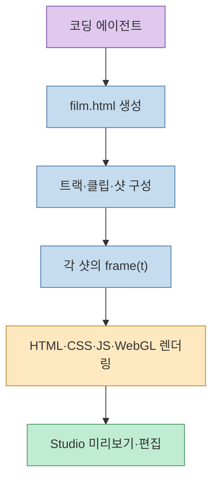
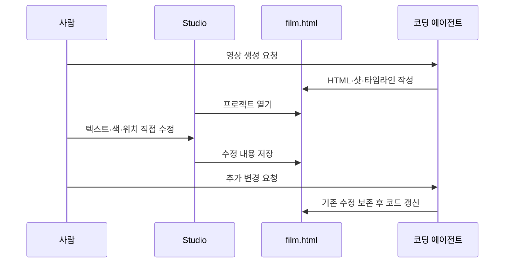
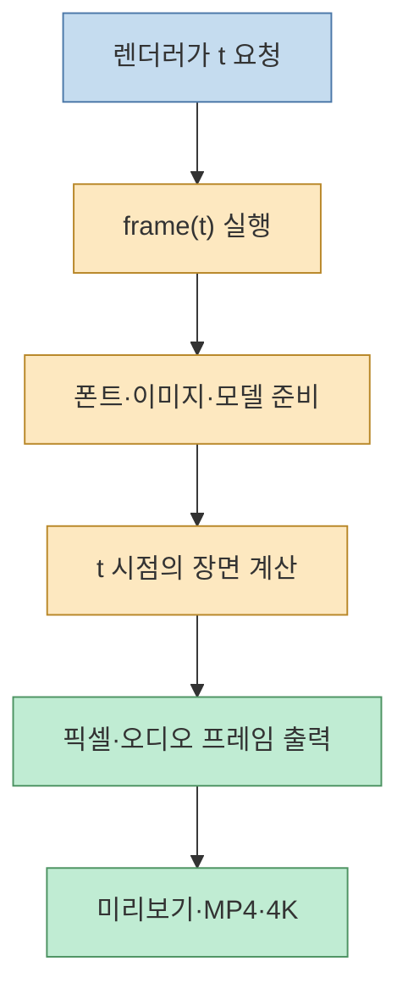
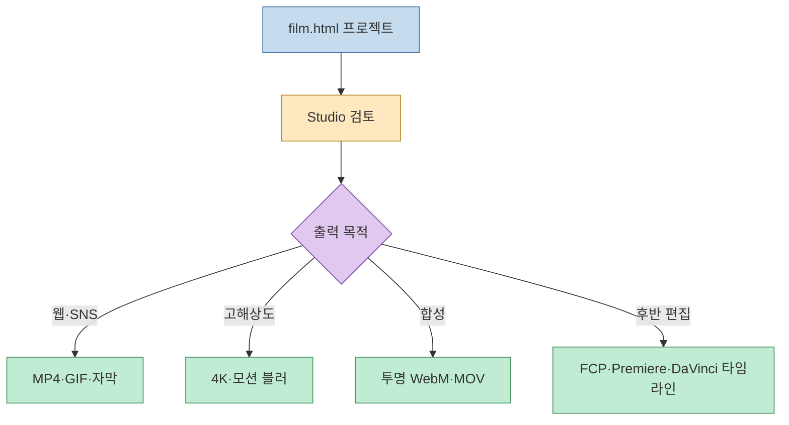
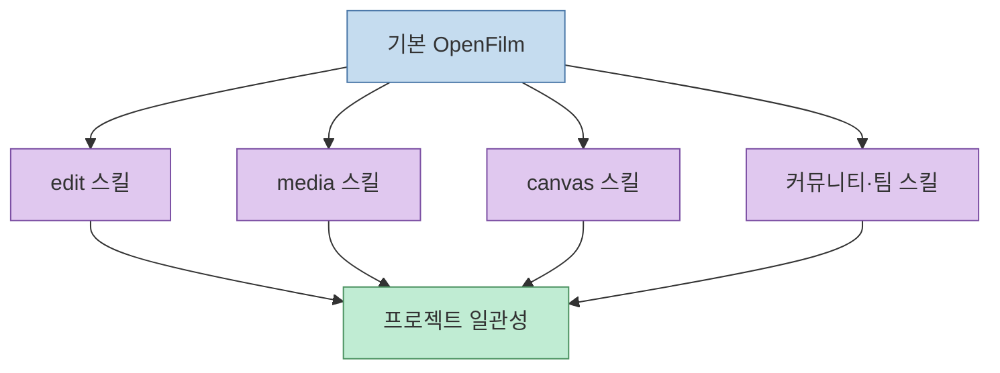

AI 영상 생성의 가장 큰 불편은 결과물이 마음에 들지 않을 때 전체를 다시 뽑아야 한다는 점이다. Threads에서 소개된 **OpenFilm**은 이 과정을 웹 개발 방식으로 바꾼다. Claude Code나 Codex 같은 코딩 에이전트가 영상을 코드로 만들고, 사람은 로컬 브라우저 편집기 Studio에서 요소와 타임라인을 직접 수정한다. 생성과 편집을 분리하는 대신, 처음부터 같은 프로젝트 파일을 함께 다루는 방식이다.

<!--more-->

## Sources

- [Threads 원문 — OpenFilm 소개](https://www.threads.com/share/BAbA1OvEq8) (동적 페이지 본문은 Scrapling `fetch --network-idle`로 추출)
- [OpenFilm 공식 GitHub 저장소](https://github.com/openfilm/openfilm)
- [OpenFilm 공식 웹사이트](https://openfilm.dev)

## OpenFilm의 핵심 모델: 영상도 웹 페이지다

OpenFilm의 공식 README는 “한 개의 HTML 파일, 한 개의 함수, 실제 편집기”라는 구조를 설명한다. 영상은 `film.html`에 트랙과 클립을 기록하고, 각 샷은 브라우저가 그릴 수 있는 웹 페이지다. 따라서 에이전트가 이미 알고 있는 HTML·CSS·JavaScript·애니메이션 기술을 영상 제작에 그대로 사용할 수 있다. (공식 저장소 README, [구조 설명](https://github.com/openfilm/openfilm#how-it-works))

각 샷은 `frame(t)` 함수로 시간 `t`에서의 전체 화면을 그린다. three.js, WebGL, Canvas, SVG, CSS, GSAP, 비디오 등 브라우저가 렌더링할 수 있는 기술을 선택할 수 있고, 특정 영상 프레임을 생성하는 별도 전용 DSL을 배울 필요가 없다. (Threads 본문, [원문](https://www.threads.com/share/BAbA1OvEq8))



이 모델의 장점은 “생성 모델이 영상 파일을 반환한다”가 아니라 “에이전트가 수정 가능한 프로젝트를 반환한다”는 데 있다. 문구·색·위치·레이어를 바꾸는 작업은 전체 영상을 재생성하지 않고 HTML과 스타일을 수정하는 일로 바뀐다.

## Studio: 생성 결과를 손으로도, 말로도 수정한다

Studio는 로컬에서 실행되고 브라우저에서 영상을 보여 주는 편집기다. 공식 문서에 따르면 페이지 안의 텍스트와 레이어를 이동·확대·회전하고, 클립을 배치·자르고·스타일링하고·볼륨과 속도를 조절할 수 있다. 수정 내용은 프로젝트 파일에 저장되므로 이후 에이전트가 변경 사항을 읽고 유지할 수 있다. (공식 저장소 README, [Studio 설명](https://github.com/openfilm/openfilm#studio))

즉, 에이전트가 만든 첫 결과를 사람이 포기하거나 통째로 다시 생성할 필요가 없다. Studio에서 직접 고친 뒤 “이 장면의 제목을 왼쪽으로 옮기고 2초 늦춰라”처럼 다시 지시할 수 있다. 사람의 시각적 판단과 에이전트의 코드 생성 능력이 같은 파일을 중심으로 반복된다.



Studio 옆의 캔버스에서는 메모, 이미지, 클립, 보이스오버, 음악을 배치하고 타임라인으로 보낼 수 있다. 프로젝트마다 여러 캔버스를 두어 스토리보드처럼 사용할 수도 있다. 이 구조는 영상 제작을 한 번의 프롬프트가 아니라 **계획→배치→생성→검토→수정**의 반복 가능한 작업으로 만든다. (공식 저장소 README, [Studio와 캔버스](https://github.com/openfilm/openfilm#studio))

## `film.html`과 `frame(t)`를 이해하기

OpenFilm의 기본 단위는 폴더와 그 안의 `film.html`이다. `<section>`은 타임라인의 트랙이 되고, 페이지·비디오·이미지·오디오는 클립이 된다. 미디어 조각은 `#t=시작,끝`으로 자르고, `at`으로 시작 시점을 정하며 CSS의 `left`, `top`, `width`, `height`로 위치와 크기를 정한다. (공식 저장소 README, [How it works](https://github.com/openfilm/openfilm#how-it-works))

페이지는 다음 계약을 지킨다.

```javascript
window.film = {
  frame(t) {
    // t초 시점의 전체 장면을 결정적으로 그린다.
  },
  duration: 4,
  ready: loadFonts(),
  width: 480,
  height: 320,
};
```

가장 중요한 규칙은 같은 `t`가 항상 같은 화면을 그려야 한다는 점이다. 렌더러는 프레임을 순서 없이 병렬로 요청하거나 모션 블러를 위해 프레임 사이를 요청할 수 있다. 이전 프레임의 상태에 의존하면 미리보기와 최종 출력이 달라질 수 있으므로, `frame(t)`를 결정적 함수로 작성해야 한다. (공식 저장소 README, [frame 계약](https://github.com/openfilm/openfilm#how-it-works))



## 설치와 시작

공식 저장소의 간편 설치는 Node 22.2 이상과 ffmpeg, git을 요구하며 첫 실행 때 약 100MB의 headless Chromium을 내려받는다. 기본 명령은 다음과 같다. (공식 저장소 README, [Install](https://github.com/openfilm/openfilm#install))

```bash
npx skills add openfilm/openfilm
```

그 다음 에이전트에게 예를 들어 “내 CLI의 20초 런칭 영상을 음악과 함께 만들어 줘”라고 요청한다. 스킬이 없는 에이전트라면 `npx -y openfilm@latest`를 실행하고 안내를 따르도록 지시할 수 있다. macOS·Windows용 데스크톱 앱을 사용하면 ffmpeg와 브라우저가 함께 제공되어 별도 설치 부담을 줄일 수 있다. (공식 저장소 README, [Install](https://github.com/openfilm/openfilm#install))

생성형 음성·음악·이미지·비디오가 필요할 때는 ElevenLabs, OpenAI, Google, OpenRouter, fal 등의 서비스를 연결한다. 서비스별 API 키를 직접 입력하거나 OpenFilm의 로그인 방식을 사용할 수 있지만, 연결한 서비스의 사용량·과금·데이터 정책은 별도로 확인해야 한다. Threads 원문도 자신의 키로 음성·음악·이미지·비디오 서비스를 연결한다고 설명한다. (공식 저장소 README, [서비스 연결](https://github.com/openfilm/openfilm#install))

## 렌더링과 편집 결과의 내보내기

CLI는 영상을 열고, 특정 구간을 확인하고, 렌더링하고, 미디어를 가져오는 명령을 제공한다. `openfilm render`는 MP4를 만들며 `--4k`로 4K 출력, `--alpha`로 투명 WebM·MOV 출력을 선택할 수 있다. 또한 GIF, 오디오와 스템, 자막, 스틸 이미지, 투명 영상, Final Cut Pro·Premiere Pro·DaVinci Resolve용 타임라인을 내보낼 수 있다. (공식 저장소 README, [Commands](https://github.com/openfilm/openfilm#commands), [Studio](https://github.com/openfilm/openfilm#studio))



OpenFilm의 `look` 명령은 전체 프레임을 두 번 섞인 순서로 그려 화면이 달라지는지 검사하고, 페이지 오류·폰트 로드 실패·누락된 사운드 파일·프레임 밖으로 잘린 텍스트도 찾는다. 생성형 영상에서 흔한 “미리보기에서는 보였지만 렌더링에서 사라진 요소”를 잡기 위한 검증 단계다. (공식 저장소 README, [How it works](https://github.com/openfilm/openfilm#how-it-works))

## 스킬이 도구보다 중요한 이유

OpenFilm은 영상 종류별 지식을 스킬에 둔다. 기본 `edit` 스킬은 프로젝트·`film.html`·페이지를 다루고 검사하는 방법을, `media` 스킬은 라이브러리와 연결 서비스를, `canvas` 스킬은 캔버스 작업을 설명한다. 커뮤니티 스킬을 추가해 특정 영상 형식이나 브랜드 스타일에 맞는 제작 절차를 확장할 수도 있다. (공식 저장소 README, [Skills](https://github.com/openfilm/openfilm#skills))

이 구조는 “모델이 영상을 잘 만들도록 프롬프트를 길게 쓰는 것”보다 유지보수가 쉽다. 제작 규칙을 스킬 문서에 두면 여러 에이전트가 같은 검사·편집 절차를 공유하고, 사용자는 프로젝트별 스타일 스킬만 교체할 수 있다.



## 어떤 작업에 적합한가

OpenFilm은 반복적으로 문구·색·레이아웃을 바꾸는 런칭 영상, 제품 데모, 모션그래픽, 짧은 SNS 영상에 특히 잘 맞는다. HTML 요소를 직접 편집할 수 있으므로 “이 장면만 수정”하는 비용이 전체 재생성보다 낮다. 반면 실사 영상의 복잡한 색보정이나 전문가용 비선형 편집기를 완전히 대체한다고 단정해서는 안 된다. 공식 문서는 타임라인을 전문 편집기로 내보내는 흐름을 제공하므로, 생성·구조 편집은 OpenFilm에서 하고 세밀한 후반 작업은 기존 도구에서 이어가는 구성이 현실적이다.

또한 생성 서비스의 API 키와 과금은 OpenFilm 자체의 MIT 라이선스와 별개다. 저장소의 라이선스는 포맷·CLI·Studio·데스크톱 앱에 적용되지만, 외부 모델의 사용 약관이나 생성물 권리는 연결한 서비스 조건을 따른다. 상업 영상이라면 키 관리, 저작권, 음성·음악 라이선스를 별도로 확인해야 한다. (공식 저장소 README, [License](https://github.com/openfilm/openfilm#license))

## 핵심 요약

- OpenFilm은 코딩 에이전트가 영상을 만들고 사람이 같은 프로젝트를 직접 편집하는 오픈소스 AI 비디오 에이전트다.
- 영상은 `film.html`, 장면은 `frame(t)`로 표현되므로 HTML·CSS·JavaScript·WebGL 생태계를 그대로 활용한다.
- 로컬 브라우저 Studio에서 텍스트·색·위치·레이어와 타임라인을 수정하고, 변경 사항을 파일에 저장해 에이전트가 이어받는다.
- MP4·GIF·4K·투명 영상·자막과 Final Cut Pro·Premiere Pro·DaVinci Resolve용 타임라인으로 내보낼 수 있다.
- `look` 검사는 비결정적 프레임, 폰트·사운드 누락, 잘린 텍스트를 찾아 생성 결과를 검증한다.
- MIT 라이선스인 도구 자체와 외부 생성 서비스의 API 비용·약관·저작권은 구분해서 관리해야 한다.

## 결론

OpenFilm의 핵심은 AI가 영상을 한 번에 완성한다는 약속이 아니다. **영상 결과물을 코드와 편집 가능한 구조로 남긴다**는 약속이다. 에이전트에게 초안을 맡기되, Studio에서 사람이 시각적 결정을 내리고, `look`과 렌더링으로 결과를 검증한 뒤 필요하면 전문 편집기로 넘기는 흐름이 가장 현실적인 사용법이다.
