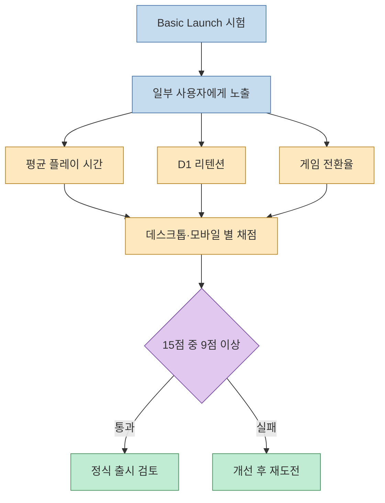
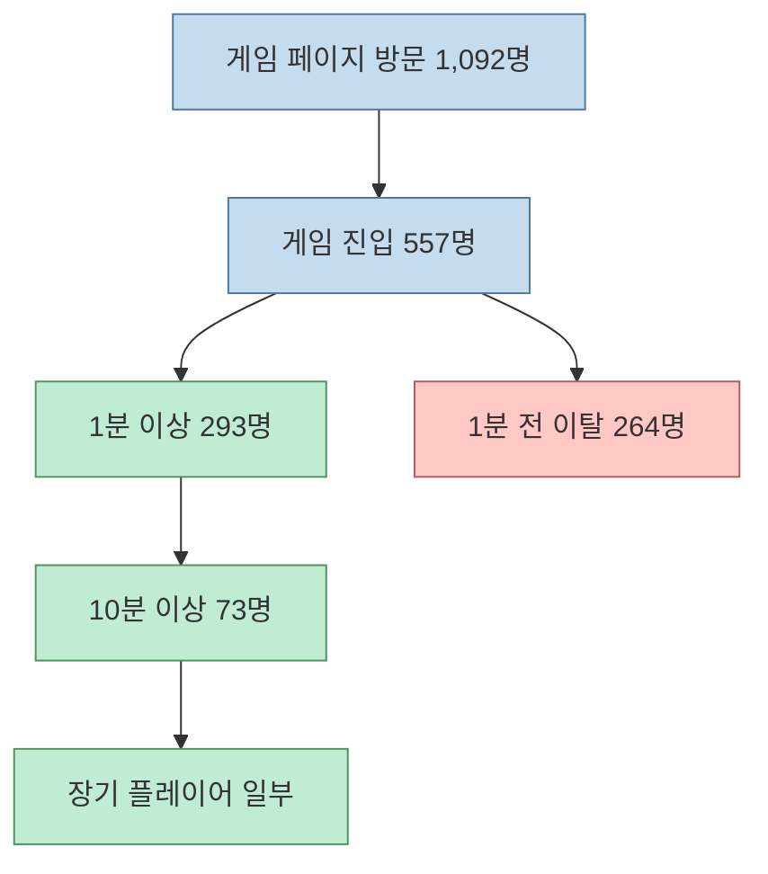
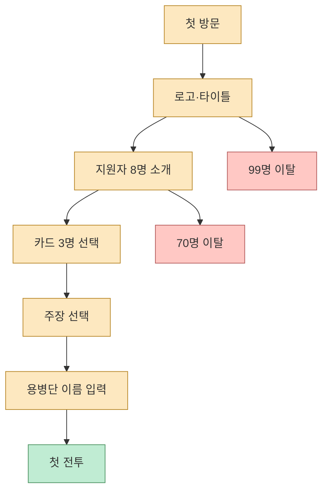
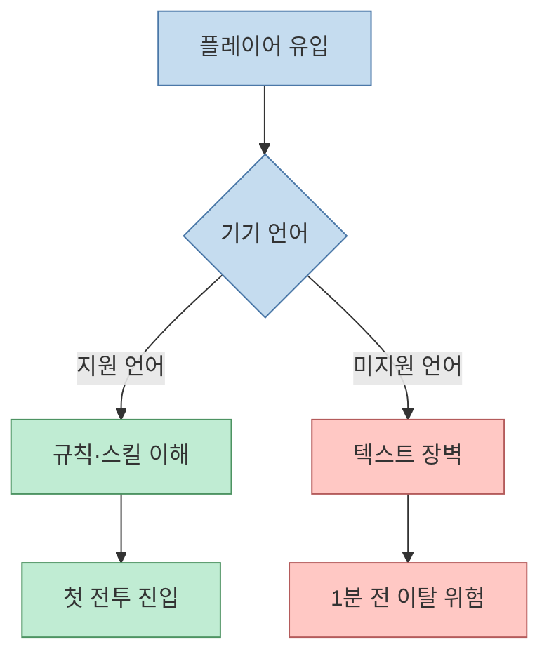
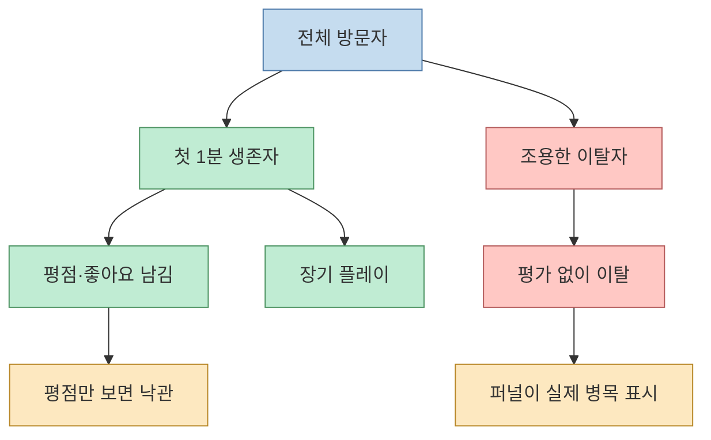
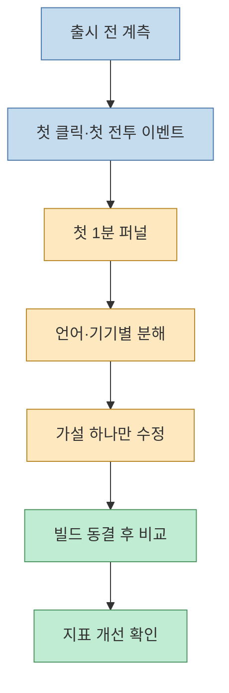
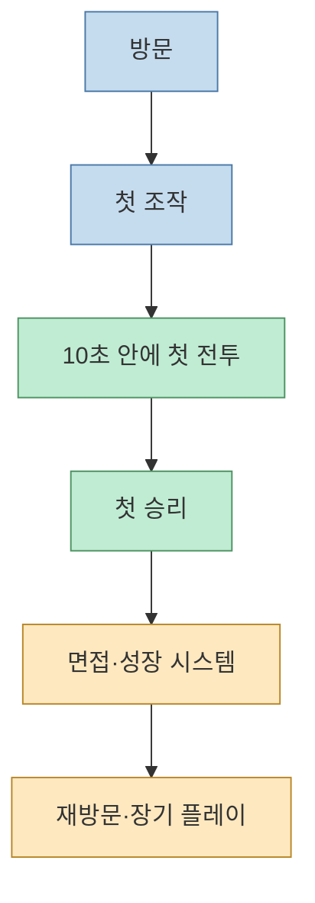

AI와 바이브 코딩으로 만든 게임은 콘텐츠를 빠르게 늘릴 수 있다. 하지만 **만들 수 있는 속도**와 **플레이어가 계속하는 속도**는 전혀 다르다. 이 영상은 픽셀 오토 배틀러 `쪼꼬미 용병단`이 CrazyGames의 Basic Launch에서 데스크톱 5/15점, 모바일 6/15점을 받아 커트라인 9점을 넘지 못한 과정을 공개한다. 평점은 10점이었지만, 대부분의 사용자가 첫 전투 전에 떠났다는 퍼널 데이터가 실패 원인을 더 정확히 보여줬다.

<!--more-->

## Sources

- [YouTube — AI 바이브코딩으로 게임 만들어서 출시했더니 광탈함ㅋㅋ (평점 10점인데 왜?)](https://www.youtube.com/watch?v=YYbxyeU0D0k)
- [CrazyGames Basic Launch 공식 지표 안내](https://docs.crazygames.com/resources/basic-launch-metrics/)

## 무엇을 평가받았나

`쪼꼬미 용병단`은 용병을 뽑고 키워 리그에서 싸우는 픽셀 오토 배틀러다. AI를 활용해 직업 100개, 스킬 600개, 챔피언 20명과 여러 모드를 만들었다. 콘텐츠의 양은 많았지만, 콘텐츠를 보기 전에 플레이어가 떠나면 아무 소용이 없다. (영상 00:12~01:02, [타임스탬프](https://youtu.be/YYbxyeU0D0k?t=12))

CrazyGames는 게임을 곧바로 정식 출시하지 않고 Basic Launch라는 제한 공개 시험을 거친다. 일부 사용자에게 7~21일 동안 노출하고, 충분한 플레이 표본이 쌓이면 평균 플레이 시간·D1 리텐션·게임 전환율을 데스크톱과 모바일별로 채점한다. 영상에서는 각 항목이 1~5점이고 15점 중 9점 이상이어야 통과한다고 설명한다. 공식 문서도 Basic Launch를 실제 사용자 지표로 게임을 검증하는 단계로 설명한다. (영상 01:08~01:47, [타임스탬프](https://youtu.be/YYbxyeU0D0k?t=68), [CrazyGames 공식 문서](https://docs.crazygames.com/resources/basic-launch-metrics/))

## 성적표: 평점과 퍼널이 말한 것

시험 결과는 데스크톱 5점, 모바일 6점이었다. 두 환경 모두 9점 커트라인에 미달했다. 제작팀은 시험 기간 일주일 동안 빌드를 18번 교체했지만, 수정 속도가 지표 개선으로 이어지지는 않았다. (영상 01:47~02:21, [타임스탬프](https://youtu.be/YYbxyeU0D0k?t=107))

평균 플레이 시간은 데스크톱 8분 34초로 2점이었다. 다음 점수에 필요한 9분 53초보다 1분 19초 짧았다. CrazyGames 문서가 제시하는 좋은 게임의 기준은 보통 10분 이상이다. D1 리텐션은 데스크톱 2.35%, 모바일 4.08%로, 영상에서 소개한 강한 게임의 10~15% 기준에 크게 미치지 못했다. (영상 02:29~03:12, [타임스탬프](https://youtu.be/YYbxyeU0D0k?t=149))

게임 전환율은 게임 페이지에 들어온 사람이 1분 이상 플레이한 비율이다. 데스크톱은 42.86%, 모바일은 18.42%로 모두 최저점인 1점이었다. 즉 오래 플레이한 소수의 만족도는 높았지만, 게임에 진입한 사람의 상당수가 첫 1분을 넘기지 못했다. (영상 03:13~03:31, [타임스탬프](https://youtu.be/YYbxyeU0D0k?t=193))

## 진짜 범인: 첫 전투까지 74초

제작팀은 자체 통계 툴을 심어 첫 전투까지 걸린 시간을 확인했다. 같은 기간 처음 들어온 플레이어 401명 중 첫 전투 시작까지 걸린 시간의 중앙값은 74초, 첫 공식 경기까지는 1분 54초였다. 플랫폼이 1분 전환율을 측정하는 동안 게임에서는 아직 칼 한 번 휘두르지 못한 셈이다. (영상 03:34~04:28, [타임스탬프](https://youtu.be/YYbxyeU0D0k?t=214))

문제의 흐름은 로고와 타이틀에서 아무 키나 누른 뒤, 용병 지원자 8명의 소개를 보고, 카드에서 3명을 고르고, 주장을 정하고, 용병단 이름까지 짓는 긴 온보딩이었다. 제작자에게는 귀여운 “면접장”이었지만 신규 사용자에게는 게임이 시작되지 않는 대기 화면이었다. (영상 04:28~05:02, [타임스탬프](https://youtu.be/YYbxyeU0D0k?t=274))

마지막 화면 분석도 이를 증명했다. 로딩이나 타이틀에서 시작 버튼을 누르지 않고 나간 사람이 99명, 면접장에서 나간 사람이 70명이었다. 401명 중 169명, 즉 42%가 첫 전투를 경험하지 못했다. 콘텐츠를 더 추가하기 전에 첫 조작에서 즉시 재미를 보여줘야 했던 것이다. (영상 05:02~05:34, [타임스탬프](https://youtu.be/YYbxyeU0D0k?t=311))

플랫폼 가이드의 실무적 원칙은 신규 사용자가 곧바로 게임 플레이에 들어가야 하며, 어렵더라도 클릭은 최대 한 번이어야 한다는 것이다. 이 게임은 첫 전투까지 최소 8번의 클릭이 필요했다. 따라서 “게임을 못 만들었다”기보다 “재미를 보여주는 순서가 뒤집혔다”고 보는 편이 정확하다. (영상 05:34~05:58, [타임스탬프](https://youtu.be/YYbxyeU0D0k?t=300))

## 두 번째 범인: 번역이 입구를 막았다

기기 언어를 보면 영어 135명, 베트남어 46명, 한국어 40명, 중국어 38명, 일본어 31명이었다. 게임은 한국어와 영어만 지원했기 때문에 영상 계산으로는 56%가 자기 언어가 아닌 화면을 마주했다. 직업·스킬·유물 설명이 많은 경영 게임에서는 번역이 부가 기능이 아니라 입구다. 읽어야 할 텍스트를 이해하지 못하면 첫 전투 전에 이탈할 가능성이 커진다. (영상 05:45~06:18, [타임스탬프](https://youtu.be/YYbxyeU0D0k?t=345))

## 세 번째 범인: 모바일을 데스크톱의 축소판으로 본 것

모바일 전환율은 18.42%로 데스크톱 42.86%의 절반에도 미치지 못했다. 작은 화면에서 지원자 카드를 읽고 버튼을 찾는 동안 1분이 지나갔다. 영상의 결론처럼 모바일은 데스크톱을 줄여 놓은 버전이 아니라, 첫 진입부터 별도로 설계해야 한다. (영상 06:18~06:28, [타임스탬프](https://youtu.be/YYbxyeU0D0k?t=373))

모바일에서는 첫 전투를 즉시 시작하고, 카드의 핵심 정보만 먼저 보여주며, 터치 대상과 화면 방향을 테스트해야 한다. 긴 텍스트나 선택지를 유지해야 한다면 “나중에 보기”로 미루고, 첫 승리 이후에 깊은 시스템을 열어 주는 방식이 더 적합하다.

## 평점 10점이 실패를 가린 이유

1분을 넘긴 플레이어는 꽤 오래 남았다. 한 시간 넘게 플레이한 사람이 13명, 한 플레이어는 467판을 했고, 평점은 10점에 좋아요 31개, 싫어요 0개였다. 게임 안으로 들어온 사람에게는 재미가 있었지만, 들어오기 전의 문이 너무 무거웠다. (영상 06:32~06:53, [타임스탬프](https://youtu.be/YYbxyeU0D0k?t=392))

따라서 평점은 생존자 편향이 강하다. 1분 안에 나간 사용자는 싫어요를 남기지 않고 조용히 떠난다. 평점은 남은 사용자의 목소리이고, 퍼널은 모든 방문자의 행동이다. 제품 초기에는 별점보다 “첫 핵심 행동까지 몇 초가 걸렸는가”를 더 먼저 봐야 한다. (영상 06:53~07:10, [타임스탬프](https://youtu.be/YYbxyeU0D0k?t=413))

## AI 콘텐츠 생산성과 제품 학습의 충돌

시험 기간에는 18개의 빌드가 배포됐다. 그중 한 번은 핵심 화면 스크립트가 컴파일되지 않았고, 마지막 날에는 로딩 크래시가 18%까지 상승했다. AI로 직업 하나를 추가하는 일은 빠르지만, 그 시간에 첫 1분을 다듬고 안정성을 검증하지 않으면 콘텐츠가 오히려 학습을 방해한다. (영상 07:10~07:24, [타임스탬프](https://youtu.be/YYbxyeU0D0k?t=430))

시험 중에는 빌드를 얼리고, 변경은 작은 실험 단위로 묶어야 한다. 계측 이벤트와 핵심 지표를 고정한 뒤 한 번에 하나의 가설만 바꾸면 어떤 변경이 전환율을 움직였는지 알 수 있다. “더 많은 직업”보다 “첫 전투까지 10초 단축”이 Basic Launch 통과에 직접적인 실험일 수 있다.

## 제작팀이 정리한 여섯 가지 레슨

1. **웹 게임의 첫 1분이 전부다.** 로고·타이틀·캐릭터 생성은 첫 전투 이후로 미룬다.
2. **상대 평가를 준비한다.** 우리 게임이 괜찮은지가 아니라 같은 장르의 성공작보다 나은지를 측정한다.
3. **텍스트가 많으면 번역이 마케팅이다.** 지원 언어를 늘리는 일은 기능 추가가 아니라 진입률 개선이다.
4. **모바일은 별도로 설계한다.** 작은 화면에서는 읽기와 터치에 허용되는 시간이 더 짧다.
5. **평점보다 퍼널을 본다.** 첫 클릭, 첫 전투, 1분, 10분 등 단계별 이탈을 계측한다.
6. **시험 기간에는 빌드를 동결한다.** 새 콘텐츠보다 재현 가능한 실험과 안정성이 우선이다. (영상 07:30~08:10, [타임스탬프](https://youtu.be/YYbxyeU0D0k?t=449))

## 다음 도전의 우선순위

제작팀은 재도전에서 접속 후 몇 초 안에 전투가 시작되도록 바꾸고, 면접장은 첫 승리 뒤로 미루며, 많이 사용하는 언어부터 번역할 계획이다. 이는 새 시스템을 더하는 대신 **가치 전달 시점**을 앞당기는 수정이다. (영상 08:29~08:47, [타임스탬프](https://youtu.be/YYbxyeU0D0k?t=509))

새 빌드의 검증 순서는 다음처럼 잡을 수 있다.

## 핵심 요약

- AI로 직업·스킬을 빠르게 늘려도 첫 전투까지 오래 걸리면 Basic Launch 전환율은 낮아진다.
- 이 사례의 데스크톱/모바일 점수는 각각 5/15, 6/15로 9점 커트라인에 미달했다.
- 평균 플레이 시간보다 먼저 1분 안에 핵심 재미를 전달해야 한다. 첫 전투까지 중앙값 74초가 걸렸고 42%가 전투 전에 이탈했다.
- 번역되지 않은 텍스트와 모바일을 데스크톱처럼 만든 UI가 진입 장벽을 높였다.
- 평점 10점은 남은 플레이어의 평가일 뿐이다. 출시 전부터 이벤트를 계측하고 퍼널을 봐야 한다.
- 시험 기간에는 빌드를 얼리고, 콘텐츠 추가보다 한 가지 가설을 검증하는 실험을 우선해야 한다.

## 결론

이 사례는 AI 바이브 코딩의 실패담이라기보다 **제품 학습 순서**에 대한 회고다. AI는 콘텐츠를 무한히 만들 수 있지만 플레이어의 첫 1분을 대신 플레이해 주지는 않는다. 다음 출시에서는 가장 화려한 시스템이 아니라 가장 빠른 첫 전투, 이해 가능한 언어, 모바일에서의 한 손 조작, 그리고 정확한 퍼널 계측이 성공을 결정한다.
