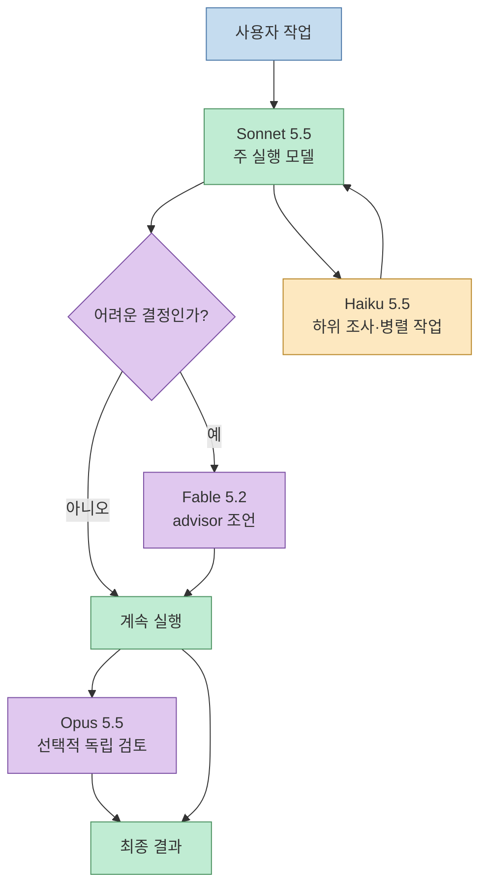
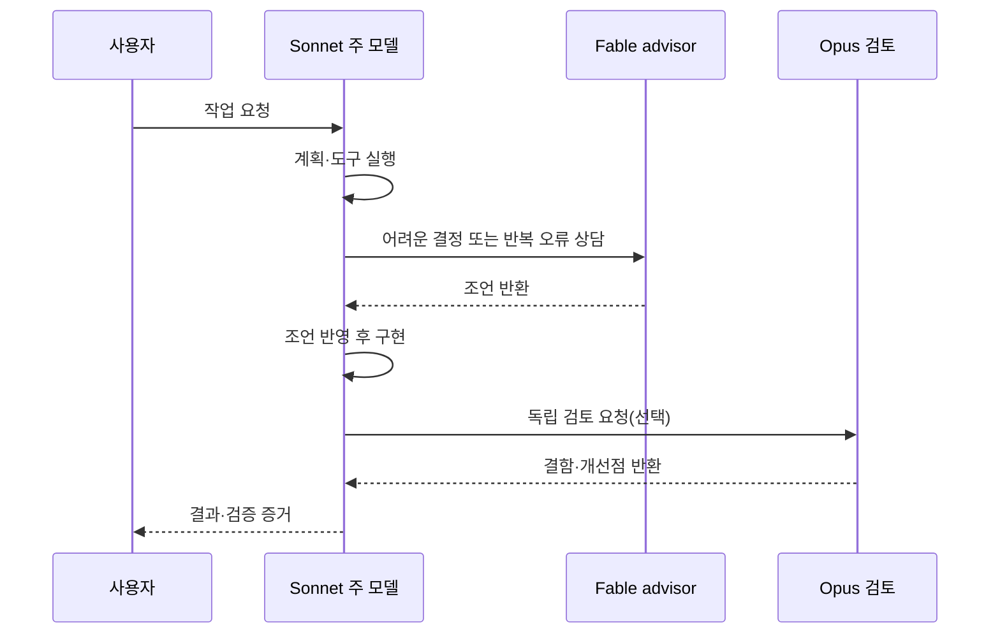
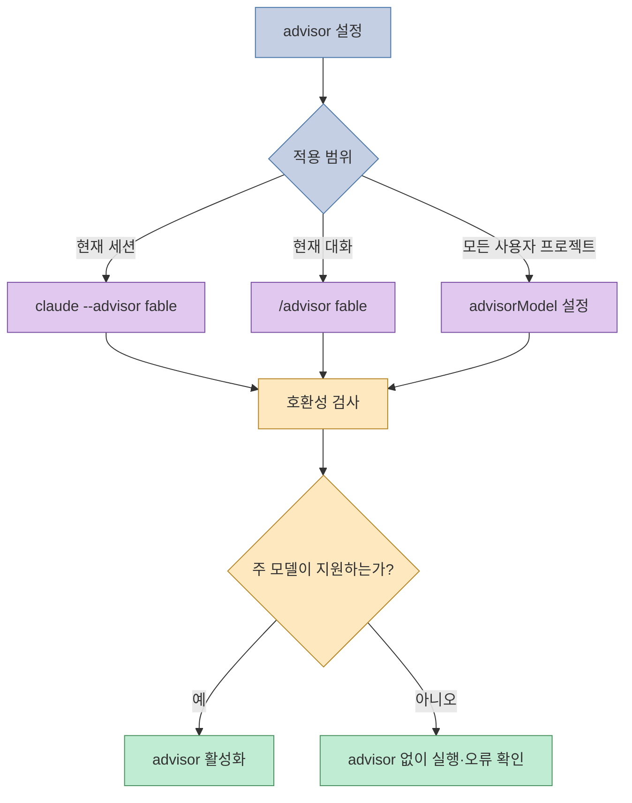
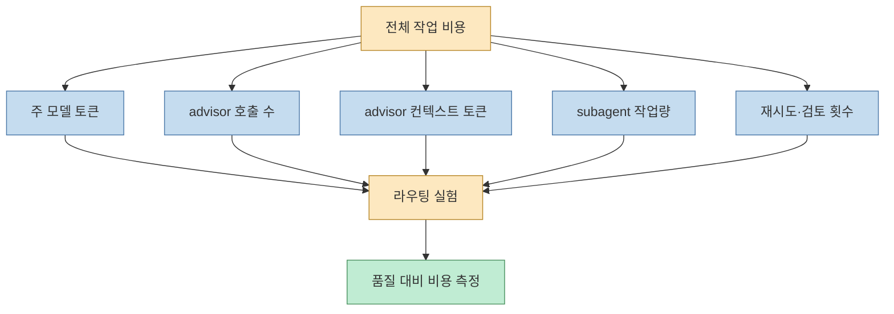
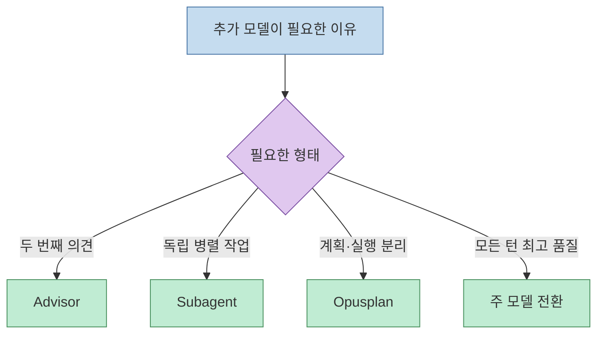

강한 모델을 모든 턴에 사용하는 대신, 대부분의 작업은 저렴한 모델이 처리하고 어려운 결정만 더 강한 모델에 넘기는 방법이 있다. X 게시물은 이를 “Fable 5.2가 생각하고, Sonnet 5.5가 만들고, Opus 5.5가 검토하고, Haiku 5.5가 하위 작업을 조정한다”는 구조로 소개한다.

핵심은 Fable을 주 모델로 계속 돌리지 않고 **Claude Code의 advisor 기능으로 필요한 순간에만 호출하는 것**이다. X 게시물의 비용 절감 수치와 198회 실험 결과는 원문 작성자의 주장으로 표시하고, 실제 설정과 모델 호환성은 Anthropic 공식 문서를 기준으로 설명한다.

<!--more-->

## Sources

- [X 원문 — Fable·Sonnet·Opus·Haiku 모델 라우팅](https://x.com/angeldot_/status/2121262061170692468?a=Kj5hNZFnJcoAX0C1rE8&s=35) (FxTwitter API·X oEmbed로 본문 추출)
- [Claude Code 공식 문서 — advisor 도구](https://code.claude.com/docs/en/advisor)
- [Anthropic — Claude Opus 5.5 소개](https://www.anthropic.com/claude-opus-5-5)
- [Claude Code 공식 CLI 문서](https://docs.anthropic.com/en/docs/claude-code/cli-usage)

## 모델을 한 줄로 배치하면

X 게시물의 제안은 모델마다 역할을 분리한다.

- **Fable 5.2**: 계획을 닫기 전, 같은 오류가 반복될 때, 완료 선언 전에 조언한다.
- **Sonnet 5.5**: 일반적인 코딩과 파일 변경을 수행하는 주 실행 모델이다.
- **Opus 5.5**: 별도의 검토자 또는 더 강한 advisor로 복잡한 판단을 확인한다.
- **Haiku 5.5**: 조사·검색·요약처럼 병렬화하기 쉬운 하위 작업을 맡긴다.

공식 advisor 문서가 보장하는 것은 “주 모델이 작업을 수행하고, 더 강한 모델을 의사결정 시점에 서버 측 advisor로 호출한다”는 구조다. advisor는 전체 대화와 도구 호출 결과를 읽고 조언을 반환하며, Claude Code가 언제 호출할지 결정한다. X 게시물의 “항상 이 순서로 네 모델이 실행된다”는 표현은 이 공식 기능 위에 subagent·검토 프롬프트를 추가한 운영 패턴으로 이해하는 편이 정확하다. ([Claude Code advisor 공식 문서](https://code.claude.com/docs/en/advisor))



## Advisor는 언제 호출되는가

공식 문서에 따르면 advisor는 접근 방식을 확정하기 전, 같은 오류가 반복될 때, 작업 완료를 선언하기 전에 호출되는 경향이 있다. 호출 시점은 고정 규칙이 아니라 모델이 결정하며, 프롬프트에서 “계속하기 전에 advisor에게 검토를 요청하라”고 명시할 수도 있다. ( [Advisor 호출 시점](https://code.claude.com/docs/en/advisor#when-claude-consults-the-advisor))

이 방식은 짧은 파일 수정처럼 계획 비용이 작은 작업보다 대규모 리팩터링, 반복 디버깅, 독립적인 완료 검사가 필요한 작업에 적합하다. 매 턴 강한 모델을 실행하는 대신 대부분의 턴을 Sonnet으로 처리하고, 실패 확률이 높은 경계에서만 Fable이나 Opus를 부른다.



## Claude Code에서 advisor 설정하기

공식 문서는 세 가지 설정 방법을 제공한다.

### 세션 안에서 `/advisor`

대화 중 `/advisor`를 입력하면 사용 가능한 advisor 모델을 고를 수 있다. 예를 들어 `/advisor fable` 또는 `/advisor opus`처럼 지정하며, `/advisor off`로 끌 수 있다. 선택은 사용자 설정의 `advisorModel`에 저장되어 이후 세션에도 적용될 수 있다. ([`/advisor` 명령](https://code.claude.com/docs/en/advisor#use-the-advisor-command))

### 사용자 설정 파일

모든 프로젝트에 기본 advisor를 적용하려면 사용자 설정에 다음과 같이 둔다.

```json
{
  "advisorModel": "fable"
}
```

실제 설정 파일의 위치와 기존 옵션은 설치 방식과 Claude Code 버전에 따라 다를 수 있으므로, 현재 공식 설정 문서를 확인하고 기존 파일을 백업한 뒤 수정해야 한다. ([설정 방법](https://code.claude.com/docs/en/advisor#set-advisormodel-in-settings))

### 한 세션에서만 `--advisor`

저장된 설정을 바꾸지 않고 한 번만 advisor를 사용하려면 다음처럼 실행한다.

```bash
claude --advisor fable
```

Fable 5.2 advisor는 Claude Code v2.1.321 이상을 요구한다. 공식 문서는 `claude update`로 최신 버전을 설치할 수 있다고 안내하지만, 업데이트 전에 현재 프로젝트와 설정을 백업하고 변경 로그를 확인하는 것이 안전하다. ([CLI 문서](https://docs.anthropic.com/en/docs/claude-code/cli-usage), [모델 호환성](https://code.claude.com/docs/en/advisor#choose-an-advisor-model))



## 모델 호환성과 “Fable + Sonnet”의 실제 의미

Advisor는 아무 모델 조합이나 허용하지 않는다. 공식 호환성 표에서 Sonnet 5.5 주 모델은 Fable, Opus 5 이상, Sonnet 5.5를 advisor로 사용할 수 있다. Opus 5.5 주 모델은 Fable 또는 Opus 5 이상을 advisor로 쓸 수 있다. Fable 5.2 주 모델은 Fable 계열만 advisor로 허용된다. ([호환 모델 표](https://code.claude.com/docs/en/advisor#choose-an-advisor-model))

따라서 X 게시물의 “Sonnet이 만들고 Fable이 조언한다”는 조합은 공식 문서의 지원 범위와 맞는다. 반면 “Opus가 매번 리뷰한다”와 “Haiku가 항상 swarm을 조정한다”는 부분은 advisor 기능이 자동으로 보장하는 동작이 아니다. Opus 검토는 명시적인 검토 단계나 별도 subagent로 설계해야 하고, Haiku 병렬 조사는 Claude Code의 subagent 설정과 작업 분해가 필요하다.

## 비용 절감은 호출 빈도와 작업 분해의 함수다

X 게시물은 Fable을 의사결정 시점에만 호출하면 약 3.4배 저렴해지고, Haiku가 Fable보다 토큰 비용이 80배 낮다고 주장한다. 또 Anthropic의 198개 사례에서 advisor 호출 시점을 지시하는 한 줄이 없으면 advisor가 한 번도 호출되지 않았다고 말한다. 이 숫자들은 X 게시물 작성자의 실험·해석으로, 이 글에서 독립적으로 재현하거나 Anthropic 공식 문서에서 확인한 수치는 아니다.

공식 문서가 확인해 주는 일반 원칙은 advisor 호출마다 advisor 모델의 토큰 비용이 추가되고, 호출은 매 턴이 아니라 의사결정 시점에 일어난다는 점이다. 따라서 총비용은 다음 요소에 의해 결정된다.

- 주 모델의 전체 입력·출력 토큰
- advisor 호출 횟수와 전체 대화 재전달 비용
- advisor 모델의 입력·출력 단가 또는 구독 사용량
- Haiku subagent가 실제로 처리한 병렬 작업량
- 실패 재시도와 검토 루프의 횟수



Anthropic은 Opus 5.5 페이지에서 모델 비용과 속도, 코딩 벤치마크를 공개하지만, X 게시물의 전체 4모델 조합 비용을 보증하지 않는다. 자신의 저장소에서 동일한 작업 세트를 고정하고 `advisor off`, `advisor fable`, `advisor opus`를 각각 실행해 성공률·토큰·시간·재작업 횟수를 비교해야 한다. ([Opus 5.5 공식 비용·성능](https://www.anthropic.com/claude-opus-5-5#performance-and-cost-effectiveness))

## Haiku swarm을 안전하게 붙이는 법

Haiku를 하위 에이전트에 쓰는 목적은 연구·검색·파일 목록화·테스트 로그 요약처럼 서로 독립적인 작업을 병렬 처리하는 것이다. 최종 설계 판단이나 권한 상승을 Haiku에게 맡기지 않고, 주 모델이 결과를 취합해 검증한다.

각 subagent의 출력 형식을 고정하면 조정 비용이 줄어든다.

```json
{
  "task": "조사한 사실",
  "evidence": ["파일 경로 또는 URL"],
  "uncertainty": ["확인하지 못한 부분"],
  "next_action": "주 에이전트가 할 일"
}
```

병렬화할 수 없는 작업을 억지로 나누면 오히려 컨텍스트 병합과 충돌 해결 비용이 커진다. 하위 에이전트는 읽기·분석 중심으로 시작하고, 쓰기 권한과 외부 전송 권한은 주 에이전트나 사람 승인 뒤에 두는 것이 좋다.

## advisor·subagent·opusplan의 차이

공식 문서는 advisor가 두 번째 모델의 조언을 같은 대화에 돌려주는 기능이고, subagent는 별도 작업을 수행하는 실행 단위이며, `opusplan`은 계획 단계와 실행 단계에 다른 모델을 쓰는 사전 설정이라고 구분한다. ([advisor 비교](https://code.claude.com/docs/en/advisor#how-the-advisor-compares-with-opusplan-and-subagents))

선택 기준은 다음과 같다.

- **Advisor**: 현재 대화 전체를 읽고 중요한 결정에 두 번째 의견을 받을 때
- **Subagent**: 독립적인 조사·테스트·파일 분석을 병렬 처리할 때
- **Opusplan**: 계획 품질을 높인 뒤 Sonnet 등으로 실행 모델을 전환할 때
- **주 모델 전환**: 모든 턴에서 최고 품질이 필요할 때



## 운영 체크리스트

1. `claude update` 전에 현재 버전과 설정을 기록한다.
2. 작은 작업에서 `/advisor fable` 호출 로그가 실제로 남는지 확인한다.
3. 주 모델·advisor·subagent의 모델 ID와 비용을 기록한다.
4. advisor가 읽는 전체 대화에 비밀정보가 포함되지 않도록 정리한다.
5. 파일 쓰기·삭제·배포는 승인 모드로 제한한다.
6. 동일한 평가 작업 세트로 advisor 설정 전후를 비교한다.
7. 품질이 오르지 않으면 강한 모델을 추가하기보다 호출 조건과 검증 단계를 조정한다.

## 핵심 요약

- Claude Code advisor는 주 모델이 중요한 순간에 더 강한 모델의 조언을 받게 하는 실험적 기능이다.
- Sonnet 5.5 + Fable advisor 조합은 공식 호환성 표에 포함된다.
- advisor는 매 턴 실행되지 않고 모델이 결정한 시점에 호출되므로, 짧은 작업보다 장기·복합 작업에 적합하다.
- X 게시물의 3.4배 비용 절감, 80배 단가 차이, 198회 실험 수치는 원문 작성자의 주장으로 별도 검증이 필요하다.
- Opus 검토와 Haiku swarm은 advisor만 켠다고 자동으로 생기지 않으며, subagent와 검증 루프를 별도로 설계해야 한다.
- 비용은 모델 단가뿐 아니라 호출 횟수, 전체 대화 재전달, 재시도, 병렬 작업량을 함께 측정해야 한다.

## 결론

모델 라우팅의 목표는 “항상 가장 싼 모델”이나 “항상 가장 강한 모델”이 아니다. 일상적인 구현은 Sonnet이 맡고, 어려운 판단은 Fable·Opus에 에스컬레이션하며, 독립적인 조사는 Haiku로 나누는 **품질 대비 비용 최적화**가 목표다. advisor 호출이 실제로 품질을 높이는지와 비용을 줄이는지는 자신의 작업 세트와 로그로 확인해야 한다.
