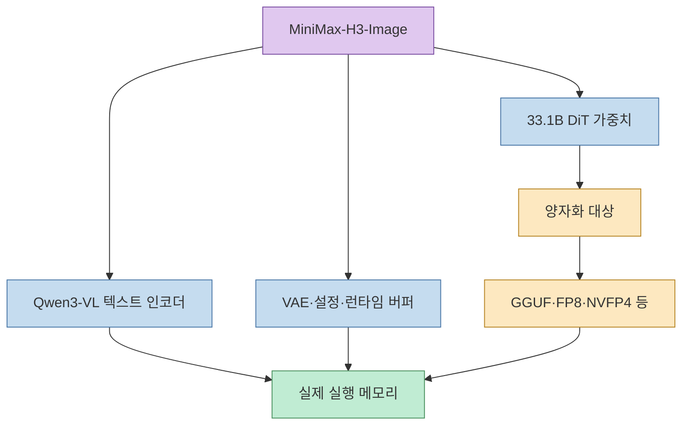
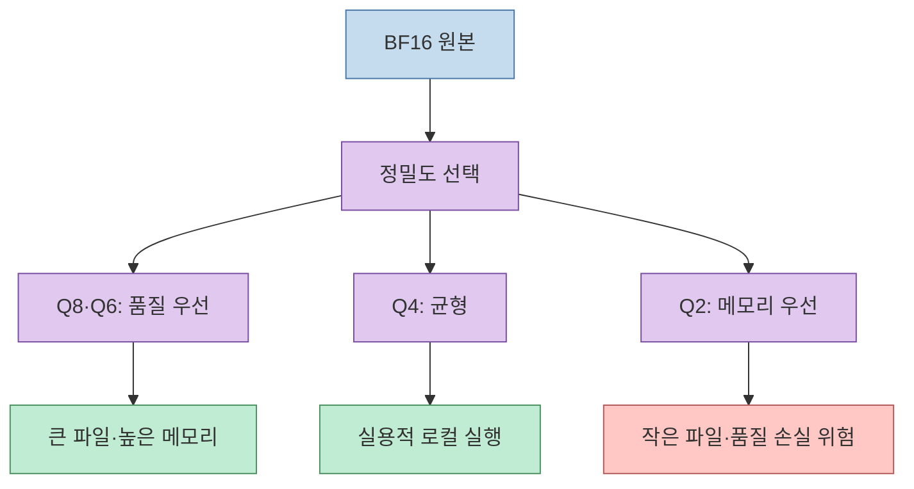
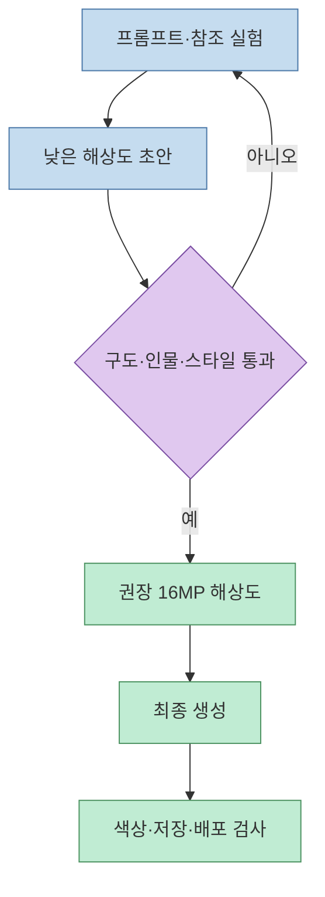
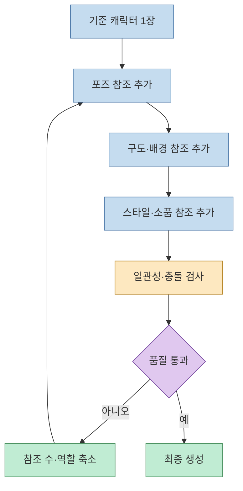
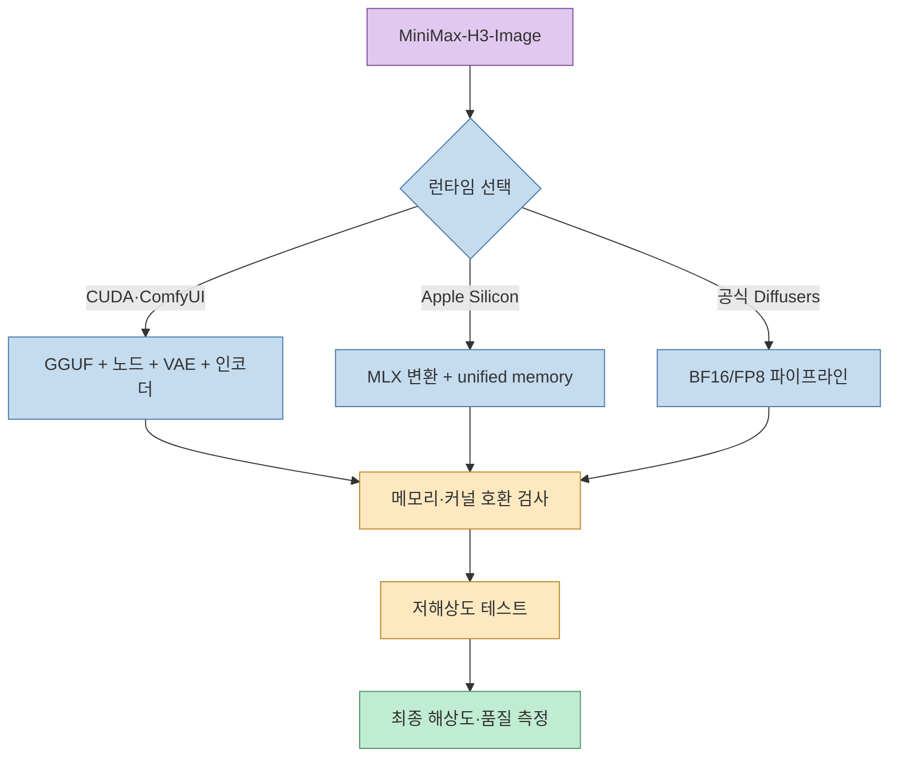

대형 이미지 생성 모델은 품질이 좋아도 개인 장비에서 실행하기 어렵다. X 게시물은 MiniMax-H3-Image의 원본 가중치가 약 68.65GB인 상황에서 커뮤니티가 Q4·Q2 계열 GGUF를 만들어 약 10.78GB·6.4GB 수준까지 줄였다고 소개한다. 핵심은 모델을 작게 “압축”했다는 사실보다, **양자화된 모델·텍스트 인코더·런타임을 함께 고려하면 로컬 실행의 문턱이 달라진다**는 점이다.

이 글은 X 게시물의 주장을 MiniMax 공식 모델 카드와 Hugging Face Diffusers 문서로 교차검증한다. 다운로드 수와 특정 커뮤니티 파일의 VRAM 수치는 시점에 따라 바뀌므로, 현재 수치로 고정하지 않고 구조와 측정 방법을 중심으로 설명한다.

<!--more-->

## Sources

- [X 원문 — MiniMax-H3-Image 커뮤니티 양자화 소개](https://x.com/EngMoElgaraihy/status/2121301347563651247?a=bcAg7WpPMxaaLPtVhVI&s=35) (FxTwitter·VxTwitter API로 본문 추출)
- [MiniMax-H3-Image 공식 모델 카드](https://huggingface.co/MiniMaxAI/MiniMax-H3-Image)
- [MiniMax-H3-Image 공식 GitHub README](https://github.com/MiniMax-AI/MiniMax-H3-Image)
- [Hugging Face Diffusers — MiniMax-H3-Image 파이프라인](https://huggingface.co/docs/diffusers/main/en/api/pipelines/minimax_h3_image)
- [unsloth/MiniMax-H3-Image-GGUF 커뮤니티 양자화](https://huggingface.co/unsloth/MiniMax-H3-Image-GGUF)
- [MiniMax-AI — 로컬 실행 통합 가이드](https://github.com/MiniMax-AI/awesome-minimax-h3-integration/blob/main/docs/run-h3-locally.md)

## MiniMax-H3-Image는 어떤 모델인가

공식 모델 카드는 MiniMax-H3-Image를 텍스트-이미지 생성과 이미지 편집에 사용하는 모델로 소개한다. Diffusion Transformer는 33.1B 파라미터의 단일 스트림 구조이며, 50개 레이어·hidden size 5376·56개 attention head·FFN size 14336·3D 멀티모달 RoPE를 사용한다. ( [공식 모델 카드](https://huggingface.co/MiniMaxAI/MiniMax-H3-Image), [GitHub README](https://github.com/MiniMax-AI/MiniMax-H3-Image))

공식 BF16 DiT 파일 크기는 약 68.65GB다. 여기에 Qwen3-VL 기반 텍스트 인코더와 VAE, 런타임 메모리, KV·버퍼가 더해지므로 “가중치 파일이 68GB”와 “실행에 68GB VRAM만 필요”는 같은 말이 아니다. 반대로 GGUF 양자화 파일이 6.4GB라고 해도 텍스트 인코더와 CPU RAM·VRAM 오프로딩을 포함한 실제 요구량은 더 커질 수 있다.



## 양자화는 무엇을 줄이는가

양자화는 가중치의 표현 정밀도를 낮춰 저장 공간과 메모리 대역폭을 줄이는 방법이다. 16비트 BF16 값을 4비트 또는 2비트에 가까운 표현으로 바꾸면 파일 크기는 크게 줄지만, 모든 값의 정밀도가 같게 보존되는 것은 아니다. 블록별 스케일·제로포인트·중요도 행렬 같은 보조 정보가 들어가며, 구현마다 실제 용량과 품질이 달라진다.

커뮤니티 GGUF 저장소에는 Q6·Q4·Q2 계열 파일과 혼합 정밀도 파일이 함께 올라온다. 예를 들어 unsloth 저장소는 MiniMax-H3-Image용 GGUF가 원본 BF16 DiT를 담을 수 없는 GPU와 Apple Silicon·CPU에서 사용되도록 설계됐다고 설명한다. MiniMax 공식 통합 가이드는 GGUF가 공식 MiniMax 릴리스가 아니라 커뮤니티 변환임을 명시한다. ( [unsloth GGUF](https://huggingface.co/unsloth/MiniMax-H3-Image-GGUF), [공식 로컬 실행 가이드](https://github.com/MiniMax-AI/awesome-minimax-h3-integration/blob/main/docs/run-h3-locally.md))



### 파일 크기와 VRAM은 다르다

X 게시물은 Q4를 약 10.78GB, Q2_K를 약 6.4GB로 소개한다. 이 값은 특정 커뮤니티 변환 파일의 디스크 크기 또는 가중치 규모를 가리키는 것으로 이해해야 하며, 모든 장비에서 해당 VRAM만으로 실행된다는 보장은 아니다. 텍스트 인코더가 별도로 로드되고, 해상도가 높을수록 중간 활성값과 작업 버퍼가 증가하기 때문이다.

실행 가능 여부는 다음 합으로 판단한다.

```text
필요 메모리 ≈ 양자화된 DiT + 텍스트 인코더 + VAE + 활성값 + 런타임 버퍼
```

따라서 8GB GPU에서 Q2 파일이 “다운로드 가능”하다는 것과 8GB VRAM에서 4K 이미지를 “원활하게 생성”한다는 것은 다르다. CPU 오프로딩이나 unified memory를 활용할 수 있지만 속도와 시스템 RAM 여유를 함께 측정해야 한다.

## 16MP 네이티브 생성과 해상도 선택

공식 모델 카드와 Diffusers 문서는 H3-Image가 업스케일러를 거치지 않고 약 16메가픽셀 이미지를 직접 생성할 수 있다고 설명한다. 권장 크기는 정사각형 4096×4096, 4:3 4736×3552, 3:2 5024×3360, 16:9 5472×3072, 21:9 6272×2688이며, 세로 방향은 폭과 높이를 바꾼다. ( [Diffusers 공식 문서](https://huggingface.co/docs/diffusers/main/en/api/pipelines/minimax_h3_image), [공식 모델 카드](https://huggingface.co/MiniMaxAI/MiniMax-H3-Image))

“4K를 한 번에 만든다”는 장점은 선명도뿐 아니라 후처리 단계를 줄이는 데 있다. 그러나 해상도가 커지면 GPU 메모리·생성 시간·파일 크기가 함께 늘어난다. 로컬 테스트에서는 먼저 1024~2048급으로 프롬프트와 참조 조합을 검증하고, 최종 후보만 권장 고해상도로 생성하는 것이 안전하다.



## 6단계 샘플링의 의미

Diffusers 문서는 H3-Image 체크포인트가 `sample_sigmas`에 따라 6단계로 샘플링하며, 일반적인 `num_inference_steps`를 임의로 설정하는 방식이 아니라고 설명한다. X 게시물의 “6단계·CFG 불필요” 주장은 이 모델의 특수한 샘플링 설계와 연결된다. ([Diffusers API 문서](https://huggingface.co/docs/diffusers/main/en/api/pipelines/minimax_h3_image))

단계 수가 적다는 것은 한 장을 빠르게 만들 가능성이 있다는 뜻이지, 전체 파이프라인이 항상 빠르다는 뜻은 아니다. 텍스트 인코더 로딩, 참조 이미지 처리, 디스크·메모리 이동, 고해상도 활성값 계산이 총 시간을 결정한다. 따라서 “6 steps”만 보고 다른 확산 모델의 20~50단계와 단순 비교하면 안 된다.

## 참조 이미지와 편집의 활용

공식 모델 카드에는 참조 이미지와 이미지 편집 예제가 포함되어 있으며, 4096×4096 같은 고해상도에서 참조를 사용한 결과를 보여 준다. X 게시물은 최대 16개의 참조 이미지를 사용해 캐릭터 일관성을 유지할 수 있다고 설명하지만, 실제 지원 개수와 품질은 사용한 인터페이스·프롬프트·메모리 구성에 따라 확인해야 한다.

참조 이미지를 많이 넣을수록 일관성이 항상 좋아지는 것은 아니다. 서로 다른 포즈·조명·스타일이 충돌하면 모델이 어떤 특징을 우선할지 불분명해진다. 실무에서는 다음처럼 단계적으로 늘린다.

1. 캐릭터 기준 이미지 1장으로 얼굴·의상·색을 고정한다.
2. 포즈나 구도를 위한 두 번째 이미지를 추가한다.
3. 결과가 안정적일 때만 배경·소품·스타일 이미지를 추가한다.
4. 각 참조의 역할을 프롬프트에 명시한다.



## 로컬 실행 경로: ComfyUI·GGUF·MLX

X 게시물은 ComfyUI용 GGUF와 Mac용 MLX 가중치를 함께 언급한다. 커뮤니티 파일은 같은 모델을 다른 런타임의 메모리·커널 형식에 맞게 변환한 것이다. ComfyUI에서는 노드·워크플로·텍스트 인코더·VAE가 맞아야 하며, MLX에서는 Apple Silicon의 unified memory와 해당 변환 형식을 지원하는 코드를 사용해야 한다.

MiniMax 공식 통합 문서는 GGUF 변환이 공식 배포물과 다르다는 점을 강조한다. 따라서 다운로드 전 저장소의 변환 방식, 사용 중인 ComfyUI 커스텀 노드, 모델 라이선스, 텍스트 인코더 요구사항을 확인해야 한다. “GGUF 파일 하나”만 내려받아 바로 동작한다고 가정하면 실패하기 쉽다. ([공식 로컬 실행 가이드](https://github.com/MiniMax-AI/awesome-minimax-h3-integration/blob/main/docs/run-h3-locally.md))



## 품질·성능·라이선스 체크리스트

- **품질**: Q2·Q3에서 텍스트 렌더링, 얼굴, 미세 질감, 색 띠 현상을 원본과 비교한다.
- **메모리**: 파일 크기뿐 아니라 텍스트 인코더·VAE·활성값·오프로딩을 포함한 피크 메모리를 기록한다.
- **속도**: 단계 수가 아니라 총 준비 시간부터 최종 저장까지의 wall-clock 시간을 잰다.
- **재현성**: 모델 커밋, 양자화 저장소 커밋, 런타임·노드 버전, seed와 해상도를 함께 기록한다.
- **보안**: 커뮤니티 모델과 커스텀 노드는 격리 환경에서 검사하고, 출처가 불명확한 스크립트를 그대로 실행하지 않는다.
- **라이선스**: 원본 모델·양자화 파생물·생성 서비스의 라이선스와 상업적 사용 조건을 각각 확인한다.

## 핵심 요약

- MiniMax-H3-Image는 33.1B 파라미터 DiT와 텍스트 인코더·VAE로 구성된 대형 이미지 생성·편집 모델이다.
- 공식 BF16 DiT는 약 68.65GB지만, 커뮤니티 GGUF 양자화는 Q4·Q2 계열의 파일 크기를 크게 낮춘다.
- 파일 크기와 실제 VRAM 요구량은 다르며, 텍스트 인코더·VAE·활성값·오프로딩을 함께 계산해야 한다.
- 공식 문서는 약 16MP 네이티브 출력, 다양한 종횡비, 6단계 샘플링을 지원한다고 설명한다.
- 6단계라고 해서 전체 생성 시간이 항상 짧은 것은 아니며, 고해상도와 참조 이미지 수가 메모리·시간을 늘린다.
- ComfyUI GGUF와 MLX는 커뮤니티 변환·런타임 호환성을 확인한 뒤 사용해야 한다.

## 결론

MiniMax-H3-Image의 양자화는 거대한 모델을 무조건 작은 모델로 바꾸는 마법이 아니다. 정밀도와 품질의 일부를 교환해, 적절한 런타임·메모리·해상도 조합에서 더 많은 개발자가 실험할 수 있게 만드는 공학적 선택이다. 먼저 낮은 해상도와 높은 정밀도에서 파이프라인을 검증하고, 그다음 Q4·Q2와 고해상도 설정을 비교하는 순서가 안전하다.
