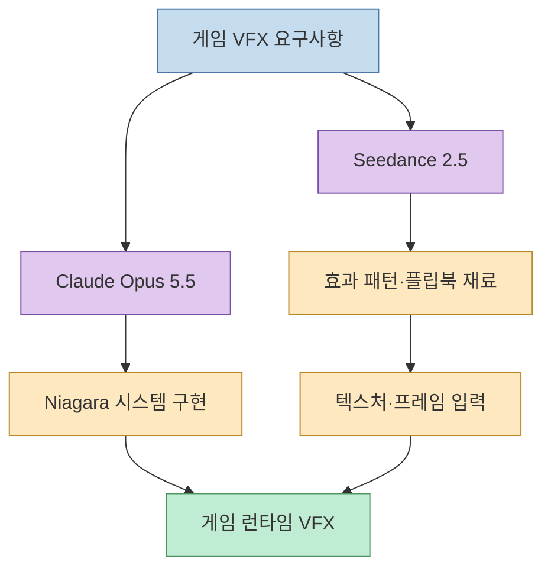
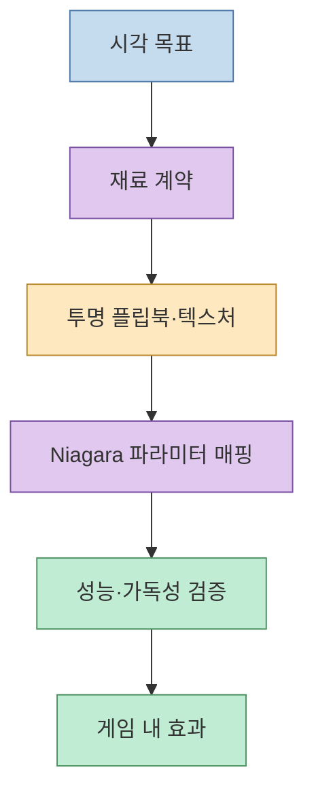
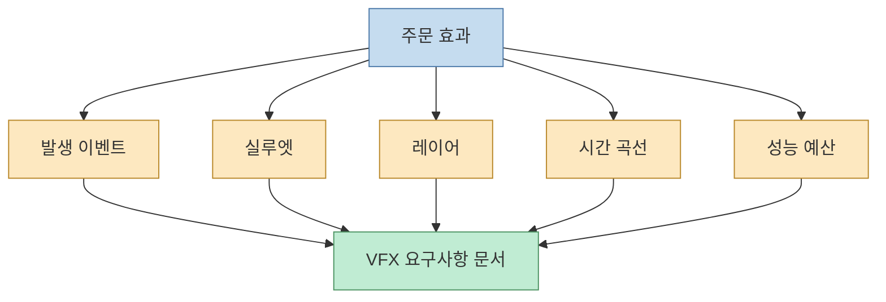
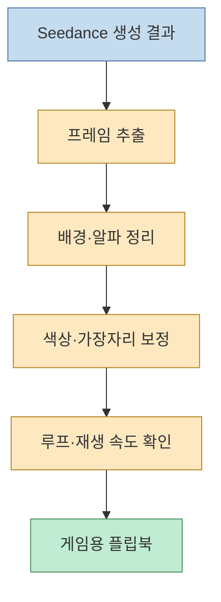
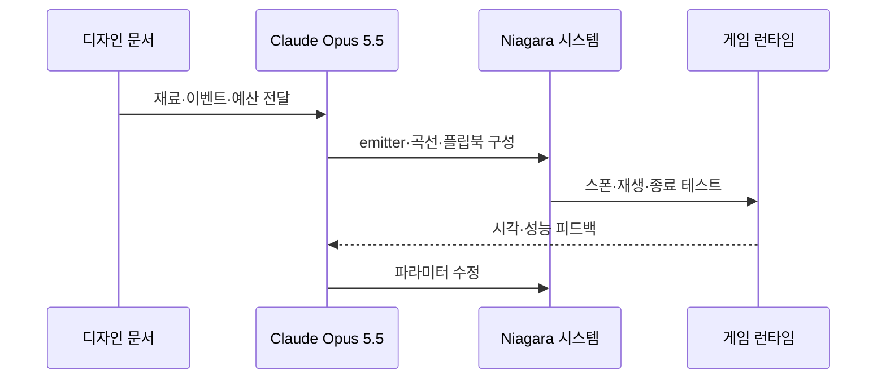
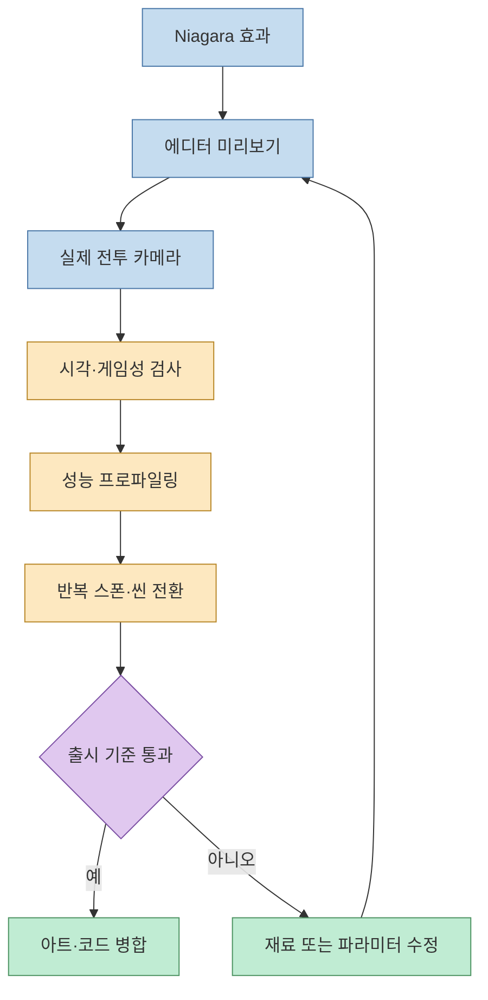

게임의 마법 효과를 한 모델에게 전부 맡기지 않고, **영상 생성 모델과 코딩 에이전트가 잘하는 일을 나누면** 결과를 더 쉽게 게임 안에 넣을 수 있다. Threads의 사례는 Diablo 스타일의 작은 게임에 주문 효과를 적용하면서 Seedance 2.5로 효과 패턴과 플립북 재료를 만들고, Claude Opus 5.5로 Niagara 효과를 작성했다는 내용이다.

이 글은 해당 Threads 게시물과 연결된 원문을 바탕으로, 이 분업을 재현 가능한 제작 파이프라인으로 해석한다. 게시물에는 프로젝트의 엔진 버전·프레임 수·텍스처 해상도·실제 코드가 공개되어 있지 않으므로, 확인된 사실과 일반적인 VFX 설계 원칙을 구분해 설명한다.

<!--more-->

## Sources

- [Threads 원문 — Seedance 2.5와 Claude Opus 5.5의 게임 VFX 사례](https://www.threads.com/share/BAXFJ4BO5S) (Scrapling `fetch --network-idle`로 본문 추출)
- [연결된 원문 X 게시물](https://x.com/CanItCode/status/2120135112876580869)
- [ByteDance Seedance 2.5 공식 소개](https://seed.bytedance.com/en/blog/one-take-creation-flexible-referencing-introducing-seedance-2-5)
- [Anthropic Claude Opus 5.5 공식 소개](https://www.anthropic.com/claude-opus-5-5)

## 사례에서 확인되는 역할 분담

게시물의 첫 번째 항목은 Seedance 2.5를 마법 효과의 **패턴과 플립북 제작**에 사용했다고 설명한다. 여기서 영상 AI가 맡은 것은 게임 엔진에서 실행되는 최종 파티클 시스템이 아니라, 불꽃·빛·연기·에너지의 모양을 참고하거나 텍스처 시트로 변환할 수 있는 시각 재료다. (Threads 원문, [게시물](https://www.threads.com/share/BAXFJ4BO5S))

두 번째 항목은 Claude Opus 5.5가 Niagara 효과 작성을 맡았다고 설명한다. 즉, 생성된 재료를 게임의 파티클 시스템에 연결하고, 방출량·수명·색·크기·속도·노이즈·충돌 같은 런타임 동작을 코드 또는 엔진 설정으로 조립하는 역할이다. (Threads 원문, [작성자 스레드](https://www.threads.com/share/BAXFJ4BO5S))

ByteDance는 Seedance 2.5를 오디오·비디오 공동 생성과 참조 제어를 지원하는 비디오 생성 모델로 소개한다. 반면 Anthropic은 Opus 5.5를 장시간 작업과 코딩·에이전트 작업에 적합한 모델로 설명한다. 따라서 이 사례의 핵심은 두 모델을 경쟁시키는 것이 아니라 **시각 재료 생성과 엔진 통합을 분리하는 것**이다. ( [Seedance 2.5 공식 소개](https://seed.bytedance.com/en/blog/one-take-creation-flexible-referencing-introducing-seedance-2-5), [Opus 5.5 공식 소개](https://www.anthropic.com/claude-opus-5-5))

## 왜 한 모델에 전부 맡기지 않는가

영상 생성 모델은 픽셀 단위의 질감과 움직임을 빠르게 탐색하는 데 강하지만, 게임 엔진의 파티클 시스템이 요구하는 결정성·재사용성·성능 예산을 직접 보장하지 않는다. 반대로 코딩 에이전트는 엔진 API와 프로젝트 구조를 읽고 시스템을 조립할 수 있지만, 불꽃의 유기적인 모양이나 연기 가장자리 같은 시각 재료를 처음부터 아름답게 설계하는 데는 별도 참조가 필요하다.

두 역할을 분리하면 다음과 같은 계약을 만들 수 있다.

1. **재료 계약**: 프레임 수, 투명 배경, 색 공간, 방향, 루프 여부를 고정한다.
2. **엔진 계약**: 게임에서 노출할 파라미터와 성능 예산을 정의한다.
3. **검증 계약**: 에디터 미리보기와 실제 플레이 상황에서 모두 확인한다.

이 계약이 없으면 영상 모델이 만든 예쁜 이미지를 그대로 게임에 넣으려다 알파 채널이 깨지거나, 프레임이 루프되지 않거나, 모바일에서 과도한 오버드로우가 발생할 수 있다.

## 1단계: 게임 VFX 요구사항을 먼저 쪼갠다

코딩 에이전트에게 “멋진 불꽃을 만들어 줘”라고만 요청하면 엔진 통합에 필요한 정보가 빠진다. 먼저 효과를 발생 조건과 시각 레이어로 나눈다.

- **발생**: 투사체 충돌, 시전 시작, 대상 추적, 사망 등
- **핵심 실루엣**: 구체, 고리, 칼날, 번개, 소용돌이
- **레이어**: 코어 빛, 외곽 불꽃, 연기, 파편, 충격파
- **시간 곡선**: 등장, 유지, 폭발, 소멸
- **공간**: 카메라를 향하는 빌보드인지, 월드 방향을 따르는 메시인지
- **예산**: 파티클 수, 텍스처 크기, overdraw, 동시 실행 수

이 문서를 만들면 Seedance에는 시각 참조를, Claude에는 구현 제약을 각각 전달할 수 있다.

## 2단계: Seedance 2.5로 패턴과 플립북 재료를 만든다

Seedance 2.5는 공식 소개에서 이미지·비디오·오디오 참조를 활용하는 비디오 생성과 편집 기능을 강조한다. 이 사례에서는 완성된 게임 효과 영상을 그대로 쓰기보다, 마법 효과의 패턴을 탐색하고 플립북에 들어갈 시각 프레임을 만드는 재료 생성 단계로 해석하는 것이 안전하다. ( [Seedance 2.5 공식 소개](https://seed.bytedance.com/en/blog/one-take-creation-flexible-referencing-introducing-seedance-2-5))

프롬프트에는 게임에서 보존해야 할 제약을 명시한다. 예를 들어 “정면에서 보이는 작은 화염 구체, 검은 배경이 아닌 투명 배경을 목표로 한 고대비 실루엣, 12프레임의 시작-성장-폭발-소멸, 카메라 이동 없음”처럼 효과의 시간과 방향을 고정한다. 영상 생성 결과가 실제 투명 플립북으로 바로 쓰인다고 가정하지 말고, 배경 제거·알파 정리·프레임 추출·색상 보정 단계를 별도로 둔다.

### 재료를 게임용으로 정리하는 체크리스트

1. 배경과 효과의 색을 분리한다.
2. 프레임마다 알파 가장자리에 검은 후광이 없는지 확인한다.
3. 시작과 끝 프레임의 에너지가 자연스럽게 이어지는지 확인한다.
4. 프레임 수와 재생 속도를 게임의 고정 프레임·타임라인에 맞춘다.
5. 작은 해상도에서도 실루엣이 읽히는지 확인한다.

## 3단계: Claude Opus 5.5로 Niagara 시스템을 조립한다

Opus 5.5에는 재료 파일과 VFX 요구사항 문서를 함께 제공한다. 에이전트에게 요청할 내용은 “효과를 만들어 줘”가 아니라 다음처럼 구체적이어야 한다.

- 어떤 이벤트가 시스템을 스폰하는가
- 플립북의 행·열과 재생 길이는 무엇인가
- 코어·외곽·파편을 어떤 emitter로 나눌 것인가
- 색상과 크기는 어떤 곡선을 따르는가
- 카메라 거리와 화면 해상도에 따른 LOD가 필요한가
- 한 화면에 몇 개까지 동시에 실행되는가
- 종료 시 모든 파티클과 참조가 정리되는가

Claude가 프로젝트의 Niagara 설정과 코드 스타일을 먼저 읽게 하고, 작은 프로토타입부터 생성하도록 한다. 첫 단계에서는 한 emitter와 한 텍스처만 사용해 스폰·재생·종료를 검증하고, 이후 코어 빛·연기·충격파를 추가하는 편이 디버깅에 유리하다.

## 4단계: 게임 안에서 검증한다

VFX는 에디터에서 예뻐 보여도 실제 플레이에서는 실패할 수 있다. 플레이어가 움직일 때 읽히는지, 배경과 색이 섞이지 않는지, 공격 판정과 시각 효과가 일치하는지 확인해야 한다. 특히 영상 생성 모델의 결과는 게임 카메라와 조명, 후처리, 해상도에 따라 다르게 보인다.

검증은 네 층으로 나눈다.

- **시각**: 실루엣, 색 대비, 프레임 루프, 알파 경계
- **게임성**: 시전 시점, 충돌 위치, 피해 피드백, 적중 가독성
- **성능**: GPU 파티클 수, overdraw, 텍스처 메모리, 모바일 프레임 시간
- **안정성**: 반복 스폰, 씬 전환, 저장·로드, 네트워크 동기화

## 이 분업의 한계와 안전한 기대치

Threads 게시물은 효과가 적용된 사례를 보여 주지만, 정확한 엔진 버전·생성 프롬프트·후처리 과정·성능 수치를 공개하지 않는다. 따라서 Seedance가 곧바로 “완성된 Niagara 플립북”을 출력했다거나, Opus가 자동으로 최적화까지 완료했다고 해석해서는 안 된다. 이 글에서 설명한 알파 정리, 프레임 추출, 프로파일링은 사례를 재현할 때 필요한 일반적인 보완 단계다.

또한 두 모델을 연결한다고 해서 책임이 사라지지 않는다. 영상 생성 서비스의 사용 조건과 생성물 권리, 게임에 포함할 외부 이미지·음성·음악의 라이선스를 확인해야 한다. API 키는 저장소나 프롬프트에 넣지 말고 환경 변수나 비밀 저장소로 관리한다.

## 핵심 요약

- Seedance 2.5는 마법 효과의 패턴과 플립북 재료를 탐색하는 시각 생성 역할을 맡긴다.
- Claude Opus 5.5는 재료를 Niagara emitter·곡선·이벤트·성능 예산에 맞게 게임 시스템으로 조립하는 역할을 맡긴다.
- 두 모델을 연결하기 전에 프레임 수, 알파, 루프, 방향, 색 공간, 동시 실행 수를 계약으로 정해야 한다.
- 생성 결과는 배경 제거·알파 보정·프레임 추출을 거쳐야 하며, 게임 안에서 시각·게임성·성능·안정성을 다시 검증해야 한다.
- 게시물에는 세부 구현이 공개되지 않았으므로, “자동 완성”보다 역할 분담을 보여 주는 사례로 이해하는 것이 정확하다.

## 결론

게임 VFX에서 AI의 가장 현실적인 사용법은 한 모델에게 모든 일을 시키는 것이 아니다. 영상 모델로 시각 재료를 넓게 탐색하고, 코딩 에이전트로 엔진의 규칙과 성능 제약을 반영해 시스템화하는 **분업형 파이프라인**이 더 재현 가능하다. 최종 품질은 모델의 화려한 샘플보다, 재료 계약과 게임 내 검증 루프를 얼마나 잘 설계했는지에 달려 있다.
