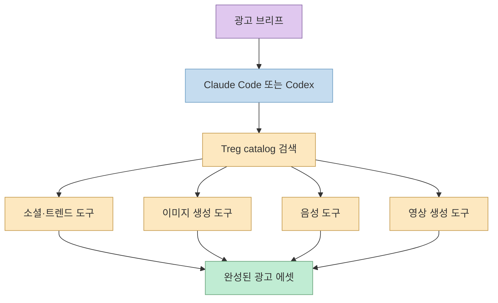
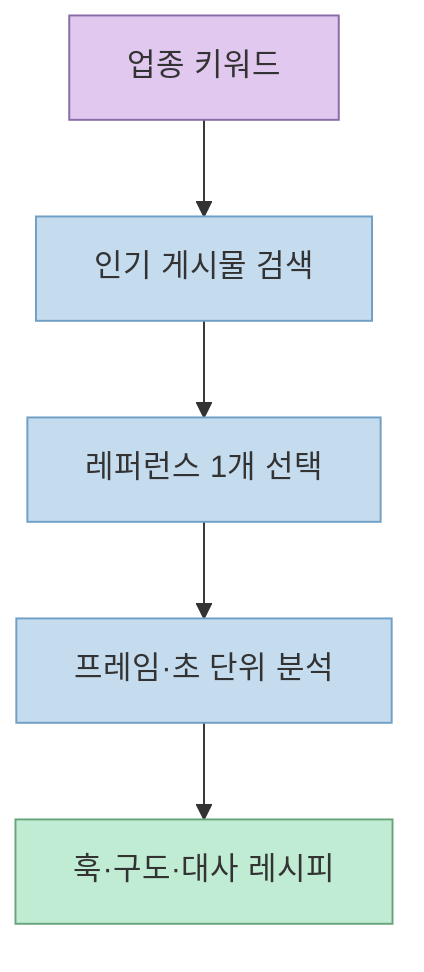
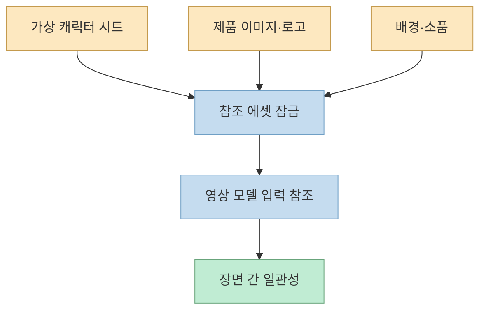
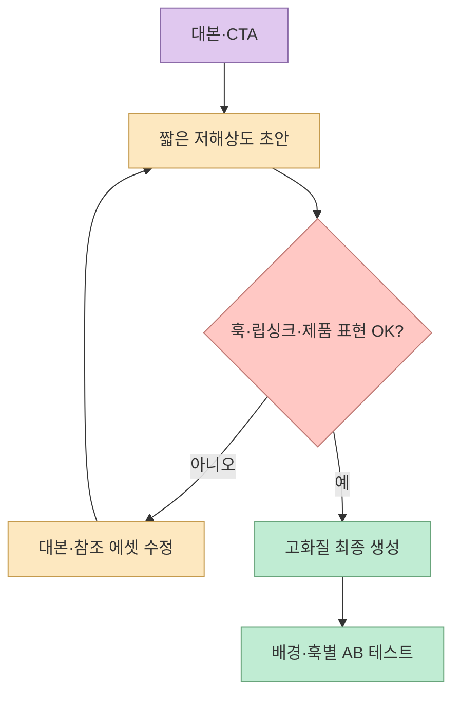

AI 영상 제작의 병목은 모델 하나를 고르는 일이 아니라, **리서치·에셋 제작·음성·영상 생성**을 서로 다른 서비스에서 이어 붙이는 일입니다. 소개 영상에서는 이 작업을 Claude Code 같은 코딩 에이전트와 `treg`로 한 번에 지휘하는 흐름을 보여 줍니다. 영상 속 데모는 업종별 바이럴 영상을 찾고, 프레임 단위로 분해한 뒤, 가상 크리에이터와 목소리를 고정하고 광고 영상을 만드는 방식입니다 ([00:04](https://youtu.be/oAa5sjPgN3g?t=4), [11:45](https://youtu.be/oAa5sjPgN3g?t=705)).

<!--more-->

## 원문과 참고 자료

- 영상: [Treg와 Claude Code로 바이럴 광고 영상 만들기](https://youtu.be/oAa5sjPgN3g)
- 공식 사이트: [treg — AI Video](https://treg.io/aigc)
- 공식 사용 지침: [`treg` `llms.txt`](https://treg.to/llms.txt)
- 오픈 소스 저장소: [superdesigndev/treg](https://github.com/superdesigndev/treg)

## Treg는 모델이 아니라 도구 라우터다

Treg의 핵심은 새로운 영상 모델을 제공하는 것이 아닙니다. 하나의 토큰과 기본 URL 뒤에 여러 제공사의 도구를 catalog로 묶고, 에이전트가 “어떤 업체를 쓸까?”가 아니라 “무슨 일을 할까?”를 검색하게 만드는 계층입니다. 공식 문서는 SEO·소셜 트렌드·스크래핑·이미지·영상·음성 생성 등 127개 제공사의 4,100개 이상 도구를 하나의 catalog로 설명합니다 ([공식 설명](https://treg.to/llms.txt)).

이 구조의 장점은 특정 공급사에 작업 흐름이 고정되지 않는다는 점입니다. Treg는 자체 catalog 도구와 팀이 등록한 API·OAuth·CLI·스킬을 함께 노출하며, 팀이 보유한 키가 있으면 그 키를 우선 사용합니다. 다만 “무료”라는 표현을 모든 호출에 적용해서는 안 됩니다. 공식 문서 기준으로 새 계정에는 조건에 따라 1달러 크레딧이 제공되고, 이후 catalog 호출은 제공사와 경로에 따라 과금됩니다 ([공식 README](https://github.com/superdesigndev/treg#two-kinds-of-tool-one-token)).

## 4단계 UGC 영상 제작 루프

영상의 제작 흐름은 다음 네 단계로 나눌 수 있습니다.

### 1. 바이럴 레퍼런스 검색과 분해

먼저 TikTok·Instagram·YouTube 같은 플랫폼에서 업종에 맞는 인기 영상을 찾습니다. 중요한 것은 영상을 그대로 복제하는 것이 아니라, 첫 3초의 훅, 컷 전환 속도, 카메라 구도, 대사 타이밍을 제작 레시피로 추출하는 것입니다 ([11:54](https://youtu.be/oAa5sjPgN3g?t=714)). 공식 AI Video 페이지도 검색 결과에서 레퍼런스 하나를 고르고, 프레이밍과 페이스를 후속 생성의 기준으로 잠그는 단계를 제시합니다 ([treg AI Video](https://treg.io/aigc#the-flow)).

이 단계의 비용은 생성 단계보다 작습니다. 영상에서는 검색과 상세 분석 호출을 합쳐 약 0.0049달러가 든 사례를 보여 주지만 ([12:35](https://youtu.be/oAa5sjPgN3g?t=755)), 실제 비용은 선택한 제공사·호출량·계정 상태에 따라 달라집니다. Treg 공식 페이지 역시 예시 가격은 catalog의 경로와 시점에 따라 달라질 수 있음을 명시합니다.

### 2. 캐릭터와 제품 에셋 고정

바로 영상을 생성하면 매 장면의 얼굴, 제품 형태, 배경이 흔들리기 쉽습니다. 따라서 먼저 정면·측면·후면·클로즈업이 포함된 캐릭터 시트를 만들고, 제품·장소·소품도 정지 이미지로 확정합니다 ([14:23](https://youtu.be/oAa5sjPgN3g?t=863)). 공식 Treg 예시는 캐릭터 시트와 세트·소품을 먼저 생성한 뒤 영상 모델에 참조 이미지로 전달하는 방식이며, 이미지 생성 비용과 영상 생성 비용을 분리해 설명합니다 ([treg AI Video](https://treg.io/aigc#why-lock-the-assets-first)).

실존 인물이나 유명인을 닮은 캐릭터를 만들지 않는 것도 중요한 안전장치입니다. 영상에서는 완전히 새로운 가상 인물을 만들도록 요청하고 ([14:55](https://youtu.be/oAa5sjPgN3g?t=895)), 유명인의 얼굴·목소리를 광고에 사용하지 말라고 강조합니다 ([26:40](https://youtu.be/oAa5sjPgN3g?t=1600)).

### 3. 캐릭터에 맞는 음성 선택

얼굴을 고정해도 음성이 어울리지 않으면 광고의 신뢰감이 떨어집니다. 영상은 1,000개가 넘는 음성 라이브러리에서 캐릭터와 분위기에 맞는 음성을 고르고, 필요하면 자체 음성 모델을 API로 연결하는 흐름을 보여 줍니다 ([16:23](https://youtu.be/oAa5sjPgN3g?t=983), [21:03](https://youtu.be/oAa5sjPgN3g?t=1263)). Treg 공식 예시도 Fish Audio의 음성 검색을 별도 단계로 두고, 선택한 음성을 영상 모델의 참조 오디오로 넘깁니다 ([treg AI Video](https://treg.io/aigc#why-the-voice-is-its-own-step)).

음성 복제는 반드시 권리와 동의를 확인해야 합니다. 자신의 목소리나 라이선스가 명시된 음성을 사용하고, 타인의 음성을 흉내 내는 설정은 피해야 합니다. 이 단계에서는 “자연스러움”보다 **사용 권한·언어·발음·립싱크 호환성**을 먼저 체크하는 편이 안전합니다.

### 4. 저해상도 초안 후 최종 영상 생성

영상 생성은 가장 비싼 단계이므로 처음부터 긴 고화질 영상을 만들지 않습니다. 영상에서는 9.7초 정도의 짧은 초안을 먼저 만들고, 훅과 립싱크가 괜찮을 때 전체 영상으로 확장하는 방식을 제안합니다 ([24:05](https://youtu.be/oAa5sjPgN3g?t=1445)). 공식 Treg 예시도 14초 480p 클립의 단계별 비용을 공개하며, 호출이 시작될 때 예상 금액을 보류하고 완료 결과에 따라 정산한다고 설명합니다 ([treg AI Video](https://treg.io/aigc#what-happens-to-the-money)).

## 설치와 운영 시 주의할 점

로컬 코딩 에이전트에서는 공식 설치 스크립트와 `treg login`으로 CLI를 준비하고, Claude Code 플러그인 방식이라면 marketplace를 추가한 뒤 `/mcp`에서 인증합니다 ([공식 quickstart](https://github.com/superdesigndev/treg#quickstart), [영상 설치 시연](https://youtu.be/oAa5sjPgN3g?t=327)). 토큰을 소스 코드에 직접 넣지 말고 환경 변수나 Treg의 서버 측 자격 증명 저장소를 사용해야 합니다. 공식 `llms.txt`도 에이전트 머신에 제공사 키를 보관하지 않고 서버에서 인증 정보를 주입한다고 설명합니다.

광고 게시 전에는 다음을 확인해야 합니다.

- AI로 생성한 영상임을 플랫폼 정책에 맞게 표시합니다 ([26:57](https://youtu.be/oAa5sjPgN3g?t=1617)).
- 실제 사용자가 남긴 것처럼 보이는 가짜 후기·성과를 만들지 않습니다 ([27:02](https://youtu.be/oAa5sjPgN3g?t=1622)).
- 유명인의 얼굴·목소리·성대모사를 사용하지 않고, 바이럴 영상은 구조만 참고합니다 ([26:40](https://youtu.be/oAa5sjPgN3g?t=1600)).
- 제품 로고와 얼굴이 일그러지지 않았는지 최종 렌더 전에 캐릭터 시트와 합성 이미지를 다시 검수합니다 ([26:17](https://youtu.be/oAa5sjPgN3g?t=1577)).
- 생성 비용 상한과 중단 조건을 정한 뒤, 초안→검수→최종 순서로 호출합니다.

## 핵심 요약

- Treg는 영상 모델 자체가 아니라 여러 외부 도구를 에이전트가 검색·호출하는 라우터입니다.
- 좋은 UGC 파이프라인은 **바이럴 레퍼런스 분석 → 에셋 고정 → 음성 선택 → 저비용 초안 → 최종 생성** 순서로 진행합니다.
- 캐릭터 시트·제품·배경을 먼저 잠그면 장면 간 일관성이 높아지고, 비싼 영상 재생성을 줄일 수 있습니다.
- 음성 복제와 유명인 참조는 권리·동의·플랫폼 정책을 먼저 확인해야 합니다.
- 예시 가격은 고정 요금이 아니므로 호출 전 비용 상한을 정하고, 광고 게시 전 AI 표기와 허위 후기 금지 규칙을 지켜야 합니다.

## 결론

Treg의 가장 큰 변화는 “영상 생성 버튼”을 하나 더 만드는 데 있지 않습니다. 에이전트가 시장에서 레퍼런스를 찾고, 필요한 에셋을 고정하고, 여러 제공사를 비교한 뒤, 실패한 초안만 다시 만드는 **검수 가능한 제작 루프**를 만든다는 데 있습니다. 쇼핑몰·마케팅 대행사·1인 크리에이터라면 처음부터 완성 영상을 대량 생성하기보다 한 업종의 레퍼런스 하나를 골라 짧은 훅을 검증하는 것부터 시작하는 편이 비용과 품질을 함께 관리하기 좋습니다.
