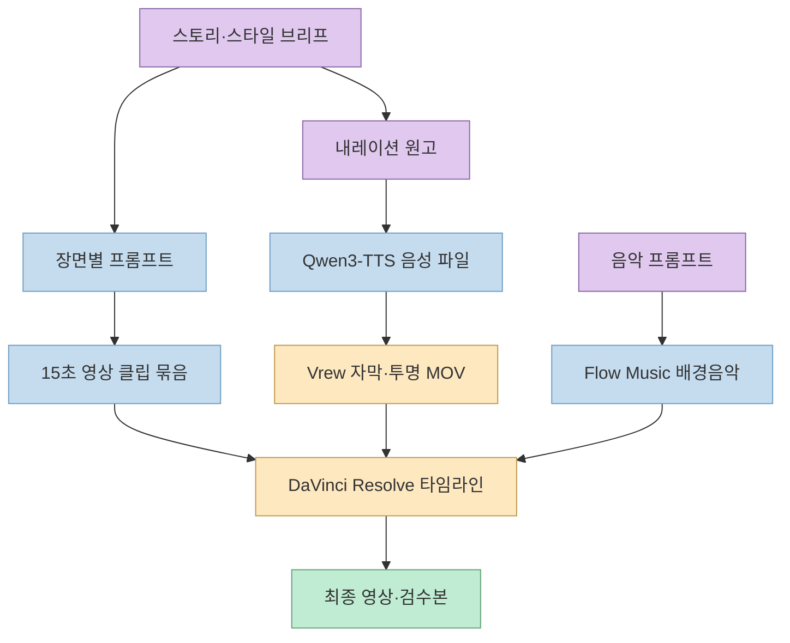
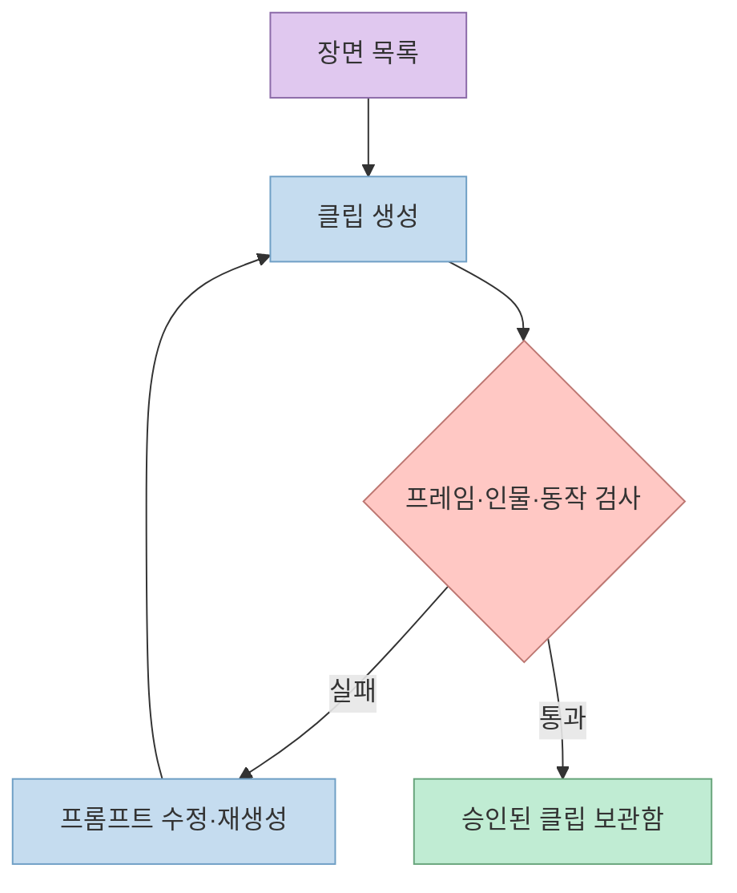
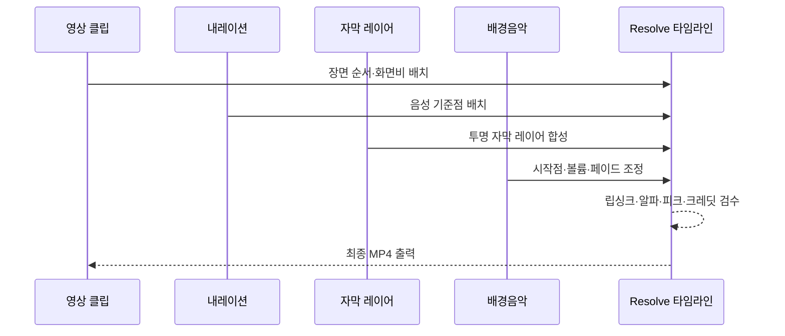

짧은 영상 하나를 만드는 일은 모델 하나에 프롬프트를 입력하는 것보다 **여러 종류의 산출물을 같은 타임라인에 맞추는 일**에 가깝습니다. Threads의 사례는 ChatGPT로 스토리와 프롬프트를 만들고, 영상 클립·성우 음성·투명 자막·배경음악을 각각 생성한 뒤 DaVinci Resolve에서 약 1분 53초짜리 영상으로 조립한 과정을 보여 줍니다.

이 글은 해당 사례를 그대로 재현한다고 주장하기보다, 게시물에 등장한 도구를 역할별로 나누어 어떤 입력과 출력이 오가는지 설명합니다. 특히 “구독료 외 비용이 없었다”는 경험담은 계정·요금제·사용량에 따라 달라질 수 있으므로, 공식 가격과 이용 약관을 별도로 확인해야 합니다.

<!--more-->

## Sources

- 원문 Threads: [이음가짐의 생성형 AI 영상 제작 사례](https://www.threads.com/share/BAPHSzWu3J)
- 원문에서 공유한 결과 영상: [YouTube Shorts](https://youtube.com/shorts/kqG80S0tGXM?feature=share)
- [Gemini Omni 1.2 Flash 공식 소개](https://blog.google/innovation-and-ai/technology/developers-tools/introducing-gemini-omni-1-2-flash/)
- [Gemini Omni Flash API 문서](https://ai.google.dev/gemini-api/docs/models/gemini-omni-flash)
- [Qwen3-TTS 공식 저장소](https://github.com/QwenLM/Qwen3-TTS)
- [Vrew 도움말: 영상·자막 내보내기](https://vrew-help.notion.site/Basic-Information-f39ae8491408449c97cbeec9a29bf5ae)
- [Google Flow Music 도움말](https://support.google.com/flow/answer/17083868)
- [DaVinci Resolve 공식 제품 페이지](https://www.blackmagicdesign.com/products/davinciresolve)

## 한 편의 영상은 여러 계약의 조합이다

게시물의 도구 이름은 “Omni Flash 1.2”, “Qwen3-TTS”, “Vrew”, “Google Flow music”, “DaVinci Resolve”입니다. 공식 문서 기준으로 현재 확인되는 명칭은 **Gemini Omni 1.2 Flash**, **Qwen3-TTS**, **Google Flow Music**에 가깝습니다. 아래 다이어그램에서 각 단계의 중요한 계약은 다음과 같습니다.

1. 스토리는 장면별 프롬프트와 내레이션 원고로 분리합니다.
2. 영상 모델의 출력 길이·해상도·화면비를 미리 고정합니다.
3. 음성은 문장별 타임코드와 함께 보관합니다.
4. 자막은 영상 위에 굽기보다 투명 레이어로 렌더링하면 최종 편집에서 위치를 바꿀 수 있습니다.
5. 음악은 영상 길이와 저작권·워터마크 조건을 확인한 뒤 믹싱합니다.



## 1. 스토리와 프롬프트를 먼저 고정하기

첫 단계는 영상 생성 모델을 호출하는 일이 아니라 **장면 목록을 만드는 일**입니다. 한 장면을 “예쁜 영상을 만들어 줘”로 남겨 두면 클립마다 인물·색·카메라 움직임이 달라집니다. 대신 장면 ID, 길이, 화면비, 등장 요소, 카메라 동작, 금지 요소를 구조화합니다.

```yaml
scene: 03
duration: 15s
aspect_ratio: 9:16
subject: "비 오는 밤의 작은 서점"
camera: "slow push-in"
palette: "deep blue and warm amber"
negative: "text, logo, extra people"
```

Gemini Omni Flash 공식 문서는 텍스트·이미지·비디오 입력과 영상 생성·편집을 설명하고, 최신 1.2 Flash 소개는 15초 영상 생성과 대화형 편집을 강조합니다. 다만 게시물의 “한 번에 15초 영상 10개”는 특정 계정과 시점에서의 사용 경험이지, 모든 사용자에게 보장되는 처리량은 아닙니다. 생성 전에는 모델의 현재 길이·해상도·요금 제한을 확인해야 합니다.

## 2. 짧은 클립을 여러 개 생성하기

15초 클립을 여러 개 만들면 긴 영상을 한 번에 생성할 때보다 장면별 재생성 범위를 좁힐 수 있습니다. 대신 연결부의 일관성이 문제가 됩니다. 다음 값을 모든 프롬프트에 반복하고, 결과 파일명에도 기록하면 후반 편집이 쉬워집니다.

- 동일한 인물·의상·색상 팔레트
- 장면의 시작·끝 동작
- 렌즈와 카메라 속도
- `scene-03-take-02` 같은 재현 가능한 파일명



## 3. Qwen3-TTS로 내레이션 만들기

[Qwen3-TTS](https://github.com/QwenLM/Qwen3-TTS)는 Qwen 팀이 공개한 음성 합성 모델군으로, 공식 저장소는 `qwen-tts` 패키지 설치와 로컬 추론 예제를 제공합니다. 게시물처럼 성우 오디오를 별도 파일로 만들면 영상 클립을 바꾸더라도 내레이션과 자막을 재사용할 수 있습니다.

권장 출력은 단순한 MP3 하나가 아니라 다음 메타데이터를 함께 갖는 것입니다.

```json
{
  "voice": "ko-neutral-01",
  "sample_rate": 24000,
  "segments": [
    {"id": "s01", "text": "첫 장면입니다.", "start": 0.0, "end": 2.1}
  ]
}
```

이렇게 하면 자막과 영상의 기준점을 음성 파일에 맞출 수 있습니다. 목소리 복제나 특정 화자 모사는 본인의 권리와 동의를 확인하고, 결과물을 실제 사람의 발언처럼 오인시키지 않도록 표시해야 합니다. 또한 로컬 추론은 서비스 요금이 없을 수 있지만 GPU·메모리·설치 시간이라는 비용이 생깁니다.

## 4. Vrew에서 자막을 별도 레이어로 만들기

Vrew는 음성 인식으로 자막을 만들고 영상·SRT·TXT 등으로 내보낼 수 있습니다. 게시물은 성우 오디오를 Vrew에 넣어 투명한 MOV 자막 레이어를 만든 뒤 최종 편집에 사용했습니다. 이 방식은 자막의 글꼴·위치·애니메이션을 Resolve에서 바꿀 수 있다는 장점이 있습니다.

다만 투명 MOV는 플레이어와 코덱에 따라 검은 배경으로 보일 수 있습니다. 따라서 다음을 확인해야 합니다.

- 알파 채널을 보존하는 코덱인지
- 프레임레이트와 해상도가 원본 타임라인과 같은지
- 투명 레이어가 실제 편집기에서 합성되는지
- 최종 내보내기에서 자막이 두 번 나타나지 않는지

## 5. 음악을 생성하고 최종 편집하기

Google Flow Music은 음악 생성 서비스이며, 공식 도움말은 더 많은 생성과 크레딧을 위해 구독 또는 Google AI 멤버십이 필요할 수 있음을 안내합니다. 따라서 “무료로 만들었다”는 사례를 그대로 일반화하기보다, 계정의 크레딧·상업 이용 조건·워터마크를 확인해야 합니다.

DaVinci Resolve에서는 영상·음성·자막·음악을 하나의 타임라인으로 정렬합니다. 아래처럼 먼저 음성을 기준으로 컷을 배치하고, 음악은 내레이션을 가리지 않도록 볼륨을 자동화하는 편이 안전합니다.



## 비용과 재현성을 관리하는 방법

게시물은 ChatGPT 구독료 외에 추가 비용이 없었다고 말하지만, 실제 파이프라인 비용은 계정 등급과 호출량에 따라 달라집니다. 비용을 재현하려면 영상 한 편마다 다음을 기록합니다.

- 모델명과 버전, 생성 횟수, 실패한 재생성 수
- TTS 추론 시간과 실행 장비
- 음악·영상 서비스의 크레딧 사용량
- 사용한 폰트·이미지·음악의 라이선스
- Resolve 프로젝트 파일과 최종 렌더 해시

특히 생성형 영상과 음악은 출력 자체보다 **상업적으로 사용할 수 있는가**가 더 큰 리스크입니다. 공개 전에는 서비스 약관, 모델 라이선스, 음악의 배포 조건, 실제 인물·브랜드의 초상권을 함께 검토해야 합니다.

## 핵심 요약

- 긴 영상을 한 번에 만들기보다 장면별 15초 클립으로 나누면 재생성 범위를 줄일 수 있습니다.
- Omni Flash 계열은 영상 생성·편집 모델이고, 현재 공식 명칭과 길이·요금 제한은 문서를 기준으로 확인해야 합니다.
- Qwen3-TTS 음성을 독립 파일로 만들면 자막과 영상 교체가 쉬워집니다.
- Vrew의 투명 자막 MOV는 후반 편집에 유연하지만 알파 채널과 코덱 호환성을 검수해야 합니다.
- Flow Music의 크레딧·상업 이용 조건은 계정과 플랜에 따라 달라질 수 있습니다.
- Resolve에서는 음성을 기준으로 영상과 자막을 맞추고, 음악은 내레이션을 방해하지 않도록 믹싱합니다.

## 결론

이 사례의 핵심은 특정 모델의 성능보다 **생성물을 파일과 메타데이터로 분리해 다음 단계에 넘기는 설계**입니다. 스토리와 프롬프트를 먼저 고정하고, 영상·음성·자막·음악을 각각 검수한 뒤 Resolve에서 조립하면 한 번의 성공에 의존하지 않는 제작 루프를 만들 수 있습니다. 처음에는 30초 테스트 영상으로 알파 채널과 음량을 검증하고, 비용·라이선스·재생성을 기록한 뒤 1분 53초 같은 긴 결과물로 확장하는 것이 안전합니다.
