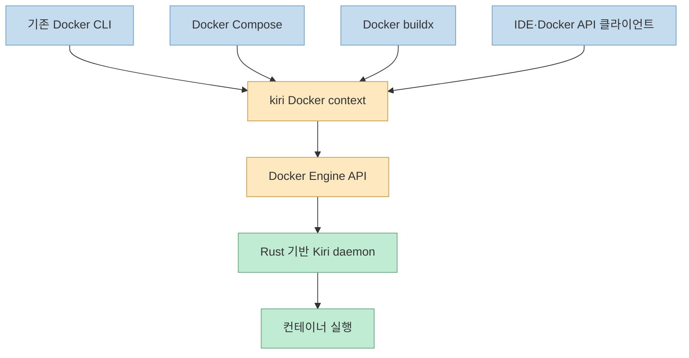
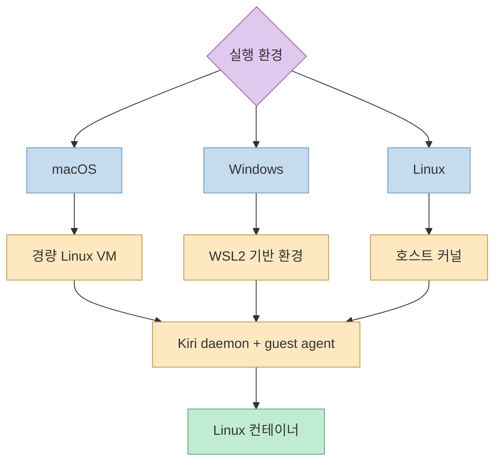
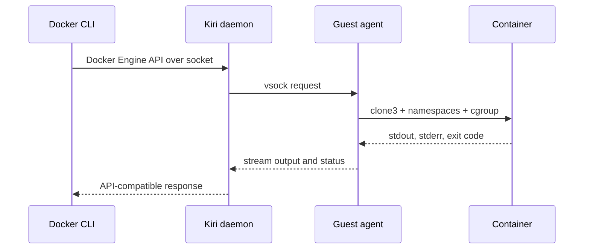
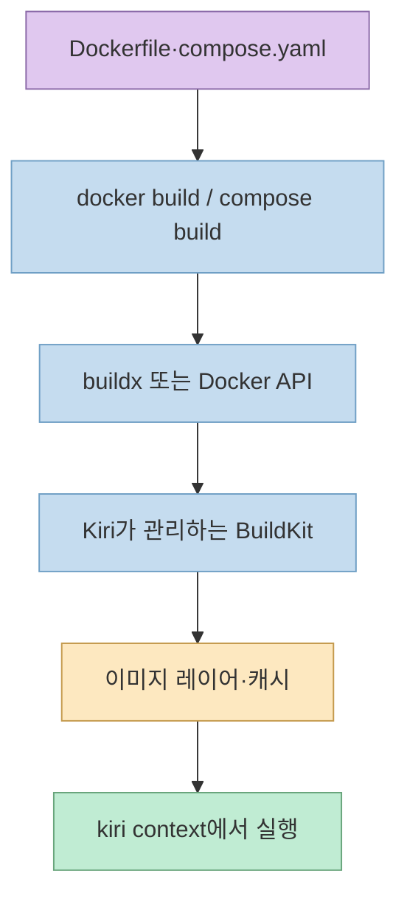
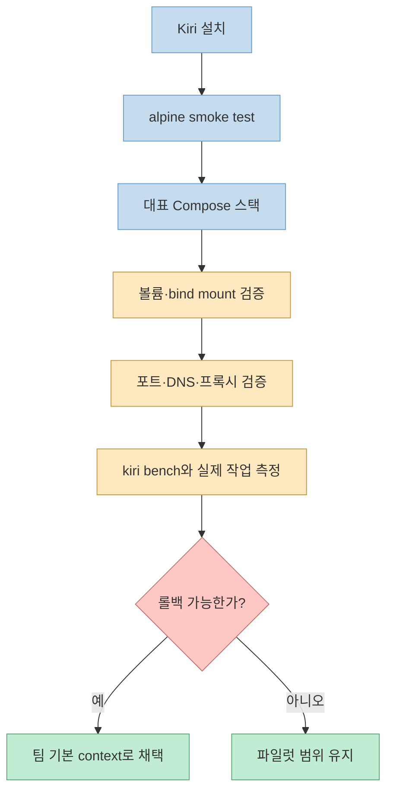

Docker Desktop은 편리하지만, 데스크톱 VM과 여러 데몬 계층이 만들어 내는 시작 지연과 리소스 사용량이 부담이 될 수 있습니다. Threads에 소개된 **Kiri**는 이 문제를 Rust로 만든 단일 컨테이너 런타임과 Docker Engine API 호환 계층으로 풀어 보려는 오픈 소스 프로젝트입니다. 핵심은 새로운 명령어를 강요하는 것이 아니라, 기존 `docker`, Compose, buildx와 IDE가 계속 같은 방식으로 동작하도록 엔진만 교체하는 것입니다.

<!--more-->

## Sources

- 원문 Threads: [Github Projects의 Kiri 소개](https://www.threads.com/share/BAefi24iCI)
- 공식 저장소: [libracoder/kiri](https://github.com/libracoder/kiri)
- 공식 문서: [Kiri Docs](https://docs.runkiri.com/)
- 아키텍처 설명: [Kiri development guide](https://github.com/libracoder/kiri/blob/main/docs/development.md)

## Kiri가 해결하려는 문제

Kiri는 Docker 이미지를 실행하는 컨테이너 런타임이며, macOS·Windows·Linux를 대상으로 합니다. 공식 저장소는 Kiri를 Docker Desktop과 OrbStack의 경량 대안으로 소개하고, Docker CLI·Compose·buildx를 그대로 사용할 수 있다고 설명합니다 ([README](https://github.com/libracoder/kiri)). macOS에서는 Linux 컨테이너를 하나의 경량 VM 안에서 실행하고, Linux에서는 호스트 커널 위에서 직접 실행하는 방식입니다 ([Kiri Docs](https://docs.runkiri.com/)).



### “80배 빠르다”는 표현을 어떻게 읽어야 할까

Threads 원문은 Docker Desktop보다 컨테이너 시작이 약 80배 빠르다고 소개합니다. 이 수치는 게시물의 요약 표현이므로 일반적인 모든 워크로드에 적용되는 보편적 보장으로 해석하면 안 됩니다. Kiri 공식 사이트는 동일한 Apple Silicon 환경에서 같은 CPU·메모리 제한과 warm image를 사용한 비교 결과를 별도로 공개합니다. 예를 들어 `docker run --rm alpine true`의 중앙값은 Kiri 22ms, Docker Desktop 178ms로 제시되어 있습니다 ([공식 성능 비교](https://runkiri.com/docker-runtime/)). 저장소 README에는 다른 측정 조건과 수치도 있으므로, 실제 도입 전에는 자신의 이미지·파일 공유·네트워크 조건으로 `kiri bench`를 다시 실행해야 합니다 ([README Numbers](https://github.com/libracoder/kiri#numbers)).

## 운영체제별 실행 모델

Kiri의 호환성은 운영체제에 따라 내부 구현이 달라진다는 점을 전제로 합니다.



- **macOS**: Kiri가 관리하는 Linux VM에서 컨테이너를 실행합니다. 공식 개발 문서는 Apple Virtualization.framework를 사용하고, 커스텀 커널과 guest agent를 포함한다고 설명합니다.
- **Windows**: 공식 README 기준으로 WSL2를 통해 실행하는 설치 경로를 제공합니다.
- **Linux**: 별도 VM 없이 호스트 커널에서 Kiri daemon이 컨테이너를 실행합니다. 공식 Linux 문서는 `kiri.service`와 `/run/kiri/docker.sock`을 제공한다고 안내합니다 ([Linux docs](https://docs.runkiri.com/linux/)).

따라서 “VM이 없다”는 말은 플랫폼 전체에 동일하게 적용되지 않습니다. macOS에서는 VM이 여전히 필요하지만, Kiri가 VM의 생명주기와 컨테이너 엔진을 한 묶음으로 관리해 사용자가 Docker Desktop의 여러 계층을 직접 다루지 않도록 합니다.

## 내부 아키텍처: dockerd·containerd·runc를 한 데몬으로

Kiri의 설계 포인트는 Docker Engine API를 외부 호환면으로 유지하면서 내부 실행 경로를 단순화하는 것입니다. 개발 문서에 따르면 macOS의 Docker CLI·Compose·buildx는 Unix socket을 통해 Kiri daemon에 연결하고, daemon은 vsock으로 guest agent에 요청을 전달합니다. guest agent는 PID 1로서 컨테이너 실행·출력 전달·포트·DNS 등을 담당합니다 ([development.md](https://github.com/libracoder/kiri/blob/main/docs/development.md)).



저장소의 개발 문서는 컨테이너를 `clone3`로 새 네임스페이스와 cgroup에 넣고, overlayfs·`pivot_root`·capability·seccomp를 조합한다고 설명합니다. 또한 일반적인 Docker 스택의 `runc`, shim, dockerd를 사용하지 않는다고 명시합니다. 이는 “명령어 호환”과 “내부 구현 호환”을 구분해야 한다는 뜻입니다. 기존 CLI가 작동해도 모든 Docker Desktop 확장 기능이나 운영 도구가 자동으로 동일하게 동작한다고 가정해서는 안 됩니다.

### 이미지와 빌드의 흐름

Kiri는 Dockerfile과 Compose 파일을 새 형식으로 바꾸지 않습니다. 공식 빌드 문서에 따르면 `docker build`, `docker buildx build`, `docker compose build`가 Kiri가 관리하는 BuildKit으로 전달되고, 결과 이미지는 Kiri에 로드되어 바로 실행됩니다 ([Builds](https://docs.runkiri.com/docker/builds/)).



빌드 캐시가 유지되는 위치와 이미지 로딩 정책은 성능에 직접 영향을 주므로, CI에서는 Kiri의 기본 캐시가 러너 수명보다 오래 유지되는지 확인해야 합니다. 로컬 개발과 CI의 엔진이 다르면 빌드 재현성과 캐시 적중률도 달라질 수 있습니다.

## 설치와 전환 방법

공식 README는 macOS 14 이상, Windows 10·11의 WSL2, Ubuntu·Fedora 계열 Linux 설치 패키지를 안내합니다 ([설치 표](https://github.com/libracoder/kiri#install)). 첫 실행 시 `kiri` Docker context를 만들고, 기존 Docker CLI가 있다면 다음처럼 테스트할 수 있습니다.

```bash
docker --context kiri run --rm alpine echo hello
docker --context kiri compose up -d
docker context use kiri
docker context use default
```

Kiri 공식 문서는 Docker Desktop이나 OrbStack에서 이미지·볼륨·컨테이너를 가져오는 `kiri import` 흐름도 안내합니다. 다만 운영 데이터가 있는 환경에서는 가져오기 전 백업과 롤백 경로를 확인해야 합니다. 특히 볼륨 파일 권한, bind mount 성능, 네트워크 이름 해석, GPU·USB 패스스루는 엔진마다 차이가 날 수 있습니다.

## 도입 전 검증 체크리스트



검증 순서는 “빠르다”는 벤치마크보다 중요합니다. 먼저 대표 컨테이너가 뜨는지 확인하고, 실제 서비스의 Compose·볼륨·네트워크를 재현한 다음, 개발자들이 매일 쓰는 `build`, `exec`, 로그 스트리밍, 파일 동기화 시간을 측정해야 합니다. 이 과정에서 문제가 생기면 Docker context만 되돌려 기존 엔진으로 복귀할 수 있어야 합니다.

## 핵심 요약

- Kiri는 Rust로 작성된 Docker 호환 컨테이너 런타임이며, 기존 Docker CLI·Compose·buildx를 유지하는 것을 목표로 합니다.
- macOS는 경량 Linux VM, Linux는 호스트 커널, Windows는 WSL2 기반으로 실행 모델이 다릅니다.
- Docker Engine API를 Kiri daemon이 받고, guest agent가 `clone3`·네임스페이스·cgroup으로 컨테이너를 실행합니다.
- `docker build`와 Compose 빌드는 Kiri가 관리하는 BuildKit과 캐시를 사용합니다.
- Threads의 “80배” 주장은 게시물의 요약 표현입니다. 공식 벤치마크의 조건·수치와 자신의 워크로드를 분리해 검증해야 합니다.
- 도입 전에는 볼륨, 네트워크, 파일 동기화, 권한, GPU·특수 장치, 롤백을 반드시 테스트해야 합니다.

## 결론

Kiri의 흥미로운 점은 Docker 생태계를 버리는 대신 **호환 가능한 API와 CLI를 유지한 채 실행 계층을 다시 설계**했다는 데 있습니다. Rust 단일 데몬, 경량 VM, 직접적인 컨테이너 초기화가 실제 개발 속도를 높일지는 워크로드에 따라 달라지지만, Docker Desktop의 무거운 기본값에 답답함을 느끼는 개발자라면 작은 테스트 프로젝트부터 Kiri context를 병행해 볼 만합니다. 성능 숫자보다 중요한 기준은 팀의 Compose 파일과 개발 도구를 수정하지 않고도 빠르게 전환하고, 문제가 생겼을 때 즉시 기존 context로 돌아갈 수 있는가입니다.
