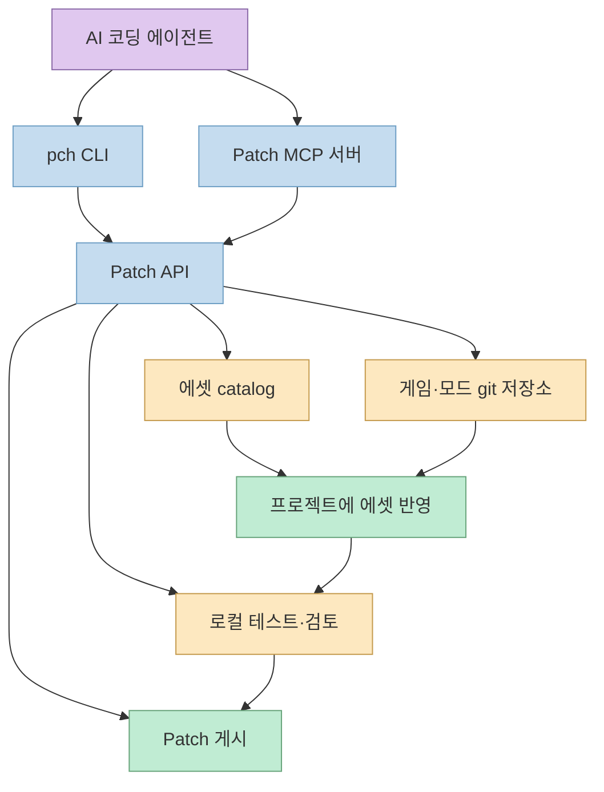
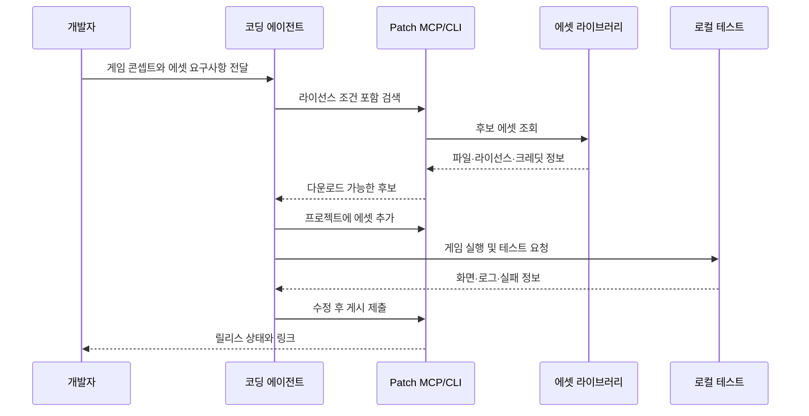
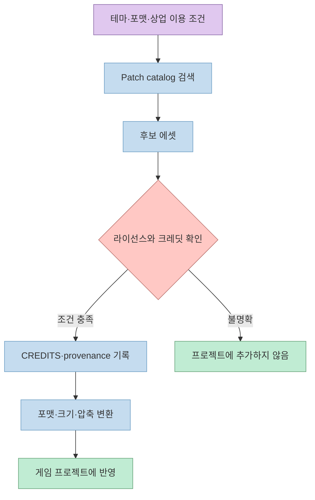
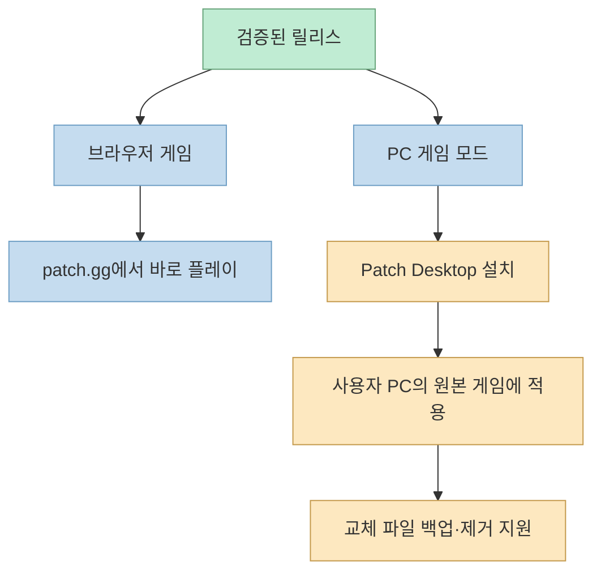

게임을 만들 때 코드를 작성하는 것보다 더 오래 걸리는 일이 있습니다. 필요한 스프라이트·3D 모델·텍스처·사운드를 찾고, 라이선스를 확인하고, 프로젝트에 맞는 형식으로 가져오는 일입니다. Threads의 게시물은 이 과정을 **Patch**라는 플랫폼과 AI 코딩 에이전트로 묶어, 약 5.9만 개의 게임 에셋을 검색하고 내려받는 흐름으로 소개합니다 ([원문](https://www.threads.com/share/_v8Jh7xZX)).

Patch는 단순한 에셋 사이트가 아닙니다. 브라우저 게임을 플레이·배포하고, Windows에서 PC 게임 모드를 설치하며, Claude Code·Codex·Cursor 같은 코딩 에이전트가 CLI와 MCP를 통해 프로젝트·에셋·테스트·배포를 조작할 수 있는 작업 플랫폼을 지향합니다.

<!--more-->

## Sources

- 원문 Threads: [누쿤의 무료 게임 에셋 소개](https://www.threads.com/share/_v8Jh7xZX)
- 공식 사이트: [Patch — build and play](https://patch.gg/)
- 공식 약관: [Patch Terms](https://patch.gg/terms)
- 공식 개인정보 처리방침: [Patch Privacy](https://patch.gg/privacy)
- 기능·출시 분석: [Patch opens to everyone](https://www.aigamer.gg/news/patch-opens-ai-game-mod-platform-cli-mcp)

## Patch는 무엇을 하나

Patch의 공식 홈페이지는 세 가지 표면을 한 제품 안에 배치합니다.

1. **에셋 라이브러리**: 3D 모델, 캐릭터, 텍스처, 머티리얼, 효과음을 검색합니다.
2. **게임·모드 호스팅**: 브라우저 게임을 Patch에서 플레이하고, Windows 앱으로 PC 모드를 설치합니다.
3. **에이전트 도구**: CLI와 MCP 서버를 통해 기존 코딩 에이전트가 검색·가져오기·테스트·게시를 수행합니다.

공식 사이트는 5만 개 이상의 오픈 소스 게임 에셋을 소개하고, Threads 게시물은 약 5.9만 개라고 설명합니다. 집계 시점과 필터가 다를 수 있으므로 숫자는 고정된 보장값이 아니라 catalog의 현재 규모를 나타내는 지표로 보는 편이 정확합니다 ([Patch 홈페이지](https://patch.gg/), [출시 분석](https://www.aigamer.gg/news/patch-opens-ai-game-mod-platform-cli-mcp)).

## AI 에이전트와 연결되는 방식

Patch의 차별점은 에이전트가 웹페이지를 눈으로 훑지 않아도 작업을 요청할 수 있다는 점입니다. CLI와 MCP는 같은 플랫폼 기능을 서로 다른 호출 표면으로 노출합니다. 예를 들어 에이전트에게 “우주 슈팅 게임에 맞는 무료 스프라이트와 사운드를 찾아 프로젝트에 넣고, 실행 가능한 빌드를 테스트해 달라”고 요청하면 다음과 같은 순서가 됩니다.

여기서 중요한 것은 Patch가 게임을 대신 만들어 주는 엔진이라는 뜻이 아니라는 점입니다. 약관은 Patch가 사용자의 작업을 빌드하지 않으며, 사용자의 PC나 CI에서 빌드한 결과물을 업로드한다고 설명합니다 ([Patch Terms — What Patch is](https://patch.gg/terms#what-patch-is)). 즉 에이전트가 코드를 생성하고 실행하는 주체이고, Patch는 에셋·저장소·테스트·호스팅을 연결하는 작업면입니다.

## 에셋 검색에서 라이선스까지 이어지는 provenance

Threads 게시물은 catalog의 에셋이 CC0·CC-BY 등 안전한 라이선스를 사용한다고 소개합니다. 그러나 **무료**와 **무조건 사용 가능**은 같은 말이 아닙니다. Patch 홈페이지는 각 에셋에 라이선스와 크레딧 라인을 붙인다고 말하고, 약관도 에셋 라이브러리 항목에 라이선스와 크레딧이 함께 제공된다고 규정합니다 ([Patch 홈페이지](https://patch.gg/), [Patch Terms — assets](https://patch.gg/terms#assets)).

따라서 에이전트가 에셋을 추가할 때는 파일만 복사하지 말고 다음 메타데이터를 함께 저장해야 합니다.

- 원본 에셋 ID와 제공자 URL
- 정확한 라이선스명과 버전
- 크레딧 문구와 표시 위치
- 다운로드 날짜와 사용한 변환·수정 내역
- 게임 배포물에 에셋 파일이 그대로 재배포되는지 여부

CC0는 저작권 조건을 크게 줄여 주지만 상표권·초상권·개인정보·외부 파일의 별도 조건까지 자동으로 해결해 주지는 않습니다. CC-BY라면 크레딧을 빠뜨리면 안 됩니다. 에셋 catalog의 검색 결과를 신뢰하더라도 최종 릴리스에는 라이선스 기록을 포함해 사람이 검수하는 것이 안전합니다.

## 브라우저 게임과 PC 모드의 배포 차이

Patch는 브라우저 게임과 PC 모드를 같은 프로젝트 생태계에서 다루지만 배포 경로는 다릅니다.

브라우저 게임은 설치 없이 플레이할 수 있지만, 모드는 Windows의 Patch Desktop과 사용자가 보유한 원본 게임이 필요합니다. Patch 약관은 다른 회사 게임의 모드는 무료여야 하고, 원본 게임 파일이나 코드를 포함해서는 안 되며, 해당 게임 제작사의 허가를 대신 제공하지 않는다고 명시합니다 ([Patch Terms — games Patch doesn't own](https://patch.gg/terms#games-patch-doesnt-own)). 따라서 “모드 배포가 가능하다”는 말은 게임 저작권과 온라인 서비스 약관을 무시해도 된다는 뜻이 아닙니다.

## 테스트와 보안 경계

Patch는 게시 전 파일 검사와 로컬 PC 테스트를 결합합니다. 약관에 따르면 브라우저 게임이나 설치 가능한 모드는 Patch Desktop에서 테스트하고, 릴리스 파일은 악성 코드 검사와 AI 기반 코드 검토를 거칩니다. 다만 약관은 검토가 모든 문제를 잡는 보증은 아니라고 명시합니다 ([Patch Terms — Your agent](https://patch.gg/terms#your-agent)).

또한 개인정보 처리방침은 에이전트 작업, 테스트 프레임, 릴리스 검토를 위해 프로젝트 파일과 소스가 서비스 제공자에게 전달될 수 있음을 설명합니다 ([Patch Privacy](https://patch.gg/privacy)). 비공개 게임이나 사업 기밀을 다룬다면 다음을 확인해야 합니다.

- 에이전트가 읽고 수정할 수 있는 디렉터리 범위를 최소화합니다.
- API 키·세이브 파일·개인정보를 저장소와 테스트 로그에서 제외합니다.
- 릴리스 검토를 위해 어떤 파일과 소스가 전송되는지 팀 정책으로 기록합니다.
- 모드 실행이 외부 네트워크·파일·프로세스에 접근하는지 직접 검토합니다.

## 현재 도입 시 한계

Patch는 빠른 프로토타이핑에 매력적이지만 아직 초기 플랫폼으로 봐야 합니다. 공식 사이트는 Windows 앱을 제공하고 Mac 사용자는 대기 목록으로 안내합니다 ([Patch 홈페이지](https://patch.gg/)). 따라서 macOS 개발자는 에이전트 CLI/MCP로 제작을 시도할 수 있어도, 최종 PC 모드 테스트와 게시에는 Windows 머신이 필요할 수 있습니다. 또한 플랫폼의 사용량 제한·지원 범위·MCP 도구 목록은 시점에 따라 변할 수 있으므로 설치 전에 공식 문서와 약관을 다시 확인해야 합니다.

## 핵심 요약

- Patch는 게임 에셋 catalog, git 저장소, 테스트, 호스팅을 CLI·MCP로 코딩 에이전트에 연결합니다.
- 약 5만~5.9만 개 규모의 에셋을 검색할 수 있지만, 숫자는 집계 시점에 따라 달라집니다.
- 에셋 파일과 함께 라이선스·크레딧·출처를 provenance 기록으로 보관해야 합니다.
- 브라우저 게임은 Patch에서 바로 플레이할 수 있지만, PC 모드는 Windows Patch Desktop과 원본 게임이 필요합니다.
- 다른 회사 게임의 모드는 무료·비재배포 원칙과 원본 게임 약관을 지켜야 합니다.
- Patch의 자동 검토는 안전 보장이 아니며, 프로젝트 파일·테스트 프레임·소스 전송에 대한 개인정보 정책을 검토해야 합니다.

## 결론

Patch가 보여 주는 방향은 “AI에게 게임 코드를 써 달라”에서 한 단계 더 나아가, **에셋 발견부터 테스트와 배포까지 에이전트가 호출할 수 있는 작업면을 제공하는 것**입니다. 특히 라이선스와 크레딧 정보를 에셋 검색 단계부터 묶어 둔 점은 게임 프로토타입을 빠르게 만드는 것과 출시 리스크를 관리하는 데 모두 중요합니다. 다만 현재는 Windows 중심의 테스트 경로와 초기 서비스의 변동성을 고려해야 하므로, 작은 브라우저 게임으로 provenance·테스트·롤백 절차를 먼저 검증한 뒤 팀의 핵심 프로젝트로 확장하는 것이 현실적인 접근입니다.
