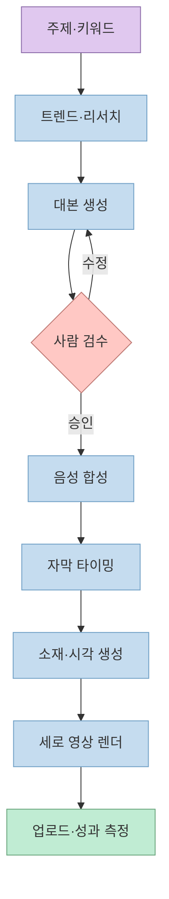
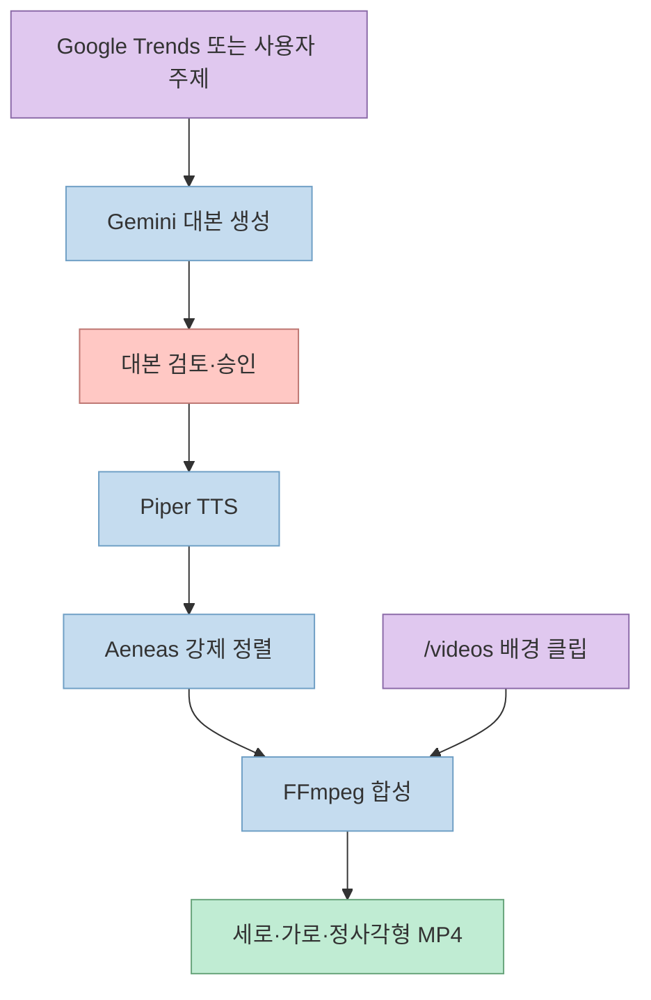
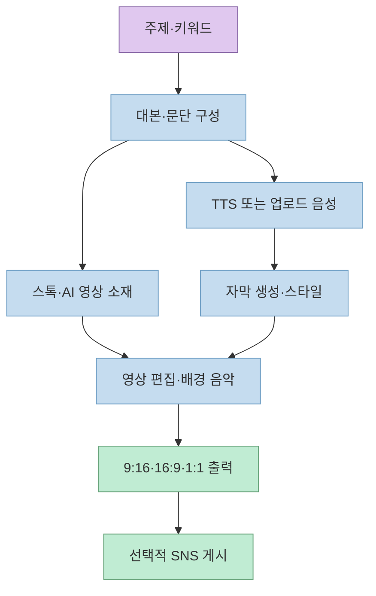
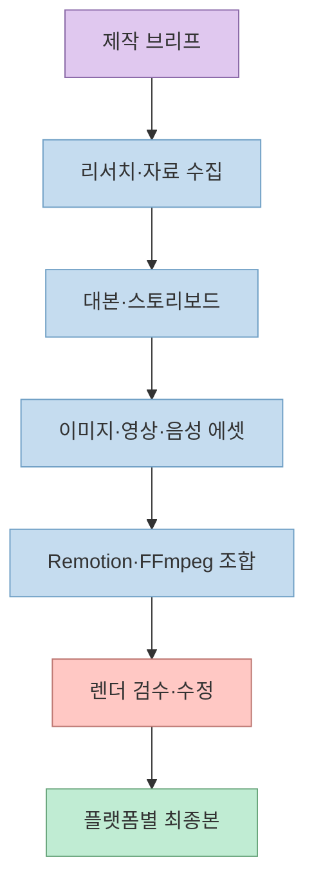
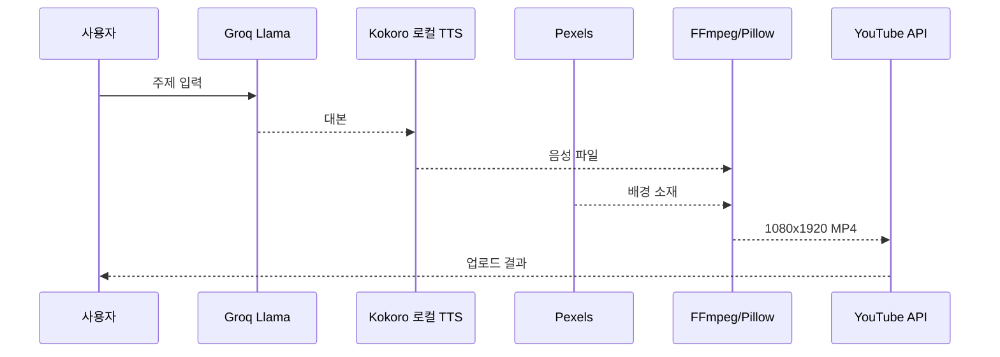
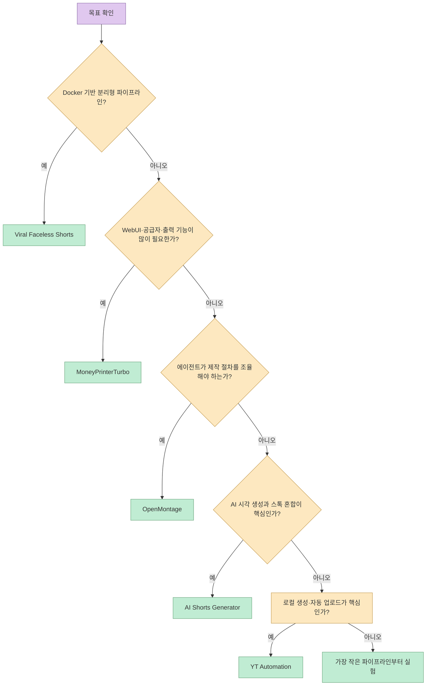

유튜브 쇼츠 자동화는 단순히 대본을 생성하는 문제가 아닙니다. 주제 탐색, 대본 검수, 음성 합성, 영상 소재 선택, 자막 타이밍, 세로 화면 합성, 업로드까지 여러 단계를 안정적으로 이어야 합니다. Threads의 목록은 이 흐름을 서로 다른 방식으로 구현한 오픈 소스 5가지를 소개합니다. 저장소 README를 기준으로 보면, 다섯 프로젝트는 같은 “자동 생성”이라는 이름 아래에서도 **로컬 파이프라인**, **웹 UI**, **에이전트형 제작 스튜디오**, **완전 자동 업로드**로 역할이 나뉩니다.

<!--more-->

## Sources

- 원문 Threads: [H2S SOUND의 유튜브 자동화 오픈 소스 TOP 5](https://www.threads.com/share/BAjT0pRi6H)
- [Viral Faceless Shorts Generator](https://github.com/Dark2C/Viral-Faceless-Shorts-Generator)
- [MoneyPrinterTurbo](https://github.com/harry0703/MoneyPrinterTurbo)
- [OpenMontage](https://github.com/OpenMontageInc/OpenMontage)
- [AI Shorts Generator](https://github.com/AbdullahNaveed/ai-shorts-generator)
- [YT Automation](https://github.com/mzu-2410z/yt-automation)

## 한눈에 보는 다섯 가지 접근

| 프로젝트 | 강점 | 기본 흐름 | 운영 성격 |
|---|---|---|---|
| Viral Faceless Shorts Generator | 트렌드부터 렌더까지 컨테이너화 | Google Trends → Gemini → Piper → Aeneas → FFmpeg | Docker 기반 웹 UI |
| MoneyPrinterTurbo | 기능 폭과 입력·출력 선택지 | 주제 → 대본·소재·음성·자막·음악 → 영상 | WebUI·CLI·Docker |
| OpenMontage | 에이전트형 영상 제작 지식과 파이프라인 | 리서치 → 대본 → 편집·생성·검수 | AGPL-3.0, 다중 파이프라인 |
| AI Shorts Generator | AI 시각 자료와 무료 스톡 혼합 | 주제 → 스크립트 → 시각·음성 → 캡션 | Python 로컬 대시보드 |
| YT Automation | 로컬 생성과 YouTube 업로드 | 주제 → Llama 3.3 → Kokoro → FFmpeg → YouTube API | Windows 중심 완전 자동화 |

프로젝트마다 “자동”의 범위가 다르므로 저장소를 고를 때는 생성 품질보다 **내가 통제하려는 단계가 어디인지**를 먼저 정해야 합니다.

## 1. Viral Faceless Shorts Generator: 단계를 분리한 Docker 파이프라인

[Viral Faceless Shorts Generator](https://github.com/Dark2C/Viral-Faceless-Shorts-Generator)는 Google Trends나 사용자 주제에서 시작해 Gemini로 제목·설명·본문을 만들고, 승인된 대본을 Piper TTS·Aeneas·FFmpeg로 영상화합니다. README는 대본을 사람이 승인한 뒤에만 렌더링하는 단계를 명시하며, `trendscraper`, `piper`, `speechalign`, `nginx` 등을 Docker Compose로 분리합니다.

이 구조는 단계별 교체가 쉽다는 장점이 있습니다. 반면 Google Gemini API 키와 배경 영상을 준비해야 하고, 여러 컨테이너와 음성·정렬 런타임을 관리해야 합니다. “한 번 클릭”은 웹 트리거를 뜻하지, 콘텐츠 품질 검수까지 사라진다는 뜻은 아닙니다.

## 2. MoneyPrinterTurbo: 가장 넓은 기능 표면

[MoneyPrinterTurbo](https://github.com/harry0703/MoneyPrinterTurbo)는 주제나 키워드에서 스크립트·소재·자막·배경 음악을 조합해 HD 쇼츠를 만드는 올인원 프로젝트입니다. README는 Windows·macOS·Linux를 지원하고, Python 3.11 이상·Docker·WebUI·CLI 경로를 제공합니다. 음성은 Edge TTS, Gemini, MiniMax, ElevenLabs 등 여러 공급자를 선택할 수 있고, 결과를 TikTok·Instagram·YouTube Shorts에 게시하는 기능도 포함합니다.

MoneyPrinterTurbo는 기능이 많은 만큼 설정과 공급자 키 관리가 복잡합니다. 최신 릴리스의 README는 API 인증, Docker 설정, Redis 동시성, 생성 작업 추적과 같은 운영 이슈도 다루고 있습니다. 비용과 약관이 서로 다른 여러 공급자를 연결하므로, 자동화 전에 사용할 모델·TTS·소재 제공자와 과금 상한을 고정하는 편이 안전합니다.

## 3. OpenMontage: 에이전트를 영상 제작자로 확장

[OpenMontage](https://github.com/OpenMontageInc/OpenMontage)는 일반적인 “주제 입력 → MP4 출력” 도구보다 큽니다. GitHub 설명은 12개 제작 파이프라인, 100개 이상의 도구, 700개 이상의 에이전트 스킬·제작 지식 파일을 제공한다고 설명합니다. Claude·Cursor·Copilot 같은 코딩 에이전트가 리서치, 스토리보드, 생성형 미디어, Remotion·FFmpeg 합성을 단계별로 수행하도록 하는 영상 제작 시스템입니다.

이 프로젝트는 콘텐츠 공장이라기보다 **에이전트가 반복 가능한 제작 절차를 따르게 하는 지식·도구 묶음**에 가깝습니다. 따라서 영상 한 편을 빨리 뽑는 것보다 시리즈의 스타일, 씬 규칙, 검수 절차를 코드로 관리하고 싶은 팀에 적합합니다. AGPL-3.0 라이선스이므로 사내 수정본을 서비스로 제공하거나 재배포할 때 라이선스 의무를 먼저 검토해야 합니다.

## 4. AI Shorts Generator: AI 시각 자료와 무료 스톡의 혼합

[AI Shorts Generator](https://github.com/AbdullahNaveed/ai-shorts-generator)는 하나의 주제를 캡션이 포함된 세로 영상으로 바꾸는 Python 파이프라인입니다. README에 따르면 Flux 기반 AI 이미지와 Wan 기반 모션 클립을 fal.ai에서 생성하거나, Pexels·Pixabay의 무료 스톡 영상을 가져올 수 있습니다. AI 음성, 단어 단위 캡션, 배경 음악, 워터마크, 로컬 리뷰 대시보드와 플랫폼별 제목·설명·해시태그 출력을 제공합니다.

이 프로젝트의 핵심은 매번 영상을 생성하지 않고 **재사용 가능한 시각 소재 라이브러리**를 만들 수 있다는 점입니다. 같은 의미의 장면을 저장해 다음 영상에서 다시 매칭하면 생성 비용과 대기 시간을 줄일 수 있습니다. 단, fal.ai·스톡 사이트의 사용량과 라이선스 조건은 별도이므로 무료 코드와 무료 콘텐츠를 혼동하면 안 됩니다.

## 5. YT Automation: 로컬 생성부터 업로드까지

[YT Automation](https://github.com/mzu-2410z/yt-automation)은 Windows PC에서 주제를 입력하면 Llama 3.3 70B(Groq)가 대본을 만들고, Kokoro TTS가 로컬 음성을 생성하고, Pexels 소재와 FFmpeg·Pillow가 1080×1920 영상을 만든 뒤 YouTube Data API로 업로드하는 구조입니다. 저장소는 각 단계를 약 5분 이내의 로컬 흐름으로 설명하며 MIT 라이선스를 사용합니다.

외부 유료 영상 생성 서비스 없이 로컬 음성을 쓰는 점은 비용 예측에 유리하지만, Groq·Pexels·YouTube API의 키와 쿼터, OAuth 토큰은 여전히 필요합니다. 업로드 자동화는 편리한 만큼 제목·설명·공개 범위·썸네일·중복 콘텐츠를 게시 전에 검수하는 안전장치를 두어야 합니다.

## 어떤 프로젝트부터 선택할까

### 공통 운영 체크리스트

- **대본 승인 단계**: 사실 오류, 과장된 제목, 타인의 콘텐츠를 베끼는 표현을 사람이 확인합니다.
- **소재 라이선스**: 배경 영상·음악·폰트·음성 모델의 상업 이용과 재배포 조건을 기록합니다.
- **비용 상한**: LLM·TTS·영상 생성 API의 월 한도와 영상당 상한을 설정합니다.
- **비밀 관리**: API 키를 `.env`와 시크릿 저장소로 관리하고 저장소·로그에 남기지 않습니다.
- **업로드 검수**: 자동 게시 대신 비공개 또는 예약 업로드로 시작해 중복·저작권·정책 위반을 확인합니다.
- **관찰 가능성**: 입력 주제, 사용 모델, 프롬프트, 소재 URL, 렌더 결과를 실행 ID와 함께 보관합니다.

## 핵심 요약

- 다섯 프로젝트는 모두 쇼츠 자동화를 다루지만, 자동화 범위와 운영 방식이 다릅니다.
- Viral Faceless Shorts Generator는 Trends→Gemini→TTS→자막 정렬→FFmpeg를 Docker로 분리합니다.
- MoneyPrinterTurbo는 WebUI·CLI·Docker와 다양한 LLM·TTS·영상 제공자를 한 프로젝트에 모읍니다.
- OpenMontage는 에이전트가 영상 제작 지식과 파이프라인을 반복 실행하게 하는 스튜디오형 접근입니다.
- AI Shorts Generator는 AI 시각 생성과 Pexels·Pixabay 스톡을 섞고, 소재를 재사용하는 흐름을 제공합니다.
- YT Automation은 Groq·Kokoro·Pexels·FFmpeg·YouTube API를 이용한 로컬 중심 자동 업로드 파이프라인입니다.
- 자동 게시보다 먼저 대본 승인, 라이선스 기록, 비용 상한, 키 보호, 비공개 업로드를 운영 규칙으로 만드는 것이 중요합니다.

## 결론

유튜브 자동화의 핵심은 “버튼 하나로 영상을 만든다”가 아니라, 반복 가능한 제작 단계를 어디까지 신뢰하고 어디에서 사람이 검수할지를 정하는 것입니다. 처음에는 YT Automation처럼 작은 로컬 루프나 Viral Faceless Shorts Generator처럼 단계가 분리된 구조로 시작하고, 시리즈 제작과 팀 협업이 필요해지면 MoneyPrinterTurbo나 OpenMontage로 확장하는 방식이 현실적입니다. 도구를 선택하기 전에 한 편의 영상이 아니라 **10편을 같은 품질과 비용으로 만들 수 있는가**를 테스트해야 합니다.
