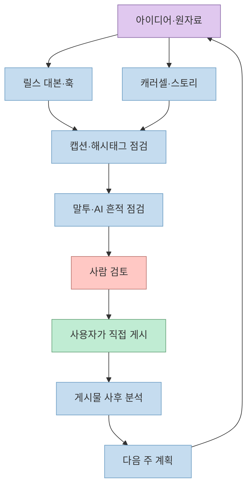
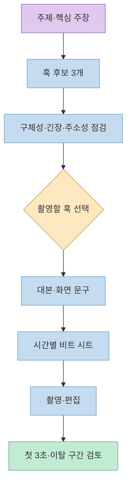
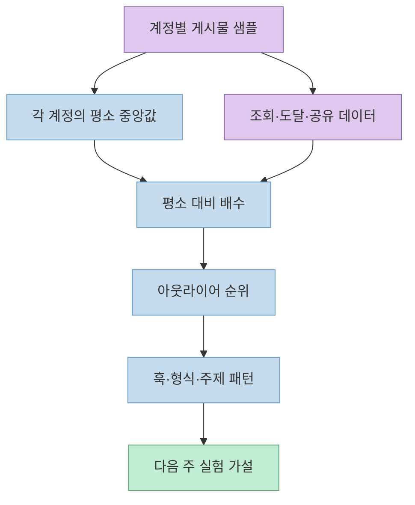
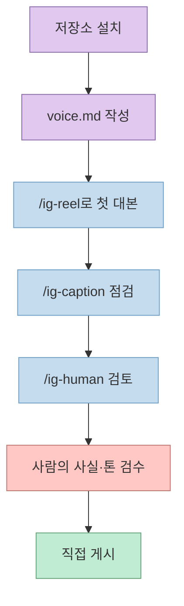
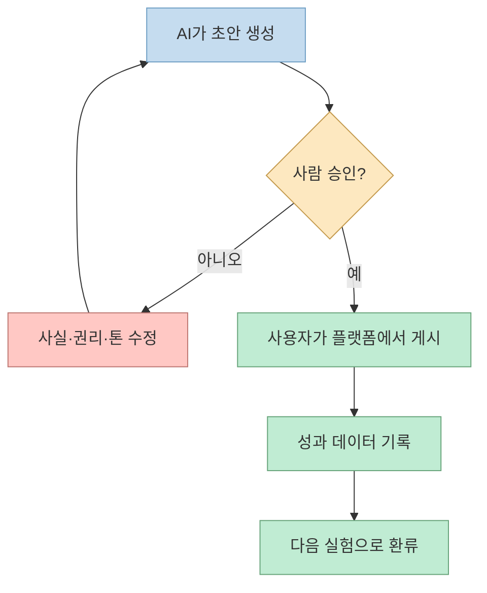

인스타그램 콘텐츠 운영은 아이디어를 하나 만드는 일보다 반복 루프를 유지하는 일이 어렵습니다. 훅을 고르고, 대본을 시간에 맞추고, 캡션을 다듬고, 지난 게시물의 성과를 비교한 뒤 다음 주 계획으로 연결해야 합니다. 영상은 이 과정을 하나의 거대한 봇이 아니라 **13개의 Claude 스킬**로 나누는 오픈소스 `instagram-agent-skill`을 소개합니다. [영상 0:00](https://youtu.be/CdRZMFG2HdM?t=0)

영상에서는 후킹 공식 23개라고 설명하지만, 현재 공식 저장소 README는 26개 공식으로 표시합니다. 저장소가 업데이트되었거나 영상 제작 시점과 현재 버전이 달라졌을 가능성이 있으므로, 설치할 때는 저장소의 현재 파일을 기준으로 확인해야 합니다. [영상 0:08](https://youtu.be/CdRZMFG2HdM?t=8)

<!--more-->

## Sources

- 원본 영상: [무료 클로드 인스타 스킬 13개](https://youtube.com/shorts/CdRZMFG2HdM?si=zpJn1F4WVwUjnA4k)
- 공식 저장소: [Jakeschincariol/instagram-agent-skill](https://github.com/Jakeschincariol/instagram-agent-skill)
- 공식 README 원문: [Instagram agent skill](https://github.com/Jakeschincariol/instagram-agent-skill#readme)

## 이 프로젝트는 인스타그램 봇이 아니라 콘텐츠 작업 모음이다

공식 README는 이 프로젝트를 “인스타그램 계정을 운영하는 13개의 Claude 스킬”로 설명합니다. 릴스 대본, 캡션, 캐러셀, 스토리, 프로필 진단, 주간 계획, 댓글·답글·DM, 리퍼포징, 사후 분석을 각각 명령어로 나눕니다. 중요한 안전장치는 **아무것도 게시하지 않고, 최종 게시자는 사람**이라는 원칙입니다. [공식 README](https://github.com/Jakeschincariol/instagram-agent-skill#readme)



따라서 이 프로젝트는 인스타그램 비밀번호를 넣어 자동으로 좋아요·댓글·게시를 수행하는 서비스와 다릅니다. 로컬에서 텍스트와 스크립트를 처리하고, 사용자가 결과를 검토한 뒤 플랫폼에 올리는 **콘텐츠 제작 보조 레이어**에 가깝습니다. [공식 README](https://github.com/Jakeschincariol/instagram-agent-skill#readme)

## 13개 스킬의 역할

공식 README에 공개된 명령어는 다음과 같이 콘텐츠 제작의 각 단계를 나눕니다.

- `/ig-reel`: 아이디어를 훅·대본·화면 문구·시간별 비트 시트로 변환
- `/ig-viral`: 계정별 평소 성과 대비 잘 된 릴스를 찾아 스와이프 파일 생성
- `/ig-caption`: 캡션을 작성하고 피드에서 먼저 보이는 부분을 점검
- `/ig-carousel`: 캐러셀 표지와 슬라이드 문구 작성
- `/ig-story`: 스토리 순서와 각 스티커의 역할 설계
- `/ig-profile`: 프로필을 루브릭으로 점수화하고 개선 순서 제안
- `/ig-plan`: 일주일 게시 형식·시점·참여할 계정 계획
- `/ig-human`: 문체와 AI 흔적을 점검하고 정리
- `/ig-comment`, `/ig-reply`, `/ig-dm`: 댓글·답글·DM 초안 작성
- `/ig-repurpose`: 영상·팟캐스트·뉴스레터를 일주일치 콘텐츠로 재구성
- `/ig-audit`: 기존 게시물의 성과를 사후 분석

영상은 특히 주간 계획과 지난 릴스 성과 비교를 강조합니다. 지난주 콘텐츠를 잘 된 이유와 아쉬운 이유로 나누고, 그 결과를 다음 주 대본에 반영하는 구조입니다. [영상 20초](https://youtu.be/CdRZMFG2HdM?t=20)

## 릴스 제작 루프: 훅에서 비트 시트까지

`/ig-reel`은 아이디어를 바로 긴 대본으로 확장하지 않고, 여러 훅 후보를 먼저 만들고 점수화한 뒤 촬영 가능한 시간 구조로 바꿉니다. 공식 저장소에는 26개 훅 공식, 훅 점수 도구, 말하기 시간을 추정하는 `beats.py`가 포함되어 있습니다. [공식 README의 스킬 목록](https://github.com/Jakeschincariol/instagram-agent-skill#the-thirteen)



공식 README의 예시는 훅 점수가 약한 문장과 강한 문장을 구분하고, 비트 시트가 훅이 3초를 넘기는지·한 비트가 너무 긴지·마지막이 첫 문장으로 돌아오는지를 알려 주는 방식입니다. 점수는 촬영 전에 명백히 약한 훅을 제거하는 필터이지, 어떤 릴스가 반드시 바이럴될지를 예측하는 모델은 아닙니다. [공식 README의 Hooks](https://github.com/Jakeschincariol/instagram-agent-skill#hooks)

## 캡션·휴머나이저·프로필 진단

캡션 스킬은 문장 전체를 예쁘게 쓰는 것보다 피드에서 “더 보기”를 누르기 전에 보이는 첫 부분을 먼저 점검합니다. 해시태그 수, 검색어, 행동 유도 문구를 함께 확인해 첫 화면에서 메시지가 끊기지 않게 합니다. 현재 플랫폼 표시 규칙은 바뀔 수 있으므로, 저장소의 린터 규칙을 인스타그램의 최신 동작과 항상 대조해야 합니다. [공식 README의 Caption](https://github.com/Jakeschincariol/instagram-agent-skill#the-caption)

`/ig-human`은 보이지 않는 유니코드 문자, 기계적인 문장 부호, 상투적인 표현을 정리하고 남은 초안을 점검합니다. 이는 “AI 탐지기를 무조건 통과한다”는 기능이 아니라, 복사·붙여넣기 과정에서 생기는 흔적과 인위적인 문체를 줄이는 로컬 휴리스틱입니다. 공식 README도 암호화 워터마크 제거를 주장하지 않는다고 명시합니다. [공식 README의 Humanizer](https://github.com/Jakeschincariol/instagram-agent-skill#the-humanizer)

```mermaid
flowchart TD
    draft["릴스·캡션 초안"] --> visible["피드 첫 화면 길이"]
    draft --> unicode["보이지 않는 문자 검사"]
    draft --> style["상투어·문장 구조 점검"]
    visible --> report["품질 리포트"]
    unicode --> report
    style --> report
    report --> revise["사람이 수정"]
    revise --> approve["게시 승인"]

    classDef draftTone fill:#e0c8ef,stroke:#8b6aa8,color:#333
    classDef checkTone fill:#c5ccef,stroke:#6f9fc5,color:#333
    classDef reportTone fill:#fde8c0,stroke:#c49a4d,color:#333
    classDef outputTone fill:#c0ecd3,stroke:#68a47b,color:#333
    class draft draftTone
    class visible,unicode,style checkTone
    class report,revise reportTone
    class approve outputTone
```

## `/ig-viral`과 `/ig-audit`: 조회수보다 기준선을 비교하기

영상에서 말하는 지난 릴스 분석은 단순히 조회수 상위 게시물을 고르는 방식이 아닙니다. 공식 README에 따르면 `/ig-viral`은 각 계정의 평소 중앙값 대비 몇 배를 기록했는지로 릴스를 비교하고, `/ig-audit`은 기존 게시물을 아웃라이어 배수와 도달 대비 공유로 정렬합니다. 큰 계정의 절대 조회수가 작은 계정의 실제 성과를 가리는 문제를 줄이려는 설계입니다. [공식 README의 Swipe file](https://github.com/Jakeschincariol/instagram-agent-skill#the-swipe-file)



단, 이 도구는 인스타그램 계정에 로그인해 숫자를 몰래 수집하는 크롤러가 아닙니다. 사용자가 직접 읽고 붙여넣은 자료나 공개적으로 확인 가능한 샘플을 바탕으로 분석하는 흐름이며, 데이터가 없으면 좋은 이유를 지어내지 않는 것이 중요합니다. [공식 README의 Fine print](https://github.com/Jakeschincariol/instagram-agent-skill#the-fine-print-which-is-the-honest-part)

## 설치와 첫 설정

공식 저장소는 Claude Code에서 세 가지 설치 경로를 안내합니다. 저장소 URL을 Claude에 전달해 설치를 요청하거나, 직접 저장소를 복제한 뒤 `~/.claude/skills/`에 `ig-*` 스킬을 복사하거나, Claude 플러그인 명령으로 설치할 수 있습니다. 프로젝트에만 적용하려면 저장소의 `.claude/skills/` 아래에 복사합니다. [공식 README의 Install](https://github.com/Jakeschincariol/instagram-agent-skill#install)

```bash
git clone https://github.com/Jakeschincariol/instagram-agent-skill.git
cp -r instagram-agent-skill/skills/ig-* ~/.claude/skills/
```

설치 직후에는 `templates/voice.md`를 작성하는 것이 핵심입니다. 공식 문서는 자신의 릴스 세 개를 예시로 주거나 직접 말투·청중·콘텐츠 기둥을 채우라고 안내합니다. 모든 스킬이 이 음성 프로필을 읽으므로, 이 파일이 비어 있으면 결과가 일반적인 마케팅 문장으로 흐르기 쉽습니다. [공식 README의 voice.md 안내](https://github.com/Jakeschincariol/instagram-agent-skill#install)



## 자동 게시를 하지 않는 이유

공식 README는 게시·댓글·팔로우·DM을 브라우저 자동화로 대신하는 방식이 계정 제한을 일으킬 수 있다고 경고하고, 이 프로젝트는 결과를 복사 가능한 블록으로 끝낸다고 설명합니다. Instagram의 공식 퍼블리싱 API를 사용하려면 프로페셔널 계정, Meta 개발자 앱, 연결된 페이지, 장기 토큰과 검토 절차가 필요합니다. 즉 “13개 스킬 설치 = 인스타그램 자동 운영”으로 해석하면 안 됩니다. [공식 README의 Fine print](https://github.com/Jakeschincariol/instagram-agent-skill#the-fine-print-which-is-the-honest-part)



## 핵심 요약

- `instagram-agent-skill`은 인스타그램 운영을 13개 Claude 스킬로 분리한 MIT 오픈소스입니다.
- 영상의 23개 훅 공식 표기와 현재 README의 26개 표기가 다르므로, 설치 시 저장소 버전을 기준으로 확인해야 합니다.
- `/ig-reel`은 훅 후보·대본·화면 문구·비트 시트를 만들고, `/ig-caption`과 `/ig-human`은 게시 전 품질을 점검합니다.
- `/ig-viral`과 `/ig-audit`은 절대 조회수보다 계정의 평소 기준선 대비 성과를 보려는 도구입니다.
- `voice.md`가 모든 스킬의 말투·청중·콘텐츠 기준을 공유하므로 초기 설정에서 가장 중요합니다.
- 프로젝트는 비밀번호를 요구하거나 자동 게시하지 않으며, 최종 게시와 사실 검수는 사람이 담당합니다.
- AI 탐지기 통과나 바이럴 성공을 보장하는 도구가 아니라, 약한 초안을 걸러내고 반복 작업을 구조화하는 로컬 워크플로입니다.

## 결론

이 프로젝트의 핵심은 “AI가 인스타그램을 대신 운영한다”가 아니라, 콘텐츠 운영을 작은 검증 가능한 단계로 쪼개는 것입니다. 먼저 `voice.md`로 말투를 고정하고 `/ig-reel`·`/ig-caption`·`/ig-human`의 짧은 루프를 돌린 뒤, 게시 결과를 직접 기록해 `/ig-viral`·`/ig-audit`·`/ig-plan`으로 확장하는 순서가 안전합니다. 자동 게시보다 사람 승인과 기준선 비교를 남겨 두는 편이 장기적으로 계정의 신뢰와 재현성을 지키는 방법입니다.
