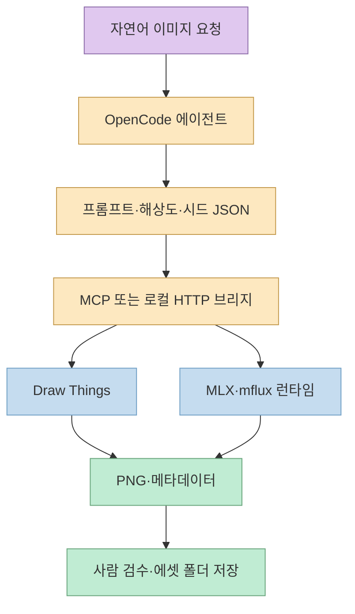
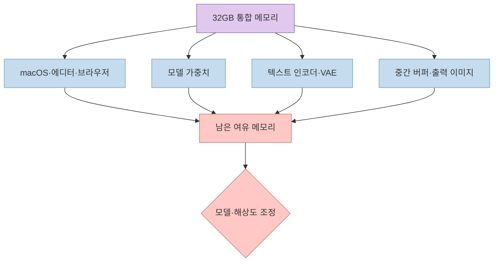
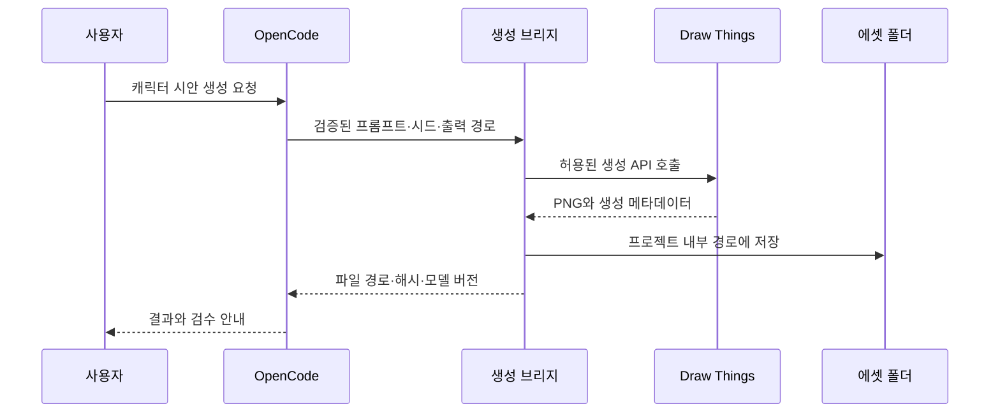

M5 칩과 32GB 통합 메모리를 갖춘 맥북은 이미지 생성 API를 매번 호출하지 않고도 게임 캐릭터, 배경, UI 시안을 반복해서 만드는 로컬 작업 장비가 될 수 있습니다. 공유된 ChatGPT 대화는 FLUX.2 Klein, Z-Image Turbo, Qwen Image, SDXL을 후보로 제시하고, Draw Things를 실행 앱으로 사용한 뒤 Paseo·OpenCode에서 자연어로 이미지 생성을 요청하는 구성을 설명합니다.

다만 모델별 “몇 초”라는 숫자는 칩·양자화·해상도·백그라운드 앱에 따라 크게 달라지는 추정치입니다. 이 글은 특정 속도를 보장하기보다, **어떤 모델을 어떤 경계에서 선택하고 어떻게 자동화할지**에 초점을 둡니다.

<!--more-->

## Sources

- 원문 ChatGPT 공유 대화: [M5 32GB 맥북의 로컬 이미지 생성과 Draw Things 연동](https://chatgpt.com/s/t_6afb2de25dc08191b021d635cd559c31)
- [Draw Things 공식 문서](https://docs.drawthings.ai/documentation/drawthings/)
- [Draw Things 공식 GitHub 조직과 커뮤니티 저장소](https://github.com/drawthingsai/)
- [Apple M5 MacBook Air 기술 사양](https://www.apple.com/macbook-air/specs/)
- [Apple의 M5 발표 자료](https://www.apple.com/newsroom/2025/10/apple-unleashes-m5-the-next-big-leap-for-apple-silicon/)
- [mflux: Apple Silicon용 MLX 이미지 생성 구현](https://github.com/mflux-community/mflux)
- [Z-Image 연구 보고서](https://zimage.net/Z_Image_Report.pdf)
- [Qwen3-TTS가 아닌 Qwen Image 계열의 MLX 구현 목록](https://github.com/mflux-community/mflux)
- [OpenCode MCP 서버 문서](https://opencode.ai/docs/mcp-servers/)

## 핵심 구조: 모델·앱·에이전트를 분리한다

공유 대화의 제안은 “OpenCode가 이미지를 만든다”가 아니라, OpenCode가 프롬프트와 파일을 관리하고 Draw Things 또는 MLX 런타임이 실제 추론을 담당하는 구조로 이해해야 합니다. 이 경계를 분리하면 모델을 바꿔도 작업 디렉터리와 자동화 명령은 유지할 수 있습니다.



Draw Things 공식 문서는 로컬 기기에서 이미지를 생성하고, 스크립트로 기능을 확장할 수 있으며, API 버전을 지정할 수 있는 안정적인 스크립트 API를 설명합니다. OpenCode 공식 문서는 MCP를 통해 로컬 명령 기반 서버와 원격 HTTP 서버를 모두 연결한다고 설명합니다. 따라서 둘을 연결할 때는 “에이전트가 임의의 셸 명령을 실행”하게 하기보다, 허용된 입력과 출력만 노출하는 작은 브리지를 두는 편이 안전합니다.

## M5 32GB에서 통합 메모리가 의미하는 것

Apple의 M5 사양은 CPU·GPU·Neural Engine이 같은 통합 메모리 풀을 사용한다는 전제를 둡니다. 기본 M5 MacBook Air 사양에는 10코어 CPU, 최대 10코어 GPU, 16코어 Neural Engine, 153GB/s 메모리 대역폭이 기재되어 있습니다. 실제 32GB 구성은 모델 가중치뿐 아니라 운영체제, 텍스트 인코더, VAE, 작업 앱이 함께 메모리를 사용합니다.

따라서 “32GB 모델”이라는 표현보다 다음 계산이 중요합니다.

```text
사용 가능한 추론 메모리
= 통합 메모리
  - macOS와 백그라운드 앱
  - 모델 가중치
  - 텍스트 인코더와 VAE
  - 중간 활성값·출력 버퍼
```



공유 대화에 나온 10~30초, 1~4분 같은 생성 시간은 동일한 M5 32GB에서 재현된 공식 벤치마크가 아닙니다. 이를 제품 사양처럼 인용해서는 안 됩니다. 첫 실행 때 512×512와 1024×1024를 각각 세 번 측정하고, 모델 로드 시간과 실제 생성 시간을 분리해 기록해야 합니다.

## 어떤 모델부터 시작할까

### FLUX.2 Klein 4B: 빠른 시안과 반복 작업

작은 파라미터 모델은 메모리 여유와 반복 속도 측면에서 첫 실험에 유리합니다. 게임 에셋의 색 조합, 구도, UI 배경처럼 여러 후보를 빠르게 비교해야 할 때 적합합니다. 단, “작다”가 “항상 최고 품질”을 뜻하지는 않으므로 최종 렌더 전에 더 큰 모델이나 업스케일 단계를 별도로 둘 수 있습니다.

### Z-Image Turbo: 적은 스텝의 실험 루프

Z-Image 연구 보고서는 Turbo 변형을 적은 단계로 증류해 소비자급 하드웨어에서도 실행할 수 있도록 설계했다고 설명합니다. 실제 Apple Silicon 실행 가능 여부와 메모리 요구량은 사용하는 포트와 양자화에 따라 달라집니다. 모델 카드와 배포 저장소의 라이선스·가중치 형식을 먼저 확인한 뒤 설치해야 합니다.

### Qwen Image: 문자와 복잡한 구도

이미지 안의 간판·버튼·카드 UI처럼 문자가 중요한 작업은 텍스트 렌더링을 우선해 비교합니다. 공유 대화의 “Qwen Image는 4비트 양자화 권장”이라는 설명은 실전 조언이지 모든 릴리스에 적용되는 공식 요구사항은 아닙니다. 모델 버전과 MLX 변환 상태를 확인하고, 글자가 많은 장면은 생성 후 수동 수정까지 포함해 평가해야 합니다.

### SDXL: 검증된 생태계와 스타일 다양성

SDXL은 새로운 모델보다 빠르다는 뜻이 아니라, 체크포인트·LoRA·ControlNet을 조합할 수 있는 선택지가 넓다는 장점이 있습니다. 특정 캐릭터 스타일을 오래 유지해야 한다면 최신 모델의 단일 생성 품질보다 이 생태계의 재현성이 더 중요할 수 있습니다.

```mermaid
flowchart TD
    goal["첫 작업 목표"] --> drafts{"많은 시안·낮은 대기시간?"}
    drafts -->|"예"| klein["FLUX.2 Klein 4B"]
    drafts -->|"아니오"| fewStep{"적은 단계의 빠른 생성?"}
    fewStep -->|"예"| zimage["Z-Image Turbo"]
    fewStep -->|"아니오"| text{"문자·복잡한 구도?"}
    text -->|"예"| qwen["Qwen Image 계열"]
    text -->|"아니오"| style["LoRA·스타일 생태계? → SDXL"]

    classDef startTone fill:#e0c8ef,stroke:#8b6aa8,color:#333
    classDef decisionTone fill:#fde8c0,stroke:#c49a4d,color:#333
    classDef modelTone fill:#c0ecd3,stroke:#68a47b,color:#333
    class goal startTone
    class drafts,fewStep,text decisionTone
    class klein,zimage,qwen,style modelTone
```

## Draw Things를 첫 실행 환경으로 쓰는 이유

Draw Things는 모델 다운로드, 프롬프트 입력, 이미지 생성, 결과 저장을 한 앱에서 확인하기 쉽습니다. 처음에는 다음 순서로 수동 경로를 검증하는 것이 좋습니다.

1. 공식 앱 또는 공식 모델 목록에서 지원되는 모델을 선택합니다.
2. 512×512, 낮은 배치 크기, 고정 시드로 기준 이미지를 만듭니다.
3. 결과 PNG와 프롬프트·시드·모델 버전을 함께 저장합니다.
4. 1024×1024로 올렸을 때 메모리 압박과 속도 변화를 측정합니다.
5. 반복 작업이 확인된 뒤에만 API·스크립트 자동화를 켭니다.

Draw Things의 API는 버전 지정이 가능하다는 점이 중요합니다. 자동화 스크립트가 앱 업데이트에 따라 조용히 깨지지 않도록 API 버전, 요청 JSON, 출력 폴더 규칙을 저장소에 고정해야 합니다. 공식 커뮤니티 저장소에는 HTTP API 서버 관련 코드도 공개되어 있지만, 실제 사용 가능한 엔드포인트와 앱 버전은 설치한 릴리스에서 다시 확인해야 합니다.

## OpenCode·Paseo와 연결하는 안전한 경계

OpenCode는 MCP 서버를 `local` 명령 또는 `remote` HTTP로 정의할 수 있습니다. 이미지 생성 브리지는 다음처럼 최소한의 작업만 노출하는 것이 좋습니다.

```jsonc
{
  "$schema": "https://opencode.ai/config.json",
  "mcp": {
    "servers": {
      "drawthings-local": {
        "type": "local",
        "command": ["python", "tools/drawthings_bridge.py"],
        "cwd": ".",
        "timeout": 120000
      }
    }
  }
}
```

브리지의 입력은 `prompt`, `width`, `height`, `seed`, `output_path` 정도로 제한하고, 출력은 생성된 파일 경로와 메타데이터만 반환합니다. 임의의 `shell`·인터넷 다운로드·경로 탈출을 허용하면 에이전트가 이미지 생성 도구를 넘어 파일 시스템 전체를 조작할 수 있습니다.



Paseo를 함께 사용한다면 Paseo가 자연어 입력과 작업 목록을 담당하고, OpenCode가 파일·스크립트·MCP 설정을 관리하며, Draw Things가 로컬 추론을 담당하도록 역할을 나누면 됩니다. 특정 Paseo 플러그인이나 Draw Things용 MCP 서버가 공식적으로 유지되는지는 별도 확인이 필요하므로, 존재하지 않는 통합을 전제로 구성해서는 안 됩니다.

## 로컬 생성의 비용과 한계

로컬 실행은 이미지당 API 과금과 네트워크 전송을 줄일 수 있지만 “무료”는 아닙니다. 맥북 구매 비용, 전력, 저장 공간, 모델 다운로드 시간, 업데이트·복구 작업이 모두 운영 비용입니다. 또한 공개 가중치 모델의 라이선스와 생성 결과의 상업 이용 조건은 API 서비스 약관과 다를 수 있습니다.

다음 기록을 남기면 클라우드와 로컬의 손익을 비교하기 쉽습니다.

- 모델·양자화·앱 버전
- 해상도·스텝·시드·배치 크기
- 모델 로드 시간과 이미지별 생성 시간
- 피크 메모리와 스왑 발생 여부
- 실패 재생성 횟수와 사람이 고른 결과 비율
- 모델 가중치·LoRA·참조 이미지의 라이선스

## 핵심 요약

- M5 32GB는 로컬 이미지 생성에 사용할 수 있지만, 32GB 전체를 모델이 독점하는 것은 아닙니다.
- Draw Things는 수동 검증과 로컬 실행의 시작점으로 적합하며, 스크립트 API를 자동화 경계로 사용할 수 있습니다.
- FLUX.2 Klein은 빠른 시안, Z-Image Turbo는 적은 단계의 실험, Qwen Image는 문자·복잡한 구도, SDXL은 LoRA 생태계 비교에 초점을 둡니다.
- 공유 대화의 생성 시간 숫자는 공식 M5 32GB 벤치마크가 아니므로 직접 측정해야 합니다.
- OpenCode는 MCP로 브리지를 호출하되, 입력 파라미터와 출력 경로를 제한해 파일 시스템 권한을 최소화해야 합니다.
- 로컬 생성은 API 비용을 줄일 수 있지만 장비·전력·저장 공간·라이선스 검토 비용이 사라지는 것은 아닙니다.

## 결론

가장 현실적인 시작점은 **Draw Things에서 작은 해상도와 고정 시드로 한 모델을 검증한 뒤, 반복 작업이 확인되면 OpenCode용 브리지를 추가하는 것**입니다. 처음부터 여러 모델과 MCP를 묶기보다 모델·메모리·출력 품질을 측정하고, 그 결과를 프롬프트와 메타데이터로 재현할 수 있게 만드는 편이 장기적으로 빠릅니다. 이렇게 구성하면 클라우드 API는 최종 고품질이나 대형 배치에만 사용하고, 시안 제작과 에셋 반복 생산은 맥북에서 처리하는 하이브리드 작업 흐름을 만들 수 있습니다.
