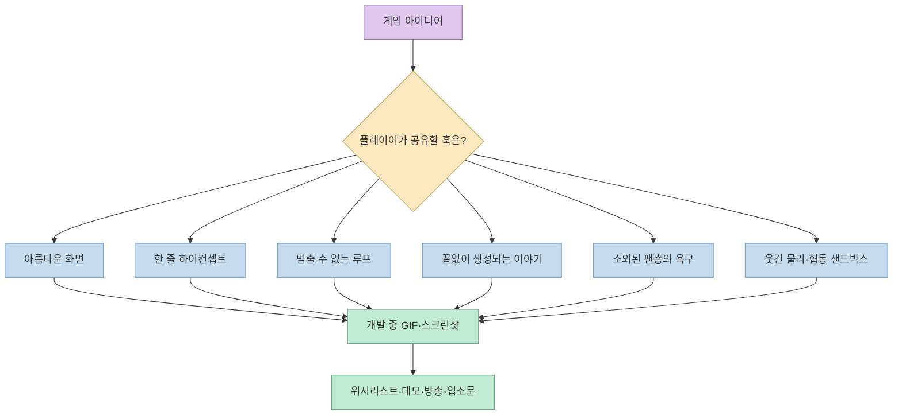
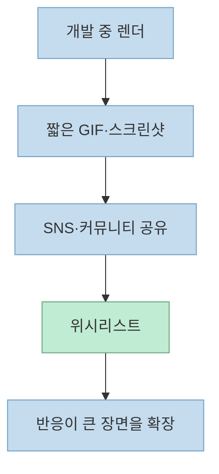
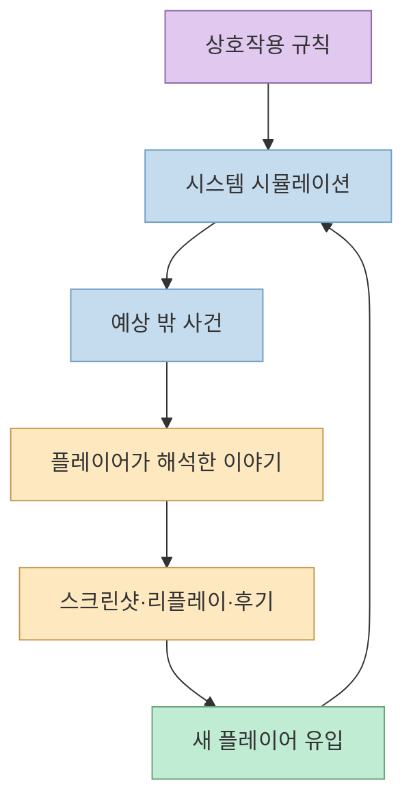
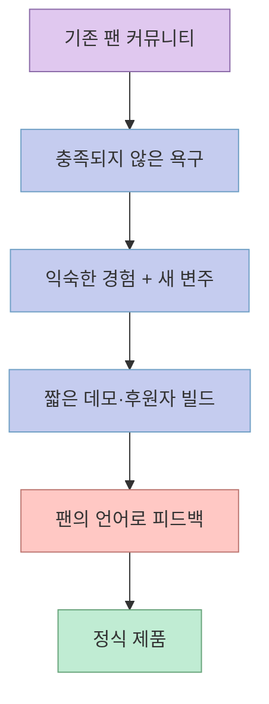
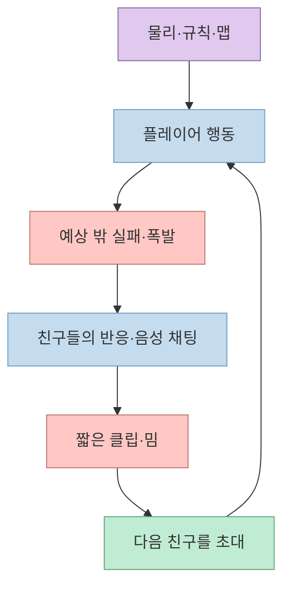
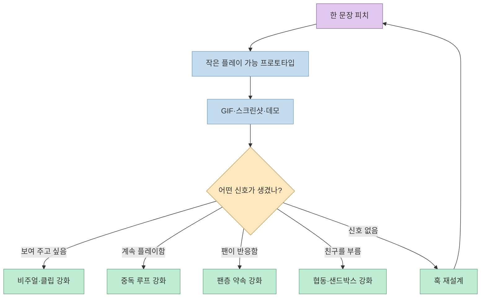

인디 게임은 기능이 많다고 자동으로 알려지지 않습니다. 누군가 스크린샷을 공유하거나, 데모를 친구에게 권하거나, 플레이 중 벌어진 장면을 영상으로 올릴 만한 **전파 장치**가 있어야 합니다. 영상은 Chris Zukowski가 정리한 “잘 팔리는 게임의 여섯 유형”을 소개하고, 각 유형을 실제 히트작과 연결합니다. [영상 0:00](https://youtu.be/gLtH71EnKBU?t=0)

이 분류는 성공을 보장하는 공식이 아니라, 기획 단계에서 “우리 게임을 남에게 설명하고 보여 줄 수 있는가?”를 점검하는 프레임입니다. 게임의 장르보다 플레이어가 공유하고 싶은 순간이 어디에서 발생하는지를 먼저 찾는 것이 핵심입니다.

<!--more-->

## Sources

- 원본 영상: [잘 팔리는 인디 게임의 6가지 유형 (히트작 26개로 보기)](https://youtu.be/gLtH71EnKBU?si=XD861Zhin7tw8-Mz)
- 원 분류 글: [Six types of best selling games — How To Market A Game](https://howtomarketagame.com/2022/11/21/six-types-of-best-selling-games/)
- 채널: [MGD - Midnight Game Devs](https://www.youtube.com/@MGD-MidnightGameDevs)

## 공통 원리: 기능이 아니라 공유할 장면을 설계한다

영상의 출발점은 단순합니다. 잘 팔린 게임에는 “남에게 퍼트리고 싶은 요소”가 하나씩 있고, 그 요소가 여섯 유형을 가릅니다. 따라서 마케팅은 출시 직전에 광고를 붙이는 일이 아니라, 개발 중인 화면만으로도 어떤 장면이 공유될지를 설계하는 작업이 됩니다. [영상 0:14](https://youtu.be/gLtH71EnKBU?t=14)



## 1. 아름다운 그래픽: 이미지 자체가 광고가 되는 게임

첫 번째 유형은 스크린샷 한 장이나 짧은 GIF만으로 감탄을 일으키는 게임입니다. 영상은 건축 샌드박스 **Tiny Glade**를 예로 들며, 벽을 끌면 돌담이 자연스럽게 쌓이는 장면 자체가 공유 소재가 되었다고 설명합니다. 개발 중인 GIF를 먼저 올리고 스팀 페이지를 연 뒤 위시리스트를 모았다는 흐름이 중요합니다. [영상 0:36](https://youtu.be/gLtH71EnKBU?t=36)

또 다른 예로 **Animal Well**을 들며, 조명·물 표현과 화면의 분위기가 마케팅 역할을 했다고 설명합니다. 영상은 출시 후 평가와 판매량을 언급하지만, 이 글에서는 해당 숫자를 독립 검증된 통계가 아니라 영상 내레이션의 사례 수치로 취급합니다. [영상 1:15](https://youtu.be/gLtH71EnKBU?t=75)



**제품 질문:** 내 게임의 가장 아름다운 순간을 5초짜리 영상으로 보여 줄 수 있는가? 가능하다면 완성 후까지 기다리지 말고, 개발 중 화면을 공개해 어떤 장면이 실제로 반응을 얻는지 측정해야 합니다.

## 2. 하이컨셉트: 한 문장으로 플레이가 그려지는 게임

하이컨셉트는 영화·출판에서 쓰이던 개념으로, 한두 문장만 들어도 게임의 상황과 욕구가 바로 그려지는 기획을 뜻합니다. 영상은 **Untitled Goose Game**을 “사람들을 괴롭히는 거위가 되는 게임”으로, **Buckshot Roulette**을 딜러와 산탄총으로 러시안룰렛을 하는 게임으로 요약합니다. [영상 1:51](https://youtu.be/gLtH71EnKBU?t=111)

**8번 출구**는 끝없는 지하 통로를 걷다가 이상한 점을 발견하면 되돌아가는 규칙으로 설명됩니다. 영상은 이런 게임들이 익숙한 놀이에 단 하나의 강한 변주를 넣었다고 정리합니다. 따라서 하이컨셉트는 완전히 새로운 장르를 발명하기보다, 이미 이해되는 규칙 하나를 극단적으로 키우는 방식으로도 만들 수 있습니다. [영상 2:34](https://youtu.be/gLtH71EnKBU?t=154)

```mermaid
flowchart TD
    familiar["익숙한 장르·놀이"] --> twist["핵심 규칙 하나를 비틀기"]
    twist --> sentence["한 문장 피치"]
    sentence --> thumbnail["썸네일·상점 문구"]
    thumbnail --> click["클릭 후 즉시 이해"]

    classDef baseTone fill:#e0c8ef,stroke:#8b6aa8,color:#333
    classDef processTone fill:#c5dcef,stroke:#6f9fc5,color:#333
    classDef outputTone fill:#c0ecd3,stroke:#68a47b,color:#333
    class familiar baseTone
    class twist,sentence,thumbnail processTone
    class click outputTone
```

**제품 질문:** 상점 페이지의 첫 문장을 읽은 사람이 별도 설명 없이 “무엇을 하는 게임인지” 말할 수 있는가? 피치가 길어질수록 기능 목록을 줄이고, 기억에 남는 변주 하나를 앞에 두어야 합니다.

## 3. 엄청난 중독성: 스크린샷보다 플레이 시간이 증거가 되는 게임

세 번째 유형은 이미지보다 실제 플레이 루프가 강합니다. 영상은 **Dome Keeper**를 자원을 캐다가 방어를 위해 돔으로 돌아오는 게임으로 소개하며, “조금만 더 캐자”가 반복 플레이를 만드는 긴장이라고 설명합니다. 데모 공개 후 위시리스트와 플레이 시간이 크게 늘었다는 사례도 함께 제시합니다. [영상 3:17](https://youtu.be/gLtH71EnKBU?t=197)

**Balatro**는 포커 족보와 조커 조합으로 점수를 키우는 로그라이크, **Clover Pit**은 슬롯머신과 부채 상환을 결합한 로그라이크로 소개됩니다. 둘 다 한 판의 결과가 다음 판의 실험 욕구를 만든다는 구조입니다. **Megabonk** 역시 한 판 안에서 캐릭터가 눈에 띄게 강해지는 감각을 반복 동기로 사용합니다. [영상 3:55](https://youtu.be/gLtH71EnKBU?t=235)

```mermaid
flowchart TD
    start["짧은 한 판"] --> reward["즉각 보상"]
    reward --> choice["다음 조합·업그레이드 선택"]
    choice --> risk["조금 더 위험한 시도"]
    risk --> result["성공 또는 실패"]
    result --> start
    result --> demo["데모·방송으로 관찰 가능한 재미"]

    classDef loopTone fill:#c5dcef,stroke:#6f9fc5,color:#333
    classDef riskTone fill:#ffc8c4,stroke:#bd7772,color:#333
    classDef outputTone fill:#c0ecd3,stroke:#68a47b,color:#333
    class start,reward,choice, result loopTone
    class risk riskTone
    class demo outputTone
```

이 유형의 검증 방법은 광고보다 데모입니다. 영상은 인디 데모 이용자의 상당수가 짧게 이탈하는 반면, 강한 게임은 플레이어가 긴 시간 붙잡힌다고 비교합니다. 수치는 영상 사례이므로 일반 기준으로 받아들이기보다, 자신의 데모에서 첫 세션 종료율·재실행률·평균 플레이 시간을 측정하는 것이 안전합니다. [영상 3:42](https://youtu.be/gLtH71EnKBU?t=222)

## 4. 끝없는 깊이: 시스템이 콘텐츠를 계속 생산하는 게임

네 번째 유형은 플레이어가 시스템을 조합하면서 새로운 이야기를 만들어 내는 게임입니다. 영상은 **Factorio**, **RimWorld**, **Dwarf Fortress**, **Manor Lords**를 예로 들며, 공장·마을·시뮬레이션의 한 장면만으로도 게임의 깊이를 보여 줄 수 있다고 설명합니다. [영상 4:50](https://youtu.be/gLtH71EnKBU?t=290)

이 유형은 개발 기간이 긴 대신, 한 번 구축한 시스템이 장기적인 콘텐츠가 됩니다. 영상은 Dwarf Fortress와 Manor Lords의 긴 개발 기간과 출시 후 판매 사례를 언급하면서, 첫 게임부터 거대한 시뮬레이션을 만들기보다 작은 프로젝트를 여러 번 완성한 뒤 도전하라고 조언합니다. [영상 5:32](https://youtu.be/gLtH71EnKBU?t=332)



**제품 질문:** 콘텐츠를 추가하지 않아도 규칙의 조합만으로 새로운 사건이 생기는가? 그렇다면 개발자는 에셋 수보다 시스템의 조합 가능성과 관찰 도구를 우선해야 합니다.

## 5. 소외된 팬층 챙기기: 이미 존재하는 수요에 응답하기

다섯 번째 유형은 좋아하는 사람은 많지만 원하는 신작이 부족한 팬층을 겨냥합니다. 영상은 **Stardew Valley**를 Harvest Moon 계열의 경험을 직접 만들고 싶었던 개발자의 사례로 설명하고, **Pizza Tower**는 Wario Land 팬층을 노린 게임으로 소개합니다. [영상 5:41](https://youtu.be/gLtH71EnKBU?t=341)

**Fields of Mistria**는 농장 시뮬레이션에 1990년대 애니메이션풍 비주얼을 얹은 사례로, **Escape from Tarkov**의 PvP 탈출 슈터 감각을 혼자 즐기는 형태로 변주한 게임도 언급됩니다. 중요한 점은 “팬이 있는가”를 추측하는 대신, 커뮤니티·포럼·모드 생태계·후원자 빌드처럼 이미 모여 있는 신호를 찾아야 한다는 것입니다. [영상 6:28](https://youtu.be/gLtH71EnKBU?t=388)



**제품 질문:** 팬이 실제로 사용하는 단어로 문제를 설명할 수 있는가? 팬층이 이미 모여 있다면 광고 카피보다 그들의 불만·희망·비교 대상을 수집하는 것이 먼저입니다.

## 6. 웃긴 샌드박스와 친구들과 망가지는 협동 게임

여섯 번째 유형은 물리 엔진·폭발·버그·예상 밖 상호작용이 웃긴 장면을 계속 만드는 샌드박스입니다. 영상은 **Goat Simulator**와 **Totally Accurate Battle Simulator**를 예로 들며, 개발자가 모든 장면을 연출하지 않아도 플레이어가 상황을 만들어 영상으로 퍼뜨린다고 설명합니다. [영상 6:49](https://youtu.be/gLtH71EnKBU?t=409)

**Garry’s Mod**처럼 오래 살아남은 샌드박스와, 친구들과 음성 채팅을 하며 함께 망가지는 저가 협동 게임을 영상은 “friendslop”이라는 흐름으로 연결합니다. **Lethal Company**, **R.E.P.O.**, **PEAK** 등이 사례로 등장하며, 영상은 짧은 개발 기간과 협동 중 발생하는 공유 가능한 혼란을 강점으로 봅니다. 판매량·동시 접속자 수는 영상 내레이션의 사례 수치이므로 별도 검증 없이 시장 예측에 사용해서는 안 됩니다. [영상 7:30](https://youtu.be/gLtH71EnKBU?t=450)



영상의 추가 해석은 이 유형이 하이컨셉트와 결합하고, 플레이 단위를 혼자에서 친구 여러 명으로 바꿀 때 더 강해질 수 있다는 것입니다. 즉 “웃긴 시스템”만으로 충분한 것이 아니라, 친구를 초대할 이유와 함께 플레이할 최소 인원이 제품 설계에 포함되어야 합니다. [영상 8:49](https://youtu.be/gLtH71EnKBU?t=529)

## 유형을 기획 검증 루프로 바꾸기

여섯 유형은 장르 선택표가 아니라 검증 순서로 사용할 수 있습니다. 먼저 한 문장으로 설명하고, 그 문장을 보여 주는 화면이나 플레이 루프를 만든 뒤, 실제 반응을 수집합니다. 반응이 약하면 기능을 추가하기보다 공유 훅 자체를 다시 설계합니다.



마지막으로 영상은 현재 만들고 있는 게임이 어느 유형에 가까운지, 그리고 남에게 퍼트리고 싶은 요소가 무엇인지 직접 질문하며 끝납니다. 이 질문은 “어떤 장르가 뜨는가?”보다 실행 가능성이 높습니다. 팀이 통제할 수 있는 플레이어 행동과 공유 장면을 정의하기 때문입니다. [영상 9:02](https://youtu.be/gLtH71EnKBU?t=542)

## 핵심 요약

- 잘 팔리는 인디 게임은 기능 수보다 플레이어가 공유하고 싶은 훅이 선명합니다.
- 여섯 유형은 아름다운 그래픽, 하이컨셉트, 중독성 있는 루프, 끝없는 시스템 깊이, 소외된 팬층, 웃긴 샌드박스입니다.
- 비주얼형은 개발 중 GIF와 스크린샷으로, 중독성형은 데모와 플레이 시간으로 검증해야 합니다.
- 하이컨셉트형은 익숙한 장르에 한 가지 강한 변주를 넣어 한 문장으로 설명할 수 있게 만듭니다.
- 깊이형은 개발 기간이 긴 대신 시스템이 새 사건과 이야기를 계속 생산합니다.
- 팬층형은 이미 존재하는 커뮤니티의 충족되지 않은 욕구를 찾아야 합니다.
- 샌드박스형과 friendslop은 플레이어와 친구가 직접 웃긴 장면을 생산하도록 규칙과 협동 구조를 설계합니다.
- 영상에 나온 판매량·동시 접속자 수는 사례 설명의 수치이므로, 제품 의사결정에는 원자료와 최신 데이터를 별도 확인해야 합니다.

## 결론

인디 게임 기획에서 가장 먼저 답할 질문은 “무슨 장르를 만들까?”가 아니라 “플레이어가 어떤 장면을 남에게 보내고 싶어 할까?”입니다. 여섯 유형 중 하나를 억지로 선택할 필요는 없지만, 비주얼·한 문장 피치·플레이 루프·시스템 깊이·팬 수요·협동 혼란 중 최소 하나는 초기 프로토타입에서 관찰 가능해야 합니다. 작은 데모와 공유 가능한 결과물을 빠르게 만들고, 실제 반응이 있는 훅에만 개발 시간을 늘리는 것이 이 분류를 제품 전략으로 사용하는 가장 현실적인 방법입니다.
