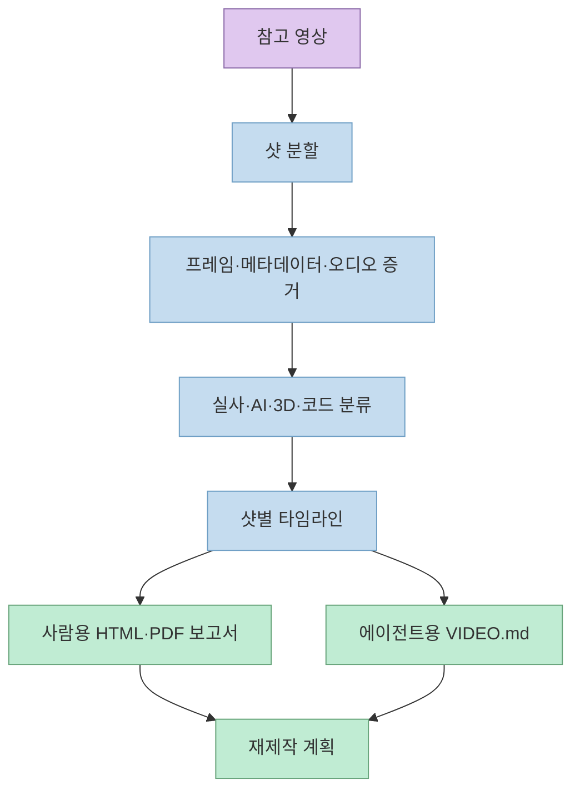
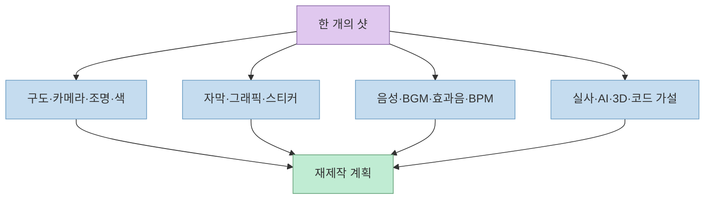
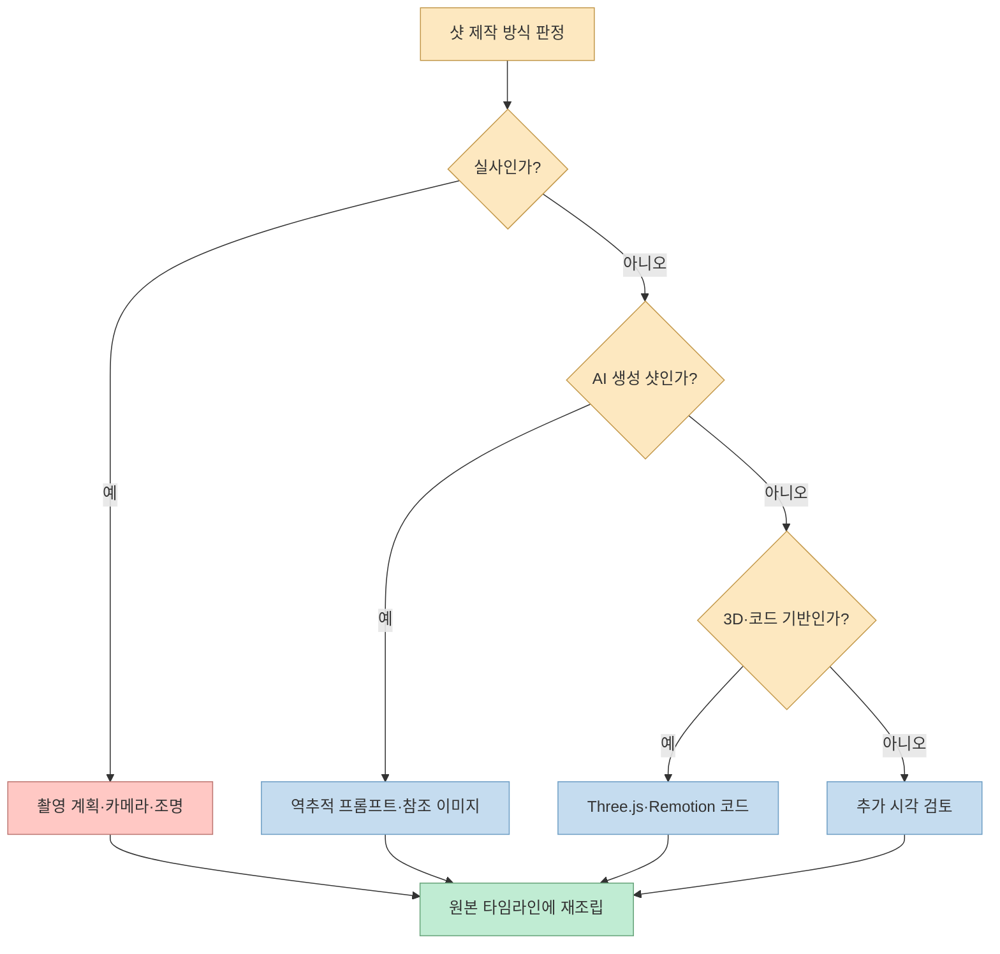
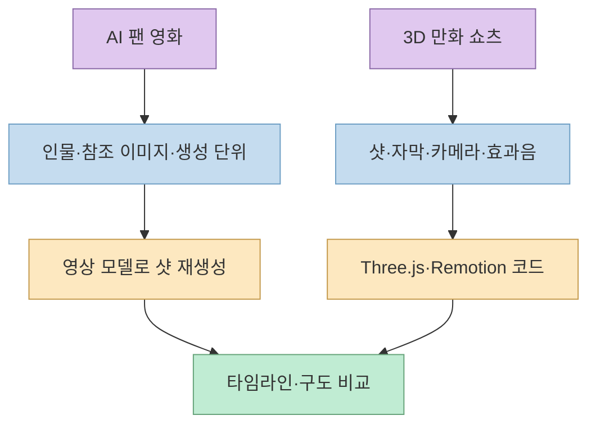
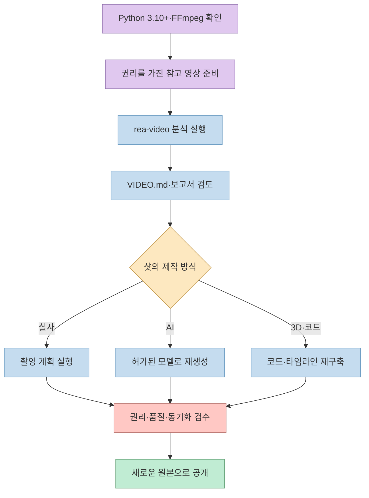

좋아하는 영상을 비슷하게 만들고 싶을 때 보통 프롬프트를 바꿔 가며 생성기를 반복 실행합니다. 하지만 결과가 닮지 않는 이유는 프롬프트가 부족해서가 아니라, 원본이 어떤 샷·카메라 움직임·자막 타이밍·음악·제작 도구로 만들어졌는지 모르기 때문입니다. 영상에서 소개한 **REA-Video**는 이 문제를 “먼저 뜯어보고, 그 다음에 다시 만든다”는 역설계 작업으로 바꿉니다. [영상 0:00](https://youtu.be/9mngM958lx0?t=0)

REA-Video의 공식 저장소는 이 도구를 촬영 영상, AI 생성 영상, 3D·애니메이션, 코드 기반 모션 그래픽까지 샷별로 분석하는 에이전트 도구로 설명합니다. 분석 결과는 사람이 읽는 보고서와 에이전트가 단계적으로 읽는 `VIDEO.md`로 나뉩니다. [공식 저장소](https://github.com/JuneYaooo/rea-video)

<!--more-->

## Sources

- 원본 영상: [말포이 유튜브 복사로 난리난 REA-Video 총정리](https://youtu.be/9mngM958lx0)
- 공식 저장소: [JuneYaooo/rea-video](https://github.com/JuneYaooo/rea-video)
- 공식 웹사이트: [Rea Video](https://reavideo.video/)
- `VIDEO.md` 형식: [VideoMD](https://videomd.github.io/)

## REA-Video는 생성기가 아니라 분석기다

영상 초반은 AI 영상 생성기의 장면 설명만 바꾸면서 원본과 비슷한 결과를 얻으려는 시행착오를 보여 줍니다. 카메라가 어떻게 움직였는지, 인물의 위치가 어떻게 바뀌었는지, 컷이 어느 박자로 넘어갔는지 알 수 없으면 생성 횟수만 늘어납니다. [영상 0:27](https://youtu.be/9mngM958lx0?t=27)

REA-Video는 입력 영상을 샷으로 나누고, 각 샷에 대해 “무엇이 보이는가”와 “어떻게 만들어졌는가”를 분리해 기록합니다. 공식 README의 분해 범위에는 실사, AI 영상, 아바타, 3D·애니메이션, 코드·템플릿, 화면 녹화, 혼합 편집이 포함됩니다. [공식 README의 What it can break down](https://github.com/JuneYaooo/rea-video#what-it-can-break-down)



이 구조는 “원본을 복사해 게시”하는 기능이 아니라 **제작 의사결정을 구조화하는 기능**입니다. 공식 문서도 결과물은 원본의 구조·리듬·기법을 학습하고, 권리를 가진 재료로 새 버전을 만드는 데 사용해야 한다고 안내합니다. [공식 README의 FAQ](https://github.com/JuneYaooo/rea-video#faq)

## 샷마다 무엇을 측정하는가

공식 README의 처리 순서는 크게 네 단계입니다. 첫째, 영상을 샷과 음성·음악·효과음으로 나눕니다. 둘째, 프레임 간격, 센서 노이즈, 메타데이터의 AIGC 태그, 손·문자·물리 표현 같은 시각 증거와 BPM·음성·노래 같은 오디오 증거를 모읍니다. 셋째, “그럴듯해 보인다”보다 측정 가능한 증거를 우선해 분류합니다. 넷째, 목표 영상 모델의 클립 길이·참조 이미지 수·멀티샷 지원 여부에 맞춰 재제작 배치를 짭니다. [공식 README의 How it works](https://github.com/JuneYaooo/rea-video#how-it-works)

영상 시연에서는 자막의 시작·종료 시점, 글자 색과 테두리, 화면에 들어오는 방식, 목소리·배경음악·BPM·효과음 위치까지 함께 추출하는 모습이 소개됩니다. [영상 2:12](https://youtu.be/9mngM958lx0?t=132)



## `VIDEO.md`: 긴 분석을 에이전트가 필요한 만큼만 읽기

전체 영상 분석은 샷 수가 늘어날수록 매우 긴 문서가 됩니다. REA-Video는 최상단 요약, 개요와 지도, 샷별 한 줄 타임라인, 개별 샷 파일로 내려가는 계층형 `VIDEO.md`를 작성합니다. 에이전트는 질문에 필요한 레벨만 읽을 수 있어, 원본 프레임과 모든 분석 결과를 매번 컨텍스트에 넣지 않아도 됩니다. [공식 README의 VIDEO.md 설명](https://github.com/JuneYaooo/rea-video#faq)

```text
out/ref/
├── VIDEO.md             # 요약·지도·타임라인·파일 목록
├── report.html          # 사람이 읽는 전체 보고서
└── shots/
    ├── 001.md           # 첫 번째 샷의 근거와 재제작 계획
    ├── 002.md
    └── ...
```

이 형식의 장점은 영상 분석과 영상 제작을 느슨하게 연결한다는 데 있습니다. 분석 도구는 샷의 사실과 추론을 저장하고, 후속 에이전트는 필요한 샷 파일만 읽어 이미지 생성 프롬프트·촬영 지시·Remotion 코드 중 하나를 선택할 수 있습니다.

## 재제작 경로를 제작 방식에 맞춰 선택하기

영상은 AI로 만든 장면은 영상 생성 서비스, 3D나 코드로 만든 장면은 Claude Code가 Three.js·Remotion 코드로, 실제 촬영 장면은 카메라 위치·조명 지시를 바탕으로 다시 촬영하는 식으로 경로를 나눕니다. [영상 7:16](https://youtu.be/9mngM958lx0?t=436)

공식 README도 3D·애니메이션은 3D 코드 또는 영상 모델 중 선택하고, 코드·템플릿 영상은 Remotion 프로젝트로 재구성할 수 있다고 설명합니다. [공식 README의 Video type](https://github.com/JuneYaooo/rea-video#what-it-can-break-down)



## 영상 속 두 가지 사례가 보여 주는 차이

첫 번째 시연은 15초 AI 팬 영화를 두 샷으로 나누고, 인물 네 명의 참고 이미지·조명·색·카메라 이동·생성 단위를 추출합니다. 영상 내레이션은 9.6초와 5.4초에 해당하는 두 생성 단위, 카메라 이동과 프롬프트 규칙을 바탕으로 다시 만들었다고 설명합니다. 이 수치와 결과는 영상 제작자의 시연 사례이며, 모든 입력 영상에서 같은 품질을 보장하는 벤치마크는 아닙니다. [영상 3:24](https://youtu.be/9mngM958lx0?t=204)

두 번째 사례는 3D 만화 쇼츠입니다. REA-Video는 15개 샷, 단어 단위 자막, 레일을 따라가는 카메라와 박자를 분해하고, 영상 생성기 대신 Three.js와 Remotion으로 3D 세계와 2D 카드 인물을 코드로 재구성하는 경로를 택합니다. [영상 5:29](https://youtu.be/9mngM958lx0?t=329)



영상은 첫 사례에서 인물 시트부터 1080p 결과까지 약 320 크레딧을 사용했고, 두 번째 사례에서는 영상 생성기를 쓰지 않아 크레딧이 0이었다고 설명합니다. 이는 “분석 결과가 제작 방식을 바꾼다”는 예시이지, REA-Video 자체가 무료로 최종 영상을 생성한다는 뜻은 아닙니다. [영상 5:52](https://youtu.be/9mngM958lx0?t=352)

## Hypit과의 차이: 빠른 유사본과 원리 분석

영상은 Hypit을 참고 영상을 바로 새 영상으로 뽑는 도구로, REA-Video를 원본이 어떻게 만들어졌는지부터 분석하고 재제작 계획을 세우는 도구로 대비합니다. [영상 1:21](https://youtu.be/9mngM958lx0?t=81)

공식 REA-Video FAQ도 비슷한 구분을 합니다. Hypit은 지원하는 영상 모델로 빠르게 lookalike를 만들고, REA-Video는 실사·AI·3D·코드 샷을 구분해 촬영 계획·프롬프트·코드 접근법을 제공합니다. 두 도구를 함께 사용할 수도 있지만, 목적이 다릅니다. [공식 FAQ](https://github.com/JuneYaooo/rea-video#faq)

| 목표 | 적합한 접근 |
|---|---|
| 비슷한 결과를 빠르게 여러 개 만들기 | 직접 생성·편집 도구 |
| 원본의 촬영·편집·생성 원리 이해하기 | REA-Video |
| 코드 기반 모션 그래픽 재현하기 | `VIDEO.md` + Remotion/Three.js |
| 장면별 요소만 바꾸고 카메라·리듬 유지하기 | 분석 후 재제작 파이프라인 |

## 설치와 운영 순서

공식 Quick Start는 Claude Code·Codex 같은 에이전트에게 저장소 설치와 로컬 영상 분석을 한 문장으로 요청하는 흐름을 제시합니다. CLI를 직접 사용할 때는 Python 3.10 이상과 FFmpeg가 필요합니다. [공식 Quick Start](https://github.com/JuneYaooo/rea-video#quick-start)

```text
Install https://github.com/JuneYaooo/rea-video,
then break down this video: /path/to/video.mp4
```

영상-capable 모델을 연결하면 AI·실사·3D 판정의 정확도와 샷별 역추적 프롬프트가 좋아질 수 있지만, API 키와 사용료가 필요합니다. 모델 없이도 원본 파일의 오프라인 도구와 에이전트의 이미지 검토만으로 동작하며, 플랫폼 재압축 영상은 추가 시각 검토가 필요할 수 있습니다. [공식 Accuracy·FAQ](https://github.com/JuneYaooo/rea-video#accuracy)



## 저작권·초상권·플랫폼 정책

“복사”라는 표현은 기술적 분석과 법적 재사용을 구분해야 합니다. REA-Video 공식 FAQ는 다른 사람의 영상·음악·캐릭터·초상·소재를 그대로 재게시하지 말고, 권리를 가진 재료로 구조와 기법을 학습해 새롭게 만들라고 안내합니다. [공식 FAQ의 권리 안내](https://github.com/JuneYaooo/rea-video#faq)

따라서 실무에서는 다음 경계를 지키는 편이 안전합니다.

- 분석할 영상은 직접 만든 영상, 사용 허가를 받은 영상, 또는 학습·비평 목적으로 합법적으로 접근 가능한 자료로 제한합니다.
- 인물의 얼굴·목소리·브랜드·캐릭터를 그대로 재현하지 말고, 권리와 동의를 확인합니다.
- 원본 음악과 효과음을 추출해 재사용하지 말고, 라이선스를 가진 대체 음원을 사용합니다.
- 분석 보고서와 생성 결과에 원본 출처와 변형 범위를 기록합니다.
- 공개 전 플랫폼의 AI 콘텐츠 표시와 저작권 정책을 확인합니다.

## 핵심 요약

- REA-Video는 영상을 바로 복제하는 생성기가 아니라, 샷별 제작 원리를 역설계하는 분석 도구입니다.
- 샷 분할, 프레임·메타데이터·오디오 증거, 제작 방식 판정, 재제작 계획의 순서로 작동합니다.
- 결과는 사람용 보고서와 에이전트용 계층형 `VIDEO.md`로 나뉘어 긴 분석을 필요한 만큼만 읽게 합니다.
- 실사 샷은 촬영 지시, AI 샷은 역추적 프롬프트·참조 이미지, 3D·코드 샷은 Three.js·Remotion 경로를 선택합니다.
- 영상 생성기를 쓰지 않고 코드로 재구성하면 비용·재현성·편집 가능성이 달라질 수 있습니다.
- AI 모델을 연결하면 플랫폼 재압축 영상의 판정과 샷별 프롬프트가 좋아질 수 있지만 API 비용이 발생합니다.
- 원본을 분석하는 것과 원본을 재게시·복제하는 것은 다르며, 권리 있는 재료와 새로운 결과물로 작업해야 합니다.

## 결론

REA-Video의 가장 큰 변화는 영상 제작을 “프롬프트를 잘 쓰는 일”에서 “원본의 제작 계약을 추출하는 일”로 바꾸는 것입니다. 먼저 샷·카메라·자막·오디오·제작 방식을 측정하고, 그 결과에 맞는 촬영·생성·코드 경로를 선택하면 무작정 재생성하는 횟수를 줄일 수 있습니다. 다만 역설계 결과를 그대로 복제에 사용하기보다, 구조와 기법을 학습해 권리 있는 소재로 새로운 영상을 만드는 워크플로로 운영해야 합니다.
