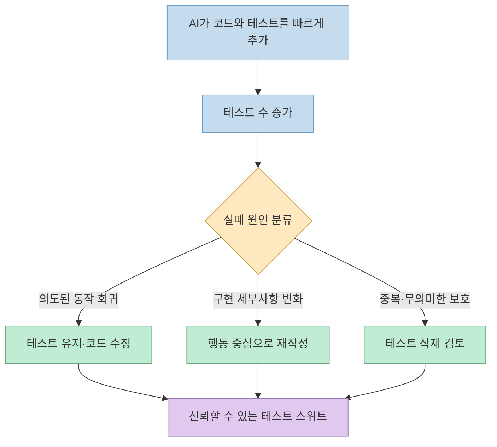
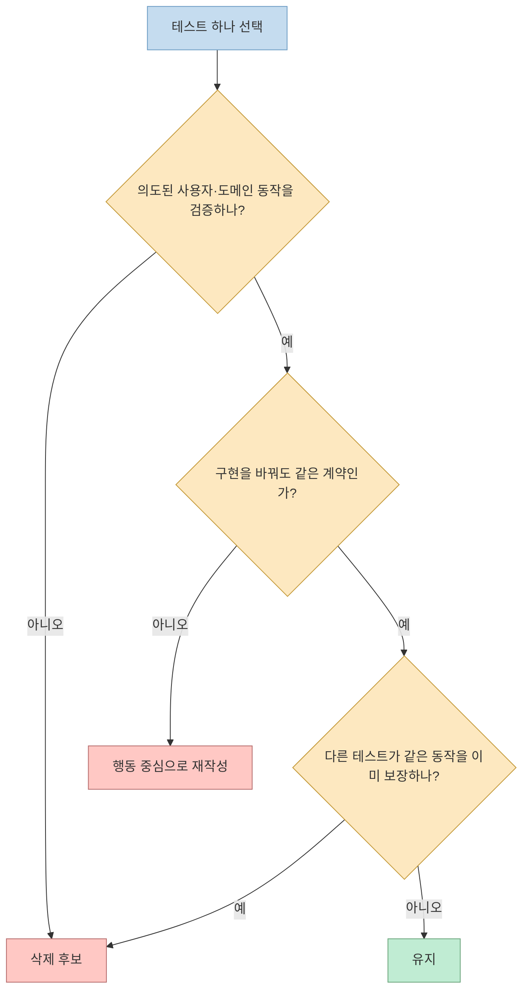
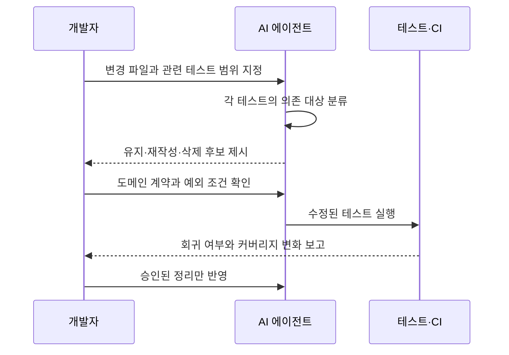

AI로 코드를 빠르게 생성하고 수정할수록 테스트 스위트가 함께 부풀어 오르기 쉽습니다. 구현 세부사항을 그대로 복제한 어설션, 이미 사라진 기능의 부재를 확인하는 테스트, 같은 동작을 반복해서 검증하는 테스트가 쌓이면 코드 리뷰와 유지보수 비용이 커집니다.

<!--more-->

## 출처와 범위

- 원문 Threads 게시물: [AI Coffee Chat의 prune-tests 소개](https://www.threads.com/@aicoffeechat/post/Df3fsCGipU2)
- 실제 스킬 문서: [caldoai/skills — prune-tests/SKILL.md](https://github.com/caldoai/skills/blob/main/skills/prune-tests/SKILL.md)

Threads 게시물은 `prune-tests`를 “없어도 되는 테스트를 찾아 지워 주는 스킬”로 소개합니다. 이 글은 원문의 제안을 그대로 자동 삭제 명령으로 해석하지 않고, 스킬 문서에 적힌 판별 기준을 안전한 테스트 정리 절차로 재구성합니다.

## 왜 AI 코딩에서 테스트 정리가 더 중요해졌나

AI가 변경량을 늘리면 테스트 실패도 더 자주 발생합니다. 그러나 실패한 테스트가 모두 제품 결함을 뜻하는 것은 아닙니다. 구현 내부의 함수 호출 순서나 private 상태를 고정한 테스트는 코드가 정상적으로 동작해도 리팩터링 때 깨집니다. 반대로 중요한 사용자 행동을 검증하는 테스트가 없다면, 테스트 개수를 줄이는 것보다 위험합니다.



## prune-tests의 핵심 판별 기준

스킬 문서의 기준은 테스트의 개수가 아니라 **무엇에 의존하는가**입니다. 남겨야 할 테스트는 의도된 동작에 의존하고, 그 동작이 회귀하면 실패해야 합니다.

### 1. 과거에 의존하는 테스트

삭제한 기능이 다시 생기지 않았는지를 확인하는 테스트는 대개 제품의 현재 계약을 검증하지 않습니다. 기능을 되살리는 것은 회귀가 아니라 새로운 결정일 수 있기 때문입니다. 예를 들어 이전 경로의 모듈 파일이 존재하지 않는지만 확인하는 테스트는, 현재 사용자가 기대하는 동작을 보장하지 않습니다.

### 2. 아무것에도 의존하지 않는 테스트

버튼이 렌더링되는지, 클릭 이벤트가 연결되는지처럼 브라우저나 프레임워크 자체가 보장하는 사실만 확인하는 테스트는 애플리케이션의 고유한 계약이 아닐 수 있습니다. 목(mock)을 호출하고 그 목이 반환한 값을 다시 검증하는 테스트도 같은 문제를 가집니다.

### 3. 구현에 의존하는 테스트

private 상태, 내부 호출 순서, 특정 헬퍼 호출 여부를 고정하면 구현을 바꿀 때마다 테스트가 깨집니다. 기대값을 프로덕션 코드와 같은 계산식으로 만들면 코드와 테스트가 함께 틀려도 통과할 수 있습니다. 이런 테스트는 외부에서 관찰 가능한 결과로 다시 써야 합니다.



## 삭제보다 먼저 해야 할 일: 관찰 가능한 계약으로 바꾸기

다음과 같이 테스트를 정리할 수 있습니다.

```typescript
// 구현 세부사항을 고정한 예
expect(cart._items.length).toBe(1)

// 호출자가 관찰하는 결과를 검증하는 예
expect(cart.total()).toBe(book.price)
```

첫 번째 테스트는 자료구조가 배열인지, 필드 이름이 무엇인지까지 고정합니다. 두 번째 테스트는 장바구니가 어떤 방식으로 저장되는지와 무관하게 호출자가 얻는 결과를 보호합니다. 단, `total()` 자체가 제품 계약인지 팀의 도메인 규칙인지 확인한 뒤 적용해야 합니다.

중복 테스트는 하나를 지우기 전에 범위를 비교해야 합니다. 두 테스트가 모두 세금 계산을 검증한다면 입력 경계가 더 명확하고 실패 원인을 잘 보여 주는 하나를 남깁니다. 삭제한 테스트만을 위해 존재하던 테스트 전용 프로덕션 코드도 함께 정리할 수 있지만, 다른 호출자가 사용하는지 먼저 검색해야 합니다.

## AI 에이전트에 적용하는 안전한 워크플로

원문 게시물은 전체 코드베이스에 한 번에 적용하면 토큰을 많이 사용할 수 있으므로, 처음에는 변경된 파일 범위에만 `prune-tests`를 붙여 보라고 권합니다. 이 제안은 합리적인 운영 힌트이지, 모든 프로젝트에서 검증된 비용 수치나 성공률을 의미하지는 않습니다.



권장 순서는 다음과 같습니다.

1. 최근 변경 파일과 직접 연결된 테스트만 대상으로 삼습니다.
2. 에이전트에게 각 테스트가 보호하는 **의도된 동작**을 한 문장으로 설명하게 합니다.
3. 삭제 후보와 재작성 후보를 분리해 제안받습니다. 자동 삭제를 바로 승인하지 않습니다.
4. 재작성한 테스트는 내부 상태가 아니라 공개 API, 화면 결과, 도메인 결과를 검증하게 합니다.
5. 변경 범위 테스트와 전체 회귀 테스트를 차례로 실행합니다.
6. 테스트를 지워서 통과한 것인지, 실제 결함이 해결된 것인지 CI 결과와 diff로 확인합니다.

## 흔한 오용과 보완책

- **실패하면 무조건 삭제**: 실패 원인이 회귀인지 테스트 노후화인지 먼저 분리해야 합니다.
- **커버리지 수치만 유지**: 줄 수 커버리지는 행동의 중요도나 테스트 중복을 설명하지 못합니다.
- **목 호출 검증을 제품 계약으로 착각**: 목은 경계 상호작용을 확인할 때만 사용하고, 최종 결과 검증을 우선합니다.
- **전체 저장소 일괄 실행**: 변경 범위를 좁혀 제안의 품질과 비용을 관찰한 뒤 확장합니다.
- **도메인 맥락 생략**: “절대 실패하면 안 되는 테스트”가 무엇인지는 에이전트보다 제품 담당자가 더 잘 압니다.

## 핵심 요약

- `prune-tests`의 목표는 테스트를 많이 없애는 것이 아니라, 의도된 동작을 실제로 보호하는 테스트만 남기는 것입니다.
- 과거 코드의 부재, 프레임워크가 보장하는 사실, private 상태와 내부 호출 순서에 의존하는 테스트는 우선 검토 대상입니다.
- 중복 테스트는 하나를 삭제하고, 구현 의존 테스트는 외부에서 관찰 가능한 결과 중심으로 재작성합니다.
- AI 에이전트에는 변경된 파일부터 좁게 적용하고, 삭제 전 사람의 도메인 검토와 CI 검증을 거쳐야 합니다.

## 결론

AI가 코드와 테스트를 동시에 빠르게 만들수록 테스트 스위트의 신호 대 잡음비를 관리해야 합니다. `prune-tests`는 “테스트를 지워라”가 아니라 “이 테스트가 어떤 의도된 동작을 보호하는가?”라는 질문을 반복하게 만드는 체크리스트에 가깝습니다. 이 질문을 코드 리뷰와 CI 흐름에 넣으면, 리팩터링에 취약한 테스트는 줄이고 실제 회귀를 잡는 테스트에는 더 집중할 수 있습니다.
