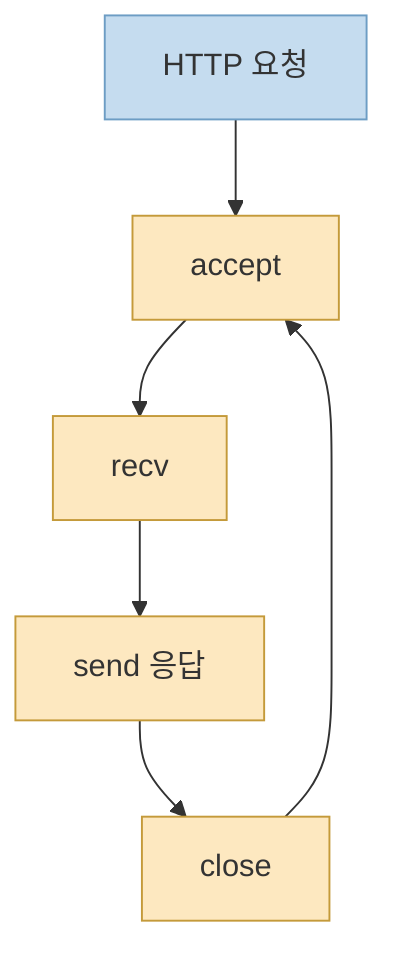
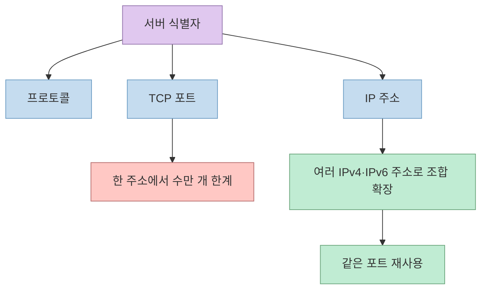
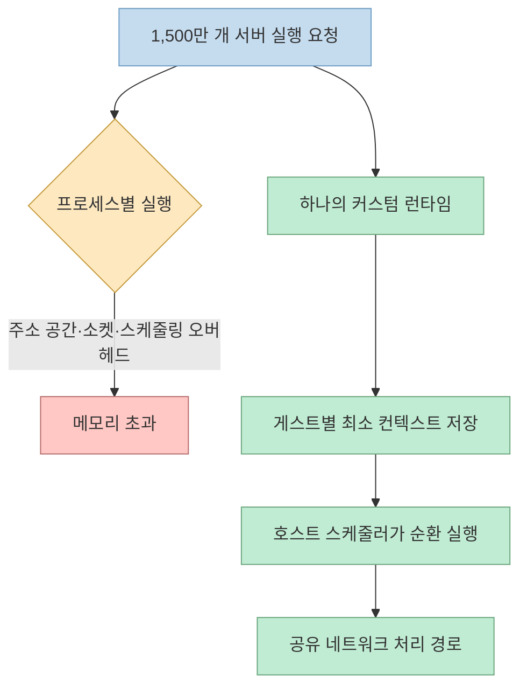
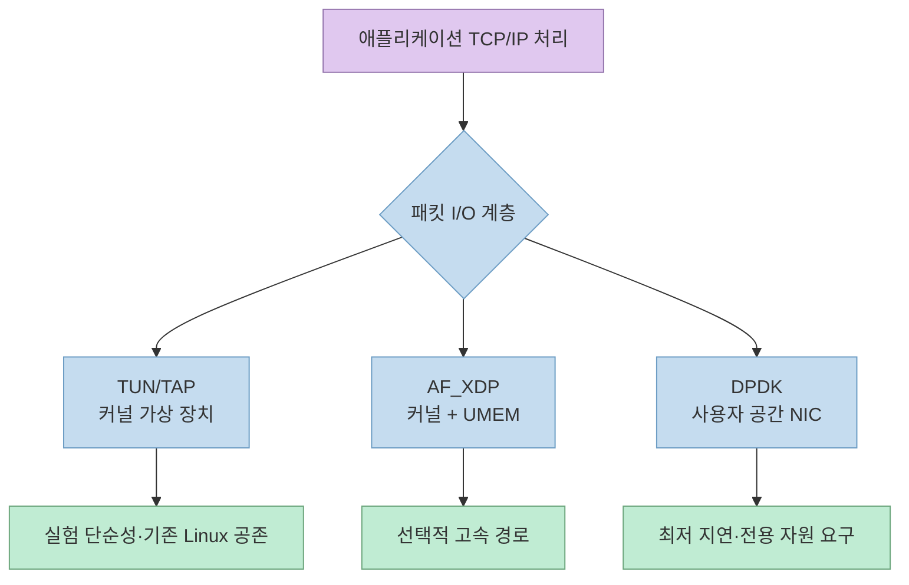

“1개 VM에서 1,500만 개 웹서버”라는 제목은 과장처럼 보이지만, 이 실험의 진짜 주제는 숫자 자체가 아닙니다. [원문](https://kapteko.com/15-million-webservers/)은 가장 단순한 C 웹서버에서 출발해 포트 번호, 프로세스 메모리, Linux 소켓 구조체, 커널 네트워크 스택을 차례로 문제로 드러냅니다. 마지막에는 Rust 기반 [smoltcp](https://github.com/smoltcp-rs/smoltcp), DPDK, AF_XDP 같은 저수준 경로가 왜 필요한지 보여줍니다.

<!--more-->

## 출처와 전제

- 요약 링크: [gitlog — 1개 VM에서 1500만 개 웹서버 돌리기](https://gitlog.kr/i/8xrnh?utm_source=threads&utm_medium=social&utm_campaign=spotlight)
- 기술 원문: [15 million web servers on one VM — smoltcp, DPDK, AF_XDP](https://kapteko.com/15-million-webservers/)
- smoltcp 공식 저장소: [smoltcp-rs/smoltcp](https://github.com/smoltcp-rs/smoltcp)
- DPDK 프로그래머 가이드: [Data Plane Development Kit](https://doc.dpdk.org/guides/prog_guide/intro.html)
- Linux 커널 문서: [AF_XDP](https://www.kernel.org/doc/html/latest/networking/af_xdp.html)

목표인 “1,500만”은 일반적인 웹서비스 운영 지표가 아니라 원문 작성자가 설정한 실험 목표입니다. 원문에는 실제 구현·벤치마크의 제약과 가정이 함께 있으므로, 여기서 소개하는 메모리 수치와 처리량을 모든 VM이나 네트워크 카드에 그대로 적용해서는 안 됩니다.

## 첫 번째 벽: 웹서버는 무엇을 하는가

가장 단순한 HTTP 서버는 다음 시스템 호출의 반복으로 설명할 수 있습니다.

1. `listen`: 소켓에서 연결을 기다립니다.
2. `accept`: 들어온 연결을 받습니다.
3. `recv`: 요청 데이터를 읽습니다.
4. `send`: 응답을 보냅니다.
5. `close`: 연결을 닫습니다.

원문은 C로 항상 `OK`를 반환하는 서버를 만들고 약 6만 5천 RPS 수준을 측정한 뒤, 이 서버를 1,500만 개 실행하려고 합니다. 여기서 중요한 점은 HTTP 라이브러리의 화려함이 아니라, 결국 커널 경계와 연결 상태를 얼마나 많이 만드는가입니다.

## 두 번째 벽: 포트가 아니라 주소의 조합이 부족하다

처음에는 서버마다 포트 0을 지정해 커널이 사용 가능한 포트를 고르게 합니다. 그러나 TCP 포트는 16비트 값이므로 한 IP 주소에서 선택할 수 있는 포트 수에는 상한이 있습니다. Linux의 기본 ephemeral port 범위는 더 좁게 설정되어 있어, 실험은 수만 개 프로세스 지점에서 먼저 실패합니다.

이 문제를 단순히 “포트 번호를 더 크게 만들면 된다”로 해결할 수는 없습니다. 일반 클라이언트와 TCP 헤더가 포트를 16비트 필드로 다루기 때문입니다. 서버 식별자는 대략 `(프로토콜, IP 주소, 포트)` 조합이므로, 여러 IP 주소를 사용하면 같은 포트를 재사용할 수 있습니다.

원문은 처음에는 여러 네트워크 카드와 IP 주소를 상상하고, 이어 IPv6 서브넷을 로컬 인터페이스에 라우팅하는 **AnyIP** 방식으로 방향을 바꿉니다. IPv6의 넓은 주소 공간은 “서버 수를 포트 수에만 묶지 않는다”는 개념을 설명하기 위한 장치이지, 공인 IPv6 주소를 무제한으로 임대할 수 있다는 뜻은 아닙니다.

## 세 번째 벽: 프로세스 하나당 메모리 비용

주소를 확보해도 프로세스 1,500만 개를 실행할 수는 없습니다. 원문은 웹서버 하나가 약 1.5MB를 소비한다고 가정해 총 20TB 수준의 메모리가 필요하다고 계산합니다. 운영체제 프로세스마다 주소 공간, 스케줄링 정보, 파일 디스크립터와 런타임 상태가 붙기 때문입니다.

해법은 모든 서버를 하나의 프로세스 안에서 실행하는 **커스텀 런타임**입니다. 원문이 설명하는 LFI 기반 격리와 사용자 공간 스케줄러는 각 게스트의 최소 실행 상태만 저장하고, 게스트가 호출하는 I/O를 호스트 핸들러로 바꾸는 방식입니다. 이는 V8이 한 프로세스에서 많은 실행 컨텍스트를 관리하는 것과 비슷한 방향이지만, Linux 프로세스와 완전한 호환성을 제공하는 일반 목적 런타임은 아닙니다.

## 네 번째 벽: 커널 소켓 자체가 비싸다

원문은 유휴 소켓도 `socket` 시스템 호출을 하는 순간 Linux 커널 자료구조를 할당한다는 점을 강조합니다. TCP 상태, 파일 객체, dentry와 큐·타이머 관리 정보가 합쳐지면 소켓 하나가 수 KB가 될 수 있고, 이를 1,500만 개 만들면 10GB VM은 즉시 메모리 부족에 도달합니다.

여기서 “소켓당 정확히 3,300바이트” 같은 숫자는 커널 버전, 설정, 프로토콜 상태와 측정 시점에 따라 달라지는 **실험값**입니다. 핵심은 숫자 하나가 아니라, 일반적인 커널 추상화가 대규모 유휴 연결을 무료로 만들어 주지 않는다는 사실입니다.

## 커널을 우회하는 세 가지 네트워크 경로

### smoltcp: 작고 독립적인 TCP/IP 스택

smoltcp는 임베디드·실시간 환경을 겨냥한 Rust 기반 이벤트 주도 TCP/IP 스택입니다. 공식 문서가 설명하듯 자체적으로 네트워크 카드를 읽고 쓰는 드라이버가 되는 것은 아니며, 패킷을 주고받을 `Device` 계층이 필요합니다. 원문은 TUN/TAP을 쉬운 실험 경로로 사용하고, 더 낮은 지연을 위해 DPDK와 AF_XDP를 비교합니다.

### DPDK: 데이터 플레인에서 NIC와 직접 통신

DPDK는 커널 네트워크 스택을 통하지 않고 메모리 매핑된 버퍼와 사용자 공간 드라이버로 패킷을 처리하는 프레임워크입니다. syscall과 복사 비용을 줄일 수 있지만, 네트워크 인터페이스를 전용으로 점유하고 CPU 코어를 바쁘게 폴링하는 설계가 흔합니다. SSH와 일반 커널 네트워크를 그대로 유지해야 하는 서버에는 운영 복잡성이 커집니다.

### AF_XDP: 커널 소유와 사용자 공간 버퍼의 절충

AF_XDP는 Linux의 XDP/eBPF 경로를 이용해 패킷을 사용자 공간의 UMEM으로 전달합니다. 커널이 장치를 관리하면서 특정 트래픽만 빠른 경로로 보낼 수 있어, DPDK보다 기존 Linux 환경과 공존하기 쉬운 선택지가 될 수 있습니다. 실제 성능과 격리 수준은 드라이버 모드, 큐 설정, 패킷 크기에 따라 달라집니다.

## 이 실험에서 배울 수 있는 설계 순서

이 사례를 실제 서비스에 그대로 복사하기보다, 다음과 같은 최적화 순서를 배울 수 있습니다.

1. **프로토콜을 단순화한다**: 정말 필요한 HTTP 기능과 연결 수명을 정의합니다.
2. **식별자 공간을 계산한다**: 포트만 보지 말고 IP·프로토콜 조합을 함께 계산합니다.
3. **상태 비용을 측정한다**: 프로세스, 소켓, 연결 큐, 버퍼를 각각 계측합니다.
4. **추상화 경계를 선택한다**: 커널 소켓으로 충분한지, TUN/TAP·AF_XDP·DPDK가 필요한지 비교합니다.
5. **격리와 운영성을 검증한다**: 보안 경계, 장애 격리, SSH·모니터링·롤백이 유지되는지 확인합니다.

성능 최적화는 숫자를 크게 만드는 경쟁이 아니라, 어떤 기능과 운영 편의성을 포기했는지 기록하는 작업입니다. 특히 커널을 우회하면 패킷 손실, 재전송, 보안 정책, 장애 복구를 애플리케이션이 더 많이 책임져야 합니다.

## 핵심 요약

- 1,500만 웹서버 실험은 포트 수보다 주소 조합, 프로세스 비용, 소켓 자료구조 비용이 더 큰 병목이 될 수 있음을 보여줍니다.
- IPv6 서브넷과 AnyIP는 같은 포트를 여러 주소에서 재사용하는 방법을 설명하지만, 주소 확보·라우팅 비용이 사라지는 것은 아닙니다.
- 커스텀 런타임은 많은 게스트를 한 프로세스에서 실행해 상태 오버헤드를 줄이지만 일반 Linux 프로세스와 같은 호환성을 보장하지 않습니다.
- smoltcp는 가벼운 TCP/IP 구현을 제공하고, DPDK·AF_XDP는 커널 네트워크 경계를 낮춰 패킷 처리 비용을 줄입니다.
- DPDK는 전용 자원과 운영 복잡성을, AF_XDP는 커널·드라이버 설정 의존성을, TUN/TAP은 상대적으로 높은 경계 비용을 감수하는 선택입니다.

## 결론

이 글의 가장 큰 교훈은 “더 빠른 라이브러리를 고르자”가 아닙니다. 시스템이 감당해야 할 상태를 먼저 계산하고, 병목이 포트인지 프로세스인지 소켓인지 패킷 I/O인지 단계적으로 낮춰 보는 방법입니다. 일반적인 웹서비스라면 Linux 커널 네트워크 스택과 검증된 프록시가 훨씬 합리적일 수 있습니다. 하지만 메모리와 지연시간이 절대적인 임베디드·고성능 네트워크 환경에서는 smoltcp, AF_XDP, DPDK 같은 선택지가 추상화 비용과 운영 책임의 교환이라는 사실을 이해하는 것 자체가 중요한 설계 능력입니다.
