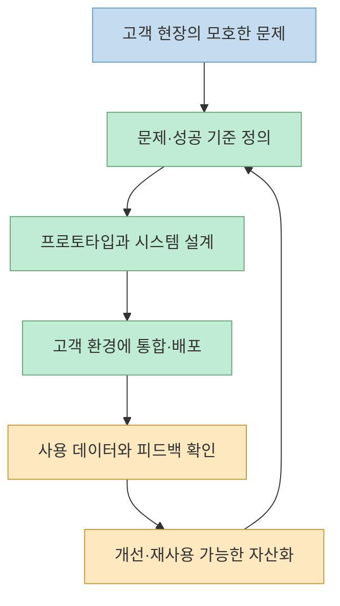
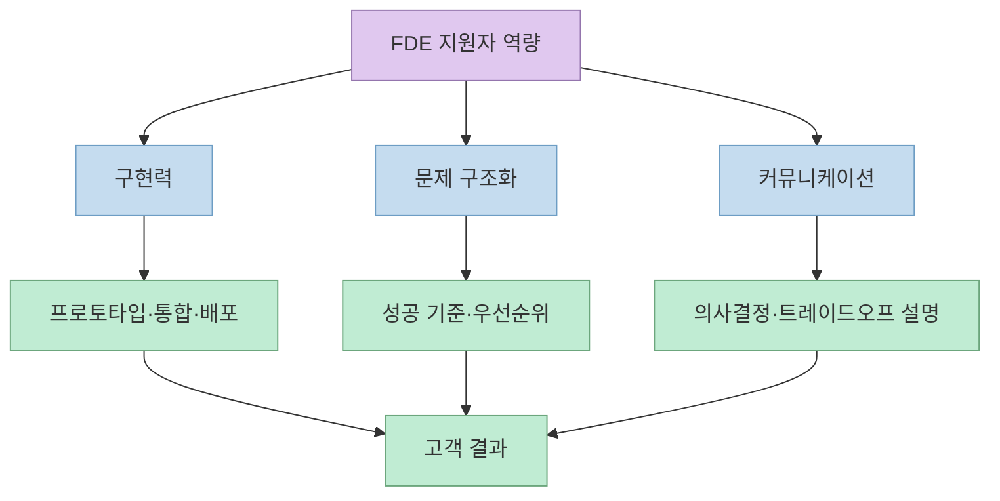
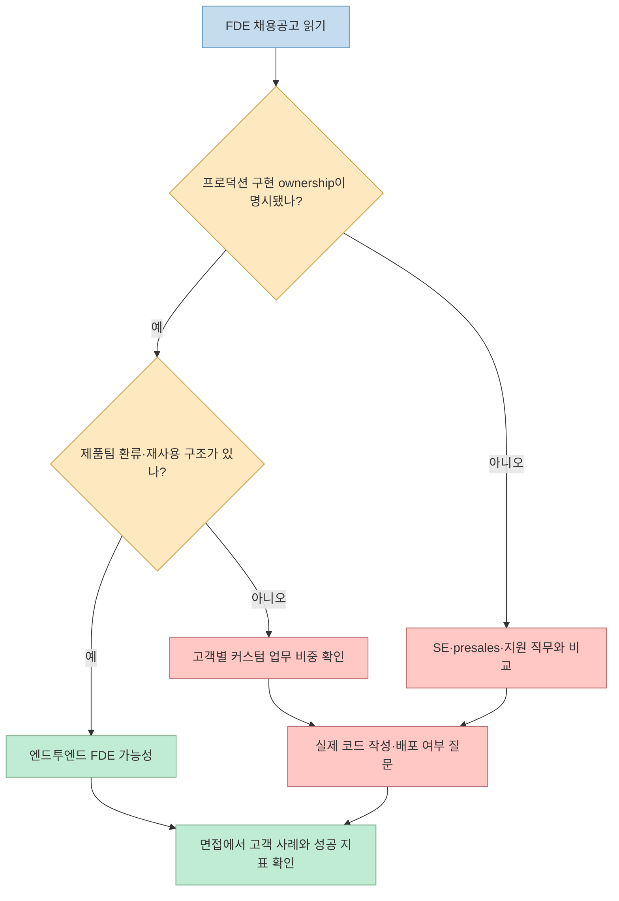
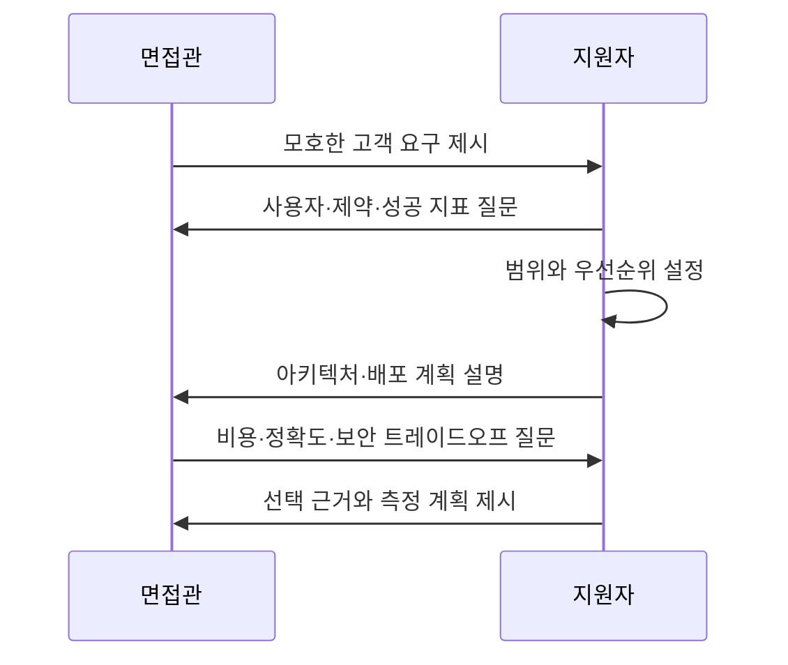

AI 모델과 도구가 빠르게 좋아져도 고객 조직에 실제로 정착시키는 일은 자동으로 해결되지 않습니다. **Forward Deployed Engineer(FDE)** 는 고객 현장의 모호한 문제를 정의하고, 직접 프로토타입과 프로덕션 코드를 만들고, 운영 결과를 다시 제품에 반영하는 역할입니다.

<!--more-->

## 출처와 읽는 법

- 원문: [잡코리아 콘텐츠LAB — Forward Deployed Engineer(FDE)란?](https://m.jobkorea.co.kr/GoodJob/Tip/View?News_No=22526&schCtgr=0&News_No=22526)
- 참고 사례: [Palantir Blog — A Day in the Life of a Palantir Forward Deployed Software Engineer](https://blog.palantir.com/a-day-in-the-life-of-a-palantir-forward-deployed-software-engineer-3c2f6f2b2b5f)
- 원문이 인용한 연구: [MIT NANDA — The GenAI Divide](https://www.nanda.mit.edu/)

잡코리아 글은 2026년 4월 기준 국내외 채용공고와 외부 자료를 편집한 커리어 가이드입니다. 따라서 기사에 나온 비율은 전체 노동시장의 확정 통계가 아니라 **특정 시점에 수집한 공고 표본의 관찰치**로 해석해야 합니다. 회사와 고객, 제품 단계에 따라 FDE의 실제 업무 범위도 달라질 수 있습니다.

## FDE는 무엇을 책임지는가

FDE의 핵심은 “AI를 아는 개발자”라는 타이틀보다 **고객 문제를 정의하고 결과가 나올 때까지 닫는 엔드투엔드 책임**입니다. 고객 인터뷰에서 발견한 문제를 기술 요구사항으로 바꾸고, 빠른 프로토타입을 만든 뒤, 배포·측정·개선을 반복합니다.

### 비슷한 직무와의 차이

- **컨설턴트**: 문제를 진단하고 방향과 제안을 만드는 비중이 큽니다.
- **솔루션 아키텍트(SA)**: 고객 요구에 맞춰 전체 아키텍처를 설계하고 구현팀에 넘기는 역할에 가깝습니다.
- **솔루션 엔지니어(SE)**: 계약 전 데모와 PoC, 기술 검증을 주로 담당합니다.
- **FDE**: 계약 전후의 경계를 넘어 문제 정의, 구현, 검증, 운영 개선까지 직접 이어가는 역할입니다.

이 구분은 직함의 법적 표준이 아니라 일반적인 업무 패턴입니다. 실제 공고에서 FDE가 presales나 고객지원에 치우칠 수 있으므로, 이름보다 **프로덕션 구현 ownership과 제품팀 환류 구조**를 확인해야 합니다.

## 채용공고에서 반복되는 세 가지 역량

잡코리아 글이 여러 공고에서 반복된다고 정리한 축은 다음 세 가지입니다.

1. **코딩과 배포**: 고객 환경에 맞는 애플리케이션을 만들고 기존 시스템·API와 통합합니다.
2. **고객 문제 정의**: 모호한 요구를 관찰 가능한 문제와 성공 지표로 바꿉니다.
3. **이해관계자 커뮤니케이션**: 임원, 현업 사용자, 제품·인프라 엔지니어에게 같은 결정을 각자의 언어로 설명합니다.

기사의 표본 분석에서는 Python과 TypeScript가 자주 언급되며, AI·LLM·에이전트 경험도 공고에 따라 요구됩니다. 다만 특정 비율은 조사 시점과 표본에 따라 달라질 수 있으므로, “LLM 기술 하나만 익히면 된다”는 뜻으로 읽으면 안 됩니다. 기본 구현력과 운영 경험이 먼저입니다.

## 회사마다 달라지는 FDE의 실체

같은 FDE라도 다음 네 가지 유형이 섞여 있을 수 있습니다. 이 분류는 업계의 공식 표준이 아니라, 원문이 채용공고를 읽고 제시한 실무적 관찰입니다.

- **전통 FDE형**: 고객 문제를 정의하고 구현한 결과를 제품팀에 환류합니다.
- **AI 배포형**: 모델·에이전트·데이터 파이프라인을 고객의 보안과 운영 환경에 안착시킵니다.
- **PoC형**: 데모와 검증, 고객 맞춤형 delivery의 비중이 큽니다.
- **Internal AX형**: 외부 고객 대신 사내 업무 자동화와 프로세스 개선을 담당합니다.

지원 전에 JD와 면접에서 아래를 확인하면 역할 drift를 줄일 수 있습니다.

## 기존 경험을 FDE 언어로 바꾸는 법

새로운 AI 프로젝트를 급히 만들기보다, 이미 한 일을 다음 네 문장으로 다시 쓰는 편이 효과적입니다.

1. **문제 정의**: 누가 어떤 반복 비용이나 실패를 겪었는가?
2. **의사결정**: 왜 이 아키텍처·모델·자동화 수준을 선택했는가?
3. **결과**: 사용자 행동, 처리 시간, 오류율, 비용 중 무엇이 달라졌는가?
4. **트레이드오프**: 어떤 조건에서 현재 설계가 한계에 도달하는가?

예를 들어 “LLM 상담 챗봇 개발”보다 “반복 문의를 분류하고 응답 초안을 생성해 상담원 처리 시간을 줄였으며, 문서 규모가 커지면 검색 기반 구조로 전환해야 한다”처럼 쓰면 문제와 판단이 드러납니다. 수치는 실제 측정값만 사용하고, 추정치라면 추정이라고 표시해야 합니다.

경력 단계에 따라 강조점도 달라집니다.

- **3~5년차**: 문제 정의부터 배포와 개선까지 끝낸 작지만 완결된 사례 하나를 준비합니다.
- **6~9년차**: 반복 가능한 템플릿, 피드백 루프, 여러 이해관계자 사이의 의사결정을 보여줍니다.
- **10년차 이상**: FDE 운영 모델, 팀 육성, 재사용 플레이북, 고객 포트폴리오와 리소스 배분 경험을 설명합니다.

## 면접은 기술 퀴즈보다 판단 구조를 본다

FDE 면접에서는 LLM·RAG·에이전트 원리뿐 아니라 고객 시나리오와 시스템 설계를 함께 봅니다. 핵심 질문은 “무엇을 만들었나?”에서 끝나지 않고 “왜 그 문제를 먼저 풀었고, 어떤 실패와 비용을 감수했나?”까지 이어집니다.

준비할 질문은 다음과 같습니다.

- 요구가 계속 바뀌면 무엇을 먼저 고정할 것인가?
- 비개발자 임원에게 기술 선택과 위험을 어떻게 설명할 것인가?
- 실제 비즈니스 결과를 어떻게 측정했는가?
- RAG와 프롬프트 중심 접근을 어떤 조건에서 선택할 것인가?
- 고객이 원하는 것과 실제로 필요한 것이 달랐던 순간에 어떻게 조정했는가?

## 핵심 요약

- FDE는 고객 문제 정의부터 구현·배포·개선까지 연결하는 엔드투엔드 엔지니어입니다.
- 핵심 역량은 코딩, 문제 구조화, 이해관계자 커뮤니케이션의 결합입니다.
- 직함보다 프로덕션 ownership, 제품팀 환류, 재사용 가능한 자산화 여부를 확인해야 합니다.
- 포트폴리오는 문제 정의 → 의사결정 → 결과 → 트레이드오프 순서로 정리하면 FDE 관점이 선명해집니다.
- 기사 속 채용 비율은 특정 시점·표본의 관찰치이므로 회사별 JD와 면접에서 다시 검증해야 합니다.

## 결론

FDE는 “AI 모델을 잘 다루는 사람”과 “고객 문제를 해결하는 엔지니어” 사이를 연결하는 직무입니다. 고객의 언어를 시스템 요구사항으로 바꾸고, 실제 환경에 배포한 뒤, 사용 결과를 제품과 팀의 자산으로 남기는 능력이 경쟁력입니다. 따라서 준비의 출발점은 유행하는 도구 목록이 아니라, 내가 만든 시스템이 누구의 어떤 문제를 어떻게 바꿨는지 설명할 수 있는 한 편의 완결된 사례입니다.
