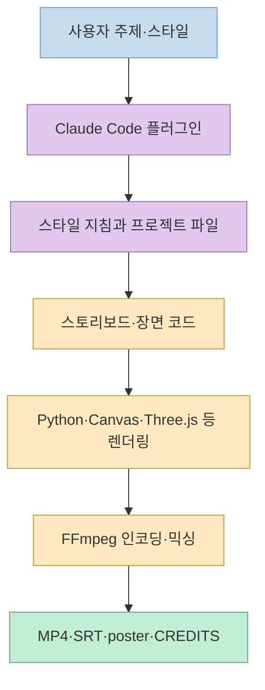
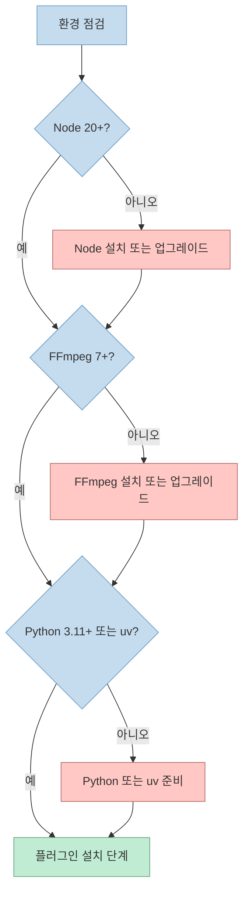
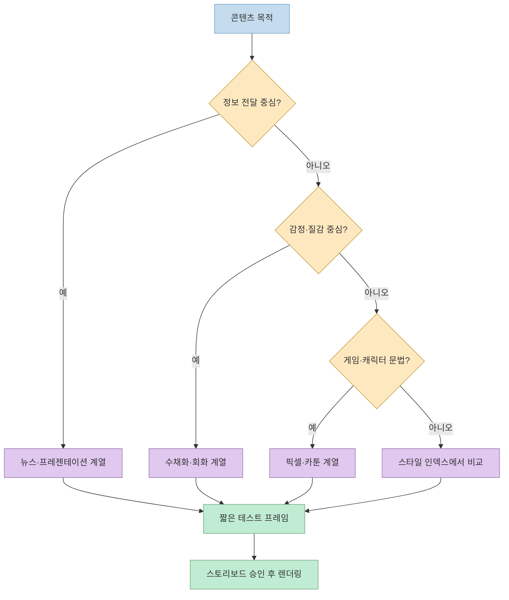
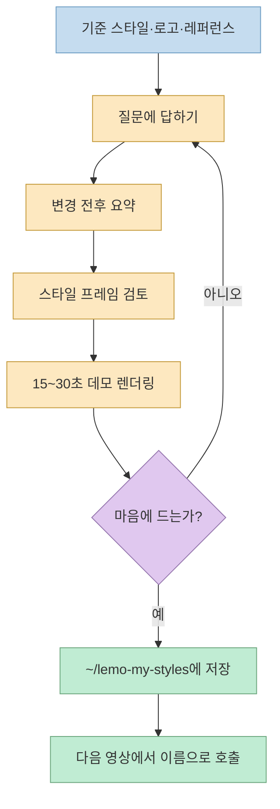

영상 생성 모델에 프롬프트를 넣는 대신, Claude Code가 스토리보드와 장면 코드를 만들고 FFmpeg로 영상을 렌더링하는 방식이 있습니다. [게으른 빌더의 lemo-opuscar 가이드](https://lazyowen.com/guides/claude-code-animation-skill-66-styles)는 이 흐름을 초보자도 따라 할 수 있도록 준비물 확인, 플러그인 설치, 첫 영상 주문, 나만의 스타일 저장 순서로 설명합니다.

<!--more-->

## Sources

- 원문 가이드: [Claude Code로 66가지 스타일 애니메이션 만들기](https://lazyowen.com/guides/claude-code-animation-skill-66-styles)
- 공식 저장소: [lemomo-ai/lemo-opuscar](https://github.com/lemomo-ai/lemo-opuscar)
- 공식 스타일 인덱스: [styles/README.md](https://github.com/lemomo-ai/lemo-opuscar/blob/main/styles/README.md)
- 커스텀 스타일 문서: [MY-STYLES.md](https://github.com/lemomo-ai/lemo-opuscar/blob/main/MY-STYLES.md)
- Claude Code 플러그인 개념: [Anthropic 공식 문서](https://code.claude.com/docs/en/plugins)

원문은 2026년 11월 4일 공개된 시점에 66개 스타일을 소개합니다. 반면 현재 공식 저장소 README는 “99 ready to use”라고 설명하고 스타일 인덱스도 계속 변경되고 있습니다. 따라서 이 글의 66개는 가이드 작성 시점의 스냅샷, 99개는 현재 저장소의 수치로 구분합니다. 스타일 수와 설치 화면은 업데이트에 따라 달라질 수 있습니다.

## lemo-opuscar는 무엇인가

공식 저장소는 lemo-opuscar를 Claude Code용 “코드로 만든 영화 스타일 도구 상자”로 소개합니다. 각 스타일은 스타일 지침과 코드로 제작한 데모 영상을 함께 가지며, 저장소 설명은 비디오 생성 모델 대신 Claude Opus 5.5가 코드를 만들고 렌더링하는 방식을 강조합니다. [공식 저장소 소개](https://github.com/lemomo-ai/lemo-opuscar)

Claude Code에서 플러그인은 스킬·에이전트·훅·MCP 서버 같은 구성요소를 하나의 단위로 설치하고 로드하는 디렉터리입니다. 따라서 이 프로젝트는 단순한 프롬프트 파일이 아니라, 스타일 문서와 렌더링 도구를 Claude Code 작업 흐름에 연결하는 플러그인으로 이해하는 편이 정확합니다. [Claude Code 플러그인 개요](https://code.claude.com/docs/en/plugins)



## 설치 전에 확인할 환경

원문이 제시하는 준비물은 Claude Code, Node.js 20 이상, FFmpeg 7 이상, Python 3.11 이상 또는 `uv`입니다. macOS Apple Silicon에서 개발되었고 Windows에서는 WSL 사용을 안내하지만, 운영체제별 지원 범위는 실제 저장소 문서와 현재 플러그인 버전을 다시 확인해야 합니다. Claude Code 자체의 계정·요금제 조건도 별도로 확인하세요. [원문 준비물 안내](https://lazyowen.com/guides/claude-code-animation-skill-66-styles)

```bash
claude --version
node --version
ffmpeg -version
python3 --version
uv --version
```

`python3`가 3.11보다 낮더라도 `uv`가 설치되어 있으면 프로젝트가 요구하는 Python 실행 방식을 충족할 수 있습니다. 빠진 패키지를 설치할 때는 운영체제 패키지 매니저를 무조건 실행하기보다, 먼저 어떤 명령이 시스템을 변경하는지 확인하고 팀 환경에 맞는 설치 방법을 선택하세요.



## 플러그인 설치와 검증

원문은 `lemolab` 마켓플레이스를 등록한 뒤 `lemo-opuscar`를 사용자 범위로 설치합니다. 두 명령은 Claude Code 대화창의 자연어 요청이 아니라 터미널에서 실행해야 합니다.

```bash
claude plugin marketplace add lemomo-ai/lemo-opuscar
claude plugin install lemo-opuscar@lemolab
claude plugin list
```

`claude plugin list`에서 `lemo-opuscar@lemolab`이 보이고 `Status: ✔ enabled`로 표시되는지 확인합니다. 이미 Claude Code가 실행 중이었다면 종료 후 다시 시작하는 것이 안전합니다. 플러그인 설치는 외부 코드와 도구를 로컬 환경에 추가하는 작업이므로, 저장소의 라이선스와 파일을 검토한 뒤 실행하세요. Claude Code의 공식 문서도 플러그인이 여러 구성요소를 하나의 단위로 설치한다고 설명합니다. [플러그인 설치 개념](https://code.claude.com/docs/en/plugins)

## 첫 영상 제작 흐름

프로젝트 파일을 섞지 않도록 전용 폴더에서 Claude Code를 시작합니다. 원문은 `~/films`를 예시로 사용하며, 직접 녹음한 나레이션 파일을 그 안에 넣으면 작업 중 참조할 수 있다고 안내합니다.

```bash
mkdir -p ~/films
cd ~/films
claude
```

첫 요청에는 최소한 네 가지를 명시하는 것이 좋습니다.

1. **스타일 이름**: 공식 스타일 인덱스의 영문 이름을 그대로 사용합니다.
2. **주제**: 영상이 설명할 한 가지 메시지를 적습니다.
3. **길이**: 처음에는 30~45초처럼 짧게 시작합니다.
4. **화면 비율**: 쇼츠·릴스라면 세로 1080×1920을 명시합니다.

예시는 다음과 같습니다.

```text
Watercolor Brush 스타일로 우리 동네 빵집의 하루를 40초 영상으로 만들어 줘.
세로 1080×1920으로 만들고, films 폴더의 내 녹음 파일을 나레이션으로 사용해.
먼저 스토리보드를 보여 줘.
```

기본 음성이 영어·중국어로 제공될 수 있으므로 한국어 나레이션은 직접 녹음한 파일을 지정하는 편이 명확합니다. 주문 전에 스토리보드를 확인하면 장면 수, 나레이션 길이, 화면 비율을 렌더링 전에 조정할 수 있습니다.

렌더링이 끝나면 원문은 MP4와 `poster.jpg`, 자막 `srt`, 스토리 문서 `TREATMENT.md`, 외부 소재와 라이선스를 기록하는 `CREDITS` 파일을 산출물로 제시합니다. 공유하기 전에 `CREDITS`를 확인해야 음악·폰트 등 외부 리소스의 사용 조건을 놓치지 않습니다.

## 66가지 스타일을 고르는 방법

가이드 작성 시점의 분류는 손그림·회화, 편집·다큐, 실증 영상, 정보·발표, 그래픽·타이포, 재질·3D, 인쇄·판화, 카툰·애니메, 동양 전통, 게임, 영화·시대 등입니다. 공식 스타일 인덱스는 현재 이름과 폴더를 계속 갱신하므로, 영상 주문 전에 README에서 영문 이름과 폴더를 확인하세요. [현재 스타일 인덱스](https://github.com/lemomo-ai/lemo-opuscar/blob/main/styles/README.md)

스타일 선택은 단순한 시각 효과 선택이 아닙니다. 같은 주제라도 `Caption News`는 정보 전달과 자막 계층을, `Watercolor Brush`는 질감과 장면 전환을, `16-bit Pixel RPG`는 픽셀 단위 표현과 게임 문법을 우선하게 됩니다. 따라서 먼저 콘텐츠 목적을 정한 뒤 스타일을 고르는 순서가 좋습니다.



## 나만의 스타일 만들기

커스텀 스타일은 기존 라이브러리 스타일을 변형하거나 빈 페이지에서 새로 시작할 수 있습니다. 원문 예시는 `Swiss Motion Graphics`의 격자·박자·문자 구조를 유지하면서 도형의 재질과 브랜드 컬러를 바꿔 별도 스타일로 저장하는 방식입니다.

작업 전에 로고 파일과 레퍼런스 이미지를 프로젝트 폴더에 준비합니다.

```text
~/films/
├── logo.png
└── refs/
    ├── reference-01.png
    └── reference-02.jpg
```

Claude Code에 기준 스타일, 사용처, 브랜드 컬러, 파일 위치를 한 번에 전달합니다.

```text
Swiss Motion Graphics 스타일을 내 버전으로 바꿔 줘.
릴스용 세로 영상이고 브랜드 컬러는 #FF6A2B야.
로고는 films/logo.png, 레퍼런스 이미지는 films/refs 폴더에 있어.
```

공식 `MY-STYLES.md`는 질문과 답변 → 변경 요약 확인 → 스타일 프레임 확인 → 15~30초 데모 영상 → 사용자 승인 후 저장의 흐름을 설명합니다. 확정된 스타일은 `~/lemo-my-styles/`에 저장되어 라이브러리 업데이트나 플러그인 삭제와 분리됩니다. [커스텀 스타일 공식 문서](https://github.com/lemomo-ai/lemo-opuscar/blob/main/MY-STYLES.md)



## 업데이트·삭제와 운영 주의점

원문은 새 스타일을 받거나 플러그인을 갱신할 때 다음 명령을 안내합니다.

```bash
claude plugin marketplace update lemolab
claude plugin update lemo-opuscar@lemolab
```

삭제는 다음과 같습니다.

```bash
claude plugin uninstall lemo-opuscar@lemolab
```

플러그인을 업데이트하거나 삭제해도 `~/lemo-my-styles/`는 별도 경로에 있으므로 커스텀 스타일은 남는다는 것이 공식 문서의 설계입니다. 반대로 `~/lemo-opuscar`에 내려받은 라이브러리를 직접 삭제하는 것은 별도 작업이므로, 재설치할 때 필요한 파일인지 확인하세요.

운영할 때는 다음을 특히 확인해야 합니다.

- **비용과 시간**: 영상 한 편은 Claude Code 사용량과 렌더링 시간이 발생합니다. 처음부터 긴 영상보다 짧은 테스트를 권장합니다.
- **라이선스**: 프로젝트 코드와 문서가 MIT라고 원문은 설명하지만, 영상에 포함된 음악·폰트 등 외부 소재는 `CREDITS`의 개별 라이선스를 따릅니다.
- **재현성**: 플러그인 업데이트로 스타일 지침과 결과가 바뀔 수 있으므로, 사용한 커밋·플러그인 버전과 프롬프트를 프로젝트에 기록합니다.
- **파일 안전**: 렌더링 전에 별도 브랜치나 전용 폴더를 사용하고, 기존 파일을 덮어쓰지 않도록 출력 경로를 확인합니다.
- **품질 검수**: 자동으로 만들어진 영상도 자막 오탈자, 음량, 프레임 누락, 모바일 화면에서의 가독성을 직접 확인해야 합니다.

## 핵심 요약

- `lemo-opuscar`는 Claude Code에 코드 기반 애니메이션 제작 스타일과 도구를 연결하는 플러그인입니다.
- 원문 가이드는 66개 스타일을 소개하지만, 공식 저장소 현재 README는 99개 스타일을 표방하므로 버전 차이를 고려해야 합니다.
- Node 20+, FFmpeg 7+, Python 3.11+ 또는 `uv`를 먼저 확인하고 플러그인 설치 상태를 `claude plugin list`로 검증합니다.
- 첫 요청에는 스타일, 주제, 길이, 화면 비율, 나레이션 파일을 명시하고 스토리보드부터 확인하는 것이 좋습니다.
- 결과물의 `CREDITS`를 확인해 음악·폰트 라이선스를 검토해야 합니다.
- 커스텀 스타일은 `~/lemo-my-styles/`에 저장해 라이브러리 업데이트와 분리할 수 있습니다.

## 결론

lemo-opuscar의 핵심은 “애니메이션을 생성해 줘”라는 한 줄보다, 스타일 지침과 렌더링 단계를 Claude Code가 재사용할 수 있는 프로젝트 구조로 묶는 데 있습니다. 먼저 짧은 세로 영상을 테스트하고, 산출물과 라이선스를 검수한 뒤 브랜드 스타일을 저장하세요. 플러그인 버전과 프롬프트를 기록해 두면, 빠르게 바뀌는 스타일 라이브러리 속에서도 같은 제작 과정을 팀의 반복 가능한 콘텐츠 파이프라인으로 발전시킬 수 있습니다.
