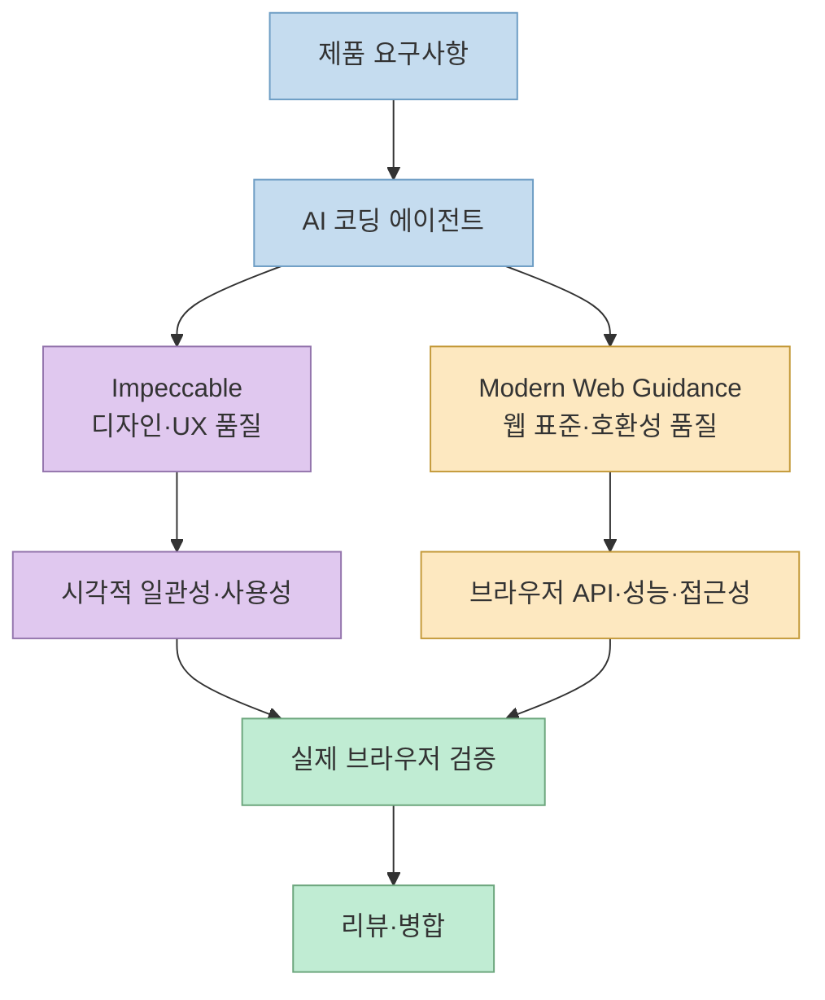
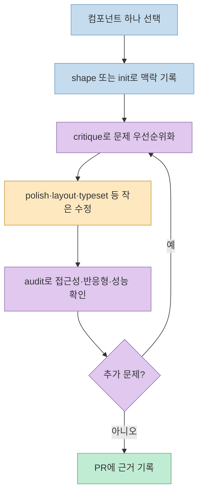
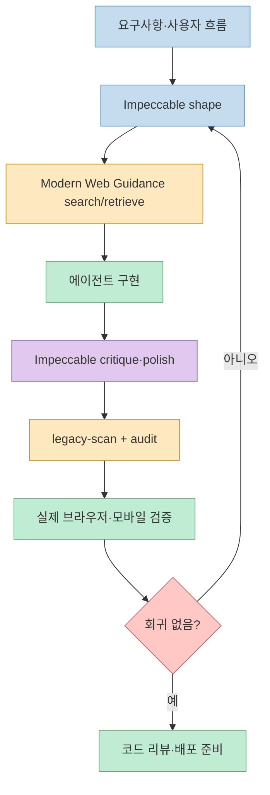

AI 코딩 에이전트로 만든 프론트엔드는 기능은 동작하지만 디자인이 획일적이거나, 반대로 보기에는 좋아도 오래된 웹 구현과 접근성 문제를 포함할 수 있습니다. 공유된 대화는 이 문제를 **Impeccable은 디자인 품질**, **Modern Web Guidance는 웹 플랫폼 구현 품질**로 나눠 해결하자고 제안합니다. 두 도구를 경쟁 관계가 아닌 서로 다른 검수 레이어로 배치하면 “예쁜 화면”과 “오래 유지되는 코드”를 함께 검토할 수 있습니다.

<!--more-->

## Sources

- 원문 대화: [Impeccable과 Modern Web Guidance 비교](https://chatgpt.com/s/t_6b01adcecaec8191b2dc8c6aa52c45ec)
- Impeccable 공식 저장소: [pbakaus/impeccable](https://github.com/pbakaus/impeccable)
- Modern Web Guidance 공식 저장소: [GoogleChrome/modern-web-guidance](https://github.com/GoogleChrome/modern-web-guidance)
- Modern Web Guidance 공식 문서: [Chrome for Developers](https://developer.chrome.com/docs/modern-web-guidance)
- Claude Code 플러그인 개요: [Anthropic 공식 문서](https://code.claude.com/docs/en/plugins)

공유 대화의 비교와 명령 예시는 원문을 기준으로 옮겼고, 설치 방법·명령 수·현행 기능 목록은 각 프로젝트의 공식 저장소와 문서로 다시 확인했습니다. GitHub 저장소의 별 개수나 기능 수는 계속 변하므로 이 글에서는 현재 작업 방식과 역할 구분에 집중합니다.

## 두 도구가 해결하는 문제가 다르다

Impeccable은 코딩 에이전트가 만든 UI에서 반복되는 시각적 안티패턴을 줄이고, 디자인 의도를 명령어로 구체화하는 도구입니다. 공식 README는 `bolder`, `quieter`, `polish` 같은 조정 명령과 `critique`, `audit` 같은 검토 명령을 제공합니다. [Impeccable 공식 README](https://github.com/pbakaus/impeccable)

Modern Web Guidance는 웹 플랫폼 전문 지식과 브라우저 호환성 데이터를 에이전트 컨텍스트에 넣습니다. 컨테이너 쿼리, `subgrid`, Popover API, `<dialog>`, View Transitions, INP, `scheduler.yield()` 등 “현재 브라우저가 제공하는 기능을 어떻게 올바르게 사용할지”가 중심입니다. [Modern Web Guidance 공식 문서](https://developer.chrome.com/docs/modern-web-guidance)



핵심은 한 도구가 다른 도구를 대체하지 않는다는 점입니다. Impeccable이 색상·레이아웃·타이포그래피를 개선해도 브라우저 API를 잘못 사용하면 구현 품질은 낮을 수 있습니다. 반대로 Modern Web Guidance가 `<dialog>`와 최신 CSS를 추천해도 정보 구조와 시각적 계층이 어색하면 사용자는 좋은 화면으로 느끼지 못합니다.

## Impeccable: 디자인 의도를 명령으로 바꾸기

### 설치와 초기화

공식 저장소의 기본 설치 흐름은 프로젝트 루트에서 `npx impeccable install`을 실행한 뒤 에이전트를 다시 시작하고 `/impeccable init`을 실행하는 것입니다. Codex에서는 `$impeccable init`을 사용합니다. 초기화 과정은 프로젝트 맥락을 읽고 제품 대상과 제약을 확인한 뒤 `PRODUCT.md`를 작성합니다. [설치 안내](https://github.com/pbakaus/impeccable#readme)

```bash
npx impeccable install
```

```text
/impeccable init
/impeccable document
```

`document`는 기존 시각 시스템을 `DESIGN.md`로 정리해 이후 변경이 브랜드에서 벗어나지 않도록 돕습니다. 초기화 파일을 먼저 만들면 에이전트에게 매번 브랜드와 사용자 맥락을 반복해서 설명하는 비용을 줄일 수 있습니다.

### 명령을 목적별로 나누기

공식 README는 현재 24개 명령을 네 묶음으로 설명합니다.

- **Steer**: `bolder`, `quieter`, `distill`, `colorize`, `typeset`, `layout`, `animate`, `delight`, `overdrive`
- **Review**: `critique`, `audit`
- **Finish**: `polish`, `harden`, `clarify`, `adapt`, `optimize`, `onboard`
- **Iterate / Plan**: `live`, `generate`, `shape`, `init`, `document`, `extract`

예를 들어 “예쁘게 바꿔 줘”처럼 넓은 요청을 하기보다 다음처럼 대상과 의도를 함께 지정합니다.

```text
/impeccable shape 결제 화면의 사용자 흐름과 오류 상태를 먼저 설계해 줘.
/impeccable critique 가격 카드의 계층과 사용성을 평가해 줘.
/impeccable polish 가격 카드만 시각적으로 마무리해 줘.
/impeccable harden 결제 폼의 오류·오버플로·다국어 상태를 점검해 줘.
```

`critique`는 사용성 기준으로 우선순위를 매기는 검토이고, `audit`는 접근성·성능·테마·반응형 같은 기술 품질 보고서에 가깝습니다. 공식 README는 62개의 결정론적 규칙으로 디자인 안티패턴을 탐지한다고 설명하지만, 탐지 결과가 제품의 미적 방향을 자동으로 결정해 주는 것은 아닙니다. [검토와 탐지 방식](https://github.com/pbakaus/impeccable#readme)

### 좁은 대상부터 반복하기

Impeccable은 이미 존재하는 화면이나 컴포넌트를 하나씩 개선할 때 특히 유리합니다. 전체 페이지를 한 번에 바꾸면 어떤 변경이 사용성이나 브랜드에 영향을 주었는지 확인하기 어렵습니다. `critique the onboarding flow`처럼 한 영역을 지정하고, 결과를 확인한 뒤 `polish settings`로 다음 영역을 처리하는 순서가 안전합니다.



## Modern Web Guidance: 최신 웹 구현을 선택하기

### 설치와 레거시 검사

Chrome 공식 문서가 권장하는 설치 명령은 다음과 같습니다.

```bash
npx modern-web-guidance@latest install
```

Claude Code 플러그인으로 직접 설치하려면 공식 문서의 마켓플레이스 명령을 사용합니다.

```bash
claude plugin marketplace add GoogleChrome/modern-web-guidance
claude plugin install modern-web-guidance@googlechrome
```

기존 코드에서 오래된 패턴을 찾는 명령은 다음과 같습니다.

```bash
npx modern-web-guidance@latest search "animate a dialog modal backdrop"
npx modern-web-guidance@latest retrieve "animate-to-from-top-layer"
npx modern-web-guidance@latest legacy-scan .
```

`search`와 `retrieve`는 구현 전에 관련 지침을 에이전트 컨텍스트에 넣는 단계이고, `legacy-scan`은 현재 코드베이스의 현대화 후보를 찾는 단계입니다. 스캔 결과는 자동 병합 명령이 아니라 검토할 이슈 목록으로 취급해야 합니다. [공식 Quickstart](https://github.com/GoogleChrome/modern-web-guidance#quickstart)

### 무엇을 최신화할 수 있나

Modern Web Guidance는 다음과 같은 선택을 구체화하는 데 도움을 줍니다.

- 직접 만든 반응형 분기 대신 **Container Queries**를 컴포넌트 크기 기준으로 검토
- 반복되는 그리드 정렬 코드를 **CSS Subgrid**로 단순화
- 부모 상태에 따른 스타일에 **`:has()`**를 사용할 수 있는지 확인
- 화면 전환에 **View Transitions**를 적용할 때 진입·이탈 상태를 검토
- 툴팁과 팝오버에 **Popover API**와 **CSS Anchor Positioning**을 고려
- 모달에 **HTML Dialog**를 사용하고 포커스·키보드 동작을 검증
- 긴 작업을 나눌 때 **`scheduler.yield()`**와 INP 영향을 측정
- Baseline과 프로젝트 브라우저 범위를 기준으로 폴백을 설계

공식 문서는 최신 API를 무조건 사용하라고 하지 않습니다. 브라우저가 최적화할 수 있는 플랫폼 기능을 우선하되, 지원 범위에 맞는 가벼운 폴백과 점진적 향상을 함께 고려하도록 안내합니다. [Modern Web Guidance의 목적](https://github.com/GoogleChrome/modern-web-guidance#why)

## 두 도구를 결합하는 실전 순서

React·TypeScript·Tailwind CSS·shadcn/ui 같은 환경에서 다음 순서를 기본값으로 삼을 수 있습니다.

1. **Impeccable `shape`** 로 사용자와 화면의 목표, 핵심 상태, 오류 흐름을 정합니다.
2. 에이전트가 컴포넌트를 구현하기 전에 **Modern Web Guidance `search`·`retrieve`** 로 관련 웹 API와 브라우저 범위를 확인합니다.
3. 에이전트에게 디자인 맥락과 웹 구현 지침을 함께 제공해 코드를 작성하게 합니다.
4. **Impeccable `critique`·`polish`** 로 레이아웃, 색상, 타이포그래피, 시각적 계층을 다듬습니다.
5. **Modern Web Guidance `legacy-scan`** 과 Impeccable `audit`로 레거시 패턴·접근성·성능 후보를 다시 확인합니다.
6. 실제 브라우저와 모바일 화면에서 키보드 조작, 반응형, 로딩, 상호작용을 검증합니다.



## 목적별로 어떤 조합을 선택할까

- **랜딩 페이지 리디자인**: Impeccable을 먼저 사용해 정보 구조와 시각적 방향을 잡고, Modern Web Guidance로 인터랙션과 반응형 구현을 검토합니다.
- **관리자 대시보드**: 두 도구를 함께 사용합니다. 정보 밀도가 높으므로 디자인 계층과 키보드 접근성, 성능을 모두 봐야 합니다.
- **SaaS 제품**: 기존 디자인 시스템을 `DESIGN.md`에 기록하고, 웹 표준 가이드는 컴포넌트별로 검색해 재사용합니다.
- **오래된 UI 현대화**: `legacy-scan`으로 브라우저 API 후보를 찾은 뒤, Impeccable `critique`로 사용성 회귀를 막습니다.
- **성능 최적화**: Modern Web Guidance의 INP·스케줄링·로딩 지침을 우선하고, Impeccable `audit`로 최적화가 시각적·반응형 품질을 깨지 않았는지 확인합니다.

두 도구의 결과가 충돌하면 제품의 브라우저 지원 정책과 사용자 데이터가 우선입니다. 예를 들어 최신 API가 더 간결하더라도 지원 브라우저가 제한되면 폴백을 유지하고, 시각적으로 강한 효과가 성능 예산을 넘으면 `quieter`나 애니메이션 축소를 선택해야 합니다.

## 한계와 안전한 운영

두 도구 모두 자동 완성 버튼이 아닙니다. Impeccable의 디자인 규칙은 패턴을 발견할 수 있지만, 브랜드의 의도적인 예외까지 모두 틀렸다고 판단할 수 있습니다. Modern Web Guidance도 가이드와 호환성 근거를 제공할 뿐, 팀의 브라우저 정책·도메인 규칙·서버 성능을 대신 검증하지 않습니다.

또한 공식 저장소와 CLI는 계속 업데이트됩니다. 설치 시점의 버전, 사용한 가이드 ID, Impeccable 명령, 변경 전후 스크린샷과 브라우저 검증 결과를 PR에 남기면 결과를 재현하기 쉽습니다. 실제 배포 전에는 다음을 확인하세요.

- 키보드만으로 모든 주요 흐름을 완료할 수 있는가
- 작은 화면과 확대 환경에서 텍스트·오버플로가 깨지지 않는가
- 최신 API의 지원 브라우저와 폴백이 요구사항에 맞는가
- `audit`·`legacy-scan` 결과를 사람이 검토했는가
- 성능 측정과 시각적 회귀 테스트가 통과했는가

## 핵심 요약

- Impeccable은 AI가 만든 UI의 디자인 방향, 시각적 일관성, UX 검토를 담당합니다.
- Modern Web Guidance는 최신 CSS·브라우저 API·호환성·성능·접근성 구현을 담당합니다.
- Impeccable은 `shape → critique → polish/audit` 순서로 좁은 컴포넌트를 반복 개선하는 데 적합합니다.
- Modern Web Guidance는 `search → retrieve → legacy-scan`으로 근거를 찾고 오래된 패턴을 점검합니다.
- 두 도구를 함께 쓸 때는 디자인 설계 → 웹 표준 구현 → 디자인 검수 → 레거시·접근성 검사 → 실제 브라우저 검증 순서가 효과적입니다.
- 공식 도구의 결과는 제안과 검사이므로 브라우저 정책, 성능 예산, 코드 리뷰를 최종 판단으로 삼아야 합니다.

## 결론

AI 프론트엔드 품질은 한 번의 프롬프트보다 검수 루프의 설계에서 결정됩니다. Impeccable로 사용자가 보는 화면의 의도와 완성도를 다듬고, Modern Web Guidance로 그 화면을 최신 웹 표준에 맞게 구현한 뒤, 실제 브라우저에서 다시 검증하세요. 이 조합은 “예쁜데 낡은 코드”와 “표준적이지만 어색한 UI” 사이의 간극을 줄이는 실용적인 작업 분담입니다.
