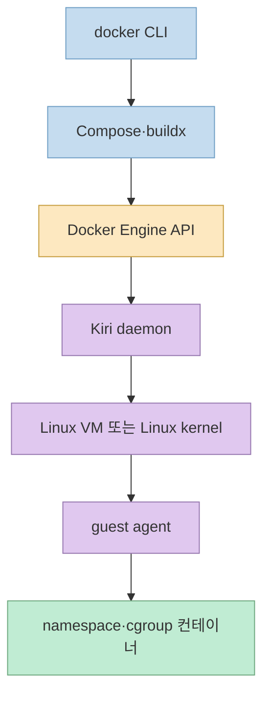
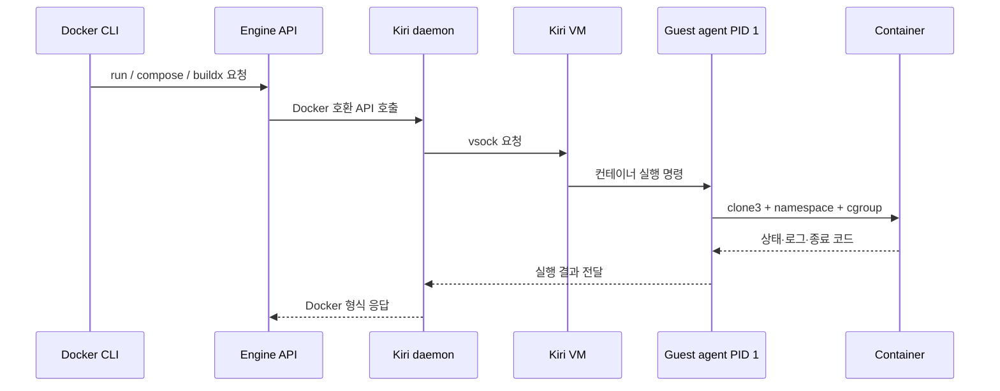
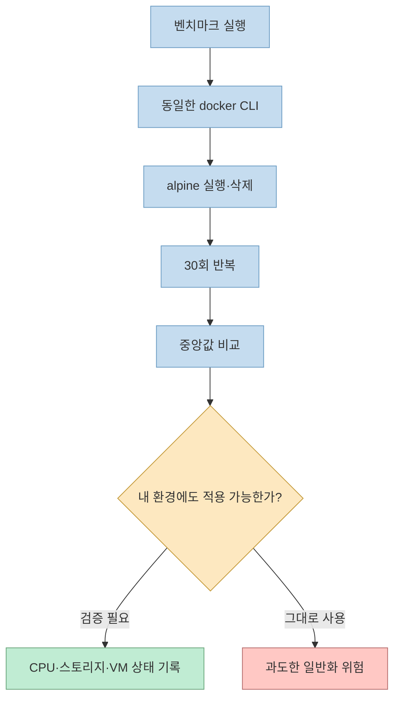

Docker Desktop과 OrbStack은 편리하지만, 개발 환경에 따라 메모리 사용량과 시작 시간이 부담이 될 수 있습니다. [Kiri](https://github.com/libracoder/kiri)는 Docker CLI와 Compose, buildx를 그대로 사용하면서 더 작은 실행 구성을 제공하려는 Rust 기반 컨테이너 런타임입니다.

<!--more-->

## 출처와 범위

- 공식 저장소: [libracoder/kiri](https://github.com/libracoder/kiri)
- 공식 문서: [Kiri Development](https://github.com/libracoder/kiri/blob/main/docs/development.md)
- 기능·릴리스 정보: [Kiri Features](https://github.com/libracoder/kiri/blob/main/docs/features.md)
- 프로젝트 사이트: [runkiri.com](https://runkiri.com/)

이 글은 저장소 README와 공개 문서를 기준으로 작성했습니다. README의 벤치마크는 특정 환경의 측정값이므로, 모든 컴퓨터에서 동일한 성능이 보장된다는 뜻은 아닙니다.

## Kiri가 해결하려는 문제

Kiri의 목표는 컨테이너 개발에 필요한 인터페이스와 실제 실행 계층을 분리하는 것입니다. 사용자는 기존 `docker` 명령과 Compose 파일을 유지하고, Kiri는 그 요청을 자체 데몬과 게스트 에이전트로 전달합니다.



README에 따르면 macOS와 Windows에서는 작은 Linux VM을 사용하고, Linux에서는 커널 위에서 직접 실행하는 경로를 제공합니다. 컨테이너마다 VM을 띄운다는 뜻이 아니라, 호스트 운영체제에 맞는 하나의 실행 계층 안에서 컨테이너를 관리하는 방식입니다.

## 주요 기능

- `docker`, Compose, buildx, `docker login` 호환
- macOS 14 이상, Windows 10·11(WSL 2), 주요 Linux 배포판 지원
- `http://<name>.kiri.local` 형태의 로컬 도메인과 Kiri 인증서 기관
- 한 명령으로 시작하는 단일 노드 Kubernetes 클러스터
- 별도 Linux 머신 생성과 셸 접속
- Docker Desktop이나 OrbStack에서 이미지·볼륨·컨테이너를 가져오는 `kiri import`
- 시스템 언어에 맞춘 다국어 UI와 메뉴 막대 애플리케이션

저장소 설명에는 무료 Ngrok 대안이라는 표현이 있지만, Tailscale·Cloudflare Tunnel·Coolify 연동은 로드맵 항목으로 표시됩니다. 따라서 모든 터널 기능이 현재 완성되어 있다고 단정하지 말고 기능 문서와 릴리스를 확인해야 합니다.

## 내부 구조: 작은 VM과 Rust 게스트 에이전트

Kiri README가 설명하는 핵심은 구성요소 수를 줄이는 것입니다. Kiri VM에는 약 10MB 크기의 커스텀 커널과 약 900KB 크기의 Rust PID 1 게스트 에이전트가 들어갑니다. 게스트 에이전트는 `clone3`로 네임스페이스와 cgroup을 만들고 컨테이너를 시작합니다.



전통적인 `dockerd`, containerd shim, `runc` 대신 Kiri 데몬과 게스트 에이전트가 컨테이너 생명주기를 직접 조정합니다. 구성요소가 줄어드는 만큼 구현·호환성·보안 검증 책임은 프로젝트가 부담하므로, 운영 환경에서는 지원 기능과 릴리스의 보안 정책을 확인해야 합니다.

## 빠른 시작

README는 macOS용 DMG와 Homebrew cask, Windows용 MSI, Linux용 DEB·RPM 패키지를 안내합니다. 최초 실행 시 `kiri` Docker context가 만들어집니다.

```bash
# Kiri Docker context로 컨테이너 실행
docker --context kiri run --rm alpine echo hello

# Compose 프로젝트 실행
docker --context kiri compose up -d

# 단일 노드 Kubernetes context 시작
kiri k8s start

# 별도 Linux 머신 생성 후 셸 접속
kiri machine create dev --distro ubuntu
kiri machine shell dev

# 기존 Docker Desktop·OrbStack 자산 가져오기
kiri import
```

Kiri 전용 명령인 `kiri run`, `kiri ps`, `kiri compose`도 제공됩니다. 팀 프로젝트에서는 Compose 파일 자체보다 Docker context가 어디를 가리키는지부터 확인하는 습관이 중요합니다.

## 벤치마크를 읽는 방법

README의 예시는 `alpine` 컨테이너에서 `true`를 실행하고 제거하는 작업을 30회 반복한 중앙값입니다. Docker Engine API 기준으로 Kiri 2.55ms, Docker Desktop 213ms, OrbStack 380ms라는 수치가 제시되며, Docker CLI 기준 수치도 별도로 제시됩니다.



저장소가 안내하는 `kiri bench --network bridge --runs 30`을 같은 머신에서 실행하고, 팀이 실제로 사용하는 Compose·볼륨·네트워크 작업도 별도로 측정해야 합니다. VM이 깨어나는 시간, 이미지 캐시, CPU 아키텍처와 파일 공유 방식이 결과에 영향을 줍니다.

## 도입 전 확인할 점

Kiri는 다음과 같은 개발 환경에서 검토할 만합니다.

1. Docker CLI와 Compose 호환성을 유지하면서 데스크톱 런타임 자원 사용량을 줄이고 싶을 때
2. macOS·Windows·Linux 팀이 같은 명령 인터페이스를 사용해야 할 때
3. 로컬 컨테이너와 단일 노드 Kubernetes를 한 도구에서 실험할 때
4. 기존 Docker Desktop·OrbStack 자산을 옮겨야 할 때

반대로 특수 Docker 플러그인, privileged 컨테이너, 복잡한 네트워크 드라이버, 기업 보안 정책과 SLA가 필요한 경우에는 먼저 호환성 표·이슈·보안 정책을 확인해야 합니다. “Docker 대체품”이라는 표현보다, 개발자 도구 경험을 유지하면서 더 작은 런타임을 제공하는 프로젝트로 이해하는 편이 현실적입니다.

## 핵심 요약

- Kiri는 Rust로 작성된 macOS·Windows·Linux용 경량 컨테이너 런타임입니다.
- Docker Engine API를 말하기 때문에 Docker CLI, Compose, buildx를 계속 사용할 수 있습니다.
- macOS·Windows에서는 작은 Linux VM, Linux에서는 커널 직접 실행 경로를 사용합니다.
- 약 10MB 커널과 Rust 게스트 에이전트가 `clone3`, namespace, cgroup으로 컨테이너를 시작합니다.
- README의 성능 수치는 특정 환경의 30회 중앙값이므로 직접 벤치마크해야 합니다.
- 지원 기능과 보안 정책을 확인한 뒤 개발 환경부터 단계적으로 도입하는 것이 안전합니다.

## 결론

Kiri의 매력은 새로운 컨테이너 명령을 배우게 하는 데 있지 않습니다. 기존 Docker 워크플로를 유지한 채 데스크톱 런타임의 실행 계층을 더 작게 만들려는 접근에 있습니다. 특히 Docker CLI·Compose 호환성과 빠른 컨테이너 시작, 단일 노드 Kubernetes 실험을 한 번에 원하는 개발자에게 흥미로운 선택지입니다. 다만 호환성은 명령어 이름만으로 보장되지 않으므로, 팀의 네트워크·볼륨·보안 요구를 실제 프로젝트로 검증한 뒤 기본 런타임을 바꾸는 것이 좋습니다.
