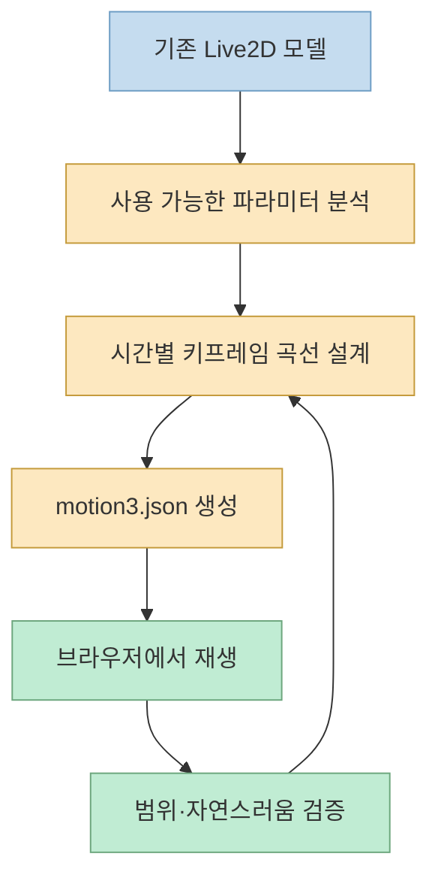
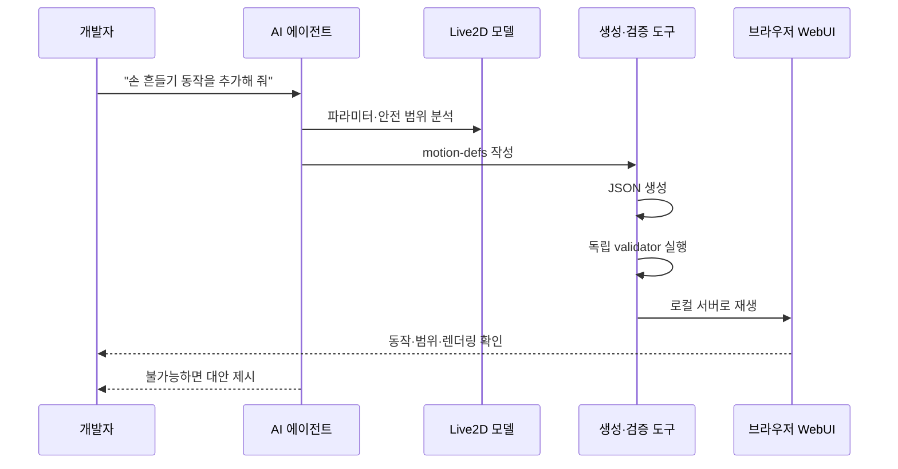
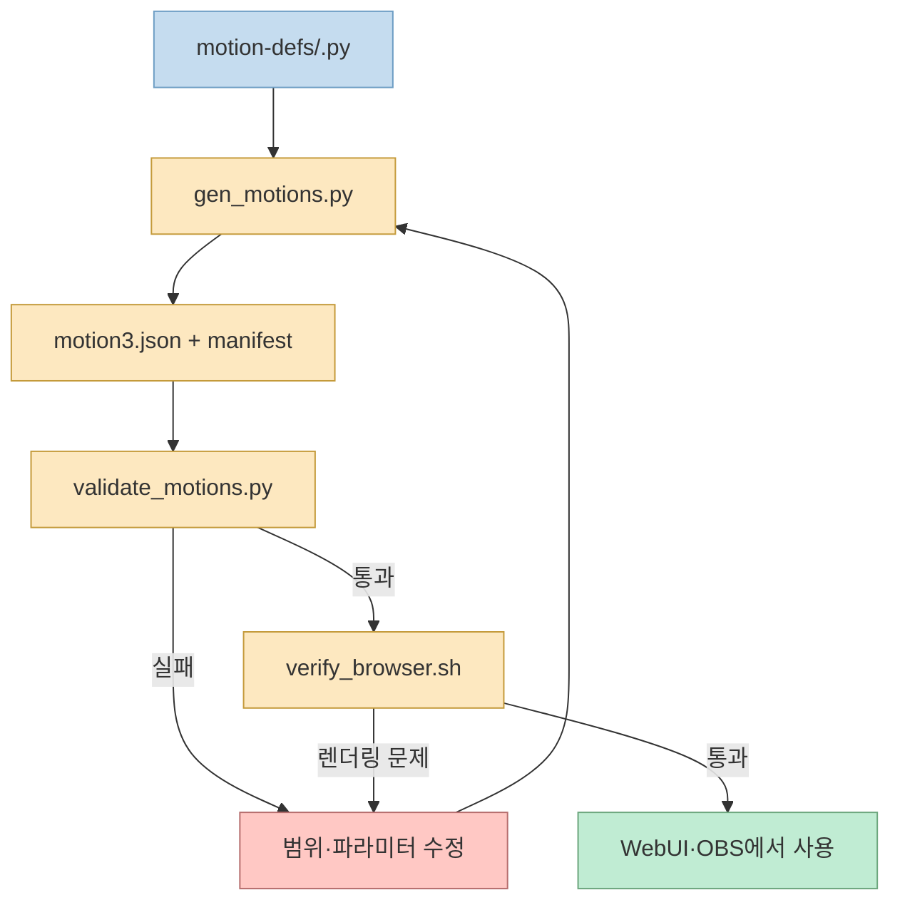

Live2D 캐릭터에 새로운 동작을 넣으려면 보통 Cubism Editor에서 리깅과 타임라인을 다뤄야 한다고 생각합니다. 하지만 [live2d-add-motion-sample-web-ui](https://github.com/shinshin86/live2d-add-motion-sample-web-ui)는 기존 모델이 가진 파라미터 범위 안에서 `.motion3.json`을 직접 생성해 동작을 추가하는 방법을 보여줍니다.

<!--more-->

## 출처와 범위

- Threads 소개: [동영 김의 Live2D 동작 생성 소개](https://www.threads.com/@ehddudrlaa/post/Df8c6F8JLfO)
- 프로젝트 저장소: [shinshin86/live2d-add-motion-sample-web-ui](https://github.com/shinshin86/live2d-add-motion-sample-web-ui)
- 공식 샘플 모델: [Live2D Hiyori Momose](https://www.live2d.com/en/learn/sample/momose-hiyori/)

Threads 게시물은 Hiyori용 7종 샘플과 브라우저 재생, Cubism Editor 없이 진행하는 흐름을 소개합니다. 아래 내용은 프로젝트 README와 저장소 문서를 기준으로 확장한 것이며, Hiyori 모델과 Cubism Core는 별도 라이선스를 따릅니다.

## 핵심 아이디어: 모션은 파라미터 곡선 데이터다

Live2D의 `.motion3.json`은 모델 파라미터별 키프레임 곡선을 담는 데이터입니다. 따라서 모델이 이미 `ParamAngleX`, 눈·입·볼·몸통 같은 파라미터를 갖고 있다면, 리깅이나 메시를 다시 편집하지 않고도 시간에 따른 값을 정의해 새로운 동작을 만들 수 있습니다.



이 방식은 모델이 지원하지 않는 팔 동작을 새로 만들어 내는 마법이 아닙니다. 기존 파라미터로 자연스럽게 표현할 수 없는 동작이라면, 프로젝트의 AI 에이전트 지침도 억지로 만들지 말고 대안을 제안하도록 합니다.

## Hiyori에 추가된 7가지 동작

저장소는 Live2D 공식 샘플인 Hiyori에 다음 동작을 JSON으로 추가합니다.

- **Happy**: 웃는 눈, 입 모양, 볼 홍조, 몸통 바운스
- **Wink**: 한쪽 눈 깜빡임과 고개 기울임
- **Nod**: 고개를 두 번 끄덕이는 동작
- **Thinking**: 고개 기울임, 시선 회피, 찡그린 눈썹
- **Surprised**: 눈 확대, 눈썹 상승, “o” 입, 몸을 뒤로 젖힘
- **Shy**: 볼 홍조, 아래를 보는 시선, 내려간 눈꺼풀
- **Head shake**: 고개 좌우 흔들기

이 목록의 의미는 “AI가 새 모델을 생성했다”가 아니라, **모델에 이미 있는 파라미터를 조합해 재사용 가능한 모션을 만들었다**는 데 있습니다.

## AI 에이전트를 생성 파이프라인에 넣는 법

README의 빠른 시작은 코딩 에이전트에게 모델 위치와 “동작을 추가하고 브라우저에서 보이게 해 달라”고 요청하는 흐름입니다. 에이전트는 모델 배치, 파라미터 분석, 동작 정의, 생성, 검증, 로컬 서버 시작을 순서대로 처리합니다.



이 흐름에서 중요한 것은 에이전트의 창의성보다 제약 조건입니다. 파라미터 ID, 안전 범위, physics가 주도하는 출력 파라미터, 기본 포즈로 돌아오는지 여부를 분석 결과에 고정해야 합니다.

## 직접 실행하는 최소 절차

저장소는 Python 표준 라이브러리만으로 생성·검증 도구를 실행할 수 있도록 구성되어 있습니다. 모델 데이터는 라이선스 문제로 저장소에 포함되지 않습니다.

```bash
git clone https://github.com/shinshin86/live2d-add-motion-sample-web-ui.git
cd live2d-add-motion-sample-web-ui

# 모델 폴더 또는 zip 배치
python3 tools/setup_model.py <model.zip 또는 model-folder>

# 모션 생성과 등록
python3 tools/gen_motions.py

# 독립 검증기
python3 tools/validate_motions.py

# 로컬 WebUI
python3 tools/serve.py
# http://localhost:8765
```

수동으로 작업할 때는 먼저 `tools/analyze_model.py`로 파라미터와 관찰된 범위를 확인한 뒤 `motion-defs/<model-name>.py`에 키프레임을 정의합니다. 생성기와 검증기를 통과한 뒤 `tools/verify_browser.sh`로 실제 브라우저 렌더링까지 확인합니다.

## 생성기와 검증기를 분리한 이유

단순히 JSON 문법이 맞는 것만으로는 모션이 안전하다고 볼 수 없습니다. 저장소의 파이프라인은 다음 세 층을 분리합니다.

1. **Generator**: 모션 정의를 `.motion3.json`과 모델의 모션 목록으로 변환합니다.
2. **Validator**: 파라미터 ID, 범위, physics 출력, blend 결과, 루프 이음새를 독립적으로 확인합니다.
3. **Headless browser**: 실제 WebUI에서 렌더링하고 최고점 포즈와 반복 구간을 확인합니다.



특히 one-shot 모션은 기본 포즈에서 시작하고 끝나야 하며, loop 모션은 시작과 끝의 값과 기울기가 이어져야 합니다. 런타임에서 값을 클램프하더라도 과도한 키프레임을 좋은 동작으로 바꿔 주는 것은 아니므로, 수치 검증과 실제 시각 검증을 모두 거쳐야 합니다.

## 브라우저 WebUI와 OBS 연동

WebUI에서는 새 모션을 버튼으로 재생하고, 아바타를 드래그하거나 휠·핀치로 확대할 수 있습니다. 모션 위에 표정과 립싱크를 겹칠 수 있고, 카메라 탭에서는 얼굴 추적·녹화·OBS 스트리밍을 사용할 수 있습니다.

OBS 스트리밍은 `python3 tools/serve.py`로 로컬 서버를 실행한 뒤 `stream.html`을 Browser source로 추가하는 방식입니다. 카메라와 마이크 데이터는 로컬 브라우저 흐름에서 처리되며, 스트리밍 페이지에는 재생 명령과 파라미터만 릴레이됩니다. 운영 전에는 로컬 서버가 `127.0.0.1`에만 열리는지와 브라우저 소스 URL을 확인해야 합니다.

## 다른 모델에 적용할 때의 한계

Hiyori에서 자연스러운 범위가 다른 모델에서도 그대로 유효하지는 않습니다. 모델마다 파라미터 ID, 기본 포즈, 물리 시뮬레이션 출력, 안전한 각도 범위가 다릅니다.

- 모델별 `motion-defs/<model-name>.py`를 따로 둡니다.
- physics가 계산하는 파라미터를 직접 애니메이션하지 않습니다.
- 공유 제스처는 정규화된 범위로 매핑하되, 실제 모델 범위에서 다시 검증합니다.
- 모델 파일과 Live2D Cubism Core를 프로젝트에 재배포할 때 라이선스를 확인합니다.
- `motion3.json`이 문법적으로 유효해도 실제 렌더링이 자연스럽다는 보장은 없으므로 브라우저 검증을 생략하지 않습니다.

## 핵심 요약

- `.motion3.json`은 모델 파라미터의 키프레임 곡선이므로 텍스트와 코드로 새 동작을 만들 수 있습니다.
- `live2d-add-motion-sample-web-ui`는 Hiyori에 Happy, Wink, Nod 등 7개 모션을 제공합니다.
- AI 에이전트가 모델 분석부터 생성·검증·로컬 서버 실행까지 처리하도록 `AGENTS.md` 지침을 제공합니다.
- 생성기, 독립 validator, headless Chrome 검증을 분리해 문법 오류와 실제 렌더링 오류를 함께 잡습니다.
- Cubism Editor가 없어도 되지만, 모델에 없는 파라미터나 동작을 새로 만들어 주는 도구는 아닙니다.
- Hiyori 모델과 Cubism Core는 저장소에 포함되지 않으며 각자의 라이선스를 따라야 합니다.

## 결론

이 프로젝트가 보여주는 핵심은 “AI가 Live2D를 자동으로 그린다”가 아닙니다. 이미 리깅된 모델의 파라미터를 읽고, JSON 기반 모션 정의를 생성하며, 독립 검증과 실제 브라우저 렌더링으로 결과를 확인하는 **재현 가능한 도구 체계**입니다. AI 에이전트를 창작 파트너로 쓰더라도 모델 범위와 라이선스, 검증 단계를 코드로 고정하면 훨씬 안전하게 캐릭터 동작을 확장할 수 있습니다.
