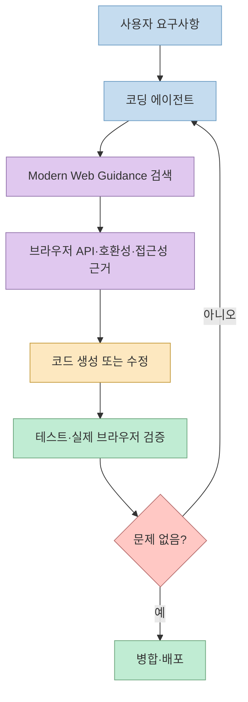
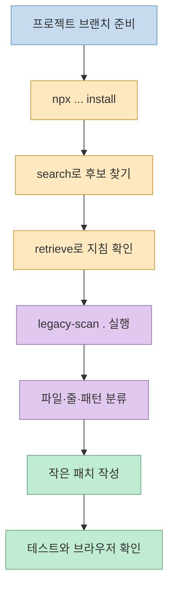
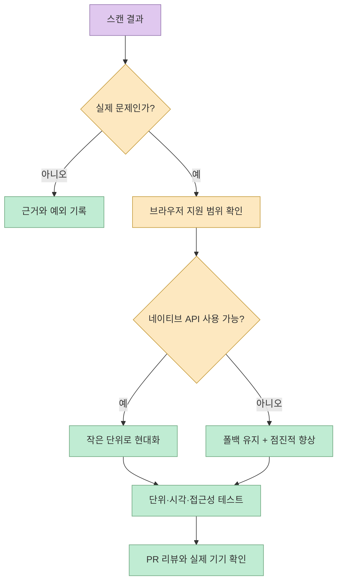

AI 코딩 에이전트가 만든 웹 코드는 동작하더라도 최신 브라우저 API와 접근성·성능 기준을 놓칠 수 있습니다. 학습 데이터에 오래된 예제가 섞여 있기 때문입니다. 이 글은 짧은 영상에서 소개한 **Modern Web Guidance**를 공식 GitHub 저장소와 Chrome 문서로 교차 확인하고, 실제 프로젝트에 적용하는 흐름을 설명합니다. [영상 설명과 링크(0:00)](https://youtu.be/HR5eKguH5fk?t=0)

<!--more-->

## 출처와 범위

- 원본 Shorts: [Modern Web Guidance 소개](https://youtube.com/shorts/HR5eKguH5fk)
- 공식 저장소: [GoogleChrome/modern-web-guidance](https://github.com/GoogleChrome/modern-web-guidance)
- 공식 문서: [Chrome Modern Web Guidance](https://developer.chrome.com/docs/modern-web-guidance)
- 영상에서 안내한 설치 가이드: [Notion 가이드](https://tuemarz.notion.site/legacy-scan-209-10-41d37c926d581b086a1e03901c4c95a)

이 Shorts는 37초 분량이며, 이번 정리는 자막 원문이 아니라 영상 설명과 공식 문서를 기준으로 했습니다. 따라서 설명에 없는 세부 발언의 정확한 시점은 확인하지 않았습니다. 영상 설명은 209개 가이드를 언급하지만, 현재 README는 262개 modern web features, Chrome 문서는 200개 이상의 검증된 스킬이라고 표현합니다. 버전과 집계 단위가 다를 수 있으므로 숫자를 하나의 고정된 제품 사양으로 해석하지 않는 것이 안전합니다.

## 왜 AI는 오래된 웹 패턴을 반복할까

코딩 에이전트는 입력한 요구사항과 저장소의 코드뿐 아니라 학습된 일반 패턴을 참고해 코드를 작성합니다. 웹 플랫폼은 빠르게 변하지만 학습 데이터에는 오래된 브라우저 우회 코드와 자바스크립트 라이브러리 예제가 많이 남아 있습니다. 그 결과 브라우저가 기본 제공하는 기능을 직접 구현하거나, 접근성·성능 개선이 반영되지 않은 코드를 제안할 수 있습니다. [공식 README의 문제 정의](https://github.com/GoogleChrome/modern-web-guidance#readme)

Modern Web Guidance는 이 간극을 **에이전트가 검색·참조할 수 있는 전문가 큐레이션 스킬**로 보완합니다. 단순히 “최신 방식으로 바꿔 줘”라고 요청하는 대신, 어떤 웹 기능을 언제 사용할지에 대한 근거를 컨텍스트에 넣는 방식입니다.



## Modern Web Guidance의 구성

공식 설명에 따르면 이 프로젝트는 웹 플랫폼 전문 지식, 모범 사례, 브라우저 호환성 정보를 코딩 에이전트에 연결하는 스킬 모음입니다. Chrome 팀만의 비공개 규칙이 아니라 Chrome·Edge·Firefox·MDN 팀과 커뮤니티가 함께 관리하는 공개 저장소입니다. 저장소에는 Claude Code, Codex, Cursor, Copilot CLI 등 여러 에이전트에 연결할 수 있는 플러그인·스킬 구성이 포함되어 있습니다. [GitHub 저장소](https://github.com/GoogleChrome/modern-web-guidance) · [Chrome 공식 문서](https://developer.chrome.com/docs/modern-web-guidance)

핵심 구성은 세 가지로 나눌 수 있습니다.

1. **스킬 데이터**: dialog, Popover API, CSS Anchor Positioning, container queries, `subgrid`, `text-wrap`, INP 등 주제별 지침입니다.
2. **검색·조회 CLI**: 요청에 맞는 가이드를 찾고, 선택한 가이드의 상세 내용을 에이전트 컨텍스트에 넣습니다.
3. **legacy-scan**: 저장소의 오래된 패턴을 빠르게 찾아 파일과 줄 단위의 개선 후보를 제시하고, 에이전트가 맥락을 고려해 마이그레이션하도록 돕습니다.

## 설치와 기본 명령

가장 간단한 설치 방법은 공식 문서가 안내하는 `npx` 명령입니다. `@latest`를 사용하므로 CI나 팀 문서에 고정할 때는 실행 시점의 버전을 기록하는 편이 좋습니다.

```bash
npx modern-web-guidance@latest install
npx modern-web-guidance@latest search "animate a dialog modal backdrop"
npx modern-web-guidance@latest retrieve "animate-to-from-top-layer"
npx modern-web-guidance@latest legacy-scan .
```

`search`는 주제에 맞는 가이드를 찾는 단계이고, `retrieve`는 선택한 가이드의 상세 내용을 가져오는 단계입니다. `legacy-scan .`은 현재 디렉터리를 검사하므로, 먼저 별도 브랜치에서 실행하고 결과를 코드 리뷰 목록으로 취급하세요. 검사 결과가 곧 자동 수정 명령은 아닙니다.



## 어떤 코드를 현대화할 수 있나

### 모달과 툴팁

직접 만든 `div` 모달 대신 `<dialog>`의 포커스 관리와 닫기 동작을 검토할 수 있습니다. 툴팁은 Popover API와 CSS Anchor Positioning 조합이 기존 위치 계산 코드보다 적합한지 확인합니다. 다만 지원 브라우저 범위가 제품 요구사항과 맞아야 하며, 필요한 경우 점진적 향상이나 대체 경로를 남겨야 합니다. [Chrome 가이드 목록](https://developer.chrome.com/docs/modern-web-guidance)

### 레이아웃과 타이포그래피

컨테이너 쿼리, `subgrid`, `text-wrap: balance`, 최신 색상 함수 등을 사용하면 미디어 쿼리와 수동 줄바꿈을 줄일 수 있습니다. 그러나 디자인 시스템의 브라우저 지원 정책과 실제 콘텐츠를 함께 확인해야 합니다. “새로운 CSS”라는 이유만으로 기존 코드를 일괄 치환하면 레이아웃 회귀가 생길 수 있습니다.

### 성능과 접근성

가이드는 INP와 LCP 같은 사용자 중심 성능 지표, `scheduler.yield()`와 즉시 프리로드 같은 개선 방향도 다룹니다. 성능 지침은 번들 크기나 Lighthouse 점수만 보는 것이 아니라 실제 상호작용과 저사양 기기에서 측정해야 합니다. 접근성 역시 자동 검사 통과만으로 충분하지 않으므로 키보드 탐색, 포커스 순서, 스크린 리더 동작을 직접 확인해야 합니다.

## 팀에 적용하는 안전한 루프



1. **스캔 결과를 이슈로 옮깁니다.** 모든 경고를 같은 우선순위로 처리하지 말고 사용자 영향과 변경 범위를 기록합니다.
2. **가이드를 읽고 목표 브라우저를 확인합니다.** Baseline, 회사 지원 정책, 필요한 폴백을 함께 결정합니다.
3. **한 패턴씩 수정합니다.** 모달 전체를 재작성하기보다 열기·닫기·포커스처럼 검증 가능한 단위로 나눕니다.
4. **브라우저에서 검증합니다.** 자동 테스트, 키보드 조작, 모바일 화면, 실제 네트워크 조건을 확인합니다.
5. **근거를 PR에 남깁니다.** 사용한 가이드와 지원 브라우저, 폴백을 기록하면 다음 에이전트 실행에서도 같은 판단을 재사용할 수 있습니다.

## 프롬프트 예시

에이전트에 다음과 같이 요청하면 검색과 수정의 범위를 제한할 수 있습니다.

```text
이 저장소의 모달 구현을 조사해 줘.
1. Modern Web Guidance에서 dialog와 top-layer 관련 가이드를 먼저 검색한다.
2. 현재 지원 브라우저와 접근성 테스트를 확인한다.
3. 한 번에 한 컴포넌트만 <dialog>로 마이그레이션하고, 기존 폴백은 유지한다.
4. 변경 전후의 포커스 이동, ESC 닫기, 스크롤 잠금 테스트를 추가한다.
5. 사용한 가이드 URL과 지원 범위를 PR 설명에 기록한다.
```

## 한계와 도입 시 주의점

Modern Web Guidance는 최신 근거를 제공하는 도구이지, 프로젝트의 제품 요구사항을 대신 결정하는 자동 리팩터가 아닙니다. 공식 문서가 소개하는 공개 평가 결과도 해당 문서의 벤치마크이므로, 팀의 코드베이스와 브라우저 조합에서 같은 효과가 난다고 가정하면 안 됩니다. [평가와 설치 안내](https://developer.chrome.com/docs/modern-web-guidance)

또한 `@latest` 설치는 시간이 지나면 가이드 결과가 달라질 수 있습니다. CI에서는 설치 로그와 커밋 시점을 보존하고, 변경이 큰 경우 스킬 버전을 고정하거나 검토 주기를 정하세요. `legacy-scan`의 제안은 반드시 코드 리뷰와 실제 브라우저 테스트를 거친 뒤 병합해야 합니다.

## 핵심 요약

- AI가 생성한 웹 코드는 학습 데이터의 오래된 패턴을 되풀이할 수 있습니다.
- Modern Web Guidance는 웹 플랫폼·호환성·접근성 지침을 코딩 에이전트의 컨텍스트에 연결합니다.
- `search`, `retrieve`, `legacy-scan`을 사용해 찾기, 읽기, 점검을 분리할 수 있습니다.
- `<dialog>`, Popover API, CSS Anchor Positioning, container queries, INP 같은 주제를 근거 기반으로 검토할 수 있습니다.
- 영상의 209개, README의 262개, 문서의 200개 이상이라는 숫자는 버전·집계 기준이 다를 수 있습니다.
- 자동 제안은 시작점일 뿐이며, 브라우저 지원 범위·접근성·실제 성능 테스트와 함께 도입해야 합니다.

## 결론

Modern Web Guidance의 핵심은 AI에게 더 강하게 명령하는 것이 아니라, 최신 웹 플랫폼 지식을 작업 직전에 공급하는 데 있습니다. 먼저 `legacy-scan`으로 위험 후보를 좁히고, 가이드의 근거와 제품의 브라우저 정책을 대조한 뒤 작은 패치와 실제 브라우저 테스트를 반복하세요. 그러면 코딩 에이전트를 단순 코드 생성기가 아니라, 오래된 웹 패턴을 발견하고 현대적인 대안을 검토하는 개발 보조 도구로 활용할 수 있습니다.
