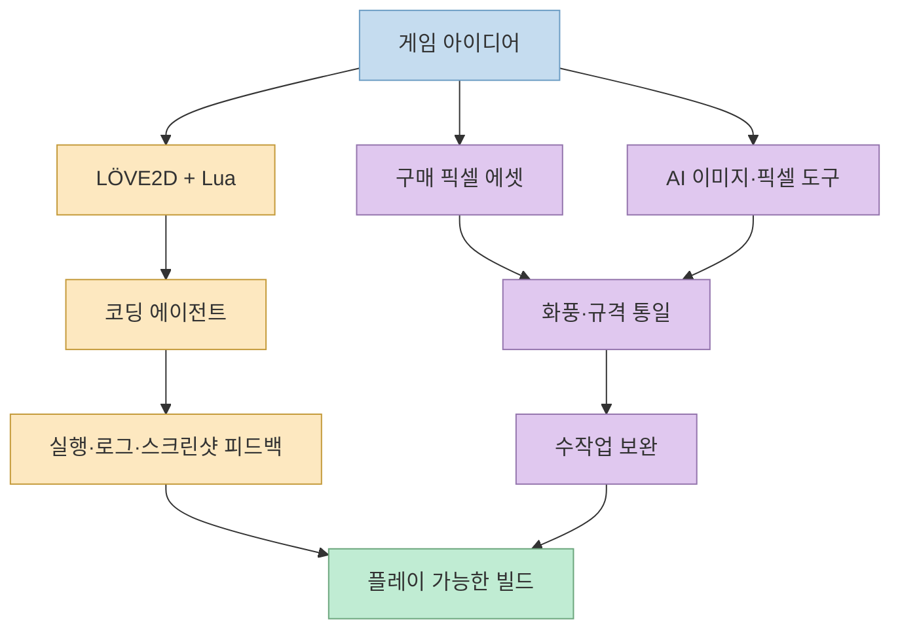
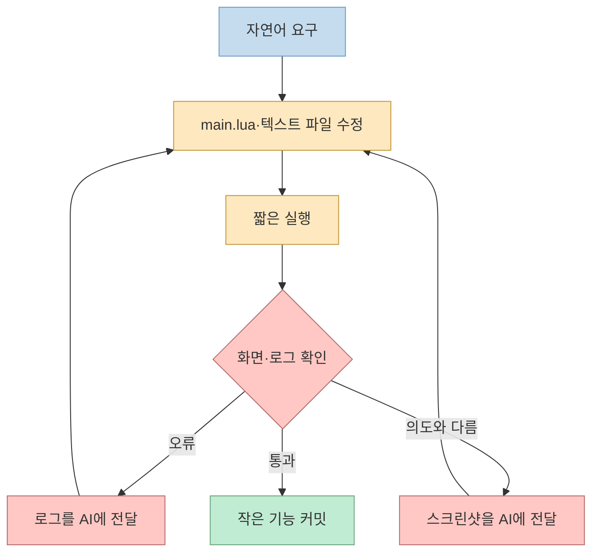
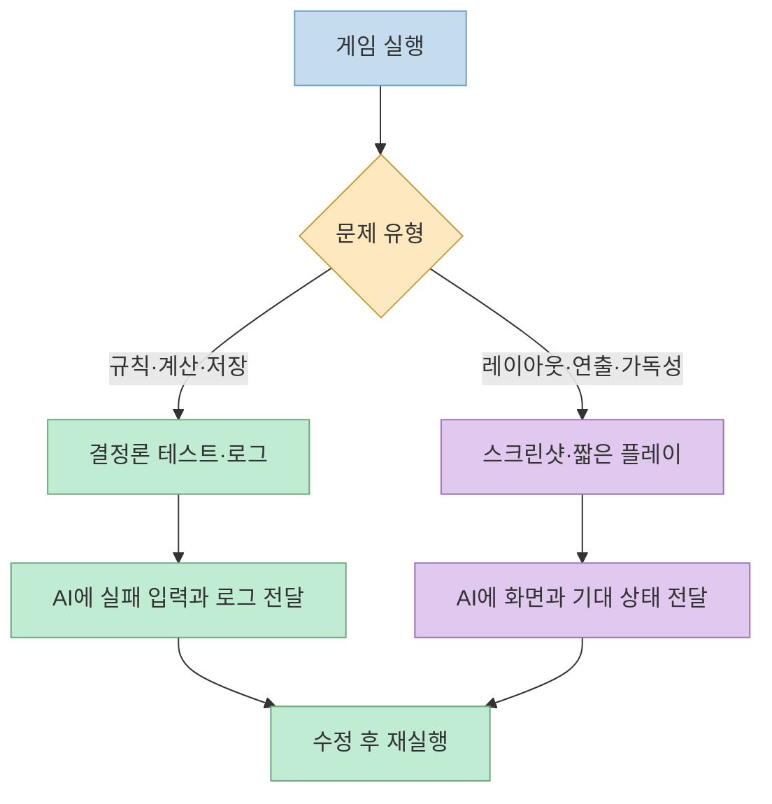
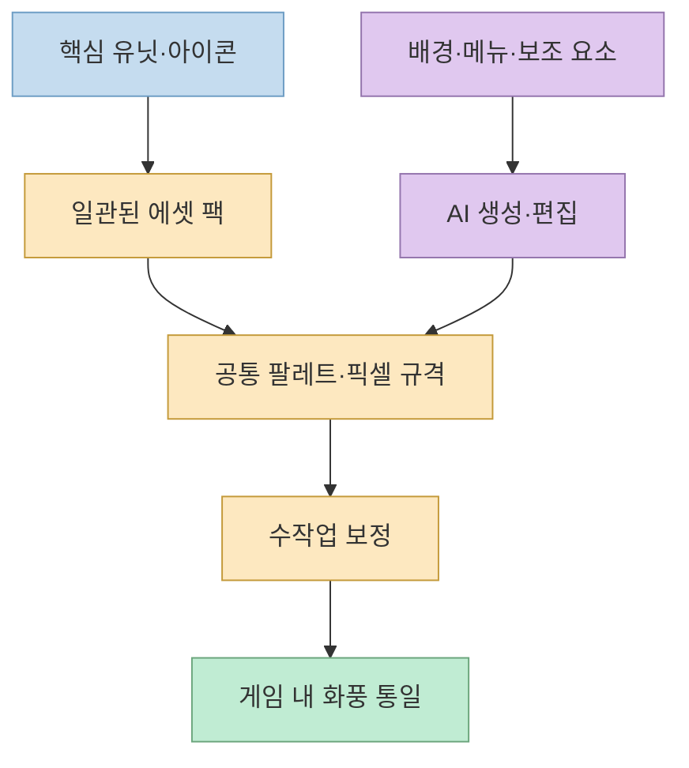
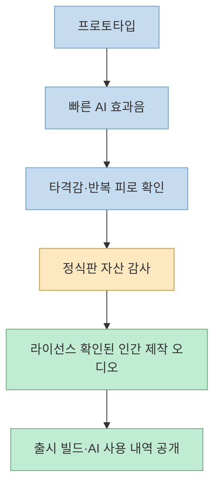
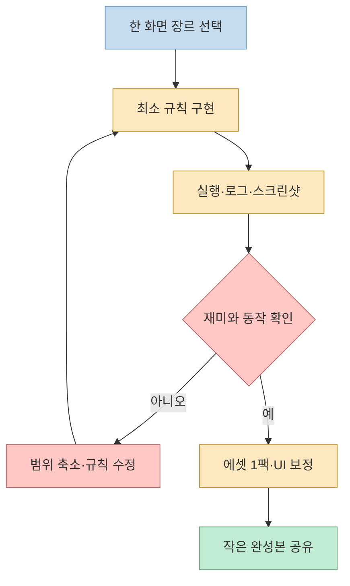

AI로 게임을 만든다는 말은 종종 “프롬프트 한 줄로 완성작을 만든다”는 뜻처럼 소비됩니다. 하지만 [TechTaek의 Slotbound 분석](https://techtaek.com/slotbound-solo-dev-ai-stack-love2d-guide/)이 보여주는 현실은 다릅니다. 가벼운 2D 엔진을 고르고, 코드는 AI로 빠르게 생성하되, 화면을 직접 실행하고 스크린샷으로 고치며, 아트와 오디오는 구매 에셋·AI·사람의 작업을 조합해 완성도를 맞추는 장기 루프에 가깝습니다.

<!--more-->

## 출처와 범위

- 원문: [TechTaek — 슬롯바운드 1인 개발 AI 스택 해부](https://techtaek.com/slotbound-solo-dev-ai-stack-love2d-guide/)
- 게임 정보: [Steam — Slotbound](https://store.steampowered.com/)
- 엔진: [LÖVE 공식 사이트](https://love2d.org/)
- 원문이 참고한 개발 일지: [Reddit r/aigamedev](https://www.reddit.com/r/aigamedev/)

원문은 개발자 인터뷰, Reddit 개발 일지, Steam 상점 정보를 종합한 사례 분석입니다. 따라서 “13개월”, 도구별 사용 방식, 초기와 정식판의 오디오 차이는 해당 사례의 기록으로 이해해야 하며 모든 1인 개발 프로젝트의 표준은 아닙니다.

## 사례에서 보이는 도구 분업

원문이 정리한 Slotbound의 스택은 한 가지 AI 서비스에 모든 일을 맡기지 않습니다. 게임 코드, 보조 추론, 배경·픽셀 아트, 후처리, 사운드를 서로 다른 도구와 사람의 판단으로 나눕니다.

여기서 중요한 패턴은 모델 이름의 나열이 아니라 **역할 분리**입니다. 한 모델이 특정 버그에서 반복해서 실패하면 다른 모델에게 로그와 현재 상태를 넘겨 두 번째 시각으로 검토하게 합니다. 다만 여러 유료 도구를 처음부터 동시에 구독해야 한다는 뜻은 아닙니다.

## 왜 LÖVE2D가 AI 코딩과 잘 맞는가

Unity와 Unreal은 강력하지만, 게임 상태가 코드 밖의 인스펙터, 씬 파일, 에디터 설정에 분산될 수 있습니다. 이 구조에서는 AI가 프로젝트를 텍스트만 읽고 수정하기 어렵고, 클릭 상태나 바이너리 변경을 놓칠 수 있습니다.

LÖVE2D는 Lua 코드와 파일 중심으로 2D 게임을 구성합니다. 간단한 프로젝트는 `main.lua`에서 시작할 수 있고, 실행 결과를 빠르게 확인한 뒤 다시 코드를 수정하는 루프를 만들기 쉽습니다. 이는 3D 오픈월드가 아니라 슬롯, 카드, 퍼즐, 오토배틀러처럼 한 화면 규칙이 명확한 장르에 특히 잘 맞습니다.

엔진이 가볍다는 이유만으로 좋은 게임이 자동으로 만들어지는 것은 아닙니다. 대신 AI가 읽고 고칠 수 있는 상태를 유지하기 쉽다는 점이 1인 개발의 반복 속도를 높입니다.

## 스크린샷 기반 디버깅은 테스트의 대체가 아니다

원문은 복잡한 테스트 프레임워크를 먼저 세우는 대신, 실행 중 발생한 오류 로그와 어긋난 화면을 AI에게 보여주는 방식을 강조합니다. UI 버튼이 왼쪽으로 밀렸거나 숫자가 테두리를 벗어난 문제는 설명만으로 재현하기 어렵지만, 스크린샷은 현재 상태를 한 번에 전달합니다.

그렇다고 스크린샷 루프가 자동화 테스트를 완전히 대체하는 것은 아닙니다. 점수 계산, 저장·불러오기, 확률 테이블, 적 생성처럼 규칙이 명확한 부분은 작은 단위 테스트나 결정론적 시나리오를 남겨야 합니다. 시각적 정렬과 연출은 스크린샷·플레이 확인으로 보완하는 식이 균형 잡힌 접근입니다.

## 아트는 ‘전부 AI 생성’보다 하이브리드가 현실적이다

모든 캐릭터와 아이콘을 각각 생성하면 선 굵기, 픽셀 크기, 팔레트, 명암 규칙이 쉽게 어긋납니다. 원문이 소개한 방식은 핵심 유닛과 아이콘을 하나의 구매 에셋 팩으로 묶고, 배경·메뉴·일부 NPC와 홍보 이미지만 AI 도구로 보충한 뒤 픽셀 규격을 맞추고 정식판에서 수작업으로 다듬는 전략입니다.

에셋 라이선스는 생성 품질만큼 중요합니다. itch.io의 무료·유료 팩도 상업 이용, 재배포, 크레딧 조건이 다를 수 있으므로 원본 라이선스를 기록하고 빌드에 포함되는 파일을 점검해야 합니다.

## 프로토타입 오디오와 정식판 오디오를 분리하기

원문은 초기 개발에서 AI 효과음을 사용해 빠르게 손맛을 확인하고, 정식판에서는 인간 제작 오디오로 정리한 사례를 소개합니다. 이 분리는 프로토타입의 속도와 출시물의 권리·신뢰 요구를 동시에 고려한 선택입니다.

Steam 출시를 준비한다면 플랫폼의 AI 생성 콘텐츠 공개 항목과 각 에셋의 상업 이용 조건을 확인해야 합니다. “AI를 썼다”는 사실 자체보다 어떤 파일을 어디에 사용했는지 추적 가능한 상태가 중요합니다.

## 1인 개발자가 재현할 수 있는 1주일 실험

Slotbound의 13개월 여정을 그대로 따라 하려 하지 말고, 다음처럼 범위를 줄이는 편이 좋습니다.

1. **한 화면 규칙을 고릅니다.** 슬롯, 카드, 퍼즐, 타워디펜스, 클릭 게임처럼 입력과 결과가 한 화면에서 끝나는 장르를 선택합니다.
2. **실행 가능한 최소판을 만듭니다.** AI에게 3×3 버튼, 랜덤 아이콘, 일치 조합 점수처럼 한 기능만 요청합니다.
3. **Git 커밋을 세이브포인트로 사용합니다.** 기능 하나가 실행되면 커밋하고, 다음 변경에서 실패해도 되돌릴 수 있게 합니다.
4. **에셋은 하나만 적용합니다.** 첫 주에는 무료 또는 적법한 픽셀 팩 하나만 사용하고 화풍을 늘리지 않습니다.
5. **로그와 스크린샷을 함께 남깁니다.** AI에게 “안 돼요” 대신 실패 입력, 오류 로그, 기대 화면을 전달합니다.

## AI가 대신하지 못하는 일

AI는 코드 생성과 에러 수정, 임시 에셋 제작을 빠르게 만들 수 있지만 다음 문제를 자동으로 해결하지는 않습니다.

- 10시간 플레이해도 반복이 지루하지 않은 밸런스
- 어떤 조합을 허용하고 금지할지에 대한 게임 디자인
- 입력 지연, 난이도 곡선, 보상 구조에 대한 실제 플레이 판단
- 에셋·오디오·모델의 상업 이용 권리
- Steam 상점 정보와 AI 생성 콘텐츠 공개의 정확성

따라서 AI 스택의 핵심은 자동 완성이 아니라, 개발자가 더 자주 플레이하고 더 작은 단위로 판단할 수 있게 만드는 것입니다.

## 핵심 요약

- Slotbound 사례의 핵심은 AI 한 방이 아니라 LÖVE2D, 코딩 에이전트, 구매 에셋, AI 아트, 수작업을 역할별로 나눈 운영입니다.
- LÖVE2D처럼 텍스트 파일 중심의 가벼운 엔진은 AI가 읽고 수정하고 즉시 실행하기 쉽습니다.
- 스크린샷 기반 디버깅은 시각 문제에 강하지만, 규칙·저장·확률 로직은 별도 테스트가 필요합니다.
- 핵심 아트는 일관된 에셋 팩으로 묶고, AI는 배경과 보조 요소에 제한적으로 쓰는 편이 화풍 통일에 유리합니다.
- 초기 프로토타입과 상용 출시물은 오디오·에셋 라이선스 기준을 다르게 관리해야 합니다.
- 처음부터 13개월짜리 게임을 목표로 하기보다 한 화면·한 규칙·한 에셋으로 첫 실행을 완성하는 것이 재현 가능한 시작점입니다.

## 결론

Slotbound 사례가 보여주는 것은 AI가 게임 개발을 없앤다는 이야기가 아닙니다. AI가 가장 잘 읽는 구조를 선택하고, 생성된 코드를 실행 결과와 스크린샷으로 계속 교정하며, 사람이 더 잘하는 디자인·밸런스·권리 검토에 시간을 쓰는 방식입니다. 오늘은 `main.lua`와 네모난 도형 하나로 시작해도 충분합니다. 작은 게임을 실행하고 커밋하는 순간부터, 아이디어는 이미 수정 가능한 프로젝트가 됩니다.
