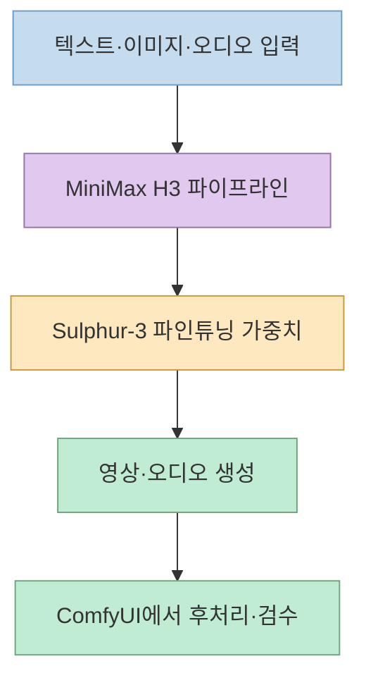
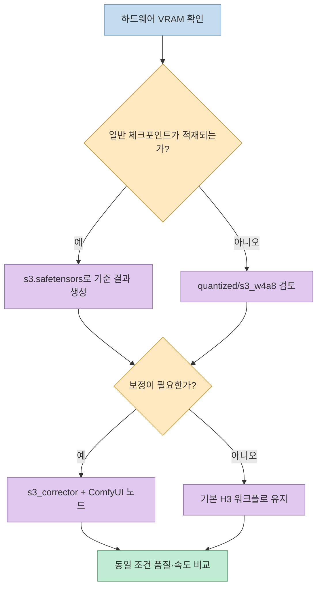
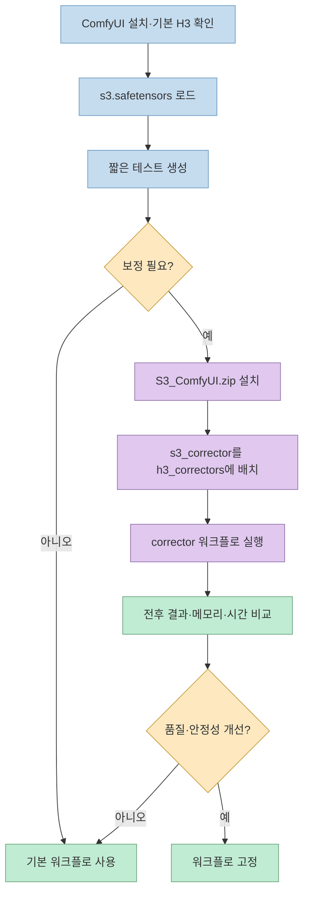
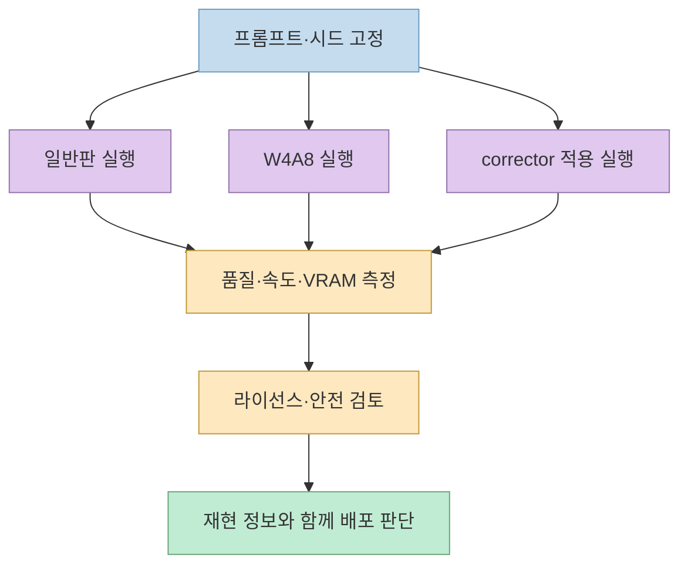

MiniMax H3 기반의 비검열 영상 생성 파인튜닝 모델 **Sulphur-3**가 공개되었습니다. X 게시물은 일반 체크포인트와 W4A8 양자화판, ComfyUI용 보정 노드와 워크플로를 안내하고 있고, Hugging Face 모델 카드는 `s3.safetensors`를 기본 실행 파일로, `quantized/` 아래에 낮은 VRAM용 선택지를 제공합니다. 이 글은 공개 파일을 어떻게 구분하고 ComfyUI에 연결할지, 그리고 “무검열”이라는 표현을 사용할 때 어떤 책임을 함께 고려해야 하는지 정리합니다.

<!--more-->

## Sources

- 원문 X 게시물: [mapte_fireball의 Sulphur-3 공개 안내](https://x.com/mapte_fireball/status/2124152041136422916?a=0l5OPoKI8iXcCBgi1bM&s=35)
- Sulphur-3 모델 카드: [SulphurAI/Sulphur-3](https://huggingface.co/SulphurAI/Sulphur-3)
- MiniMax H3 공식 모델 카드: [MiniMaxAI/MiniMax-H3](https://huggingface.co/MiniMaxAI/MiniMax-H3)
- MiniMax H3 공식 저장소: [Mini-Max-H3/MiniMax-H3](https://github.com/Mini-Max-H3/MiniMax-H3)

X 게시물의 본문은 2026년 11월 21일 작성되었으며, 일반판 40.2GB와 W4A8판 11.4GB라는 수치를 제시합니다. 이 글에서는 해당 용량을 게시물의 주장으로 표시하고, 파일의 역할과 라이선스는 Hugging Face 모델 카드로 교차 확인했습니다. 모델 저장소의 파일 구성과 용량은 업데이트될 수 있습니다.

## Sulphur-3는 무엇인가

Hugging Face 모델 카드는 Sulphur 3를 **MiniMax H3 기반의 비검열 영상 생성 모델**이라고 설명합니다. 모델 메타데이터의 base model도 `MiniMaxAI/MiniMax-H3`로 지정되어 있습니다. 따라서 완전히 새로운 영상 생성 아키텍처라기보다 H3의 입력·출력 파이프라인과 호환되는 파인튜닝 계열로 이해하는 것이 정확합니다. [Sulphur-3 모델 카드](https://huggingface.co/SulphurAI/Sulphur-3)

MiniMax H3 자체는 텍스트·이미지·비디오·오디오를 함께 다루는 멀티모달 시스템이며, 공식 카드에는 오디오가 포함된 4~15초 영상, 다양한 종횡비, 24FPS와 32kHz 스테레오 오디오 출력이 기재되어 있습니다. Sulphur-3가 이런 H3 기반 파이프라인에서 동작한다는 점은 확인되지만, Sulphur-3가 모든 H3 기능과 품질을 동일하게 보장한다는 뜻은 아닙니다. [MiniMax H3 공식 모델 카드](https://huggingface.co/MiniMaxAI/MiniMax-H3)



## 공개 파일을 어떻게 고를까

모델 카드가 안내하는 기본 선택은 `s3.safetensors`입니다. “일반 MiniMax H3 모델처럼 실행하면 된다”는 설명과 함께, 이 파일만으로 시작할 수 있다고 적혀 있습니다.

- **`s3.safetensors`**: 일반 실행을 위한 권장 체크포인트
- **`quantized/s3_w4a8.safetensors`**: 낮은 VRAM을 위한 W4A8 양자화 선택지
- **`quantized/s3_raw_w4a8.safetensors`·`s3_raw_int8.safetensors`**: raw 계열 양자화 파일
- **`s3_raw.safetensors`**: RL LoRA가 포함되지 않은 raw 변형
- **`s3_ref2va.safetensors`**: Ref2VA 변형이며 모델 카드가 학습되지 않은 변형으로 표시
- **`s3_corrector.safetensors`**: 선택형 보정기
- **`S3_ComfyUI.zip`**: corrector에 필요한 ComfyUI 노드와 워크플로

양자화는 파일 크기만 줄이는 옵션이 아니라 정밀도와 메모리 사용 방식이 달라지는 선택입니다. 먼저 하드웨어의 VRAM과 실행 가능한 워크플로를 확인하고, 품질 비교가 필요하면 같은 프롬프트·시드·프레임 조건으로 일반판과 양자화판을 측정하세요.



## ComfyUI에서 corrector를 사용하는 구조

모델 카드에 따르면 corrector는 **선택 사항**입니다. `s3`를 일반 MiniMax H3 모델처럼 실행한 뒤 문제가 없으면 보정기를 사용하지 않아도 됩니다. 사용하기로 했다면 `S3_ComfyUI.zip`에 포함된 노드와 워크플로를 설치하고, `s3_corrector.safetensors`를 다음 경로에 둡니다.

```text
ComfyUI/
└── models/
    └── h3_correctors/
        └── s3_corrector.safetensors
```

권장 적용 순서는 다음과 같습니다.

1. ComfyUI와 MiniMax H3용 기본 노드가 정상 실행되는지 먼저 확인합니다.
2. Hugging Face에서 `s3.safetensors`를 내려받아 일반 H3 워크플로로 짧은 샘플을 생성합니다.
3. 필요할 때만 `S3_ComfyUI.zip`의 노드와 워크플로를 추가합니다.
4. `s3_corrector.safetensors`를 `models/h3_correctors/`에 복사합니다.
5. 같은 입력으로 corrector 적용 전후를 비교하고, 결과가 좋아지는 경우에만 기본 워크플로로 채택합니다.



Corrector는 H3 계열의 다른 모델에도 동작할 수 있다고 모델 카드가 설명하지만, 모든 체크포인트에서 같은 효과를 보장한다고 해석하면 안 됩니다. 모델·노드·ComfyUI 버전을 기록하고, 오류가 발생하면 corrector를 제거한 최소 구성부터 다시 확인하세요.

## “무검열” 모델을 사용할 때의 책임

“비검열”은 모델이 특정 안전 필터를 기본으로 적용하지 않는다는 의미이지, 모든 출력이 합법적이거나 안전하다는 의미가 아닙니다. 공개 모델을 로컬에서 실행할 때도 다음을 지켜야 합니다.

- 실제 인물의 동의 없는 성적·사생활 침해 콘텐츠를 만들지 않습니다.
- 미성년자 성적 묘사, 폭력 선동, 명예훼손, 불법 복제 등 금지된 용도로 사용하지 않습니다.
- 공개·상업 배포 전에는 관할 지역의 법률과 플랫폼 정책을 확인합니다.
- 생성된 인물·장면이 실제 사건이나 사람으로 오인될 수 있으면 합성 콘텐츠임을 표시합니다.
- 팀 환경에서는 입력 프롬프트와 출력 파일 접근 권한을 제한하고, 민감한 자료를 외부 서비스에 업로드하지 않습니다.

모델 카드의 라이선스는 MiniMax H3 Community License를 따릅니다. Sulphur-3 저장소의 `LICENSE`와 기반 모델의 라이선스를 모두 읽고, 상업적 사용·재배포·콘텐츠 제한을 확인해야 합니다. “오픈 웨이트”라는 이유만으로 MIT나 완전 자유 라이선스로 간주하면 안 됩니다. [Sulphur-3 라이선스](https://huggingface.co/SulphurAI/Sulphur-3/blob/main/LICENSE) · [MiniMax H3 라이선스 안내](https://huggingface.co/MiniMaxAI/MiniMax-H3)

## 재현 가능한 테스트 방법

모델을 평가할 때는 “한 번 잘 나온 영상”보다 조건을 고정한 비교가 중요합니다.

1. 프롬프트와 부정 프롬프트를 파일로 저장합니다.
2. 해상도, 길이, FPS, 시드, 샘플러와 ComfyUI 커밋을 기록합니다.
3. 일반판·W4A8판·corrector 적용판을 같은 조건으로 실행합니다.
4. 생성 시간, peak VRAM, 프레임 누락, 오디오 동기화, 깜빡임을 기록합니다.
5. 최종 배포본에는 모델 버전과 라이선스, 사용한 외부 노드를 함께 적습니다.



## 핵심 요약

- Sulphur-3는 MiniMax H3 기반의 비검열 영상 생성 파인튜닝 모델입니다.
- 기본 시작점은 `s3.safetensors`이며, 낮은 VRAM에서는 `quantized/s3_w4a8.safetensors`를 검토할 수 있습니다.
- `s3_corrector.safetensors`와 `S3_ComfyUI.zip`은 선택형 보정 구성입니다.
- corrector는 `ComfyUI/models/h3_correctors/`에 배치하고, 적용 전후를 같은 조건으로 비교해야 합니다.
- X 게시물이 제시한 40.2GB·11.4GB는 게시물 수치이며, 저장소 파일과 버전이 바뀔 수 있습니다.
- MiniMax H3 Community License와 Sulphur-3 저장소의 라이선스를 함께 확인해야 합니다.
- 비검열 모델은 법률·플랫폼 정책·동의·개인정보 보호를 지키는 범위에서 사용해야 합니다.

## 결론

Sulphur-3의 실질적인 장점은 H3의 영상·오디오 생성 파이프라인을 유지하면서, 커뮤니티가 조정한 체크포인트와 ComfyUI 보정 흐름을 선택할 수 있다는 데 있습니다. 먼저 기본 `s3.safetensors`로 최소 워크플로를 검증하고, VRAM이 부족할 때 양자화판을 비교한 뒤, 필요할 때만 corrector를 추가하세요. 모델 버전·노드·라이선스·생성 조건을 기록하는 습관이 있어야 로컬 생성 결과를 안전하고 재현 가능하게 운영할 수 있습니다.
