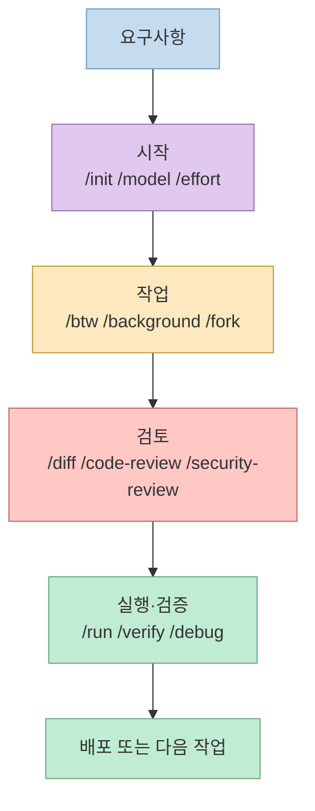

Claude Code를 오래 사용하면 모델을 바꾸거나 긴 대화를 줄이는 것보다 **언제 어떤 명령을 호출할지**가 결과 품질과 속도를 크게 좌우합니다. 이 글은 영상에서 소개한 공식 슬래시 명령어 20개를 작업 흐름에 맞춰 다시 배열하고, 현재 Claude Code 공식 문서와 대조해 실전 사용법을 정리한 안내서입니다.

<!--more-->

## Sources

- 원본 영상: [클로드 코드 할 때 무조건 알아야 할 명령어 20개](https://youtu.be/p2TgEi4Nf7A?si=hTSLN9AvNYvHx1U0)
- Claude Code 공식 문서: [Skills와 번들 명령](https://code.claude.com/docs/en/slash-commands)
- Claude Code 공식 문서: [모델과 effort 설정](https://code.claude.com/docs/en/model-config)
- Claude Code 공식 문서: [대화형 모드](https://code.claude.com/docs/en/interactive-mode)
- Claude Code 공식 문서: [서브에이전트와 병렬 작업](https://code.claude.com/docs/en/sub-agents)

영상의 한국어 자동 자막을 기준으로 명령어의 역할과 사용 순서를 정리했습니다. Claude Code는 빠르게 업데이트되므로 명령의 노출 여부, 별칭, 클라우드 기능은 설치 버전·계정·플랜에 따라 달라질 수 있습니다. 실제 사용 전에는 위 공식 문서의 현재 명령 목록을 확인하세요.

## 슬래시 명령어는 작업 단계의 인터페이스다

영상은 20개 명령을 네 그룹으로 나눕니다. 시작 전에 프로젝트와 모델을 설정하고, 작업 중에는 대화를 분기하거나 백그라운드로 보내며, 변경 후에는 diff·보안·코드 리뷰를 통과시키고, 마지막에는 실제 실행과 검증을 수행하는 구조입니다. [영상 0:57](https://youtu.be/p2TgEi4Nf7A?t=57)



명령어를 모두 외우기보다 “지금은 설정인가, 생산인가, 검수인가, 실행인가?”를 먼저 판단하면 됩니다. `/`로 시작하는 명령은 Claude Code 입력창에서 호출하고, 뒤에 인자를 붙여 대상이나 강도를 지정할 수 있습니다. 일부 명령은 기본 내장 명령이 아니라 번들 스킬이므로 설치 상태를 확인해야 합니다. [공식 문서](https://code.claude.com/docs/en/slash-commands)

## 1. 시작할 때: `/init` · `/model` · `/effort` · `/advisor` · `/context`

### `/init`: 프로젝트의 공통 기억 만들기

`/init`은 현재 폴더를 살펴보고 프로젝트 규칙과 실행 방법을 담은 `CLAUDE.md`를 만드는 출발점입니다. 이후 Claude Code가 세션을 시작할 때 이 파일을 읽으므로, 코딩 스타일·테스트 명령·금지 사항을 한 번 정리해 두면 반복 설명이 줄어듭니다. 영상은 `CLAUDE.md`를 너무 길게 만들지 말고 핵심 규칙 중심으로 유지하라고 권합니다. [영상 1:45](https://youtu.be/p2TgEi4Nf7A?t=105)

```text
/init
```

생성된 파일은 그대로 믿기보다 직접 검토하고, 팀이 지켜야 할 사실만 남기는 편이 안전합니다. 프로젝트 지식과 반복 절차가 커지면 스킬 파일로 분리하는 방식도 공식 문서가 권장합니다.

### `/model`: 작업에 맞는 모델 선택

`/model`은 현재 세션에서 사용할 모델을 고릅니다. 공식 문서의 별칭은 `opus`, `sonnet`, `haiku`, `fable`이며 `opusplan`처럼 계획에는 Opus, 실행에는 Sonnet을 쓰는 특수 모드도 있습니다. 별칭은 공급자와 시점에 따라 실제 모델 버전으로 해석됩니다. [영상 2:14](https://youtu.be/p2TgEi4Nf7A?t=134) · [모델 별칭 문서](https://code.claude.com/docs/en/model-config)

```text
/model opus
/model sonnet
```

복잡한 설계·디버깅은 상위 모델로, 반복적인 파일 수정과 간단한 변환은 빠른 모델로 나누면 비용과 응답 시간을 관리하기 쉽습니다. 다만 모델을 바꾸는 것만으로 품질이 보장되지는 않으므로 아래의 리뷰·검증 단계를 함께 사용해야 합니다.

### `/effort`: 생각의 깊이 조절

`/effort`는 모델이 추론에 사용할 노력 수준을 바꿉니다. 영상에서는 낮음부터 최대까지 다섯 단계로 설명하며, 일반 작업은 중간, 복잡한 버그는 높음, 보안처럼 어려운 분석은 최대를 고려하라고 안내합니다. 높은 수준은 더 느리고 사용량이 커질 수 있으며, 최대 수준은 현재 대화에만 적용될 수 있습니다. [영상 2:44](https://youtu.be/p2TgEi4Nf7A?t=164)

```text
/effort medium
/effort high
```

무조건 최고로 설정하기보다 먼저 중간 수준으로 실행하고, 실패 원인이 추론 부족인지 확인한 뒤 높이는 방식이 효율적입니다. 조직 정책이나 모델별 지원 범위에 따라 사용할 수 있는 값은 달라질 수 있습니다.

### `/advisor`: 두 번째 모델에게 조언 받기

`/advisor`는 현재 대화의 맥락을 다른 모델에 보여 주고 설계나 문제 해결에 대한 두 번째 의견을 받는 흐름입니다. 영상은 예를 들어 `... advisor opus`처럼 호출할 수 있다고 설명하며, 더 높은 등급의 모델을 지정해야 할 수 있고 추가 사용량이 발생하는 실험 기능이라고 말합니다. [영상 3:16](https://youtu.be/p2TgEi4Nf7A?t=196)

한 번에 결론을 위임하기보다 “이 설계의 위험 세 가지를 찾아 달라”처럼 검토 질문으로 쓰는 편이 좋습니다. 해당 명령의 실제 제공 여부는 버전·플랜을 확인하세요.

### `/context`: 컨텍스트 예산 확인

긴 세션에서는 대화가 길어져 중요한 파일과 결정이 묻힐 수 있습니다. `/context`는 컨텍스트 사용량을 보여 주고, 필요하면 `/compact`로 요약하거나 `/clear`로 새 세션을 시작하라는 신호를 줍니다. [영상 3:54](https://youtu.be/p2TgEi4Nf7A?t=234)

```mermaid
flowchart TD
    A[새 프로젝트] --> B[/init<br>CLAUDE.md]
    B --> C[/model<br>작업 난도 선택]
    C --> D[/effort<br>추론 강도]
    D --> E[/context<br>예산 확인]
    E --> F{컨텍스트가 충분한가?}
    F -->|예| G[작업 시작]
    F -->|아니오| H[/compact 또는 /clear]
    H --> G
    classDef startTone fill:#c5dcef,stroke:#6d9dc4,color:#333;
    classDef configTone fill:#e0c8ef,stroke:#9475ad,color:#333;
    classDef checkTone fill:#fde8c0,stroke:#c49a3a,color:#333;
    classDef resetTone fill:#ffc8c4,stroke:#b76b6b,color:#333;
    classDef okTone fill:#c0ecd3,stroke:#6ca67d,color:#333;
    class A startTone;
    class B,C,D configTone;
    class E,F checkTone;
    class G okTone;
    class H resetTone;
```

## 2. 작업 중: `/btw` · `/background` · `/fork` · `/tasks` · `/resume`

### `/btw`: 흐름을 끊지 않는 옆 질문

작업 중 확인하고 싶은 짧은 질문은 `/btw`로 보낼 수 있습니다. 영상 설명에 따르면 이 질문의 답변은 대화 기록에 본문으로 들어가지 않고, 새 파일을 읽거나 명령을 실행하지 않으며, 기존 대화에 있는 정보만 사용합니다. 따라서 진행 중인 구현을 바꾸지 않는 개념 확인에 적합합니다. [영상 4:31](https://youtu.be/p2TgEi4Nf7A?t=271)

### `/background`: 현재 세션을 뒤로 보내기

오래 걸리는 작업을 `/background` 또는 `/bg`로 보내면 터미널을 닫아도 세션이 계속 실행될 수 있습니다. 이후 `claude agents`나 `/tasks`로 상태를 확인합니다. [영상 5:01](https://youtu.be/p2TgEi4Nf7A?t=301)

### `/fork`: 같은 맥락에서 평행 실험

`/fork`는 현재 대화의 복사본을 만들어 원래 흐름과 별도로 작업합니다. 한 세션을 보내는 `/background`와 달리, “이 설계를 유지한 채 다른 접근도 시도”할 때 유용합니다. 파일 충돌이 예상되면 worktree 등 격리 방식을 명시적으로 선택해야 합니다. [영상 5:27](https://youtu.be/p2TgEi4Nf7A?t=327)

### `/tasks`와 `/resume`: 병렬 작업 관리

`/tasks`는 백그라운드 작업과 서브에이전트의 실행·완료 상태를 보여 줍니다. `/resume`은 이전 대화를 다시 열고, `/rename`과 함께 세션을 찾기 쉽게 관리하는 데 사용합니다. 공식 문서도 서브에이전트가 별도 컨텍스트에서 실행되며 주 대화로 요약을 돌려준다고 설명합니다. [영상 5:55](https://youtu.be/p2TgEi4Nf7A?t=355) · [서브에이전트 문서](https://code.claude.com/docs/en/sub-agents)

```mermaid
flowchart TD
    A[현재 세션] --> B{작업 전략}
    B -->|계속 진행| C[주 대화]
    B -->|시간이 오래 걸림| D[/background]
    B -->|대안도 실험| E[/fork]
    D --> F[/tasks<br>상태 확인]
    E --> F
    F --> G[/resume<br>완료 세션 재개]
    C --> H[결과 통합]
    G --> H
    classDef originTone fill:#c5dcef,stroke:#6d9dc4,color:#333;
    classDef choiceTone fill:#fde8c0,stroke:#c49a3a,color:#333;
    classDef parallelTone fill:#e0c8ef,stroke:#9475ad,color:#333;
    classDef manageTone fill:#ffc8c4,stroke:#b76b6b,color:#333;
    classDef resultTone fill:#c0ecd3,stroke:#6ca67d,color:#333;
    class A originTone;
    class B choiceTone;
    class C,D,E parallelTone;
    class F,G manageTone;
    class H resultTone;
```

병렬 작업은 무료로 무한히 늘어나는 기능이 아닙니다. 영상은 백그라운드 세션도 일반 대화처럼 구독 사용량을 소비하며, 동시에 많이 실행하면 한도가 빠르게 줄 수 있다고 경고합니다. [영상 11:40](https://youtu.be/p2TgEi4Nf7A?t=700)

## 3. 검토할 때: `/diff` · `/code-review` · `/security-review` · `/autofix-pr` · `/insights`

### `/diff`: 변경 범위부터 확인

`/diff`는 현재 작업 트리에서 무엇이 바뀌었는지 확인하는 가장 짧은 검수 단계입니다. 코드 리뷰를 요청하기 전에 파일 목록과 변경 줄을 먼저 확인하면, 에이전트가 건드린 범위를 빠르게 파악할 수 있습니다. [영상 6:42](https://youtu.be/p2TgEi4Nf7A?t=402)

### `/code-review`: 품질 리뷰

`/code-review` 또는 `/review`는 현재 변경 사항이나 PR을 대상으로 버그·유지보수성·테스트 누락을 찾는 리뷰 흐름입니다. 영상은 깊이 옵션과 `--fix`를 언급하지만, 자동 수정은 리뷰 결과를 확인한 뒤 제한된 범위에서 적용해야 합니다. [영상 7:00](https://youtu.be/p2TgEi4Nf7A?t=420)

### `/security-review`: 보안 관점만 따로 보기

기능 리뷰와 보안 리뷰를 분리하면 인증·권한·프롬프트 인젝션·민감 데이터 노출처럼 일반 코드 리뷰에서 놓치기 쉬운 위험을 별도로 확인할 수 있습니다. 원격 저장소와 브랜치 차이가 필요한 기능은 Git 설정과 권한을 먼저 확인하세요. [영상 7:27](https://youtu.be/p2TgEi4Nf7A?t=447)

### `/autofix-pr`: PR 피드백 자동 처리

`/autofix-pr`는 PR의 실패한 테스트나 리뷰 댓글을 감시하고 수정 세션을 실행하는 클라우드 기반 흐름으로 소개됩니다. 영상은 GitHub CLI와 클라우드 세션 권한이 필요하다고 설명하므로, 로컬에서 바로 동작한다고 가정하면 안 됩니다. [영상 7:49](https://youtu.be/p2TgEi4Nf7A?t=469)

### `/insights`: 사용 패턴을 데이터로 보기

`/insights`는 최근 대화 기록을 분석해 어떤 작업에서 시간이 많이 들었는지 HTML 보고서로 정리하는 명령입니다. 영상은 최대 200개의 읽지 않은 대화를 분석하고 `~/.claude/usage` 아래에 보고서를 만든다고 설명합니다. 대화에 민감 정보가 포함되어 있다면 분석 범위와 생성 파일을 먼저 확인하세요. [영상 8:11](https://youtu.be/p2TgEi4Nf7A?t=491)

```mermaid
flowchart TD
    A[코드 변경] --> B[/diff<br>범위 확인]
    B --> C[/code-review<br>품질·버그]
    C --> D[/security-review<br>보안 위험]
    D --> E{문제 발견?}
    E -->|예| F[/autofix-pr 또는 수동 수정]
    E -->|아니오| G[검증 단계]
    F --> B
    G --> H[/insights<br>작업 패턴 회고]
    classDef changeTone fill:#c5dcef,stroke:#6d9dc4,color:#333;
    classDef reviewTone fill:#fde8c0,stroke:#c49a3a,color:#333;
    classDef securityTone fill:#ffc8c4,stroke:#b76b6b,color:#333;
    classDef decisionTone fill:#e0c8ef,stroke:#9475ad,color:#333;
    classDef resultTone fill:#c0ecd3,stroke:#6ca67d,color:#333;
    class A changeTone;
    class B,C reviewTone;
    class D,F securityTone;
    class E decisionTone;
    class G,H resultTone;
```

## 4. 실행하고 검증할 때: `/run` · `/verify` · `/claude-in-chrome` · `/debug` · `/claude-api`

### `/run`과 `/verify`: “완료”를 실제 동작으로 증명

`/run`은 README나 `package.json`을 참고해 애플리케이션을 실행하고 실제 사용 흐름을 확인하는 명령으로 소개됩니다. `/verify`는 빌드·실행과 실제 동작을 확인해 테스트나 타입 검사만 통과한 상태와 구분합니다. [영상 8:54](https://youtu.be/p2TgEi4Nf7A?t=534)

둘의 차이는 **실행을 시작하는 단계**와 **요구사항이 실제로 충족됐는지 판정하는 단계**입니다. 데이터베이스·환경 변수처럼 로컬에서 재현하기 어려운 의존성이 있다면 검증 조건과 한계를 결과에 함께 기록해야 합니다.

### `/claude-in-chrome`: 실제 브라우저에서 확인

Chrome 연동이 켜져 있다면 페이지 이동·입력·콘솔 로그 확인처럼 실제 브라우저 상호작용을 수행할 수 있습니다. 영상은 확장 프로그램 또는 Chrome 통합 설정이 필요하다고 설명하므로, 브라우저 권한을 프로젝트 요구사항에 맞게 최소화하세요. [영상 9:37](https://youtu.be/p2TgEi4Nf7A?t=577)

### `/debug`: 재현 기록을 남기며 원인 추적

`/debug`는 호출 시점부터 실행 기록을 남기고, 이후 증상과 트레이스를 함께 읽어 원인을 좁히는 디버깅 흐름입니다. 설치·설정 자체가 의심되면 `/doctor`로 환경을 먼저 점검하는 것이 안전합니다. [영상 9:59](https://youtu.be/p2TgEi4Nf7A?t=599)

### `/claude-api`: API 프로젝트용 문서와 작업 흐름

Claude API를 사용하는 프로젝트에서는 `/claude-api`를 통해 공식 API·관리형 에이전트 문맥을 불러오고, 마이그레이션·비용 최적화·평가 생성 같은 하위 작업을 시작할 수 있다고 소개됩니다. API 키와 로그에는 민감 정보가 포함될 수 있으므로 실제 저장소에 남기지 않는 원칙은 그대로 지켜야 합니다. [영상 10:19](https://youtu.be/p2TgEi4Nf7A?t=619)

```mermaid
flowchart TD
    A[코드 작성] --> B[/run<br>앱 실행]
    B --> C[/claude-in-chrome<br>브라우저 상호작용]
    C --> D{문제 재현?}
    D -->|예| E[/debug<br>트레이스 분석]
    D -->|아니오| F[/verify<br>요구사항 검증]
    E --> B
    F --> G[검증 결과 기록]
    G --> H[/claude-api<br>API 프로젝트 후속 작업]
    classDef buildTone fill:#c5dcef,stroke:#6d9dc4,color:#333;
    classDef runTone fill:#fde8c0,stroke:#c49a3a,color:#333;
    classDef debugTone fill:#ffc8c4,stroke:#b76b6b,color:#333;
    classDef decisionTone fill:#e0c8ef,stroke:#9475ad,color:#333;
    classDef resultTone fill:#c0ecd3,stroke:#6ca67d,color:#333;
    class A buildTone;
    class B,C runTone;
    class D decisionTone;
    class E debugTone;
    class F,G,H resultTone;
```

## 초보자는 네 단계만 먼저 익히면 된다

영상이 제안하는 최소 학습 순서는 `/init` → `/run` → `/code-review` → `/verify`입니다. 프로젝트 규칙을 만들고, 실제로 실행하고, 변경을 리뷰하고, 요구사항을 검증하는 흐름이므로 명령어 전체를 외우기 전에 이 네 단계를 반복하는 편이 좋습니다. [영상 10:53](https://youtu.be/p2TgEi4Nf7A?t=653)

```mermaid
flowchart TD
    A[/init<br>프로젝트 규칙 생성] --> B[/run<br>실제 실행]
    B --> C[/code-review<br>변경 검토]
    C --> D[/verify<br>동작 증명]
    D --> E{통과했는가?}
    E -->|아니오| F[수정 후 다시 실행]
    F --> B
    E -->|예| G[PR·배포 준비]
    classDef setupTone fill:#c5dcef,stroke:#6d9dc4,color:#333;
    classDef executeTone fill:#fde8c0,stroke:#c49a3a,color:#333;
    classDef reviewTone fill:#e0c8ef,stroke:#9475ad,color:#333;
    classDef verifyTone fill:#ffc8c4,stroke:#b76b6b,color:#333;
    classDef decisionTone fill:#f5d6a6,stroke:#c49a3a,color:#333;
    classDef resultTone fill:#c0ecd3,stroke:#6ca67d,color:#333;
    class A setupTone;
    class B executeTone;
    class C reviewTone;
    class D,F verifyTone;
    class E decisionTone;
    class G resultTone;
```

## 핵심 요약

- **프로젝트 시작**: `/init`으로 `CLAUDE.md`를 만들고, `/model`과 `/effort`로 작업 난도에 맞게 설정합니다.
- **긴 작업 관리**: `/btw`는 옆 질문, `/background`는 현재 세션 보내기, `/fork`는 독립적인 대안 실험입니다.
- **검토**: `/diff`로 범위를 확인한 뒤 `/code-review`와 `/security-review`를 분리해 실행합니다.
- **실행 증명**: `/run`으로 앱을 실제 실행하고 `/verify`로 요구사항 충족 여부를 판정합니다.
- **비용과 권한**: 병렬 세션·높은 effort·클라우드 자동 수정은 사용량과 권한을 늘릴 수 있으므로 필요한 순간에만 사용합니다.
- **버전 확인**: `/advisor`, `/autofix-pr`, `/insights`, `/claude-api`처럼 번들 스킬 성격이 강한 명령은 현재 설치 버전과 플랜에서 제공되는지 먼저 확인합니다.

## 결론

Claude Code의 슬래시 명령어는 단축키 모음이 아니라 **컨텍스트를 준비하고, 일을 분리하고, 결과를 검토하고, 실제로 증명하는 품질 루프**입니다. 처음에는 `/init`·`/run`·`/code-review`·`/verify`만 반복하고, 작업이 길어질 때 `/context`, 병렬성이 필요할 때 `/background`와 `/fork`, 보안 위험이 있을 때 `/security-review`를 추가하면 됩니다. 마지막으로 “코드가 작성됐다”와 “사용자 시나리오가 동작한다”를 구분하는 습관이, 모델 선택보다 재현 가능한 결과를 만드는 데 더 중요합니다.
