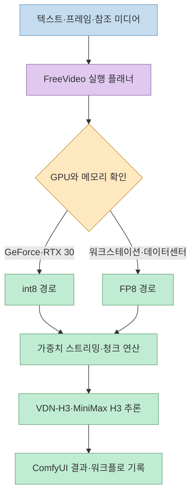
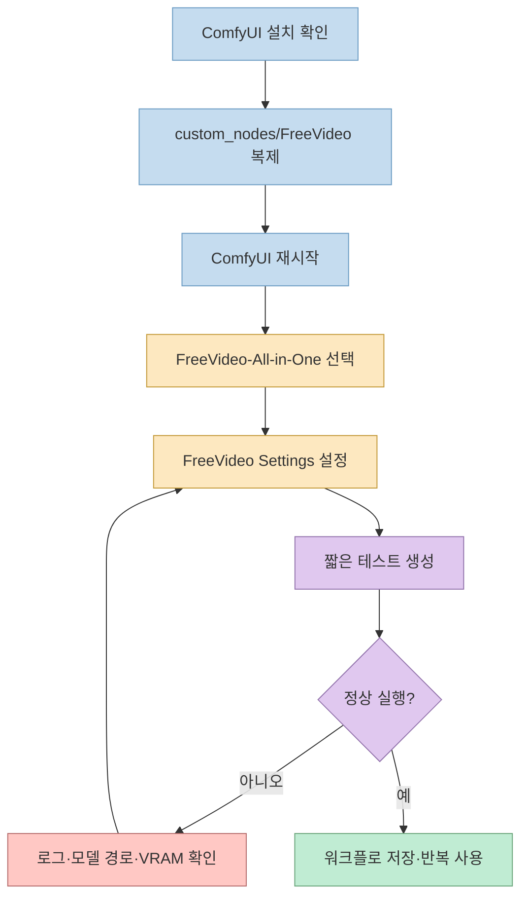
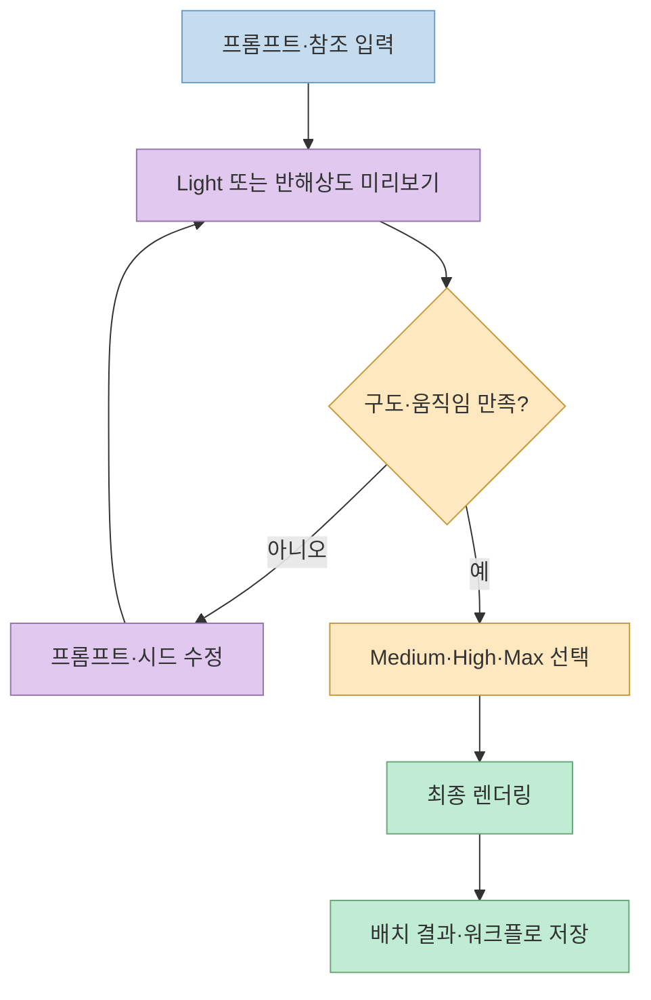
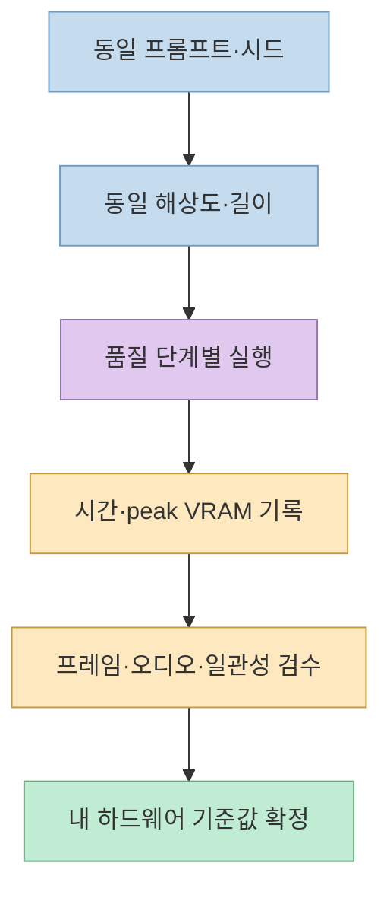

영상 생성 AI를 사용하려면 보통 크레딧을 결제하거나 원격 GPU를 빌려야 합니다. **FreeVideo**는 이미 가지고 있는 컴퓨터에서 MiniMax H3를 실행하는 로컬 추론 엔진으로, 공식 README는 최소 8GB VRAM과 16GB RAM 구성을 목표로 삼습니다. 가중치 스트리밍과 청크 단위 연산으로 메모리 사용량을 낮추고, ComfyUI 안에서 미리보기·배치 생성·LoRA·타임라인 편집을 연결하는 것이 핵심입니다. [원문 Threads 게시물](https://www.threads.com/share/_pH9XgU_T)

<!--more-->

## Sources

- 원문 Threads 게시물: [think.5x의 FreeVideo 소개](https://www.threads.com/share/_pH9XgU_T)
- 공식 저장소: [FlashML-org/FreeVideo](https://github.com/FlashML-org/FreeVideo)
- 설치·실행 안내: [FreeVideo README](https://github.com/FlashML-org/FreeVideo/blob/main/README.md)
- 기반 모델: [MiniMaxAI/MiniMax-H3](https://huggingface.co/MiniMaxAI/MiniMax-H3)
- 기반 기술: [Video DeltaNet](https://openvdn.github.io/)

Threads 게시물은 VRAM 8GB·RAM 16GB, RTX 3090에서 5초 영상 약 2.3배 속도 향상, Windows/macOS/Linux 배포판, Claude Code·Codex 연동을 소개합니다. 설치 명령과 기능 설명은 공식 README로 확인했으며, 성능 수치는 하드웨어·버전·품질 설정에 따라 달라지는 프로젝트 측정값으로 보아야 합니다.

## FreeVideo의 핵심 구조

FreeVideo는 MiniMax H3를 다시 학습한 모델이 아니라, OpenVDN의 8-step VDN-H3 모델과 Video DeltaNet의 하이브리드 어텐션을 이용하는 **로컬 추론 엔진**입니다. 실행 중 VRAM·시스템 메모리·디스크에 가중치를 나눠 배치하고, GPU에 맞는 정밀도와 어텐션 커널을 선택합니다. [공식 README](https://github.com/FlashML-org/FreeVideo#about)

공식 README는 GeForce와 RTX 30 시리즈에는 int8 경로를, 워크스테이션·데이터센터 GPU에는 FP8 경로를 선택한다고 설명합니다. 가중치 스트리밍, 비동기 프리페치, 청크 연산이 함께 작동하므로 “8GB에서 실행 가능”은 모델 전체를 8GB VRAM에 한 번에 올린다는 뜻이 아니라 메모리 계층을 나눠 실행한다는 뜻입니다.



## 설치 방법

### Windows

공식 README는 `FreeVideo.exe`를 내려받아 실행한 뒤 기존 ComfyUI 폴더를 선택하거나 새로 설치하도록 안내합니다. 기존 모델 폴더를 연결하면 재사용할 수 있고, 누락된 모델은 런처가 내려받습니다.

1. 릴리스에서 `FreeVideo.exe`를 내려받습니다.
2. 기존 ComfyUI를 선택하거나 새 설치를 선택합니다.
3. **Install & launch**를 눌러 브라우저에서 FreeVideo 워크스페이스를 엽니다.

보안 소프트웨어가 실행 파일을 격리하면 릴리스 페이지의 SHA-256 값을 먼저 비교하세요. 출처가 불명확한 실행 파일을 예외 처리해서는 안 됩니다.

### macOS Apple Silicon

macOS 배포판은 Apple Silicon 프리뷰입니다. `FreeVideo-Mac-arm64.dmg`를 열어 애플리케이션 폴더로 옮긴 뒤 ComfyUI 폴더를 선택하고 설치를 시작합니다. 공식 README는 M5·통합 메모리 24GB 환경에서 테스트했다고 밝히며, 아직 Apple 공증이 되지 않아 첫 실행 때 보안 경고가 나타날 수 있다고 안내합니다. 공식 Releases에서 받은 파일인지 확인하세요.

### Linux

데스크톱에서는 `FreeVideo-Linux-x86_64.AppImage`를 내려받아 실행할 수 있습니다. 서버나 터미널 환경에서는 다음 흐름을 사용합니다.

```bash
git clone https://github.com/FlashML-org/FreeVideo.git
cd FreeVideo
./setup.sh
```

설치 후 `freevideo`로 다시 열 수 있고, 서버에서 LAN 링크를 만들 때는 README의 `freevideo server --listen 0.0.0.0` 옵션을 사용할 수 있습니다. 외부 네트워크에 노출할 경우 인증·방화벽 정책을 별도로 구성해야 합니다. [설치 안내](https://github.com/FlashML-org/FreeVideo/blob/main/README.md#getting-started)

## 기존 ComfyUI에 연결하기

이미 ComfyUI를 사용 중이라면 저장소를 `custom_nodes` 아래에 복제하고 ComfyUI를 재시작합니다.

```bash
cd ComfyUI/custom_nodes
git clone https://github.com/FlashML-org/FreeVideo.git
```

그 다음 **Workflow → Browse Templates → FreeVideo → FreeVideo-All-in-One**을 열고 FreeVideo Settings에서 설정을 완료합니다. 업데이트는 해당 디렉터리에서 `git pull`을 실행하거나 ComfyUI-Manager를 사용한 뒤 다시 시작합니다.



## 저메모리 추론을 활용하는 법

FreeVideo는 반해상도 미리보기, Light·Medium·High·Max 품질 단계, 배치 생성, 두 단계 샘플링, 이미지·비디오·오디오 참조, H3 LoRA를 제공합니다. 처음부터 Max 품질로 긴 영상을 만들기보다, 미리보기로 후보를 고른 뒤 선택한 결과만 고품질로 렌더링하는 편이 효율적입니다.



## Claude Code·Codex와 타임라인 편집

공식 README의 릴리스 기록에 따르면 v0.4.0부터 Claude Code나 Codex 같은 AI 에이전트가 영상을 직접 만들 수 있고, 1분을 넘는 영상과 타임라인 편집 보기를 지원합니다. 이는 에이전트가 프롬프트를 작성하는 수준을 넘어 생성·선택·편집 작업을 하나의 로컬 프로젝트 흐름으로 묶을 수 있다는 뜻입니다. 다만 에이전트가 만든 결과도 실제 프레임·음량·저작권을 사람이 검수해야 합니다. [v0.4.0 릴리스 기록](https://github.com/FlashML-org/FreeVideo#news)

추천 루프는 다음과 같습니다.

1. 에이전트에게 길이, 화면 비율, 장면 목록과 금지 요소를 명시합니다.
2. 짧은 미리보기와 낮은 품질 단계로 후보를 생성합니다.
3. 타임라인에서 장면 순서와 길이를 편집합니다.
4. 선택한 장면만 High 또는 Max 품질로 다시 렌더링합니다.
5. 프롬프트, 시드, GPU, FreeVideo 버전을 결과물과 함께 보관합니다.

## 라이선스와 안전한 사용

FreeVideo의 **코드**는 Apache License 2.0으로 공개되어 있지만, README는 **모델 가중치**가 MiniMax H3 Community License를 따른다고 명시합니다. 이 라이선스에는 지역 제한과 허용 가능한 사용 제한이 포함되므로 코드 라이선스만 보고 상업적 사용이 자유롭다고 판단하면 안 됩니다. [공식 라이선스 안내](https://github.com/FlashML-org/FreeVideo#license)

MiniMax H3는 사람·음성·참조 영상을 입력으로 받을 수 있는 멀티모달 모델입니다. 타인의 얼굴·음성·저작물을 동의 없이 사용하지 말고, 실제 인물로 오인될 수 있는 결과를 공개할 때는 합성 콘텐츠임을 표시하세요. 로컬 실행은 외부 API로 데이터를 보내지 않을 수 있지만, 입력 파일·캐시·생성물의 디스크 권한까지 자동으로 안전해지는 것은 아닙니다.

## 성능 측정 기준

Threads 게시물의 “RTX 3090에서 5초 영상 2.3배”는 특정 버전과 조건에 대한 수치입니다. 내 환경에서는 GPU·드라이버·VRAM, RAM·디스크, FreeVideo·ComfyUI 커밋, 품질 단계·해상도·시드를 고정하고 생성 시간·peak VRAM·프레임 누락·오디오 동기화를 기록해야 합니다.



## 핵심 요약

- FreeVideo는 MiniMax H3를 소비자 GPU에서 실행하기 위한 로컬 추론 엔진이자 ComfyUI 플러그인입니다.
- 공식 README는 최소 8GB VRAM·16GB RAM, 하드웨어별 int8/FP8 경로, 가중치 스트리밍과 청크 연산을 안내합니다.
- Windows 실행 파일, Apple Silicon macOS 프리뷰, Linux AppImage·터미널 설치를 제공합니다.
- 기존 ComfyUI에서는 `custom_nodes/FreeVideo`에 복제한 뒤 `FreeVideo-All-in-One` 템플릿을 선택합니다.
- 미리보기와 품질 단계로 렌더링 비용을 줄이고, 선택한 결과만 고품질로 완성할 수 있습니다.
- v0.4.0부터 Claude Code·Codex 에이전트, 1분 이상 영상, 타임라인 편집을 지원합니다.
- 코드 Apache-2.0과 모델 가중치 MiniMax H3 Community License는 별개이므로 상업적 사용 전에 두 라이선스를 모두 확인해야 합니다.

## 결론

FreeVideo가 바꾸는 지점은 “고성능 GPU가 있어야만 로컬 영상 생성이 가능하다”는 전제입니다. 메모리 계층화와 하드웨어 적응형 실행으로 기존 PC를 ComfyUI 기반 제작 환경으로 활용하고, 미리보기와 에이전트·타임라인 기능으로 반복 비용을 줄입니다. 다만 8GB 실행 가능이라는 문구를 고품질·고속 렌더링 보장으로 해석하지 말고, 내 GPU와 품질 단계에서 직접 측정하세요. 코드와 모델의 라이선스를 분리해 검토하는 것까지가 로컬 생성 워크플로의 일부입니다.
