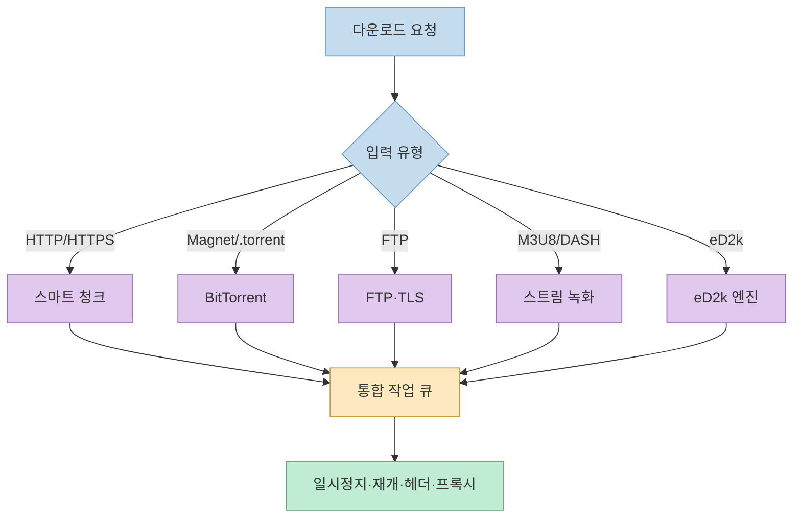
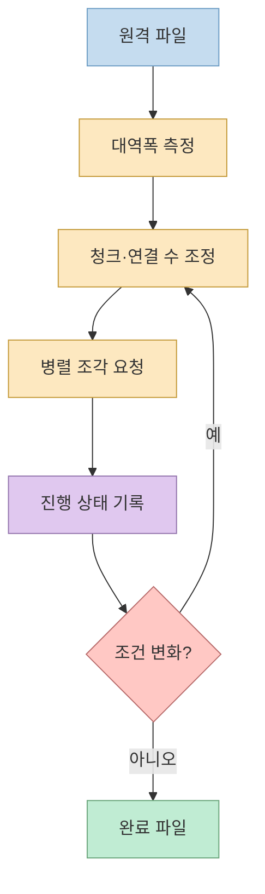
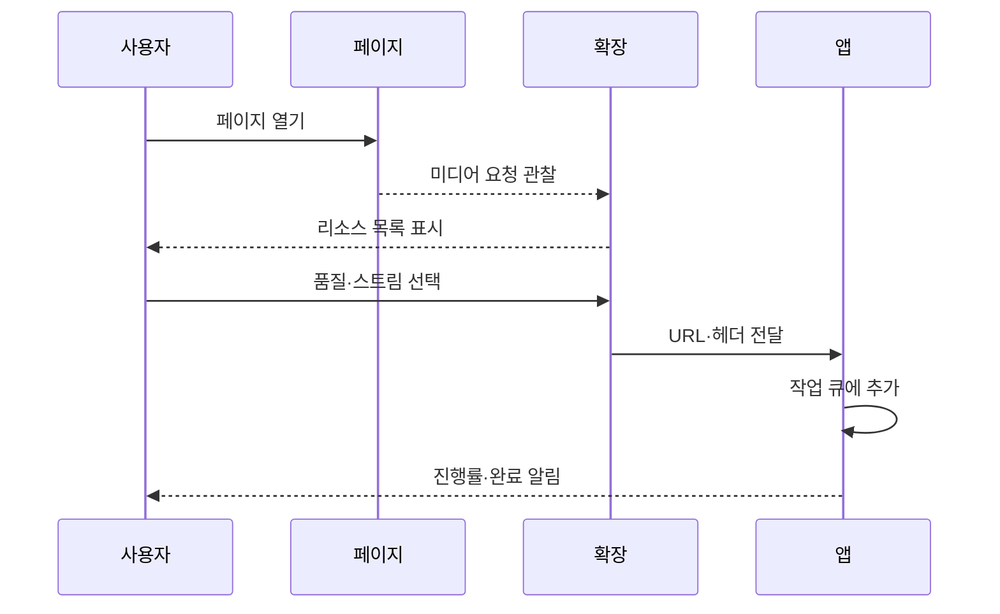
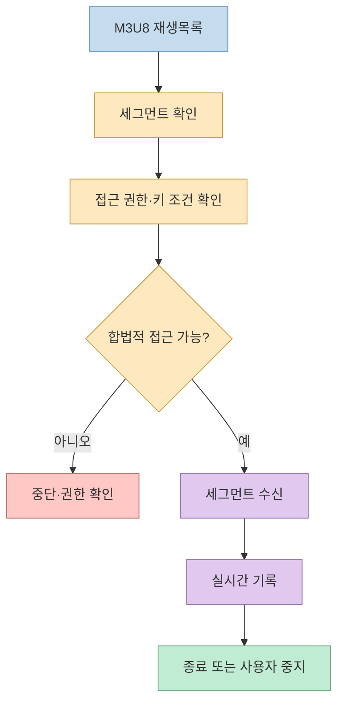
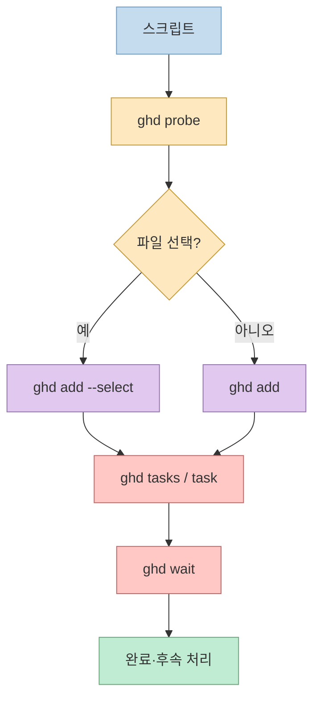

다운로드 도구를 여러 개 설치하면 파일은 받을 수 있어도 작업 흐름이 끊깁니다. Ghost Downloader는 HTTP·BitTorrent·FTP·HLS·MPEG-DASH·eD2k를 하나의 앱과 브라우저 확장으로 묶어 같은 작업 목록에서 다루려는 오픈 소스 프로젝트입니다.

<!--more-->

## Sources

- 공식 웹사이트: [Ghost Downloader](https://gd.xychr.com/)
- 공식 저장소: [XiaoYouChR/Ghost-Downloader-3](https://github.com/XiaoYouChR/Ghost-Downloader-3)
- 공식 문서: [기능 및 설치 가이드](https://gd.xychr.com/docs/)
- 공식 벤치마크: [Benchmark Data](https://gd.xychr.com/docs/benchmark/)

이 글은 공식 사이트와 저장소의 설명을 바탕으로 작성했습니다. 속도 수치는 단일 장비·단일 실행 결과이므로 네트워크·서버·연결 수에 따라 달라집니다. 저작권·서비스 약관·접근 권한을 우회하기 위한 도구로 사용해서는 안 되며, 합법적으로 접근 가능한 콘텐츠만 내려받아야 합니다.

## Ghost Downloader가 해결하려는 문제

핵심은 “가장 빠른 단일 앱”보다 **프로토콜별 도구를 하나의 작업 큐로 통합하는 것**입니다. 공식 사이트는 일반 파일, 토렌트, FTP, 라이브 스트림, 영상 파서, 모바일 백그라운드 다운로드를 한 앱에서 제공한다고 설명합니다. 저장소 README는 HTTP, Magnet/BT, FTP, M3U8, MPEG-DASH, eD2k와 YouTube·Bilibili·GitHub·HuggingFace 특화 기능을 함께 제시합니다.



모든 사이트에서 무조건 성공한다는 뜻은 아닙니다. DRM, 로그인 정책, 서버의 안티봇 규칙에 따라 결과가 달라질 수 있습니다. 브라우저 쿠키와 헤더를 데스크톱 앱으로 넘기는 기능도 사용자가 해당 콘텐츠를 받을 권리가 있는지와는 별개의 문제입니다.

## 속도보다 중요한 설계: 청크와 연결 상태

공식 사이트는 스마트 청킹과 파일 병합 단계를 줄이는 방식을 핵심 성능 요소로 소개합니다. 저장소 README는 대역폭 자동 감지, 브라우저와 비슷한 TLS 지문, 다운로드 중 URL·헤더·프록시 변경, 진행 상태 보존을 함께 설명합니다. 단순히 연결 수를 늘리는 도구라기보다 서버 조건에 맞춰 작업 상태를 조정하는 엔진에 가깝습니다.



### 공식 벤치마크를 읽는 법

공식 문서의 2026년 7월 30일 벤치마크는 Windows 11, 1Gbps IPv6 회선, 각 항목 1회 실행 조건에서 Ghost Downloader 4.2.2와 IDM·Motrix Next·Gopeed를 비교했습니다. 6개 파일을 모두 완료하고 5개에서 가장 빨랐다고 기록되어 있지만, OneDrive 항목은 Ghost Downloader와 Motrix Next가 128개 연결을 사용해 다른 도구의 32개 연결과 조건이 달랐습니다. 문서도 표본이 작고 시간·라우팅에 민감하다고 명시합니다.

따라서 “내 회선에서도 2.9배 빠르다”는 보장이 아니라 제한된 조건에서 청킹·연결 정책이 유리하게 작동한 사례로 읽어야 합니다. 실제 도입 전에는 자주 쓰는 호스트와 동일한 연결 수·속도 제한 조건으로 직접 비교하세요.

## 브라우저 확장: 링크 복사 대신 리소스 스니핑

브라우저 확장은 페이지를 감시해 동영상·오디오·이미지·HLS·DASH 리소스를 찾고 선택한 항목을 데스크톱 앱에 넘깁니다. 공식 사이트의 흐름은 영상 위 다운로드 버튼, 확장 팝업의 리소스 목록, 데스크톱 앱으로의 작업 전달입니다.

브라우저의 쿠키와 헤더가 함께 전달될 수 있어 로그인 상태가 필요한 합법적 다운로드에서는 링크 복사가 줄어듭니다. 반대로 쿠키 전달은 민감한 인증 정보와 직접 연결되므로 확장을 설치할 브라우저 프로필과 권한을 신중히 선택해야 합니다.



공식 브라우저 인계 테스트는 네 사이트를 한 번씩 확인해 4/4 성공했다고 기록하지만 표본이 작고 사이트 정책은 변할 수 있습니다. 이를 모든 웹사이트의 보호를 해제하는 기능으로 해석해서는 안 됩니다.

## HLS·M3U8 라이브 스트림 녹화

M3U8은 짧은 미디어 세그먼트 목록을 가리키는 경우가 많습니다. Ghost Downloader는 데스크톱과 Android에서 라이브 M3U8을 실시간 처리하고, 공식 사이트는 복호화가 필요한 스트림도 실시간으로 기록한다고 설명합니다. 실제 성공 여부는 키 제공 방식, DRM 사용 여부, 서비스 약관에 따라 달라집니다.



YouTube·Bilibili 파서는 클립 범위, 여러 화질, 4K HDR, 자막, 재생목록, 다중 에피소드 처리를 목표로 합니다. 사이트별 포맷과 정책이 다르므로 “지원”은 특정 시점의 정상 동작이며 영구적인 호환성 보장은 아닙니다.

## 크로스 플랫폼과 CLI 자동화

공식 저장소는 Windows 10 이상, macOS 13 이상, Linux glibc 2.35 이상, Android 9 이상을 대상으로 하며 데스크톱 x86_64와 arm64를 지원한다고 표기합니다. 공식 사이트의 배포 형식은 Windows EXE/ZIP, macOS 패키지, Linux AppImage·Deb·Tar.xz, Android APK입니다.

설정에서 `ghd` 명령줄 도구를 설치하면 GUI 밖에서도 작업을 자동화할 수 있습니다.

```bash
ghd probe "https://example.com/a.torrent"
ghd add "https://example.com/a.torrent" --select 0,3 -o ./downloads
ghd tasks
ghd task tsk_0123
ghd wait tsk_0123
```

CLI는 반복 다운로드, 특정 토렌트 파일 선택, 완료 대기를 스크립트에 넣을 때 유용합니다. URL·토큰·쿠키를 셸 히스토리나 CI 로그에 남기지 않도록 환경 변수와 권한을 관리해야 합니다.



## 도입 전에 확인할 것

### 법적·윤리적 사용 범위

기술적으로 다운로드 가능하다는 사실과 다운로드 권리가 있다는 사실은 다릅니다. 공개 라이선스 파일, 직접 소유한 미디어, 서비스가 명시적으로 허용한 저장 기능처럼 권한이 분명한 대상만 처리해야 합니다.

### 인증 정보와 브라우저 권한

확장은 네트워크 요청과 인증 헤더를 볼 수 있어야 하므로 권한 범위가 넓습니다. 업무용·개인용 브라우저 프로필을 분리하고, 사용하지 않을 때 확장을 비활성화하며, 로그에 토큰이 남지 않는지 확인하세요.

### 오픈 소스와 업데이트

저장소는 GPL-3.0 라이선스로 공개되어 있고 Python·PySide6·Qt 기반 구성과 브라우저 확장 코드를 함께 관리합니다. 설치할 때는 공식 릴리스와 체크섬·서명 여부를 확인하고 출처가 불분명한 재패키징 파일은 피하세요.

## 핵심 요약

- HTTP/HTTPS, BitTorrent, FTP, M3U8, MPEG-DASH, eD2k를 하나의 작업 큐로 통합합니다.
- 브라우저 확장은 페이지 리소스를 감지해 데스크톱 앱으로 넘기며, 합법적 다운로드의 링크 복사를 줄입니다.
- YouTube·Bilibili 파서, 라이브 M3U8 녹화, GitHub·HuggingFace 미러 가속, Android 백그라운드 다운로드를 제공합니다.
- 공식 벤치마크는 유망하지만 표본과 조건이 제한적이므로 개인 환경에서 재현 테스트해야 합니다.
- 인증 정보와 저작권을 다루는 도구인 만큼 브라우저 권한·로그·서비스 약관을 먼저 확인해야 합니다.

## 결론

Ghost Downloader의 매력은 속도 하나보다, 브라우저에서 발견한 리소스부터 토렌트·FTP·라이브 스트림까지 **서로 다른 입력을 같은 작업 모델로 처리하는 통합성**에 있습니다. 여러 도구를 오가는 사람이 많다면 공식 릴리스로 허용된 미디어를 먼저 시험하고, 브라우저 권한과 벤치마크 조건을 검증한 뒤 도입하는 것이 안전합니다.
