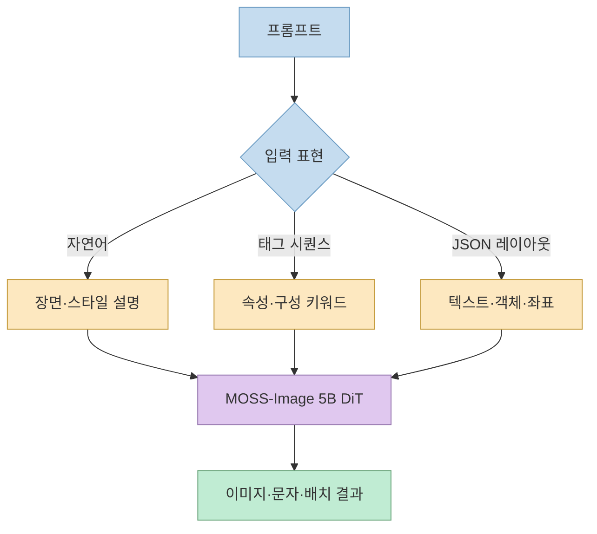
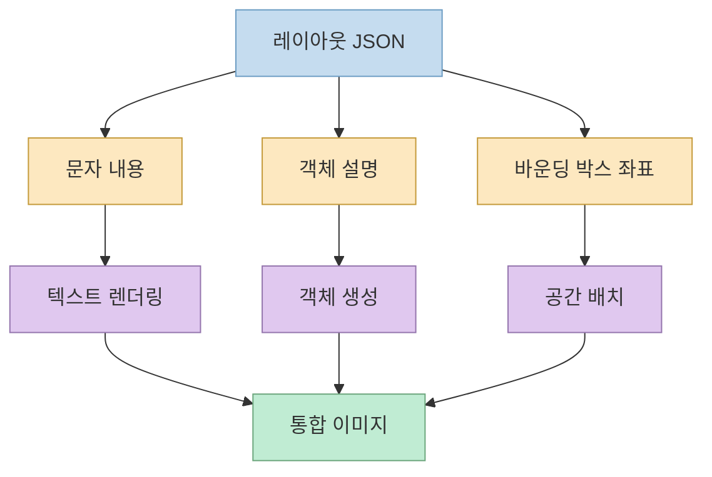
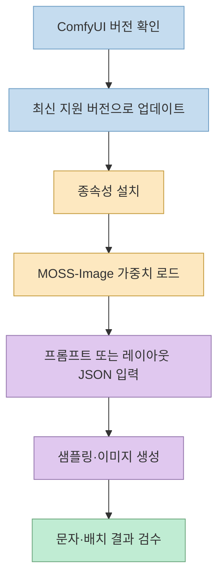
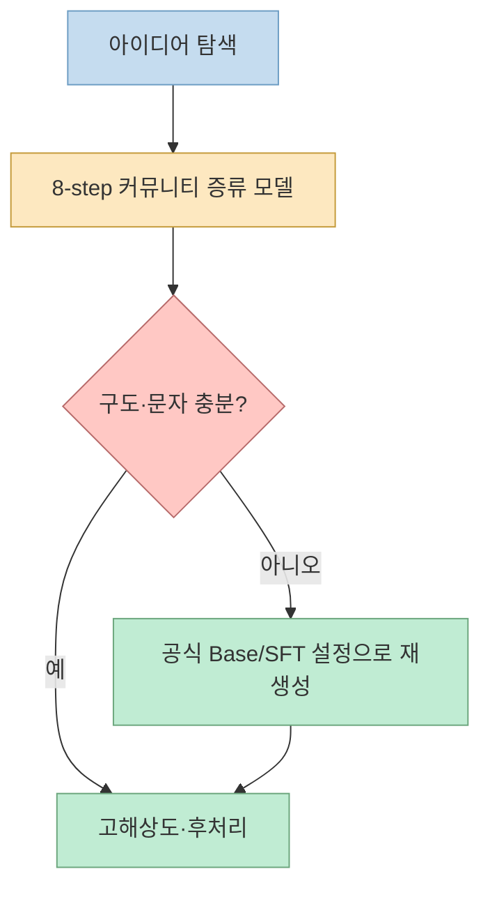

이미지 생성 모델의 품질을 평가할 때 사람의 얼굴이나 풍경만 보면 실제 업무와 거리가 있습니다. 포스터 문구가 정확한지, 여러 객체가 원하는 위치에 놓이는지, 한국어·중국어 같은 문자가 무너지지 않는지가 제품 디자인과 콘텐츠 제작에서는 더 중요할 수 있습니다. OpenMOSS의 **MOSS-Image** 는 자연어 프롬프트뿐 아니라 텍스트 배치와 객체 위치를 구조적으로 지정하는 방향을 택한 5B 파라미터 오픈 모델입니다.

<!--more-->

## Sources

- 원문 Threads: [CHOI의 MOSS-Image 소개](https://www.threads.com/share/_33MBrZR4)
- 공식 모델 카드: [OpenMOSS-Team/MOSS-Image-Base](https://huggingface.co/OpenMOSS-Team/MOSS-Image-Base)
- 공식 저장소: [OpenMOSS/MOSS-Image](https://github.com/OpenMOSS/MOSS-Image)
- 기술 보고서: [MOSS-Image Technical Report](https://arxiv.org/abs/2610.23374)
- ComfyUI 워크플로 안내: [공식 저장소의 ComfyUI 문서](https://github.com/OpenMOSS/MOSS-Image/tree/main/comfyui)

Threads 게시물은 MOSS-Image가 Apache 2.0으로 공개되었고, 자연스러운 인물 피부·중국어와 영어 텍스트 생성·위치 제어·ComfyUI 지원을 특징으로 소개합니다. 공식 모델 카드와 저장소를 기준으로 수치와 실행 방법을 다시 확인했으며, 커뮤니티 프로젝트와 공식 릴리스를 구분했습니다.

## MOSS-Image가 다른 이미지 모델과 다른 지점

MOSS-Image-Base는 텍스트-이미지 생성을 위한 5B 파라미터 DiT 계열 모델입니다. 공식 모델 카드는 자연어 프롬프트, 태그 시퀀스, JSON 레이아웃을 입력으로 받아 이미지 안의 텍스트와 객체 배치를 제어할 수 있다고 설명합니다. 저장소는 고품질 텍스트 렌더링, 레이아웃 생성, 긴 프롬프트, 이미지 스타일 다양성을 핵심 기능으로 제시합니다.



일반적인 프롬프트가 “무엇을 그릴지”를 설명한다면, 레이아웃 입력은 “무엇을 어디에 놓을지”를 추가합니다. 공식 형식은 `summary.caption`과 `items` 배열을 사용하고, 각 항목에 텍스트·설명·바운딩 박스를 넣습니다. 좌표는 `yxyx` 형식과 중앙화된 절대 좌표 공간을 사용하므로, 임의의 JSON을 넣기보다 공식 예제의 스키마를 그대로 따르는 것이 안전합니다.

## 텍스트 렌더링과 레이아웃 제어

이미지 안에 문자를 넣는 작업은 생성 모델의 약점으로 자주 언급되어 왔습니다. MOSS-Image 공식 저장소는 강한 텍스트 렌더링과 레이아웃 제어를 강조하고, 모델 카드에는 중국어 문장이 포함된 냉장고 메모 예제가 있습니다. Base와 SFT 비교에서는 SFT 쪽이 화이트보드의 문자 그룹과 배치를 더 정돈하는 예시를 제시합니다.



이 기능은 포스터, 카드뉴스, 제품 목업처럼 “이미지와 문자의 위치가 함께 중요한” 작업에 유리합니다. 다만 특정 언어·폰트·긴 문장·작은 글자에서 언제나 완벽한 결과를 보장하는 것은 아니므로, 생성 후 OCR이나 시각 검수 단계를 두는 편이 좋습니다.

## 공식 실행 환경과 설치

공식 모델 카드는 Python 3.10 이상과 CUDA를 지원하는 NVIDIA GPU를 기본 빠른 경로로 안내합니다. Diffusers, Transformers, Accelerate, Safetensors, Pillow를 설치한 뒤 `DiffusionPipeline.from_pretrained("OpenMOSS-Team/MOSS-Image-Base")`로 모델을 불러옵니다. 모델 카드 예제는 기본적으로 BF16을 사용하고 VAE는 FP32로 처리합니다.

```python
import torch
from diffusers import DiffusionPipeline

pipe = DiffusionPipeline.from_pretrained(
    "OpenMOSS-Team/MOSS-Image-Base",
    custom_pipeline="pipeline_moss_image",
    trust_remote_code=True,
    torch_dtype={"default": torch.bfloat16, "vae": torch.float32},
)
pipe.scheduler = type(pipe.scheduler).from_config(pipe.scheduler.config)
pipe.to("cuda")

image = pipe(
    "A poster with a clear Chinese headline and a red bicycle on the right",
    height=1024,
    width=1024,
    num_inference_steps=50,
    guidance_scale=3.0,
    uncond_skip_layers=[22],
).images[0]
image.save("poster.png")
```

공식 기본 샘플러는 Flow-matching Euler, 기본 스텝은 50, CFG는 3으로 문서화되어 있습니다. Python API의 이미지 크기는 16의 배수여야 하며, 모델·커스텀 파이프라인 코드는 처음 실행할 때 캐시됩니다. [모델 카드의 Quick start](https://huggingface.co/OpenMOSS-Team/MOSS-Image-Base#quick-start)

## ComfyUI에서 쓰는 방법

공식 저장소는 최신 ComfyUI에서 MOSS-Image를 네이티브 지원한다고 안내합니다. ComfyUI를 master/nightly로 업데이트하고 종속성을 설치한 뒤, ComfyUI 형식의 가중치를 로더로 불러오는 방식입니다. 모델 카드도 ComfyUI Manager에서 MOSS-Image를 검색해 설치할 수 있다고 안내하지만, 공식 저장소는 네이티브 지원이 진행 중인 버전에 맞춰 설치하라고 설명하므로 사용 중인 ComfyUI 버전을 먼저 확인해야 합니다.



ComfyUI를 이용하면 노드 기반으로 레이아웃·샘플링·후처리를 연결할 수 있습니다. 다만 네이티브 로더와 별도 플러그인 워크플로가 공존할 수 있으므로, 기존 워크플로 파일을 백업하고 공식 예제에서 시작하는 것이 좋습니다.

## 8단계 버전은 어떻게 봐야 할까

Threads 게시물은 이미지 생성 속도를 약 5배 높인 8단계 버전을 함께 언급합니다. 공식 GitHub 저장소의 커뮤니티 프로젝트 목록에는 `MOSS-Image-SFT-8-steps-dmd`가 소개되어 있으며, 이는 MOSS-Image-SFT의 커뮤니티 8-step DMD 증류 모델입니다. 따라서 이것을 기본 모델의 공식 체크포인트와 동일한 것으로 보면 안 됩니다.

8단계 증류 모델은 빠른 미리보기나 반복적인 구도 탐색에 유용할 수 있지만, 스텝 수 감소는 품질·문자 정확도·세부 묘사와의 트레이드오프를 만들 수 있습니다. 최종 출력에서는 공식 50스텝 설정과 8스텝 모델을 같은 프롬프트·시드·해상도로 비교해 선택하세요.



## 라이선스와 운영 시 주의점

모델 가중치와 번들 추론 코드는 Apache License 2.0으로 공개되어 있습니다. 이 라이선스는 상업적 활용과 수정에 유연하지만, 모델·데이터·외부 플러그인에 별도 조건이 있는지 확인해야 합니다. 공식 모델 카드에는 현재 Inference Provider가 배포되어 있지 않다고 표시되므로, 처음에는 로컬 GPU나 직접 구성한 환경을 기준으로 계획하는 편이 현실적입니다.

또한 5B 모델이라고 해서 모든 GPU에서 같은 속도와 메모리 사용량을 보장하지 않습니다. BF16·VAE FP32 조합, 해상도, 스텝 수, CPU 오프로딩 여부가 실제 요구 자원을 바꿉니다. 생성 결과에 사람이 읽는 텍스트가 포함된다면 OCR·맞춤법·브랜드 가이드 검수를 자동 파이프라인에 넣는 것이 좋습니다.

## 핵심 요약

- MOSS-Image는 5B 파라미터 오픈소스 텍스트-이미지 DiT 모델입니다.
- 자연어·태그뿐 아니라 JSON 레이아웃으로 텍스트와 객체 위치를 제어할 수 있습니다.
- 공식 모델 카드와 저장소는 텍스트 렌더링, 긴 프롬프트, 다양한 스타일, LoRA·파인튜닝 경로를 제공합니다.
- Diffusers Python API와 ComfyUI를 모두 지원하며, 기본 예시는 50스텝·CFG 3입니다.
- Threads에서 언급된 8단계 모델은 공식 Base가 아니라 커뮤니티 DMD 증류 모델로 구분해야 합니다.
- Apache 2.0이라도 모델·데이터·플러그인의 추가 조건과 실제 출력 품질을 별도로 확인해야 합니다.

## 결론

MOSS-Image의 핵심 가치는 단순히 또 하나의 이미지 생성 모델이 아니라, **이미지 속 텍스트와 공간 배치를 프롬프트 구조로 다룰 수 있다는 점**입니다. 포스터·제품 목업·정보 그래픽처럼 구도와 문자가 중요한 작업이라면 JSON 레이아웃과 ComfyUI를 활용해 반복 가능한 생성 파이프라인을 만들 수 있습니다. 빠른 8단계 모델은 탐색용으로, 최종 결과는 공식 Base/SFT 설정과 직접 비교하는 방식이 가장 안전합니다.
