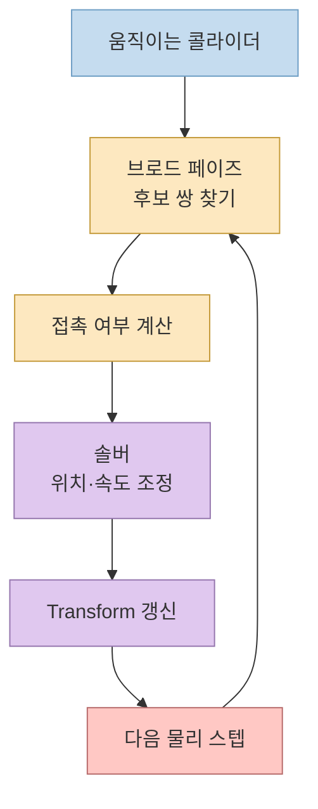
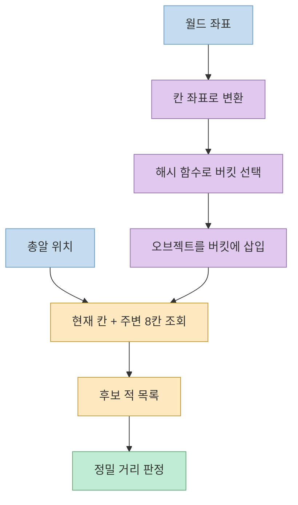
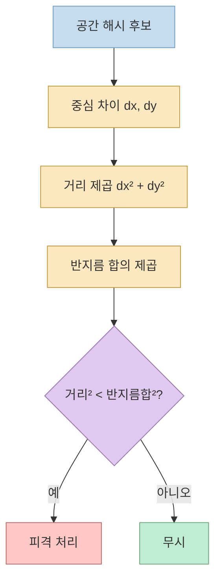
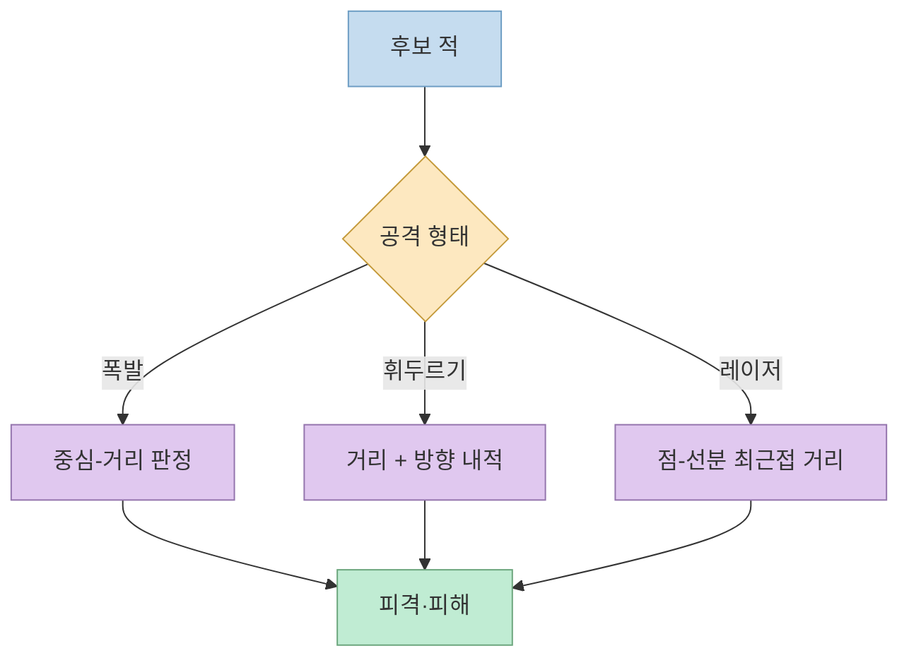
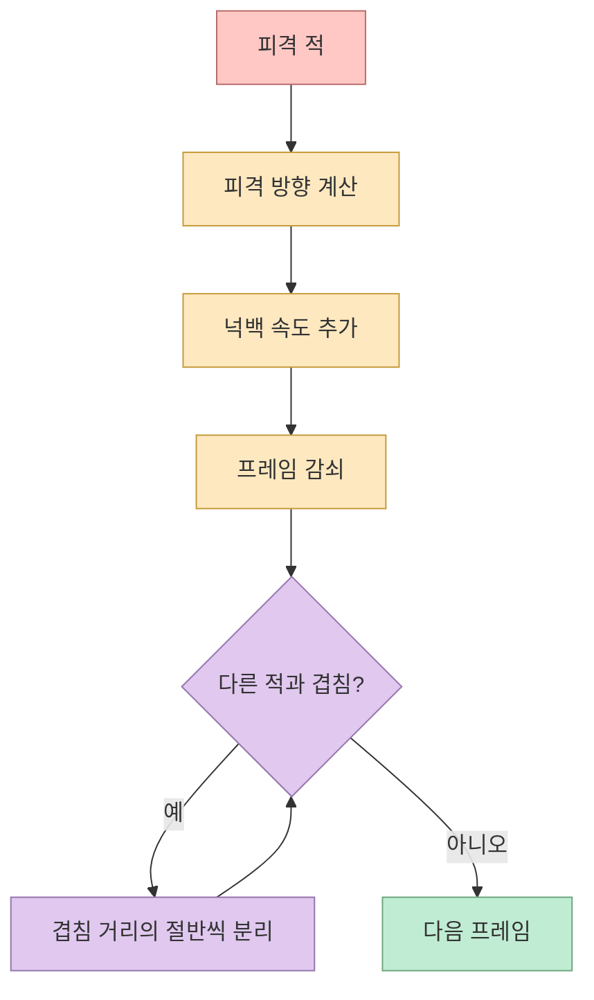
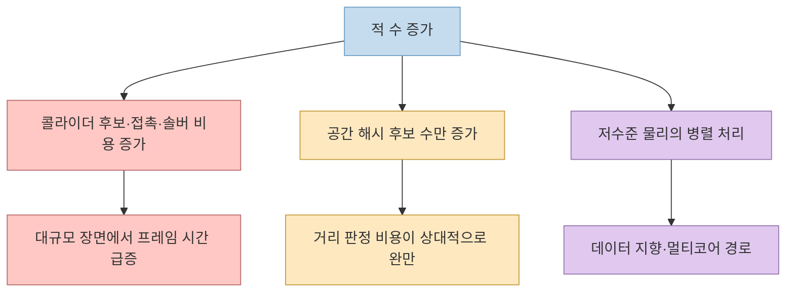

적이 화면을 가득 채우는 불렛 헤븐 장르에서는 모든 오브젝트에 콜라이더를 붙이는 설계가 빠르게 한계에 도달합니다. 콜라이더가 없어도 충돌이 필요한 게임 규칙을 직접 계산할 수 있습니다. 이 글은 5,000마리 적 데모를 바탕으로 **공간 해시로 후보를 줄이고, 거리·내적·점-선분 거리로 판정하며, 넉백만 수동으로 적용하는 방식**을 설명합니다.

<!--more-->

## Sources

- 원본 쇼츠: [콜라이더 없이 맞히고 밀쳐낸다](https://youtube.com/shorts/SZ_0dewoO3g?si=MWU8smGZGGR93Ok-)
- 전체 글: [콜라이더 없이 맞히고 밀쳐낸다 - 공간 해시와 거리 판정](https://ch5saeng.tistory.com/162)
- Unity 공식 문서: [Physics 2D Profiler module](https://docs.unity.com/en-us/engine/6000.5/manual/unity2d/2d-physics/physics-2d-profiler/module-reference)
- Unity 공식 문서: [Physics2D.jobOptions](https://docs.unity.com/en-us/engine/6000.5/script-reference/unityengine/physics2d/joboptions)
- Unity 공식 문서: [Physics Core 2D 소개](https://docs.unity.com/en-us/engine/6000.5/manual/unity2d/2d-physics-api/get-started/introduction)
- Teschner 외: [Optimized Spatial Hashing for Collision Detection](https://cgweb.informatik.uni-freiburg.de/publications/2003_VMV_collisionDetectionHashing.pdf)
- Matthias Müller: [Ten Minute Physics 11 - Spatial Hashing](https://matthias-research.github.io/pages/tenMinutePhysics/11-hashing.pdf)
- Unity API: [Vector3.sqrMagnitude](https://docs.unity3d.com/ScriptReference/Vector3-sqrMagnitude.html)
- Unity API: [Rigidbody2D.linearDamping](https://docs.unity3d.com/ScriptReference/Rigidbody2D-linearDamping.html)

쇼츠는 전체 글의 데모를 요약한 영상이고, 알고리즘·벤치마크 수치는 전체 글과 Unity 문서를 기준으로 정리했습니다. 성능 수치는 특정 데모와 하드웨어에서 측정된 사례이므로 모든 프로젝트에 그대로 적용되는 보장값은 아닙니다.

## 콜라이더가 비싸지는 이유

Unity 2D 물리는 한 스텝에서 새로운 접촉 후보를 찾고, 충돌을 계산하고, 솔버로 위치와 속도를 조정합니다. 적들이 서로 붙어 무리를 이루면 엔진은 프레임마다 겹칠 가능성이 있는 셰이프 쌍을 찾고, 실제 접촉 여부를 계산하고, 서로 밀어내는 결과를 반영해야 합니다. [쇼츠 0:08](https://youtu.be/SZ_0dewoO3g?t=8)

물리적으로 튕기고 쌓이는 반응이 필요한 오브젝트라면 이 비용이 기능의 일부입니다. 하지만 총알이 적을 맞혔는지, 폭발 반경 안에 있는지처럼 결과만 필요한 판정까지 접촉 솔버에 맡길 필요는 없습니다. 데모는 이 둘을 분리합니다. [쇼츠 0:52](https://youtu.be/SZ_0dewoO3g?t=52)

## 1단계: 공간 해시로 가까운 후보만 찾기

모든 총알과 모든 적을 비교하면 후보 수는 `총알 수 × 적 수`가 됩니다. 공간 해시는 월드를 일정한 칸으로 나누고, 각 오브젝트를 자신의 칸에 넣은 뒤 현재 칸과 주변 칸만 조회합니다. 2D에서 칸 크기를 충돌 지름 정도로 잡으면 한 칸과 둘레 8칸, 총 9칸만 확인해도 가까운 후보를 놓치지 않습니다. [쇼츠 0:21](https://youtu.be/SZ_0dewoO3g?t=21)

데모는 칸 크기를 0.6유닛으로 두고, 적끼리 접촉 거리 0.56, 총알-적 접촉 거리 0.40이 칸보다 짧도록 설정했습니다. 플레이어와 적의 접촉 거리 0.73은 더 크기 때문에 플레이어 주변은 5×5칸을 검색합니다. 해시 충돌로 서로 다른 칸이 같은 버킷에 들어가도 마지막 거리 판정이 거짓 후보를 걸러 냅니다.

칸이 너무 작으면 하나의 오브젝트가 여러 칸에 걸리고 인접 칸 조회가 늘어납니다. 너무 크면 한 칸에 후보가 많이 쌓여 정밀 판정 비용이 커집니다. 가장 큰 상호작용 반경과 평균 밀도를 기준으로 벤치마크해 선택해야 합니다.

## 2단계: 제곱거리로 원형 충돌 판정

원형 적과 총알의 충돌은 중심 간 거리 `d`가 두 반지름의 합 `r₁ + r₂`보다 작은지 확인하면 됩니다. `dx = enemy.x - bullet.x`, `dy = enemy.y - bullet.y`, `dx² + dy² < (r₁ + r₂)²`처럼 제곱근 없이 비교할 수 있습니다.

`Vector3.Distance`처럼 제곱근을 계산하지 않고 `sqrMagnitude`를 비교하면 크기 비교 결과는 같고 제곱근 비용을 피할 수 있습니다. [Unity sqrMagnitude 문서](https://docs.unity3d.com/ScriptReference/Vector3-sqrMagnitude.html)

이 방식은 “맞았다”는 이벤트만 필요할 때 적합합니다. 실제 접촉점, 회전, 마찰, 반발 계수, 연속 충돌 검출이 필요하다면 직접 구현해야 할 상태가 늘어나므로 콜라이더나 저수준 물리 API가 더 적합할 수 있습니다.

## 3단계: 폭발·휘두르기·레이저를 각각 계산하기

폭발은 중심에서 반경 안에 있는 적을 찾는 문제입니다. 폭발 반경이 걸친 칸을 순회하고 각 후보에 제곱거리 판정을 적용합니다. 휘두르기는 적 방향 단위 벡터와 무기 방향의 내적이 부채꼴 반각의 코사인 이상인지 확인합니다. 레이저는 점과 선분 사이의 가장 가까운 거리를 계산해 레이저 반폭과 적 반지름의 합보다 짧으면 피격합니다. [쇼츠 0:38](https://youtu.be/SZ_0dewoO3g?t=38)

## 4단계: 넉백을 속도와 분리해 적용하기

충돌 솔버가 없어도 넉백은 속도 벡터로 구현할 수 있습니다. 피격 방향에 넉백 속도를 더하고, 프레임마다 `v ← v / (1 + c·dt)` 형태로 감쇠시키면 밀린 뒤 점차 멈춥니다. 데모의 감쇠 값은 6이며 Unity `Rigidbody2D.linearDamping`과 같은 형태의 감쇠식을 사용합니다. [쇼츠 0:44](https://youtu.be/SZ_0dewoO3g?t=44)

밀려서 서로 겹친 적은 중심 거리가 접촉 거리보다 짧은 만큼을 양쪽에 절반씩 나눠 반대 방향으로 이동시킵니다. 데모는 이 분리 과정을 한 스텝에 네 번 실행해 겹침을 줄였습니다. 이는 물리 엔진의 일반적인 접촉 솔버를 대체하는 근사이므로 벽·장애물·질량 차이가 있으면 별도 규칙이 필요합니다.

## 성능 비교와 해석

전체 글은 같은 시드·무기 시간표·렌더 조건으로 거리 판정, `Rigidbody2D` 콜라이더, 저수준 Physics Core 2D를 각각 12초 실행했습니다.

- 1,000마리: 거리 0.83ms, 콜라이더 0.80ms, 저수준 물리 0.63ms
- 3,000마리: 거리 2.49ms, 콜라이더 3.80ms, 저수준 물리 1.46ms
- 5,000마리: 거리 4.60ms, 콜라이더 9.85ms, 저수준 물리 2.31ms
- 10,000마리: 거리 10.30ms, 콜라이더 38.10ms, 저수준 물리 4.47ms

10,000마리에서 콜라이더 판은 60fps 예산인 약 16.7ms를 넘었고, 거리 판정은 그 안에 남았습니다. 반면 저수준 물리 판은 연속 메모리와 멀티코어 실행을 활용해 더 빨랐습니다. 데모의 거리 판정은 C# 단일 스레드이며 Burst나 잡 시스템을 쓰지 않았다는 점도 함께 봐야 합니다. [전체 글의 비교 표](https://ch5saeng.tistory.com/162)

이 숫자는 콜라이더가 항상 나쁘다는 뜻이 아닙니다. 적은 수의 오브젝트, 복잡한 접촉 반응, 벽·경사·마찰·반발이 필요한 게임에서는 Unity 물리가 구현 비용과 안정성 면에서 더 낫습니다. 대규모 단순 판정에서는 직접 만든 공간 해시가 유리하고, 더 높은 성능이 필요하면 Physics Core 2D나 Burst·잡 시스템을 검토할 수 있습니다.

## 구현을 선택하는 기준

거리 판정은 피격·범위·시야처럼 결과가 불리언 또는 피해량이면 충분하고, 오브젝트 수가 수천 개 이상이며, 충돌 후 튕김·마찰·회전이 필요 없을 때 적합합니다. 콜라이더는 적이 벽과 정확하게 밀리고 쌓여야 하거나, 질량·마찰·반발·관절이 게임플레이의 핵심일 때 유지하는 편이 좋습니다.

실전에서는 총알·범위 공격은 거리 판정으로 처리하고 벽·플레이어·보스처럼 물리 반응이 중요한 일부만 콜라이더를 사용하는 혼합 구조가 합리적입니다.

## 핵심 요약

- 공간 해시는 월드를 칸으로 나눠 현재 칸과 주변 칸만 검색해 충돌 후보를 줄입니다.
- 원형 충돌은 제곱근 없이 `거리² < (반지름 합)²`로 판정할 수 있습니다.
- 폭발은 중심 거리, 휘두르기는 내적과 거리, 레이저는 점-선분 거리를 사용합니다.
- 넉백과 겹침 분리는 속도 감쇠·수동 위치 보정으로 구현할 수 있지만 복잡한 물리 반응의 완전한 대체는 아닙니다.
- 5,000~10,000마리 규모에서는 콜라이더 비용이 빠르게 증가할 수 있으며, 저수준·데이터 지향 물리 경로도 대안입니다.
- 최적화의 출발점은 콜라이더 제거가 아니라 실제 상호작용에 물리 솔버가 필요한지 구분하는 것입니다.

## 결론

불렛 헤븐의 모든 공격이 실제 물리 충돌일 필요는 없습니다. “맞았는가”, “범위 안인가”, “레이저 선분에서 가까운가”처럼 게임 규칙으로 표현할 수 있는 판정은 공간 해시와 기하 계산으로 빠르게 처리할 수 있습니다. 반대로 밀고 튕기고 쌓이는 반응이 재미의 핵심이라면 물리 엔진을 유지해야 합니다. 오브젝트별 요구사항을 나눈 뒤 두 방식을 섞는 것이 성능과 구현 안정성을 함께 얻는 현실적인 설계입니다.
