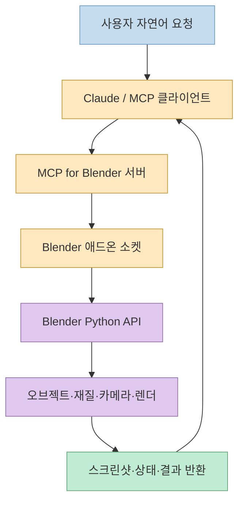
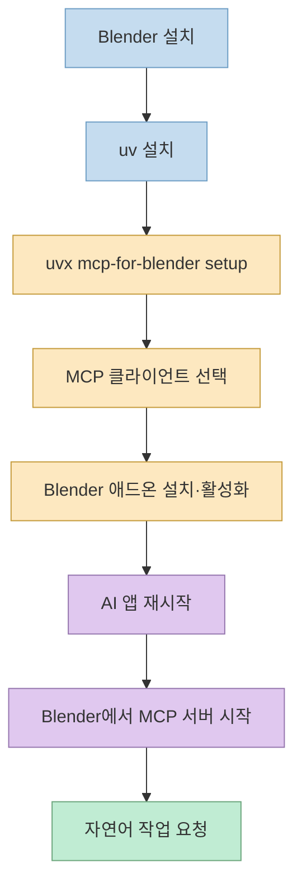
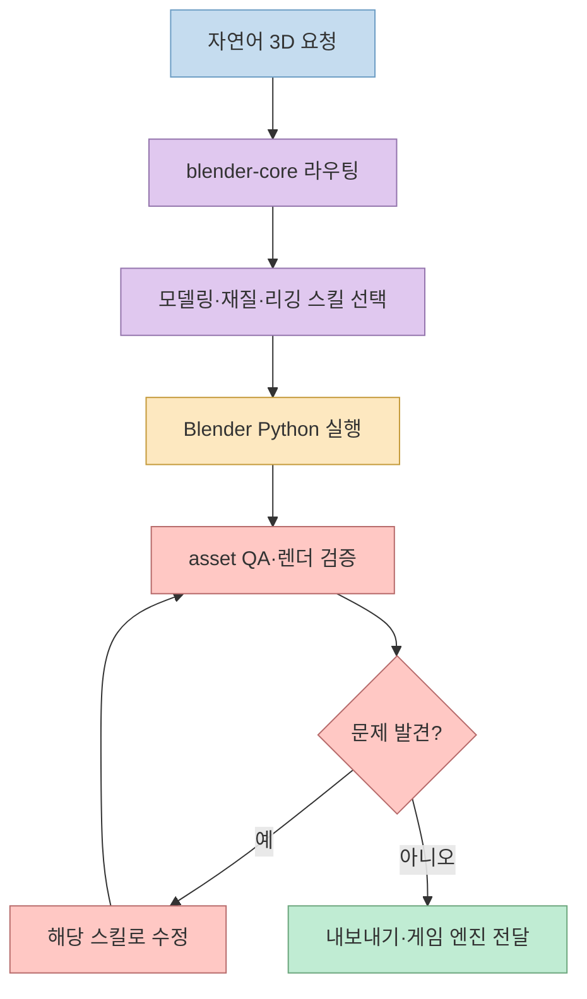
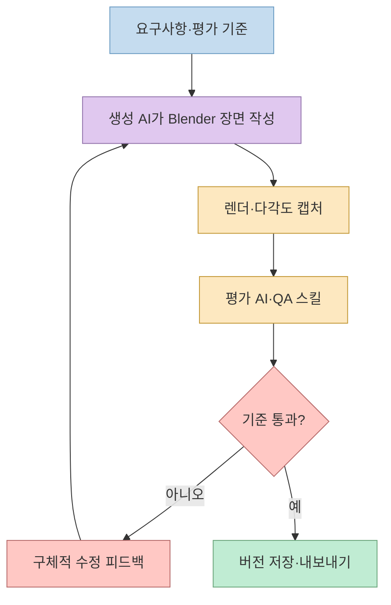

Blender를 열고 메뉴를 하나씩 누르는 대신 “던전에서 금 항아리를 지키는 로우폴리 용을 만들어 줘”라고 말하면 장면이 생성되는 시대가 왔습니다. 핵심은 이미지 생성이 아니라, Claude가 Blender의 Python API와 장면 데이터를 직접 조작하도록 **Model Context Protocol(MCP)** 로 연결하는 것입니다.

<!--more-->

## Sources

- 원본 쇼츠: [말 한 줄에 3D 용이 뚝딱](https://youtube.com/shorts/A7Xcz7lkR1M)
- MCP for Blender 공식 저장소: [ahujasid/mcp-for-blender](https://github.com/ahujasid/mcp-for-blender)
- MCP for Blender 공식 사이트: [mcp-for-blender.com](https://www.mcp-for-blender.com/)
- Blender Agent Skills: [EL4CTEO/blender-skills](https://github.com/EL4CTEO/blender-skills)
- Blender 공식 사이트: [Blender](https://www.blender.org/)

쇼츠의 시연·성능 사례는 영상 설명과 자동 자막을 기준으로 정리했고, 설치 명령과 보안 주의사항은 MCP for Blender 공식 README를 확인했습니다. MCP for Blender는 Blender Foundation이 만든 공식 기능이 아닌 커뮤니티 서드파티 통합 도구입니다.

## MCP for Blender의 구조

MCP for Blender는 Claude Desktop·Claude Code·Codex·Cursor 같은 MCP 클라이언트와 Blender 애드온 사이에 소켓 서버를 둡니다. Claude는 MCP 도구를 호출하고, 서버는 Blender 안에서 Python 코드를 실행해 오브젝트·재질·카메라·렌더를 변경합니다. 애드온은 기본적으로 `localhost`에서만 수신하므로 같은 컴퓨터 안에서 연결하는 구성이 기본입니다. [쇼츠 0:08](https://youtu.be/A7Xcz7lkR1M?t=8)



공식 README는 오브젝트 생성·수정·삭제, 재질 제어, 여러 각도와 와이어프레임을 통한 시각 검증, Blender Python 실행을 주요 기능으로 제시합니다. 따라서 “모델 하나를 만들고 끝”이 아니라 생성→검사→수정 루프를 구성할 수 있습니다.

## 설치와 연결

공식 Quickstart는 macOS·Linux에서 다음 설치 스크립트를 사용하고, Windows에서는 PowerShell 설치 스크립트를 제공합니다.

```bash
# macOS / Linux
curl -LsSf https://www.mcp-for-blender.com/install.sh | sh

# uv가 이미 있다면
uvx mcp-for-blender setup
```

설치 도구는 Claude Desktop, Claude Code, Codex, Cursor, VS Code 등 MCP 클라이언트를 찾아 `blender` 엔트리를 추가하고 Blender 애드온을 설치합니다. 자동 설치를 쓰지 않으려면 Claude Code에서 `claude mcp add blender uvx mcp-for-blender`로 서버를 등록할 수 있습니다. 설치 후 AI 앱을 완전히 종료했다가 다시 열고 Blender의 애드온을 활성화해야 합니다.



Blender를 연 뒤 3D 뷰포트에서 `N`을 눌러 MCP for Blender 탭을 열고 서버를 시작합니다. 공식 문서는 MCP 서버 인스턴스를 여러 클라이언트에서 동시에 띄우지 말라고 안내합니다.

## 잘하는 일과 아직 어려운 일

쇼츠는 “3D를 전혀 몰라도 한 줄에 용과 금 항아리 던전이 만들어진다”고 시연합니다. 이미지 한 장을 입력해 숲속 오두막을 3D로 재구성하고 여러 각도에서 확인하는 흐름도 소개합니다. [쇼츠 0:00](https://youtu.be/A7Xcz7lkR1M?t=0) 이런 작업은 오브젝트 배치, 카메라 설정, 기본 재질, 반복 렌더처럼 명령으로 분해하기 쉬운 단계에서 특히 효과적입니다.

반면 유명 Blender 강사의 테스트에서는 처음부터 만드는 3D 여우 모델에 구멍이 생기거나 면이 종잇장처럼 얇아지는 문제가 있었다고 설명합니다. AI가 생성한 메시의 토폴로지·두께·노멀·리깅을 전문가 수준으로 보장하지는 않는다는 뜻입니다. [쇼츠 0:14](https://youtu.be/A7Xcz7lkR1M?t=14)

AI가 잘 처리하는 영역은 이미 만든 캐릭터를 게임에서 걷게 만드는 리깅·애니메이션 연결, 카메라 배치, 반복적인 재질·렌더 설정 같은 후처리입니다. 생성 모델링과 후처리 자동화의 난이도가 다르므로, 완성품을 한 번에 요구하기보다 단계별 결과를 저장하며 진행하는 편이 좋습니다. [쇼츠 0:24](https://youtu.be/A7Xcz7lkR1M?t=24)

## Blender Agent Skills로 품질 지식을 주입하기

`blender-skills`는 Blender 5.2 LTS 이상을 대상으로 모델링, UV, PBR 재질, 베이킹, 리깅, 애니메이션, 최적화, 엔진별 내보내기, QA를 에이전트 스킬로 묶은 커뮤니티 저장소입니다. 같은 모델이라도 스킬을 먼저 읽힌 경우 담요가 판자처럼 굳지 않고 주름지게 표현되는 사례가 영상에 나옵니다. [쇼츠 0:35](https://youtu.be/A7Xcz7lkR1M?t=35)

공식 README는 28개의 스킬을 제공하고, 각 스크립트를 실제 Blender에서 테스트했다고 설명합니다. Claude Code 플러그인으로 설치하거나 저장소를 복제해 `~/.claude/skills`와 `~/.agents/skills`에 설치할 수 있습니다. 모든 스킬을 한꺼번에 주입하기보다 작업에 필요한 `blender-scene-setup`, `blender-retopology-uv`, `blender-character-rigging`, `blender-asset-qa`처럼 목적별 스킬을 선택하는 편이 컨텍스트 관리에 유리합니다.



스킬은 모델의 지식 자체를 바꾸는 것이 아니라, 작업 순서·Blender 5.x API 규칙·검수 체크리스트를 컨텍스트에 제공하는 방식입니다. 따라서 스킬을 사용해도 메시 품질이나 게임 엔진 호환성을 실제 파일로 검증해야 합니다.

## 여러 AI를 평가자로 두는 반복 개선 루프

쇼츠는 한국의 한 유튜버가 AI 여섯 개와 채점 AI를 함께 사용해 항공모함 모델을 반복 개선한 사례도 소개합니다. 10점 만점에 3.8점이던 결과가 아홉 번째 판에서 7.9점까지 올라갔다는 수치는 해당 시연의 사례이며, 일반적인 품질 보장값은 아닙니다. [쇼츠 0:46](https://youtu.be/A7Xcz7lkR1M?t=46)

이 방식의 핵심은 모델을 많이 붙이는 것이 아니라 **평가 기준을 먼저 고정하는 것**입니다. 실루엣, 부품 누락, 스케일, 재질, 카메라 구도, 게임 엔진에서의 폴리곤 예산처럼 측정 가능한 항목을 정하고, 생성 모델과 평가 모델을 분리하면 한 모델의 자기평가 편향을 줄일 수 있습니다.



## 안전하게 사용하기

### 작업 파일을 먼저 저장

MCP for Blender의 `execute_blender_code`는 Blender 안에서 임의의 Python 코드를 실행할 수 있습니다. 공식 README도 사용 전에 항상 작업을 저장하라고 경고합니다. 자동화가 편리해도 저장되지 않은 장면에서 대규모 스크립트를 실행하지 말고, 버전별 `.blend` 파일을 남기세요.

### Safe mode 켜기

`BLENDER_MCP_SAFE_MODE=1`을 설정하면 파일 직접 읽기·쓰기, 다른 프로그램 실행, 네트워크 접근, 지속성 코드를 차단하고 모델링·재질·렌더·저장 같은 일반 Blender 작업은 허용합니다.

```json
{
  "mcpServers": {
    "blender": {
      "command": "uvx",
      "args": ["mcp-for-blender"],
      "env": {"BLENDER_MCP_SAFE_MODE": "1"}
    }
  }
}
```

### 원격 연결은 localhost 밖으로 열지 않기

애드온 소켓에는 인증과 암호화가 없고, 포트에 접근할 수 있는 클라이언트가 Blender에서 Python을 실행할 수 있습니다. 따라서 기본 `localhost`를 유지하고, 원격 연결이 꼭 필요하면 신뢰할 수 있는 사설 네트워크와 방화벽 또는 SSH 터널을 사용해야 합니다. 공개 인터넷에 포트를 노출하면 안 됩니다.

### 텔레메트리 확인

공식 README에 따르면 기본적으로 익명 설치 ID·세션 ID·도구 이름·성공 여부·실행 시간·버전·운영체제·타임스탬프가 수집될 수 있습니다. 프롬프트·생성 코드·스크린샷·장면 데이터는 별도 동의 없이는 수집하지 않는다고 설명하며, 완전히 끄려면 MCP 환경에 `DISABLE_TELEMETRY=true`를 설정할 수 있습니다.

## 처음 시도할 작업

처음부터 복잡한 캐릭터를 만들기보다 다음처럼 결과와 검증 기준이 명확한 작업부터 시작하는 편이 좋습니다.

1. Blender에서 새 파일을 저장합니다.
2. MCP for Blender를 `localhost`로 연결하고 Safe mode를 켭니다.
3. “던전 안에 금 항아리를 지키는 로우폴리 용을 만들고, 카메라 3개로 렌더해 각도를 확인해 줘”라고 요청합니다.
4. 오브젝트 수·재질·카메라·렌더 결과를 확인합니다.
5. `.blend`와 렌더 결과를 별도 버전으로 저장합니다.
6. 필요하면 Blender Agent Skills의 QA·최적화 스킬을 추가해 노멀, 떠 있는 부품, 폴리곤 예산을 검사합니다.

## 핵심 요약

- MCP for Blender는 Claude와 Blender 사이에서 Python 기반 장면 조작을 연결하는 서드파티 MCP 통합입니다.
- 자연어로 오브젝트·재질·카메라·렌더를 만들고, 여러 각도 캡처로 결과를 검증할 수 있습니다.
- 새 모델 생성보다 리깅·애니메이션·재질·반복 후처리에서 안정적인 생산성 향상을 기대하기 쉽습니다.
- Blender Agent Skills는 모델링부터 QA·게임 엔진 내보내기까지의 작업 지식과 체크리스트를 제공합니다.
- `BLENDER_MCP_SAFE_MODE=1`, 저장 선행, localhost 유지, 원격 포트 차단이 기본 안전 수칙입니다.
- 텔레메트리 수집 범위와 라이선스·서드파티 플러그인 조건을 설치 전에 확인해야 합니다.

## 결론

Claude와 Blender의 결합은 “AI가 예쁜 3D 모델을 한 번에 완성한다”는 마법보다, Blender의 반복적인 조작과 검수 단계를 자연어·스크립트·스킬로 연결하는 자동화에 가깝습니다. 생성 품질이 불안정한 영역은 사람이 기준을 정하고, AI는 장면 구성·후처리·검증·내보내기를 반복하게 하세요. 저장·Safe mode·localhost라는 세 가지 안전장치를 지킨다면 3D를 잘 모르는 사람도 작은 장면부터 이 워크플로를 시험할 수 있습니다.
