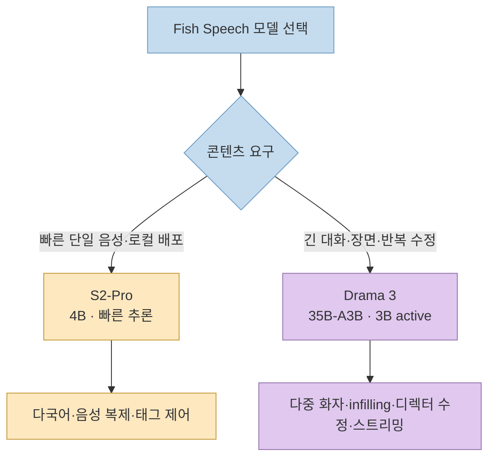
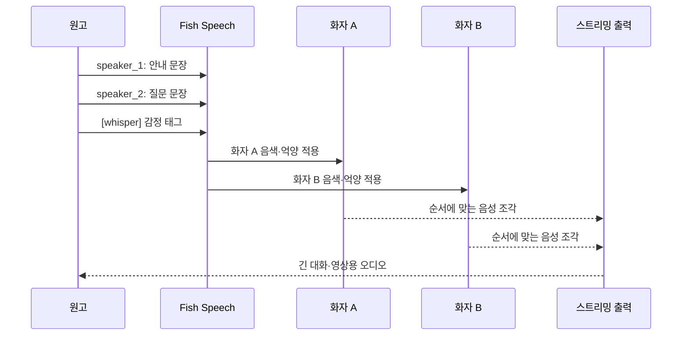
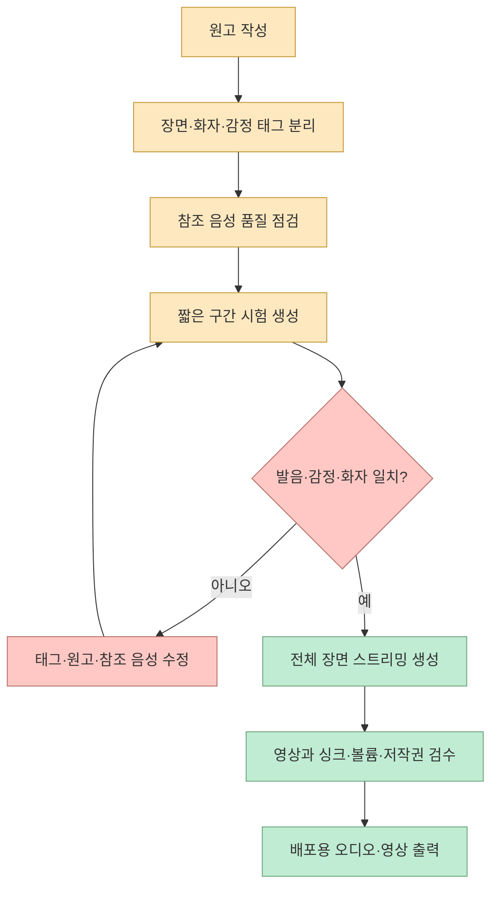
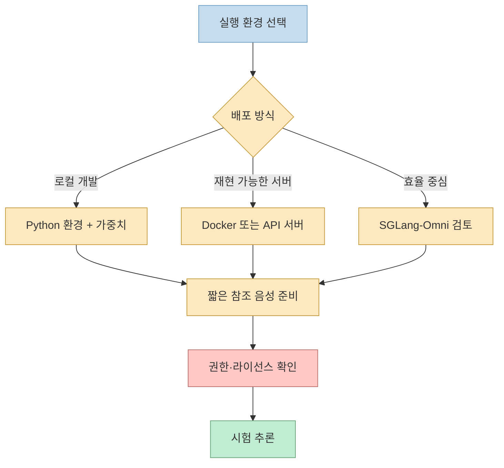
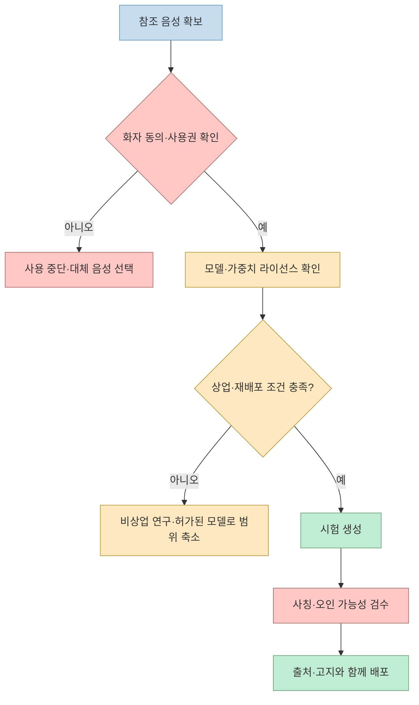

강의와 쇼츠를 만들 때 가장 많은 시간이 드는 작업 중 하나는 원고를 자연스러운 음성으로 녹음하고 수정하는 일입니다. Threads에서 소개된 **Fish Speech** 는 한국어를 포함한 다국어 음성 합성, 짧은 참조 음성으로 화자를 복제하는 기능, 감정 제어, 여러 화자의 대화 생성을 하나의 오픈소스 프로젝트로 묶습니다. 단순히 문장을 읽는 TTS가 아니라, 원고 수정과 장면 단위 음성 제작까지 염두에 둔 도구입니다.

<!--more-->

## Sources

- 원문 Threads: [고래밥의 Fish Speech 소개](https://www.threads.com/share/BAUBFjgoAx)
- 공식 저장소: [fishaudio/fish-speech](https://github.com/fishaudio/fish-speech)
- 공식 설치·추론 문서: [Fish Audio Speech Docs](https://speech.fish.audio/)

원문은 Threads가 제공하는 공개 미리보기를 Jina Reader로 추출했습니다(`jina-reader`, 원문 페이지는 CAPTCHA 챌린지로 직접 접근 불가). 원문에 나온 기능·사용 사례는 공식 저장소 README의 모델 설명과 라이선스 고지를 교차 확인했습니다.

## Fish Speech가 제공하는 기능

원문은 Fish Speech를 한국어를 포함한 다국어 TTS와 음성 복제를 지원하는 오픈소스로 소개합니다. S2-Pro는 10~30초 분량의 참조 음성만으로 음색을 복제할 수 있고, `[whisper]`, `[laughing]` 같은 인라인 태그로 감정과 전달 방식을 제어할 수 있다고 설명합니다. [원문 Threads](https://www.threads.com/share/BAUBFjgoAx)

공식 저장소는 S2-Pro를 자연어 제어와 감정 표현을 지원하는 이전 세대 플래그십으로 설명하며, 약 100개 언어와 10~30초 참조 음성 기반 복제, 다중 화자 생성, 긴 음성의 스트리밍 출력을 명시합니다. 따라서 원문의 “짧은 샘플로 음성 복제” 주장은 모델 문서와 일치하지만, 실제 품질은 샘플의 길이·잡음·화자 동의·언어에 따라 달라질 수 있습니다. [S2-Pro 공식 설명](https://github.com/fishaudio/fish-speech#fish-audio-s2-pro)

```mermaid
flowchart TD
    A[텍스트 원고] --> B[화자·언어 선택]
    B --> C{제어 방식}
    C -->|일반 문장| D[자연어 TTS]
    C -->|감정 태그| E[[whisper]·[laughing] 등]
    C -->|여러 화자| F[Speaker ID로 대화 구성]
    D --> G[음성 스트리밍·파일 출력]
    E --> G
    F --> G
    classDef inputTone fill:#c5dcef,stroke:#6d9dc4,color:#333;
    classDef controlTone fill:#fde8c0,stroke:#c49a3a,color:#333;
    classDef outputTone fill:#c0ecd3,stroke:#6ca67d,color:#333;
    class A inputTone;
    class B,C,D,E,F controlTone;
    class G outputTone;
```

## S2-Pro와 Drama 3의 역할 차이

공식 README에는 두 모델이 함께 정리되어 있습니다. S2-Pro는 4B 파라미터 모델로 빠른 추론과 소비자 GPU 배포를 목표로 하는 이전 세대 플래그십이고, Drama 3는 35B-A3B 구조(토큰당 3B 활성)로 여러 등장인물이 나오는 장면과 긴 콘텐츠를 겨냥한 신세대 모델입니다. [공식 모델 표](https://github.com/fishaudio/fish-speech#models)

Drama 3는 S2 계열의 다중 화자 생성·음성 복제·자연어 제어를 유지하면서, 이전 생성 결과에 “조금 더 부드럽고 슬프게”처럼 수정 지시를 내리는 다중 턴 디렉터 수정, 특정 단어만 바꾸는 infilling, 긴 대화의 스트리밍, 웃음·울음·속삭임 같은 표현 강화를 추가합니다. [Drama 3 기능](https://github.com/fishaudio/fish-speech#fish-audio-drama-3)



이 구분은 “최신 모델이 항상 더 좋다”는 뜻이 아닙니다. 짧은 내레이션이나 GPU 자원이 제한된 환경에서는 S2-Pro가 단순하고 빠른 선택일 수 있고, 여러 인물이 대화하며 중간 문장을 자주 고치는 제작 파이프라인에는 Drama 3의 편집 기능이 더 적합합니다. 이 판단은 공식 모델 설명을 바탕으로 한 사용 시나리오별 해석입니다.

## 감정 태그와 다중 화자 대화

인라인 태그는 원고와 음성 연출을 한 텍스트 안에 함께 적는 방식입니다. 예를 들어 `[whisper]`는 속삭임, `[laughing]`은 웃는 전달을 요청하는 신호가 될 수 있습니다. 태그가 모든 언어·문장·참조 음성에서 동일하게 작동한다고 단정할 수는 없으므로, 실제 결과를 짧은 구간으로 먼저 들어 보고 태그 위치와 참조 음성을 조정해야 합니다. [공식 태그 설명](https://github.com/fishaudio/fish-speech#fish-audio-drama-3)

S2-Pro는 한 텍스트 안에서 speaker ID로 화자를 구분해 여러 명의 음성을 생성할 수 있고, Drama 3는 이를 장면 단위 다중 화자 제작으로 확장합니다. 기존 방식처럼 화자별 파일을 따로 만든 뒤 이어 붙이는 대신, 대화 구조와 화자 정보를 원고에 보존할 수 있다는 점이 장점입니다. [공식 S2-Pro 설명](https://github.com/fishaudio/fish-speech#fish-audio-s2-pro)



## 강의·쇼츠·더빙 제작 워크플로

원문은 강의와 쇼츠 내레이션, 프레젠테이션 영상 더빙을 대표적인 사용 사례로 제시합니다. 이때 가장 안정적인 방법은 처음부터 긴 전체 원고를 한 번에 합성하는 것이 아니라, 문장·장면 단위로 나눠 음질과 발음·감정을 확인한 뒤 최종 믹싱으로 넘기는 것입니다. [원문 사용 사례](https://www.threads.com/share/BAUBFjgoAx)



이 구조는 음성 모델의 장점을 제작 공정에 맞게 사용하는 방법입니다. 먼저 10~30초 샘플이 깨끗하고 해당 화자의 사용 허가를 받았는지 확인하고, 짧은 테스트에서 발음·감정·속도를 검수합니다. 이후에만 긴 강의나 쇼츠 묶음을 생성하면 대량 재생성 비용과 수정 시간을 줄일 수 있습니다.

## 설치와 실행 전 확인할 것

공식 저장소는 설치, 가중치 다운로드, Docker 배포, 명령줄·API 서버·WebUI 추론 문서를 제공합니다. 최신 README는 효율을 중시하는 사용자에게 SGLang-Omni를 권장하고, 모델별 설치 절차는 공식 문서에서 확인하도록 안내합니다. [공식 Quick Start](https://github.com/fishaudio/fish-speech#quick-start)



실행 전에는 GPU 메모리, 모델 가중치 크기, 스트리밍 지연, 한국어 발음 품질을 먼저 측정해야 합니다. 공식 문서의 벤치마크 수치는 특정 평가셋과 실행 조건에서 나온 결과이므로, 자신의 화자·원고·하드웨어에서 동일한 수치가 재현된다고 가정해서는 안 됩니다.

## 라이선스와 음성 복제의 책임

이 프로젝트는 코드와 모델 가중치에 **FISH AUDIO COMMUNITY LICENSE** 를 적용하며, S2-Pro 가중치는 Fish Audio Research License의 적용을 받는다고 공식 저장소가 고지합니다. 상업적 사용이나 재배포는 MIT 라이선스 프로젝트처럼 처리할 수 없고, 사용하려는 모델·가중치·출력물의 조건을 각각 확인해야 합니다. [공식 라이선스 고지](https://github.com/fishaudio/fish-speech#license-notice)

특히 음성 복제는 기술 문제가 아니라 동의와 권리의 문제이기도 합니다. 본인 목소리나 명시적으로 허가받은 배우의 음성만 사용하고, 실제 인물이나 기관을 사칭할 수 있는 내레이션은 공개 전에 검수해야 합니다. 모델이 생성한 음성이 자연스럽더라도 원본 화자의 동의·상업 이용 범위·플랫폼 정책이 자동으로 해결되는 것은 아닙니다.



## 핵심 요약

- Fish Speech는 한국어를 포함한 다국어 TTS와 음성 복제를 제공하는 오픈소스 프로젝트입니다.
- S2-Pro는 10~30초 참조 음성, 인라인 감정 태그, 다중 화자 생성, 긴 음성 스트리밍을 지원한다고 공식 문서가 설명합니다.
- Drama 3는 35B-A3B 신세대 모델로, 다중 턴 수정·특정 단어 infilling·긴 대화·강한 감정 표현에 초점을 둡니다.
- 강의·쇼츠·프레젠테이션 더빙은 짧은 구간 시험 생성→검수→전체 스트리밍 생성 순서가 안전합니다.
- 코드와 가중치에는 FISH AUDIO COMMUNITY LICENSE 및 S2-Pro Research License 조건이 적용되므로 상업 이용 전 확인이 필요합니다.
- 음성 복제는 반드시 화자 동의와 사칭 방지 검수를 거쳐야 합니다.

## 결론

Fish Speech의 중요한 변화는 TTS를 “문장을 읽어 주는 API”에서 “화자와 감정을 가진 오디오 제작 도구”로 확장한 데 있습니다. S2-Pro로 빠른 로컬 내레이션을 만들고 Drama 3로 여러 인물의 긴 장면과 반복 수정을 처리할 수 있지만, 모델 선택보다 먼저 음성 사용권과 라이선스를 확인해야 합니다. 권한이 확보된 참조 음성으로 짧게 검수하고, 검증된 결과만 강의·쇼츠·더빙 파이프라인에 연결하는 것이 현실적인 도입 방법입니다.
