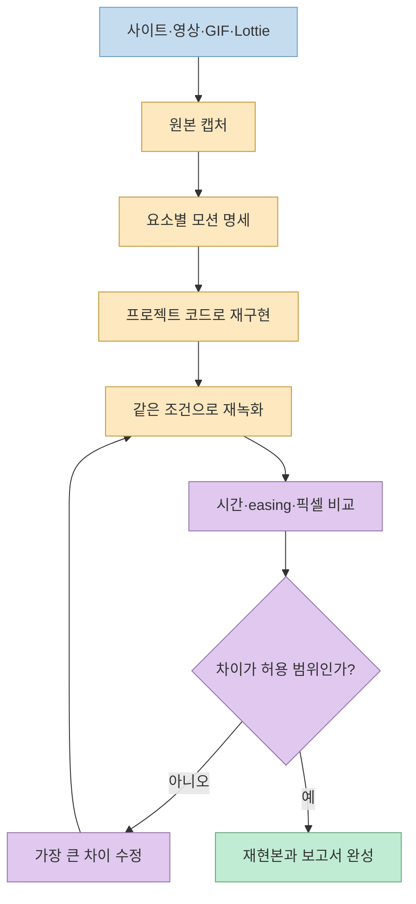
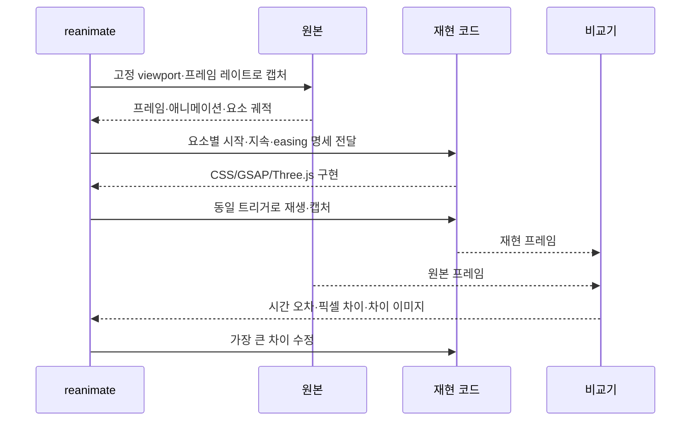
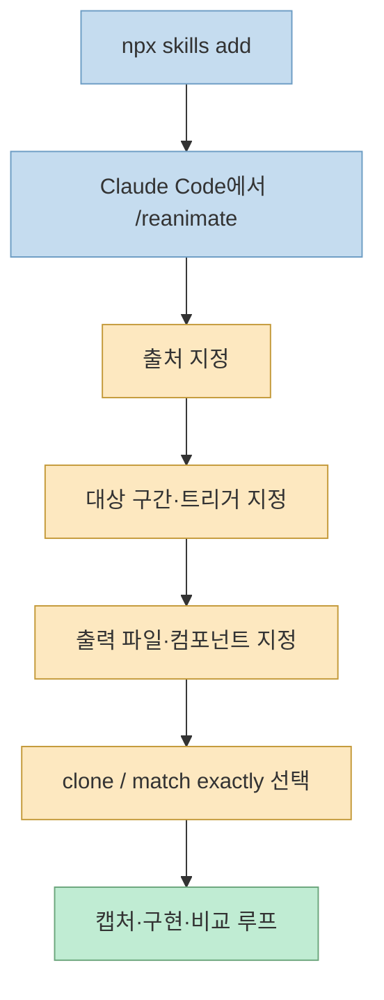
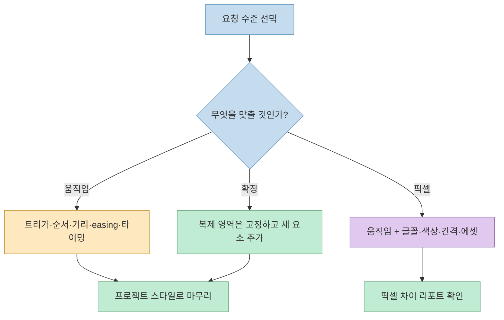
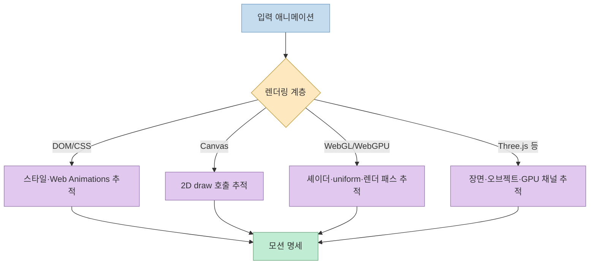
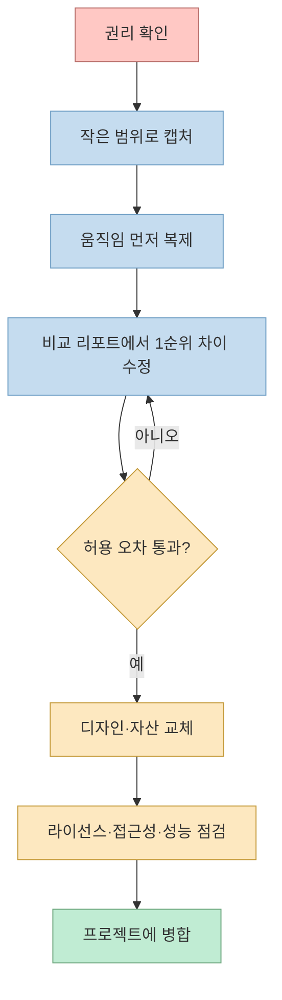

웹 애니메이션을 복사할 때 가장 어려운 부분은 정지 화면이 아니라 **시간**입니다. 어떤 요소가 언제 시작하고, 얼마나 이동하며, 어떤 easing 곡선을 쓰는지 알아야 같은 움직임을 만들 수 있습니다. 쇼츠에서 소개한 `reanimate`는 이 문제를 Claude Code의 반복 작업으로 바꿉니다. 원본을 녹화하고, 움직임을 명세로 추출하고, 기존 프로젝트의 CSS·Framer Motion·GSAP·Three.js로 다시 만든 다음, 동일한 조건에서 비교하며 차이를 줄입니다.

<!--more-->

## Sources

- 원본 쇼츠: [reanimate 애니메이션 복제 소개](https://youtube.com/shorts/udYDSzrOuRs)
- 공식 사이트: [reanimate · a skill for Claude Code](https://reanimate.niazmorshed.dev/)
- 공식 저장소: [NiazMorshed2007/reanimate](https://github.com/NiazMorshed2007/reanimate)

영상의 기능 설명과 수치는 쇼츠의 자동 자막·설명란을 기준으로 정리했고, 설치 명령·지원 입력·검증 방식·제한사항은 공식 사이트와 저장소 README를 교차 확인했습니다.

## reanimate가 해결하는 문제

스크린샷만 보고 애니메이션을 재현하면 첫 장면은 비슷해도 속도, stagger, hover 반응은 쉽게 어긋납니다. 영상은 `reanimate`가 웹사이트 주소뿐 아니라 MP4, 화면 녹화, GIF를 입력으로 받을 수 있고, 화면 속 요소가 언제 움직이는지와 가속·감속 구간까지 분석한다고 설명합니다. [쇼츠 0:00](https://youtu.be/udYDSzrOuRs?t=0)

공식 문서는 이 과정을 “원본을 같은 viewport와 프레임 레이트로 기록하고, 재현본을 같은 방식으로 기록한 뒤 timing·easing·pixel 차이를 비교하는 루프”로 정의합니다. 기본 목표는 색상과 글꼴을 복사하는 것이 아니라 트리거, 순서, 거리, 타이밍을 맞추는 것입니다. [공식 작동 방식](https://reanimate.niazmorshed.dev/#how-it-works)



## 영상에서 확인한 반복 검증 루프

쇼츠는 대략 비슷한 결과를 내고 멈추는 대신, Claude가 자신이 만든 결과를 직접 녹화해 원본과 한 프레임씩 비교하고 수치가 맞을 때까지 수정한다고 설명합니다. 영상의 예시에서는 Vercel Toolbar 애니메이션을 복제한 결과 417프레임이 원본과 같았다고 소개합니다. [쇼츠 0:26](https://youtu.be/udYDSzrOuRs?t=26)

공식 예시도 같은 구조를 보여 줍니다. Vercel Toolbar 복제는 417개 프레임이 동일했고 각 변화가 같은 프레임에 시작했으며, 기본 루프는 보통 2~5회 반복됩니다. 다만 이 수치는 특정 예시의 측정 결과이지 모든 사이트에서 보장되는 성능은 아닙니다. [공식 예시](https://reanimate.niazmorshed.dev/#examples)



## 설치와 첫 요청

공식 저장소는 skills CLI로 전역 설치하는 명령을 제공합니다.

```bash
npx skills add NiazMorshed2007/reanimate -g
```

Claude Code에서 `/reanimate`를 입력한 뒤 출처, 대상 구간, 결과 파일 위치, 원하는 일치 수준을 함께 적습니다. 예를 들어 `https://example.com`의 hero entrance를 `components/Hero.tsx`로 옮기거나, 로컬 영상의 3초부터 5초까지 loader를 재현하도록 요청할 수 있습니다. [공식 사용법](https://reanimate.niazmorshed.dev/#using-it)



첫 실행에는 Bun 1.1 이상이 필요하고, macOS·Linux에서 테스트되었습니다. 스킬 폴더에 정적 ffmpeg와 Playwright Chromium을 내려받으므로 약 250MB가 추가로 필요하며, API 키는 요구하지 않습니다. Windows는 공식 저장소에서 미검증 상태로 표시합니다. [저장소 설치 안내](https://github.com/NiazMorshed2007/reanimate#install)

## “움직임 일치”와 “픽셀 일치”를 구분하기

기본 요청인 `clone this animation`은 트리거, 순서, stagger, 타이밍(약 80ms 이내), easing 계열, 이동 거리를 맞추는 모드입니다. 따라서 글꼴과 색상은 프로젝트의 디자인 시스템에 맞게 바꿀 수 있습니다. [공식 일치 수준](https://reanimate.niazmorshed.dev/#how-close)

`match it exactly` 또는 `pixel-perfect`을 요청하면 글꼴·크기·색상·간격·에셋까지 비교 대상으로 확장하고, 공식 문서는 평균 픽셀 불일치 2% 이하를 목표로 설명합니다. “복제한 뒤 우리 로고를 추가해 달라”처럼 원본 동작 위에 별도 디자인을 얹는 모드도 지원합니다.



## CSS부터 WebGL까지 다루는 방식

공식 README에 따르면 캡처 단계는 CSS와 Web Animations API 애니메이션, 요소별 위치를 기록하고, Canvas·WebGL·WebGPU에서는 셰이더·uniform·draw call과 Three.js 장면 정보까지 추적할 수 있습니다. 프로젝트가 이미 사용하는 CSS, Framer Motion, GSAP, Three.js 중 하나를 선택해 재현하는 방식이므로 새 렌더링 프레임워크를 강제로 도입하지 않습니다. [저장소의 작동 방식](https://github.com/NiazMorshed2007/reanimate#how-it-works)

Canvas나 GPU 기반 효과는 프레임마다 같은 결과가 나오도록 가상 시계를 사용하고 난수 시드를 고정합니다. 이 덕분에 GPU 속도가 달라도 비교가 가능해지지만, 실제 환경의 GPU 차이나 외부 데이터에 의존하는 동작까지 완전히 동일해진다는 뜻은 아닙니다.



## 제한사항과 저작권 경계

로그인이 필요한 페이지, YouTube, Loom은 직접 녹화할 수 없으므로 화면 녹화를 입력으로 넘겨야 합니다. 물리 기반 spring은 원본 소스에서 읽는 것이 아니라 overshoot와 정착 시간을 관찰해 근사하고, iframe 안의 Canvas는 해당 iframe URL을 별도로 지정해야 합니다. [공식 제한사항](https://reanimate.niazmorshed.dev/#limits)

가장 중요한 실무 경계는 “기술적으로 복제할 수 있음”과 “복제해도 됨”이 다르다는 점입니다. 공식 문서는 스킬이 지정한 대상을 복사할 뿐이며, 다른 사이트의 글꼴·이미지·코드는 원래 소유자에게 속한다고 명시합니다. 상업적 사용 전에는 라이선스, 이용 약관, 브랜드·콘텐츠 권리를 확인하고, 학습용 재현과 실제 배포물을 구분해야 합니다. [저장소 라이선스 안내](https://github.com/NiazMorshed2007/reanimate#license)

## 안전하고 재현 가능한 작업 순서

실제 프로젝트에 적용할 때는 다음 순서가 안전합니다.

1. 복제 권한이 있는 자체 사이트나 화면 녹화를 준비합니다.
2. 재현 범위를 한 컴포넌트와 한 트리거로 좁힙니다.
3. 먼저 `clone this animation`으로 움직임만 맞춥니다.
4. 비교 리포트에서 가장 큰 시간 오차나 픽셀 차이 하나씩 수정합니다.
5. `match it exactly`가 필요한 경우에만 폰트·색상·에셋을 확정합니다.
6. 최종 코드에서 원본 브랜드 자산을 자체 자산으로 교체하고 라이선스를 기록합니다.



## 핵심 요약

- `reanimate`는 웹사이트·화면 녹화·MP4·GIF·Lottie에서 애니메이션의 시간적 구조를 추출하는 Claude Code 스킬입니다. [쇼츠 0:00](https://youtu.be/udYDSzrOuRs?t=0)
- 원본 캡처 → 요소별 명세 → 코드 재현 → 동일 조건 비교 → 반복 수정의 폐루프가 핵심입니다. [공식 작동 방식](https://reanimate.niazmorshed.dev/#how-it-works)
- 기본 모드는 움직임을 맞추고, `match it exactly`는 글꼴·색상·간격·에셋과 픽셀 차이까지 평가합니다.
- CSS뿐 아니라 Canvas, WebGL/WebGPU, Three.js 계층도 추적할 수 있지만 GPU·난수·외부 데이터에 따른 차이는 남을 수 있습니다.
- 로그인 페이지·YouTube·Loom은 직접 캡처할 수 없으므로 화면 녹화를 사용해야 합니다.
- 재현 가능성보다 먼저 라이선스와 이용 권한을 확인해야 하며, 원본 자산은 배포 전에 자체 자산으로 교체하는 편이 안전합니다.

## 결론

`reanimate`의 핵심 가치는 “AI가 비슷하게 만들어 준다”가 아니라 **비교 가능한 측정 루프를 AI 작업에 넣는다**는 데 있습니다. 애니메이션을 작은 단위로 캡처하고, 시간과 픽셀 차이를 수치로 확인하며, 가장 큰 오차부터 고치면 Claude Code는 막연한 모션 생성기보다 재현 가능한 프런트엔드 역설계 도구에 가까워집니다. 다만 복제 대상의 권리와 운영 환경의 제약은 자동화할 수 없으므로, 최종 배포 판단은 개발자가 직접 내려야 합니다.
